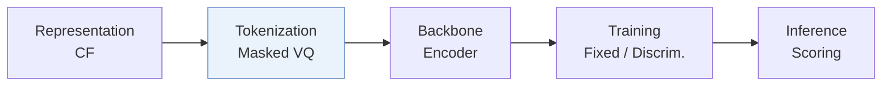
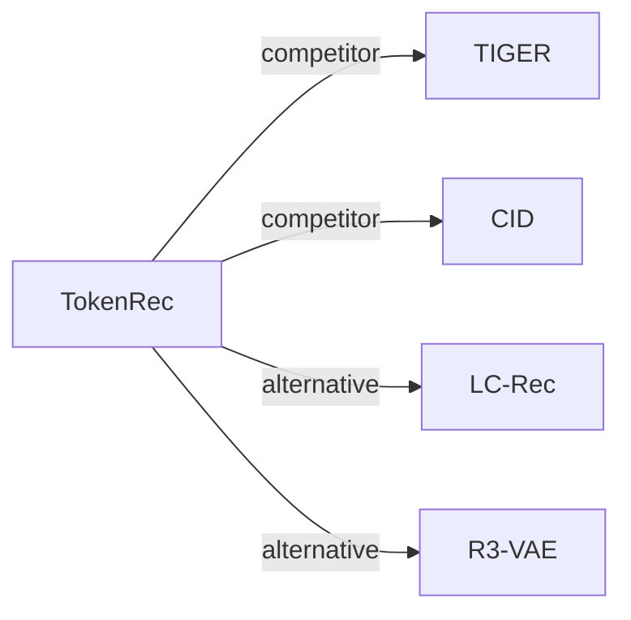

# TokenRec

*Learning to tokenize id for llm-based generative recommendations* — Qu et al. · TKDE’25

`I. Informativeness` · `Tokenization` · [Paper](https://arxiv.org/abs/2406.10450) · [Code](https://github.com/Quhaoh233/TokenRec) · [Matrix](../../README.md#i--tokenization) · [中文](../zh/papers/tokenrec.md)

Reading level: Reading Notes (Level 2) · On this page: [TL;DR](#tldr) · [At a Glance](#at-a-glance) · [1. Why It Matters](#1-why-this-paper-matters) · [2. Method](#2-how-it-works) · [3. Experiments](#3-experimental-findings) · [4. Limitations](#4-limitations--critical-analysis) · [5. Related Work](#5-connections-to-related-work)

- `CF`: Collaborative filtering signal.
- `Fixed`: SIDs are built first and not changed while the generator trains.
- `Discrim.`: Scores items; does not generate SIDs.

### TL;DR

> [!NOTE]
> TokenRec quantizes masked collaborative user and item representations into discrete tokens and retrieves top-K items without autoregressive decoding or beam search, to generalize to new users and items.

### At a Glance

| Aspect | Summary |
| :-- | :-- |
| Research Problem | I. Informativeness: Do the SIDs, or the model reading them, carry the collaborative and multimodal signals recommendation needs? |
| Key Contribution | TokenRec quantizes masked collaborative user and item representations into discrete tokens and retrieves top-K items without autoregressive decoding or beam search, to generalize to new users and items. |
| Modified Stage | Tokenization |
| Limitation | New users and items need a retrained collaborative filtering model to produce their representations; only the tokenizer and the LLM stay frozen (Sec. II-E.2). |

### 1. Why This Paper Matters

LLM-based recommenders need user and item tokens that the LLM can read (Abstract). One token per user or item expands the LLM vocabulary with the number of users and items (Sec. I). The authors also name two further gaps: existing tokens do not capture high-order collaborative knowledge, and they generalize poorly to users or items outside the training data (Abstract). TokenRec tokenizes users and items from collaborative representations and replaces autoregressive decoding with retrieval.

Based on arXiv v3.

### 2. How It Works

#### MQ-Tokenizer

A GNN-based collaborative filtering model learns user and item representations, which are stored in a vector database (Sec. II-C.2).

> "Specifically, our MQ-Tokenizer assigns each user and item a small number of discrete tokens generated by quantizing the GNN-based representations." (Sec. II-C.1)

The tokenizer randomly masks the representation, encodes it with K separate encoders, and quantizes each output against its own codebook (Sec. II-C.2, Sec. II-C.3). The decoder averages the K codewords and reconstructs the collaborative representation with an MLP (Sec. II-C.4, Eq. 9). User and item tokenizers are trained separately.

> "we propose to randomly mask these representations to create a challenging task that enables the tokenizer to build a comprehensive understanding and generalize well." (Sec. II-C.2)

#### Generative Retrieval

The LLM reads a prompt with the user's tokens and, optionally, the tokens of interacted items, which are shuffled during training rather than kept in time order (Sec. II-D.2). The LLM acts as a query encoder. A three-layer MLP projects its hidden state, and cosine similarity against the GNN item representations scores all items for top-K retrieval (Sec. II-D.3, Eqs. 17–19).

### 3. Experimental Findings

Experimental setup

- **Datasets**: LastFM (1,090 users / 3,646 items), MovieLens-1M (6,040 / 3,416), Amazon Beauty (22,363 / 12,101), Amazon Clothing (23,033 / 39,387 as printed); histories capped at 100 items. Filtering rules: not reported.
  - Source: Datasets and statistics: [S3.SS1.SSS1.p1](https://arxiv.org/html/2406.10450v3#S3.SS1.SSS1.p1) and [S3.T1](https://arxiv.org/html/2406.10450v3#S3.T1).
- **Split**: Leave-one-out: all but the last observation for training; histories are randomly shuffled to give non-chronological lists (to match collaborative-filtering baselines). Separate study on Beauty and LastFM: the 5% of users with the least history are removed from training as unseen users, and all items they interacted with are excluded from training too.
  - Source: Leave-one-out with shuffled histories: [S3.SS1.SSS1.p1](https://arxiv.org/html/2406.10450v3#S3.SS1.SSS1.p1); unseen-user split: [S3.SS3.p2](https://arxiv.org/html/2406.10450v3#S3.SS3.p2).
- **Candidates**: full catalog (scores all items in the item base and retrieves top-K). Training uses 1:1 negatives drawn at random from un-interacted items.
  - Source: Scores over all items for top-K retrieval; training negatives 1:1: [S2.SS4.SSS3.p3](https://arxiv.org/html/2406.10450v3#S2.SS4.SSS3.p3) and [S3.SS1.SSS4.p1](https://arxiv.org/html/2406.10450v3#S3.SS1.SSS4.p1).
- **Visibility**: Main: warm; no unseen-item protocol is defined. Unseen-user study: held-out users and every item they interacted with are excluded from the training split, so those items are unseen by the generator and the MQ-Tokenizer training (tokens for them are produced afterwards from their representations).
  - Source: Unseen-user study excludes those users' items from training: [S3.SS3.p2](https://arxiv.org/html/2406.10450v3#S3.SS3.p2).
- **SID**: Masked vector-quantized tokenizer (MQ-Tokenizer) for both users and items: K parallel sub-encoders, each quantized against its own sub-codebook of L codes (K searched in 1-5, L in 128-1,024; prompt example uses K=3), over masked collaborative representations. Collision handling: not reported.
  - Source: K-way masked vector-quantized tokenizer, ranges: [S2.SS3.SSS3.p2](https://arxiv.org/html/2406.10450v3#S2.SS3.SSS3.p2), [S2.SS3.SSS3.p3](https://arxiv.org/html/2406.10450v3#S2.SS3.SSS3.p3), [S3.SS1.SSS4.p1](https://arxiv.org/html/2406.10450v3#S3.SS1.SSS4.p1).
- **Inference budget**: No beam search: the T5 output is projected and all items are scored for top-K. Table 5: average top-20 inference time per user of 5.76-8.43 ms versus 76-102 ms for P5, POD, CID, and TIGER; hardware and batch size: not reported.
  - Source: Generative retrieval by scoring instead of beam decoding: [S2.SS4.SSS3.p3](https://arxiv.org/html/2406.10450v3#S2.SS4.SSS3.p3); timing: [S3.T5](https://arxiv.org/html/2406.10450v3#S3.T5).
- **Results from**: Tables 2-3 (LastFM, ML1M, Beauty, Clothing versus CF, sequential, and LLM-based baselines); Table 4 (seen versus unseen users); Table 5 (inference time); Table 6 (ablations).
  - Source: Main: [S3.T2](https://arxiv.org/html/2406.10450v3#S3.T2) and [S3.T3](https://arxiv.org/html/2406.10450v3#S3.T3); unseen users: [S3.T4](https://arxiv.org/html/2406.10450v3#S3.T4); time: [S3.T5](https://arxiv.org/html/2406.10450v3#S3.T5); ablation: [S3.T6](https://arxiv.org/html/2406.10450v3#S3.T6).

- Main comparison: TokenRec outperforms both traditional and LLM-based recommenders on the four datasets (Abstract, Tables 2 and 3).
- Inference time: the authors attribute the speed to retrieval instead of decoding.

  > "This can be attributed to our generative retrieval paradigm, bypassing the most time-consuming auto-regressive decoding and beam search processes of LLMs [ 29 ] ." (Sec. III-D)

### 4. Limitations & Critical Analysis

**Our analysis.**

- TIGER decodes text-based `RQ-VAE` IDs with `Beam`; TokenRec builds tokens from collaborative signals only (`CF`) and ranks by `Scoring`, so it never generates an ID.
- CID also tokenizes collaborative signals (`CF`) but with `Spectral Clus.` and decodes with `C-Beam`; TokenRec uses `Masked VQ` and an `Encoder`.

### 5. Connections to Related Work

- **Competitor** · [TIGER](tiger.md): TIGER decodes RQ-VAE item IDs by beam search; TokenRec tokenizes users and items with a masked K-way quantizer and scores all items directly, about ten times faster.
  - Source: TokenRec v3, baselines: https://arxiv.org/html/2406.10450v3#S3.SS1.SSS2.p1; Tables 2-5: https://arxiv.org/html/2406.10450v3#S3.T2, https://arxiv.org/html/2406.10450v3#S3.T3, https://arxiv.org/html/2406.10450v3#S3.T4, https://arxiv.org/html/2406.10450v3#S3.T5.
- **Competitor** · [CID](cid.md): CID builds collaborative indices for P5-style text generation; TokenRec builds collaborative tokens for users and items and retrieves without decoding.
  - Source: TokenRec v3, baselines: https://arxiv.org/html/2406.10450v3#S3.SS1.SSS2.p1 and https://arxiv.org/html/2406.10450v3#S3.I2.i4.p1; Tables 2-5: https://arxiv.org/html/2406.10450v3#S3.T2 and https://arxiv.org/html/2406.10450v3#S3.T5.
- **Alternative** · [LC-Rec](lc-rec.md): LC-Rec decodes item indices autoregressively, which TokenRec avoids for speed and to limit hallucinated items.
  - Source: TokenRec v3, Section 2.4.3 cites Zheng et al. (2024): https://arxiv.org/html/2406.10450v3#S2.SS4.SSS3.p1.
- **Alternative** · [R3-VAE](r3-vae.md): R3-VAE later evaluates TokenRec's masked quantizer (MQ) as a tokenizer baseline and proposes reference-guided residual quantization.
  - Source: Evidence is from the later R3-VAE paper: baselines and Tables 1, 4: https://arxiv.org/html/2604.11440v3#S4.SS1.SSS2.p1, https://arxiv.org/html/2604.11440v3#S3.T1, https://arxiv.org/html/2604.11440v3#S4.T4.

[View all papers in this cell](../../README.md#i--tokenization)
