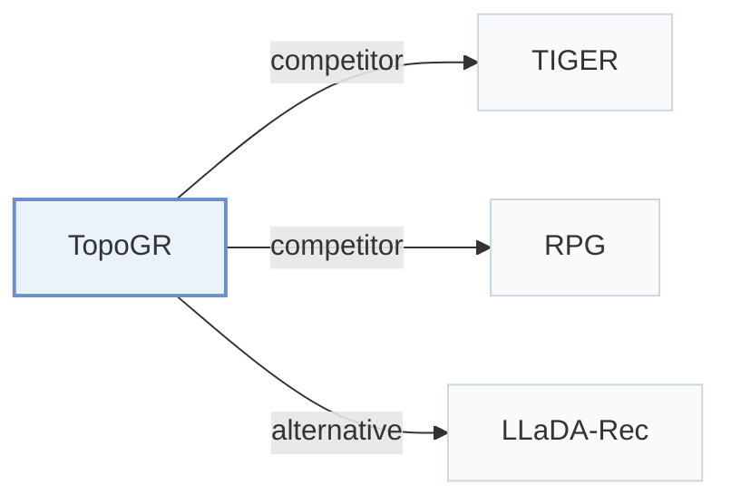

# TopoGR

[← Problem × Stage Matrix](../../README.md#iii--tokenization) · [Papers by Stage](../index/stages.md) · [Papers by Modality](../index/modality.md) · [Papers by Domain](../index/domain.md) · English | [中文](../zh/papers/topogr.md)

| **Title** | *Revealing and Preserving Latent Structure of Semantic ID in Generative Recommendation* |
| :-- | :-- |
| **Authors** | Zheng et al. |
| **Venue** | arXiv’26 |
| **Problem × Stage** | `III. SID–Model Alignment` · `Tokenization` |
| **Changes** | ● Tokenization · ○ Backbone · ○ Objective · ○ Inference |
| **SID inputs** | `Text` |
| **Domain** | `E-commerce` |
| **Links** | [Paper](https://arxiv.org/abs/2607.25216) |
| **Reading level** | Overview (Level 1) |

**On this page**: [TL;DR](#tldr) · [3. Experiments](#3-experimental-findings) · [5. Related Work](#5-connections-to-related-work)

- `Text`: Textual item metadata (titles, descriptions, categories, or prompts).
- `BDQ`: Bit-Decomposable Quantizer.
- `Non-AR`: Non-autoregressive.
- `Fixed`: SIDs are built first and not changed while the generator trains.
- `MTP + Aux.`: Multi-token prediction jointly optimized with auxiliary objectives.
- `Scoring+Rerank`: Score candidate items and then rerank a selected subset.

### TL;DR

> [!NOTE]
> TopoGR learns bit-decomposable binary Semantic IDs and uses their Hamming geometry in input features, soft training targets, and reranking, instead of treating Semantic ID tokens as independent symbols.

---

### 3. Experimental Findings

Experimental setup

- **Datasets**: Amazon Review Sports & Outdoors, Beauty, Toys & Games, CDs & Vinyl; reviews treated as chronological interactions. Filtering and maximum history length not reported.
  - Source: [S5.SS1.p1](https://arxiv.org/html/2607.25216v1#S5.SS1.p1) ; #A1.T3
- **Split**: Leave-one-out with checkpoint selection by validation performance; exact train/validation/test holdout allocation not reported.
  - Source: [S5.SS1.p3](https://arxiv.org/html/2607.25216v1#S5.SS1.p3)
- **Candidates**: full catalog scored through vectorized SID-probability gathering, followed by top-1000 reranking; consumed-item exclusion not reported.
  - Source: [S4.SS5.p1](https://arxiv.org/html/2607.25216v1#S4.SS5.p1) ; #A1.SS4.p4
- **Visibility**: warm; no unseen-item protocol is defined. Tokenizer fitting exposure to test items not reported.
  - Source: [S5.SS1.p1](https://arxiv.org/html/2607.25216v1#S5.SS1.p1) ; #S5.SS1.p3 ; #S4.SS1.p8
- **SID**: BDQ/LFQ: 64 positions x 8 bits, each position mapping to 256 integer codes; implicit fixed binary vertices, not learned centroid codebooks. Reported full-SID collapse ratio <0.003; collision disambiguation not reported.
  - Source: [A1.T4](https://arxiv.org/html/2607.25216v1#A1.T4) ; #A1.SS3.p2 ; #A1.SS2.p1
- **Inference budget**: Parallel prediction of all 64 SID positions, full-corpus gather scoring and Hamming reranking of 1000 items; no beam search; Recall/NDCG@5/10. One H20 96GB is used for experiments; Figure 8 plots approximately 9 ms inference time on Beauty. Inference batch size and timing aggregation not reported.
  - Source: [S4.SS3.p3](https://arxiv.org/html/2607.25216v1#S4.SS3.p3) ; #S4.SS5 ; #S5.SS1.p4 ; #A1.F8
- **Results from**: Table 1: four-dataset comparison; some baseline numbers adopted from Rajput et al. (2023), remaining datasets/models reproduced with official implementations or RecBole; exact reused rows not specified. Table 6: ablations; Figure 8: inference efficiency.
  - Source: [S5.T1](https://arxiv.org/html/2607.25216v1#S5.T1) ; #S5.SS1.p4 ; #A2.T6 ; #A1.F8

---

### 5. Connections to Related Work

- **Competitor** · [TIGER](tiger.md): TIGER decodes residual SIDs autoregressively; TopoGR exposes binary SID geometry and predicts all positions in parallel before full-corpus scoring.
  - Source: TopoGR v1, Section 5.1 and Appendix A.4: [S5.SS1.p2](https://arxiv.org/html/2607.25216v1#S5.SS1.p2); [A1.SS4.p4](https://arxiv.org/html/2607.25216v1#A1.SS4.p4).
- **Competitor** · [RPG](rpg.md): RPG uses parallel SID prediction with graph-constrained decoding; TopoGR instead uses vectorized full-corpus scoring and Hamming-consistent reranking.
  - Source: TopoGR v1, Section 5.1 and Appendix A.4: [S5.SS1.p2](https://arxiv.org/html/2607.25216v1#S5.SS1.p2); [A1.SS4.p5](https://arxiv.org/html/2607.25216v1#A1.SS4.p5).
- **Alternative** · [LLaDA-Rec](llada-rec.md): LLaDA-Rec uses discrete diffusion for bidirectional SID generation; TopoGR predicts SID positions simultaneously and adds binary-topology supervision and reranking.
  - Source: TopoGR v1, Related Work and Section 4.3; cited alternative rather than a listed baseline: [S2.p2](https://arxiv.org/html/2607.25216v1#S2.p2); [S4.SS3.p1](https://arxiv.org/html/2607.25216v1#S4.SS3.p1).

[View all papers in this cell](../../README.md#iii--tokenization)
