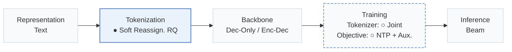
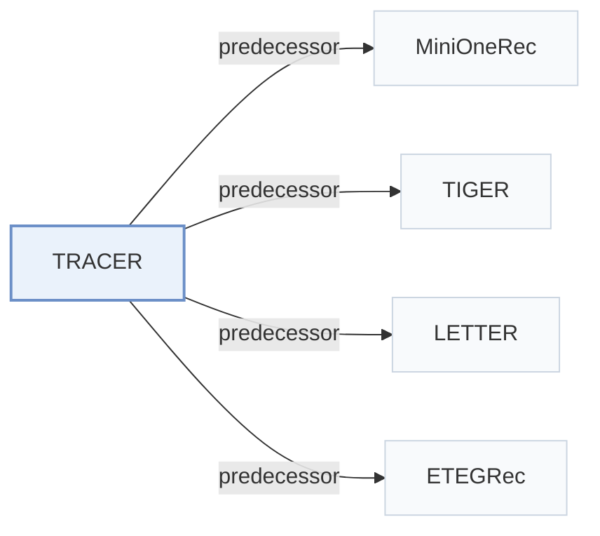

# TRACER

[← Problem × Stage Matrix](../../README.md#iv--tokenization) · [Papers by Stage](../index/stages.md) · [Papers by Modality](../index/modality.md) · [Papers by Domain](../index/domain.md) · English | [中文](../zh/papers/tracer.md)

| **Title** | *Token ReAssignment for Concept ERasure in Generative Recommendation* |
| :-- | :-- |
| **Authors** | Chen et al. |
| **Venue** | NeurIPS’26 |
| **Problem × Stage** | `IV. Utility` · `Tokenization` |
| **Changes** | ● Tokenization · ○ Tokenizer · ○ Objective |
| **SID inputs** | `Text` |
| **Domain** | `E-commerce` |
| **Links** | [Paper](https://arxiv.org/abs/2606.07688) |
| **Reading level** | Overview (Level 1) |

**On this page**: [TL;DR](#tldr) · [3. Experiments](#3-experimental-findings) · [5. Related Work](#5-connections-to-related-work)

- `Text`: Textual item metadata (titles, descriptions, categories, or prompts).
- `Soft Reassign. RQ`: Residual quantization with differentiable soft code reassignment.
- `Dec-Only / Enc-Dec`: Decoder-only and encoder–decoder backbone variants.
- `Joint`: The generator loss updates the tokenizer directly.
- `NTP + Aux.`: NTP plus another auxiliary loss.
- `Beam`: Autoregressive beam search over Semantic ID tokens.

### TL;DR

> [!NOTE]
> TRACER removes sensitive concepts from a generative recommender by reassigning concept-related items to alternative Semantic ID tokens with a coherence regularizer, instead of suppressing tokens shared with retained items.

---

### 3. Experimental Findings

Experimental setup

- **Datasets**: Amazon Industrial & Scientific, Sports & Outdoors and Toys & Games; remove users/items with fewer than five interactions. Amazon release year: not reported. Randomly select 5% of brands for forgetting, covering approximately 10% of interactions.
  - Source: Sec.4 datasets/preprocessing and concept setup: [S4.SS0.SSS0.Px1.p1](https://arxiv.org/html/2606.07688v1#S4.SS0.SSS0.Px1.p1) and [S4.SS0.SSS0.Px2.p1](https://arxiv.org/html/2606.07688v1#S4.SS0.SSS0.Px2.p1)
- **Split**: Chronological 80/10/10 train/validation/test. Per-user versus global allocation and history cap: not reported.
  - Source: Sec.4 datasets/preprocessing: [S4.SS0.SSS0.Px1.p1](https://arxiv.org/html/2606.07688v1#S4.SS0.SSS0.Px1.p1)
- **Candidates**: not reported; full-catalog versus sampled ranking and history-item exclusion are unspecified.
  - Source: Evaluation metrics and Appendix D.1 do not specify catalog/sampling protocol: [S4.SS0.SSS0.Px6.p1](https://arxiv.org/html/2606.07688v1#S4.SS0.SSS0.Px6.p1) and [A4.SS1.p1](https://arxiv.org/html/2606.07688v1#A4.SS1.p1)
- **Visibility**: warm; no unseen-item protocol is defined. Forgetting targets training-data influence; tokenizer exposure to held-out items/interactions: not reported.
  - Source: Forget set comprises previously trained interactions, not an unseen-item evaluation: [S2.SS2.p1](https://arxiv.org/html/2606.07688v1#S2.SS2.p1) and [S4.SS0.SSS0.Px2.p1](https://arxiv.org/html/2606.07688v1#S4.SS0.SSS0.Px2.p1)
- **SID**: All backbones use three RQ-VAE levels x 256 codes, embedding dimension 64. TRACER learns soft-assignment perturbations for target-concept items while preserving other items' original SIDs. Collision handling: not reported.
  - Source: Appendix D.1 and Sec.3.1: [A4.SS1.p1](https://arxiv.org/html/2606.07688v1#A4.SS1.p1) and [S3.SS1.p2](https://arxiv.org/html/2606.07688v1#S3.SS1.p2)
- **Inference budget**: Beam search width 10; retain/forget HR and NDCG@5/10, MRR, and description-based semantic similarity. Experiments use 4x A100 GPUs. Inference batch, latency and throughput: not reported. Batch128 and 19-27 minutes concern unlearning training, not inference.
  - Source: Appendix D.1-D.3: [A4.SS1.p1](https://arxiv.org/html/2606.07688v1#A4.SS1.p1) and [A4.SS2.p1](https://arxiv.org/html/2606.07688v1#A4.SS2.p1) and [A4.SS3.p1](https://arxiv.org/html/2606.07688v1#A4.SS3.p1)
- **Results from**: This paper's unlearning comparisons: main MOR/MiniOneRec and LETTER results on Scientific/Sports; Appendix D Tables1-3 cover five backbones x three datasets, Table4 unlearning time, Table5 item-level forgetting. ELM/RMU/RepNoise/FLAT/BLUR/PISCES baselines start from the same SFT checkpoint with tuned learning rates; five-run averages. No borrowed baseline-score source is identified.
  - Source: Sec.4 models/baselines and Appendix D.1/D.2/D.4: [S4.SS0.SSS0.Px3.p1](https://arxiv.org/html/2606.07688v1#S4.SS0.SSS0.Px3.p1) and [S4.SS0.SSS0.Px5.p1](https://arxiv.org/html/2606.07688v1#S4.SS0.SSS0.Px5.p1) and [A4.SS1.p1](https://arxiv.org/html/2606.07688v1#A4.SS1.p1) and [A4.SS2.p1](https://arxiv.org/html/2606.07688v1#A4.SS2.p1) and [A4.SS4.p1](https://arxiv.org/html/2606.07688v1#A4.SS4.p1)

---

### 5. Connections to Related Work

- **Predecessor** · [MiniOneRec](minionerec.md): MiniOneRec supplies the Qwen2.5-7B backbone for unlearning.
  - Source: TRACER v1, Sec.4 Models/Backbones: [S4.SS0.SSS0.Px3.p1](https://arxiv.org/html/2606.07688v1#S4.SS0.SSS0.Px3.p1); [S4.SS0.SSS0.Px4.p1](https://arxiv.org/html/2606.07688v1#S4.SS0.SSS0.Px4.p1).
- **Predecessor** · [TIGER](tiger.md): TIGER is a tested separate-training backbone.
  - Source: TRACER v1, Sec.4 Models and Appendix D.2: [S4.SS0.SSS0.Px3.p1](https://arxiv.org/html/2606.07688v1#S4.SS0.SSS0.Px3.p1); [A4.SS2.p1](https://arxiv.org/html/2606.07688v1#A4.SS2.p1).
- **Predecessor** · [LETTER](letter.md): LETTER supplies a tested joint-training backbone and the motivating retraining analysis.
  - Source: TRACER v1, Sec.3 motivation and Sec.4 Models: [S3.SS0.SSS0.Px1.p1](https://arxiv.org/html/2606.07688v1#S3.SS0.SSS0.Px1.p1); [S4.SS0.SSS0.Px3.p1](https://arxiv.org/html/2606.07688v1#S4.SS0.SSS0.Px3.p1).
- **Predecessor** · [ETEGRec](etegrec.md): ETEGRec is a tested joint-training backbone.
  - Source: TRACER v1, Sec.4 Models and Appendix D.2: [S4.SS0.SSS0.Px3.p1](https://arxiv.org/html/2606.07688v1#S4.SS0.SSS0.Px3.p1); [A4.SS2.p1](https://arxiv.org/html/2606.07688v1#A4.SS2.p1).

[View all papers in this cell](../../README.md#iv--tokenization)
