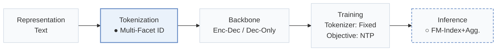
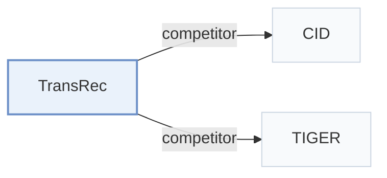

# TransRec

[← Problem × Stage Matrix](../../README.md#ii--tokenization) · [Papers by Stage](../index/stages.md) · [Papers by Modality](../index/modality.md) · [Papers by Domain](../index/domain.md) · English | [中文](../zh/papers/transrec.md)

| **Title** | *Bridging Items and Language: A Transition Paradigm for Large Language Model-Based Recommendation* |
| :-- | :-- |
| **Authors** | Lin et al. |
| **Venue** | KDD’24 |
| **Problem × Stage** | `II. Uniqueness and Validity` · `Tokenization` |
| **Changes** | ● Tokenization · ○ Inference |
| **SID inputs** | id: – · title: `Text` · attribute: `Text` |
| **Domain** | `E-commerce` · `POI / Local` |
| **Links** | [Paper](https://arxiv.org/abs/2310.06491) · [Code](https://github.com/Linxyhaha/TransRec/) |
| **Reading level** | Overview (Level 1) |

**On this page**: [TL;DR](#tldr) · [3. Experiments](#3-experimental-findings) · [5. Related Work](#5-connections-to-related-work)

- `Text`: Textual item metadata (titles, descriptions, categories, or prompts).
- `Multi-Facet ID`: Identifiers representing multiple facets of an item.
- `Enc-Dec / Dec-Only`: Evaluated on both Encoder-Decoder and Decoder-Only backbones.
- `Fixed`: SIDs are built first and not changed while the generator trains.
- `NTP`: Next-token prediction loss only; continuing from a pretrained LLM (SFT) also counts as NTP.
- `FM-Index+Agg.`: FM-index-constrained generation followed by identifier-to-item score aggregation.

### TL;DR

> [!NOTE]
> TransRec indexes items with multi-facet identifiers combining ID, title, and attributes, constrains generation with FM-index substring indexing, and aggregates generated identifiers to rank catalog items.

---

### 3. Experimental Findings

Experimental setup

- **Datasets**: Amazon Beauty and Toys, plus Yelp. Release year and filtering thresholds: not reported. Items use random unique numeric IDs, titles and categories.
  - Source: Sec.4.1 Datasets and Appendix Table9: [S4.SS1.SSS1.p1](https://arxiv.org/html/2310.06491v2#S4.SS1.SSS1.p1) and [A1.T9](https://arxiv.org/html/2310.06491v2#A1.T9)
- **Split**: Per-user leave-one-out: last item test, penultimate validation, remainder training. Full training uses all training users; few-shot selects 1024/2048 users. Discard oldest history items until input fits 1024 tokens (BART) or 512 (LLaMA).
  - Source: Sec.4.1 Datasets/Implementation and Sec.4.3.1: [S4.SS1.SSS1.p1](https://arxiv.org/html/2310.06491v2#S4.SS1.SSS1.p1) and [S4.SS1.SSS3.p1](https://arxiv.org/html/2310.06491v2#S4.SS1.SSS3.p1) and [S4.SS3.SSS1.p1](https://arxiv.org/html/2310.06491v2#S4.SS3.SSS1.p1)
- **Candidates**: not reported: full-catalog versus sampled evaluation and history-item exclusion are unspecified. Generated facet identifiers are aggregated into scores for in-corpus items.
  - Source: Sec.3.2 aggregated grounding and Sec.4.1 evaluation: [S3.SS2.SSS2.p1](https://arxiv.org/html/2310.06491v2#S3.SS2.SSS2.p1) and [S3.SS2.SSS2.p3](https://arxiv.org/html/2310.06491v2#S3.SS2.SSS2.p3) and [S4.SS1.SSS2.p2](https://arxiv.org/html/2310.06491v2#S4.SS1.SSS2.p2)
- **Visibility**: Full-training item-level visibility: not reported. Few-shot tests the N training users plus N unseen users; warm requires both user and item warm, otherwise cold. Cold items are unseen by generator training, but the cold subset also includes unseen-user cases. Identifier construction reportedly uses only warm items; learned SID tokenizer n/a for manual facets. Cold-item exposure through the FM-index is not reported.
  - Source: Sec.4.2 and Sec.4.3.1 explicitly distinguish warm/cold users and items: [S4.SS2.p1](https://arxiv.org/html/2310.06491v2#S4.SS2.p1) and [S4.SS3.SSS1.p1](https://arxiv.org/html/2310.06491v2#S4.SS3.SSS1.p1) and [S4.SS3.SSS1.p2](https://arxiv.org/html/2310.06491v2#S4.SS3.SSS1.p2)
- **SID**: Three separate facets: unique random numeric ID, title and categories. Variable text-token lengths; codebook size n/a. Numeric IDs provide uniqueness while titles/attributes can be shared. Training samples five title substrings per sequence and uses each category separately; this is not a quantized SID.
  - Source: Sec.3.1.1-3.1.2 and Appendix A.2: [S3.SS1.SSS1.p2](https://arxiv.org/html/2310.06491v2#S3.SS1.SSS1.p2) and [S3.SS1.SSS1.p5](https://arxiv.org/html/2310.06491v2#S3.SS1.SSS1.p5) and [S3.SS1.SSS2.p2](https://arxiv.org/html/2310.06491v2#S3.SS1.SSS2.p2) and [A1.SS2.p1](https://arxiv.org/html/2310.06491v2#A1.SS2.p1)
- **Inference budget**: FM-index-constrained beam20 for TransRec and LLM baselines; generate each facet, then aggregate grounding scores. Recall/NDCG@5/10. Table3 reports 218.43s grounding per 5000 Beauty users, not end-to-end request latency. Inference batch, hardware and generated-length cap: not reported; four RTX A5000 GPUs are explicitly the training setup.
  - Source: Sec.3.2 generation, Sec.4.1 implementation/evaluation and Table3: [S3.SS2.SSS1.p3](https://arxiv.org/html/2310.06491v2#S3.SS2.SSS1.p3) and [S4.SS1.SSS3.p1](https://arxiv.org/html/2310.06491v2#S4.SS1.SSS3.p1) and [S4.SS1.SSS2.p2](https://arxiv.org/html/2310.06491v2#S4.SS1.SSS2.p2) and [S4.T3](https://arxiv.org/html/2310.06491v2#S4.T3)
- **Results from**: This paper's Table1 full-training BART comparison, Table2 Beauty few-shot warm/cold comparison, Table3 grounding ablation, and appendix analyses. P5 is explicitly trained on sequential tasks with randomized IDs; Appendix A.3 implements indexing baselines and TransRec with the same T5-small backbone/single prompt. Borrowed-score attribution and run/seed counts: not reported.
  - Source: Tables1-3 and Appendix A.3/A.6: [S4.T1](https://arxiv.org/html/2310.06491v2#S4.T1) and [S4.T2](https://arxiv.org/html/2310.06491v2#S4.T2) and [S4.T3](https://arxiv.org/html/2310.06491v2#S4.T3) and [S4.SS1.SSS2.p1](https://arxiv.org/html/2310.06491v2#S4.SS1.SSS2.p1) and [A1.SS3.p1](https://arxiv.org/html/2310.06491v2#A1.SS3.p1) and [A1.SS6.p1](https://arxiv.org/html/2310.06491v2#A1.SS6.p1)

---

### 5. Connections to Related Work

- **Competitor** · [CID](cid.md): CID+IID and the other Hua et al. indexing variants are compared baselines.
  - Source: TransRec v2, Sec.4.1 Baselines and Appendix A.3: [S4.SS1.SSS2.p1](https://arxiv.org/html/2310.06491v2#S4.SS1.SSS2.p1); [A1.SS3.p1](https://arxiv.org/html/2310.06491v2#A1.SS3.p1).
- **Competitor** · [TIGER](tiger.md): TIGER is compared as a quantized semantic-identifier baseline.
  - Source: TransRec v2, Sec.4.1 Baselines and Sec.4.2: [S4.SS1.SSS2.p1](https://arxiv.org/html/2310.06491v2#S4.SS1.SSS2.p1); [S4.SS2.p1](https://arxiv.org/html/2310.06491v2#S4.SS2.p1).

[View all papers in this cell](../../README.md#ii--tokenization)
