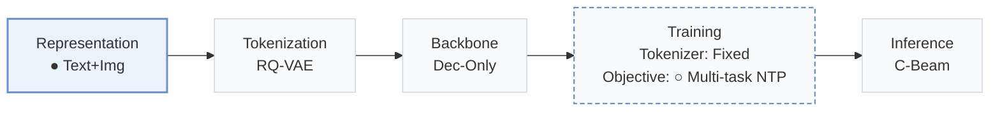
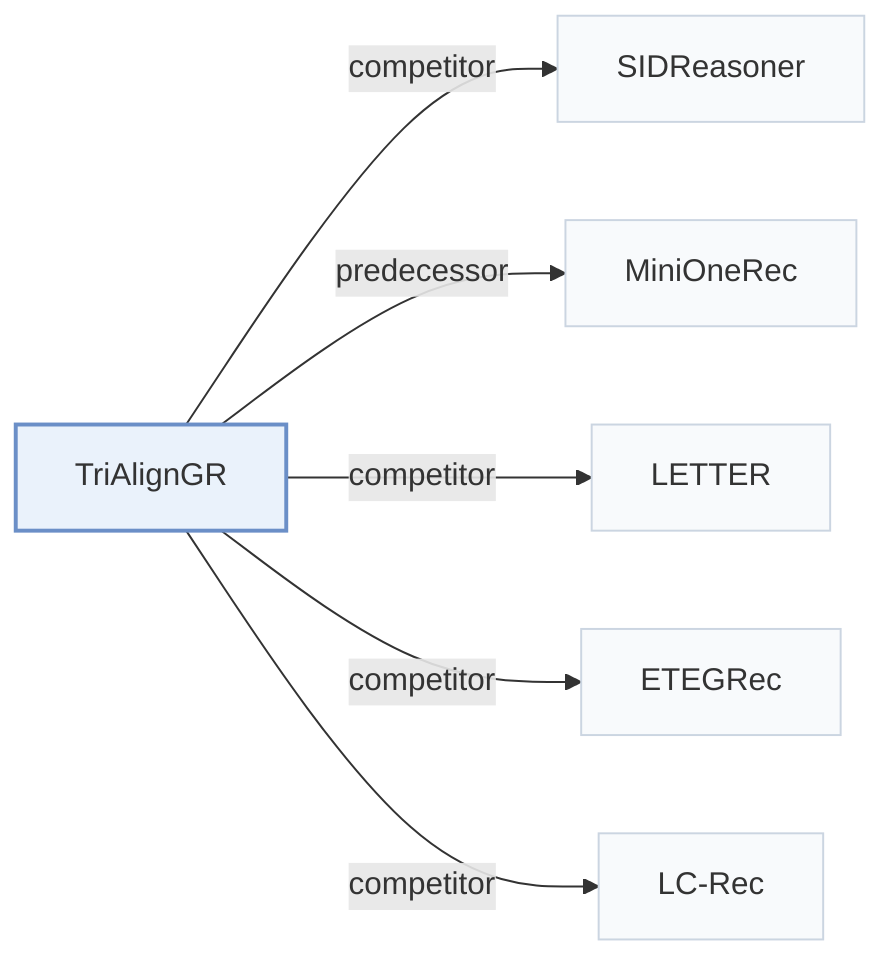

# TriAlignGR

[← Problem × Stage Matrix](../../README.md#i--representation) · [Papers by Stage](../index/stages.md) · [Papers by Modality](../index/modality.md) · [Papers by Domain](../index/domain.md) · English | [中文](../zh/papers/trialigngr.md)

| **Title** | *Triangular Multitask Alignment with Multimodal Deep Interest Mining for Generative Recommendation* |
| :-- | :-- |
| **Authors** | Zeng et al. |
| **Venue** | arXiv’26 |
| **Problem × Stage** | `I. Informativeness` · `Representation` |
| **Changes** | ● Representation · ○ Objective |
| **SID inputs** | `Text` + `Img` |
| **Domain** | `E-commerce` |
| **Links** | [Paper](https://arxiv.org/abs/2605.05249) |
| **Reading level** | Overview (Level 1) |

**On this page**: [TL;DR](#tldr) · [3. Experiments](#3-experimental-findings) · [5. Related Work](#5-connections-to-related-work)

- `Text+Img`: Text and visual item representations.
- `RQ-VAE`: Residual-Quantized Variational AutoEncoder.
- `Dec-Only`: Decoder-only.
- `Fixed`: SIDs are built first and not changed while the generator trains.
- `Multi-task NTP`: The same NTP loss over several tasks.
- `C-Beam`: Constrained beam search.

### TL;DR

> [!NOTE]
> TriAlignGR adds visual content and LLM-mined user intents to Semantic ID construction and trains several generation tasks linking Semantic IDs, text, and images under one autoregressive loss.

---

### 3. Experimental Findings

Experimental setup

- **Datasets**: Amazon Beauty, Sports and Outdoors, Musical Instruments with 5-core filtering (22K-36K users, 10K-18K items, 198K-296K interactions in total ranges; per-dataset counts not separated in the text).
  - Source: Datasets and protocol: [A1.p1](https://arxiv.org/html/2605.05249v3#A1.p1).
- **Split**: Leave-last-out protocol (allocation not restated beyond the label); results averaged over three seeds.
  - Source: Leave-last-out: [A1.p1](https://arxiv.org/html/2605.05249v3#A1.p1); three seeds: [S4.SS1.p1](https://arxiv.org/html/2605.05249v3#S4.SS1.p1).
- **Candidates**: not reported (full catalog versus sampled evaluation candidates); top-K from beam search with beam size 20.
  - Source: Metrics and beam: [A1.p2](https://arxiv.org/html/2605.05249v3#A1.p2).
- **Visibility**: warm; no unseen-item protocol is defined.
  - Source: Standard split with no unseen-item protocol: [A1.p1](https://arxiv.org/html/2605.05249v3#A1.p1).
- **SID**: 3-level RQ-VAE with codebook sizes 4,096, 2,048, and 1,024 over gme-Qwen2-VL multimodal embeddings enriched with image captions (CMSA) and mined user interests (MDIM). Collision rates are reported: 3.1% of Beauty items share a full SID (5.1% for text-only RQ-VAE); a resolution rule is not reported.
  - Source: 3-level RQ-VAE with 4096/2048/1024 over gme-Qwen2-VL embeddings: [A1.p3](https://arxiv.org/html/2605.05249v3#A1.p3); collision diagnostics: [A3.T6](https://arxiv.org/html/2605.05249v3#A3.T6).
- **Inference budget**: Beam size 20; Qwen2.5-7B-Instruct backbone; experiments on NVIDIA A100 GPUs; inference batch size and latency: not reported.
  - Source: Beam 20, backbone, GPUs: [A1.p2](https://arxiv.org/html/2605.05249v3#A1.p2) and [A1.p3](https://arxiv.org/html/2605.05249v3#A1.p3).
- **Results from**: Table 2 (Beauty, Sports, Instruments versus sequential, generative, LLM, and reasoning baselines; three seeds); Tables 3-5 (component, SID-versus-task, and task-combination ablations); Appendix Tables 6-8 (SID diagnostics, semantic probing, SID construction versus MiniOneRec).
  - Source: Main: [S4.T2](https://arxiv.org/html/2605.05249v3#S4.T2); ablations: [S4.T3](https://arxiv.org/html/2605.05249v3#S4.T3), [S4.T4](https://arxiv.org/html/2605.05249v3#S4.T4), [S4.T5](https://arxiv.org/html/2605.05249v3#S4.T5); SID diagnostics: [A3.T6](https://arxiv.org/html/2605.05249v3#A3.T6); probing: [A4.T7](https://arxiv.org/html/2605.05249v3#A4.T7); vs MiniOneRec: [A5.T8](https://arxiv.org/html/2605.05249v3#A5.T8).

---

### 5. Connections to Related Work

- **Competitor** · [SIDReasoner](sidreasoner.md): SIDReasoner is the strongest baseline, aligning SIDs and language through enriched corpora and RL; TriAlignGR adds visual captions and mined interests before quantization and eight alignment tasks.
  - Source: TriAlignGR v3, Section 4.1: [S4.SS1.p1](https://arxiv.org/html/2605.05249v3#S4.SS1.p1); Table 2: [S4.T2](https://arxiv.org/html/2605.05249v3#S4.T2).
- **Predecessor** · [MiniOneRec](minionerec.md): TriAlignGR shares MiniOneRec's backbone, training protocol, and RQ-VAE configuration and isolates the effect of its SID enrichment against it.
  - Source: TriAlignGR v3, Section 4.1 comparison: [S4.SS1.p3](https://arxiv.org/html/2605.05249v3#S4.SS1.p3); Appendix Table 8: [A5.T8](https://arxiv.org/html/2605.05249v3#A5.T8).
- **Competitor** · [LETTER](letter.md): LETTER regularizes a text tokenizer; TriAlignGR changes the tokenizer input to multimodal, interest-enriched embeddings.
  - Source: TriAlignGR v3, Table 2 baseline: [S4.T2](https://arxiv.org/html/2605.05249v3#S4.T2).
- **Competitor** · [ETEGRec](etegrec.md): ETEGRec trains tokenizer and generator jointly; TriAlignGR keeps a fixed tokenizer and adds multitask alignment.
  - Source: TriAlignGR v3, Table 2 baseline: [S4.T2](https://arxiv.org/html/2605.05249v3#S4.T2).
- **Competitor** · [LC-Rec](lc-rec.md): LC-Rec uses text-only SIDs with alignment tasks; TriAlignGR extends the task set with visual-semantic tasks.
  - Source: TriAlignGR v3, Table 2 baseline: [S4.T2](https://arxiv.org/html/2605.05249v3#S4.T2).

[View all papers in this cell](../../README.md#i--representation)
