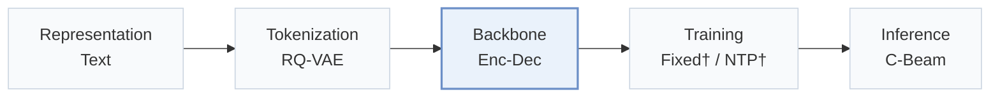
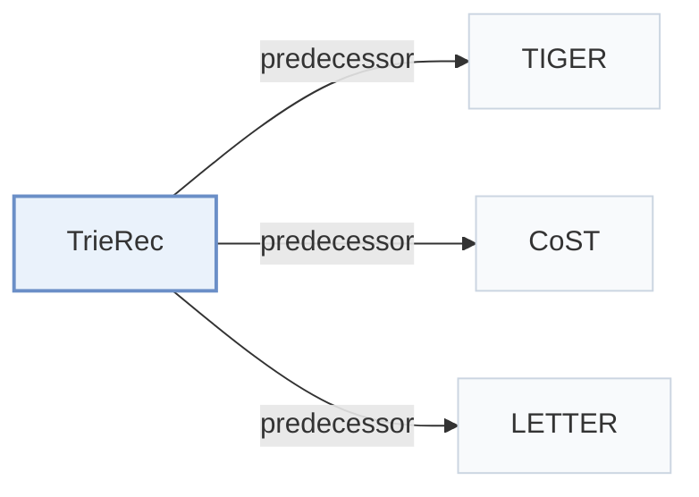

# TrieRec

[← Problem × Stage Matrix](../../README.md#iii--backbone) · [Papers by Stage](../index/stages.md) · [Papers by Modality](../index/modality.md) · English | [中文](../zh/papers/trierec.md)

| **Title** | *Trie-Aware Transformers for Generative Recommendation* |
| :-- | :-- |
| **Authors** | Xu et al. |
| **Venue** | NeurIPS’26 |
| **Problem × Stage** | `III. SID–Model Alignment` · `Backbone` |
| **Links** | [Paper](https://arxiv.org/abs/2602.21677) |
| **Reading level** | Overview (Level 1) |

**On this page**: [TL;DR](#tldr) · [At a Glance](#at-a-glance) · [3. Experiments](#3-experimental-findings) · [5. Related Work](#5-connections-to-related-work)

- `Text`: Textual item metadata (titles, descriptions, categories, or prompts).
- `RQ-VAE`: Residual-Quantized Variational AutoEncoder.
- `Enc-Dec`: Encoder-decoder.
- `Fixed†`: Tokenizer frozen before generator training (inferred).
- `NTP†`: Next-token prediction loss (inferred).
- `C-Beam`: Constrained beam search.

### TL;DR

> [!NOTE]
> TrieRec adds a trie-aware absolute positional encoding and a topology-aware relative positional encoding to Transformer generators, so attention reflects the Semantic ID prefix tree instead of a flat token stream.

---

### At a Glance

| Aspect | Summary |
| :-- | :-- |
| Research Problem | III. SID–Model Alignment: Can the generator read, write, and reason over SIDs, and do the tokenizer and generator work toward the same goal? |
| Key Contribution | TrieRec adds a trie-aware absolute positional encoding and a topology-aware relative positional encoding to Transformer generators, so attention reflects the Semantic ID prefix tree instead of a flat token stream. |
| Modified Stage | Backbone |

---

### 3. Experimental Findings

Experimental setup

- **Datasets**: Amazon Beauty, Toys, Food; MovieLens-1M. Standard 5-core filtering, histories retain the most recent 20 interactions.
  - Source: Section 4.1.1: [S4.SS1.SSS1.p1](https://arxiv.org/html/2602.21677v1#S4.SS1.SSS1.p1)
- **Split**: Per-user most recent interaction test, penultimate validation, earlier interactions training.
  - Source: Section 4.1.1: [S4.SS1.SSS1.p1](https://arxiv.org/html/2602.21677v1#S4.SS1.SSS1.p1)
- **Candidates**: Traditional models: full catalog; generative candidate universe not explicitly reported beyond a valid-item trie.
  - Source: Section 4.1.2: [S4.SS1.SSS2.p1](https://arxiv.org/html/2602.21677v1#S4.SS1.SSS2.p1)
- **Visibility**: warm; no unseen-item protocol is defined. Tokenizer/collaborative encoder exposure to test items not reported.
  - Source: Section 4.1 defines no unseen-item holdout: [S4.SS1](https://arxiv.org/html/2602.21677v1#S4.SS1)
- **SID**: Sentence-T5-base text features; RQ-VAE: 3 semantic levels x 256 codes, dimension 32, plus a fourth collision token. Select lowest-collision tokenizer checkpoint before appending the uniqueness digit; collision-token vocabulary size not reported.
  - Source: Section 4.1.4 and Appendix A: [S4.SS1.SSS4.p1](https://arxiv.org/html/2602.21677v1#S4.SS1.SSS4.p1) and [A1.p1](https://arxiv.org/html/2602.21677v1#A1.p1)
- **Inference budget**: Constrained beam 10; Recall/NDCG@5/10. Hardware and inference batch size not reported. Figure 3 plots inference time on Beauty/Toy, but the inference panel lacks explicit units and numeric bar labels.
  - Source: Sections 4.1.2/4.4 and Figure 3: [S4.SS1.SSS2.p1](https://arxiv.org/html/2602.21677v1#S4.SS1.SSS2.p1) and [S4.F3](https://arxiv.org/html/2602.21677v1#S4.F3)
- **Results from**: Original Tables 2/4: TrieRec on TIGER, CoST, LETTER and competing positional/structure encodings. Table 3: LETTER-based ablations.
  - Source: Section 4.2, Tables 2/4: [S4.SS2.p1](https://arxiv.org/html/2602.21677v1#S4.SS2.p1) and [S4.T2](https://arxiv.org/html/2602.21677v1#S4.T2) and [S4.T4](https://arxiv.org/html/2602.21677v1#S4.T4) and [S4.T3](https://arxiv.org/html/2602.21677v1#S4.T3)

---

### 5. Connections to Related Work

- **Predecessor** · [TIGER](tiger.md): TrieRec adds trie-aware positional encodings to TIGER.
  - Source: TrieRec v1, Sections 1/4.1: [S1.p5](https://arxiv.org/html/2602.21677v1#S1.p5); [S4.SS1.SSS4.p1](https://arxiv.org/html/2602.21677v1#S4.SS1.SSS4.p1).
- **Predecessor** · [CoST](cost.md): CoST is the contrastive-tokenization backbone augmented by TrieRec.
  - Source: TrieRec v1, Section 4.2 and Related Work: [S4.SS2.p2](https://arxiv.org/html/2602.21677v1#S4.SS2.p2); [S5.p3](https://arxiv.org/html/2602.21677v1#S5.p3).
- **Predecessor** · [LETTER](letter.md): LETTER supplies the backbone for TrieRec's main ablations and efficiency comparison.
  - Source: TrieRec v1, Table 3 and Section 4.4: [S4.T3](https://arxiv.org/html/2602.21677v1#S4.T3); [S4.SS4.p1](https://arxiv.org/html/2602.21677v1#S4.SS4.p1).

[View all papers in this cell](../../README.md#iii--backbone)
