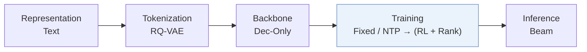
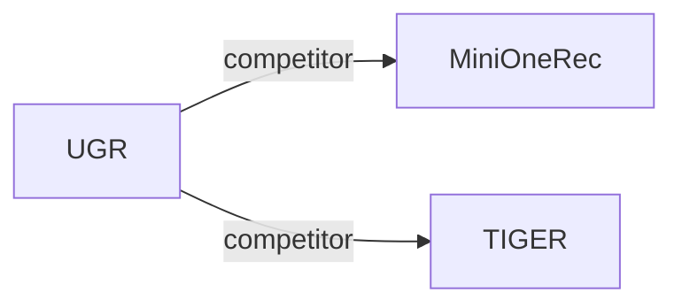

# UGR

*Uncertainty-aware Generative Recommendation* — Fan et al. · KDD’26

`IV. Utility` · `Training` · [Paper](https://arxiv.org/abs/2602.11719) · [Code](https://github.com/cxfann/UGR) · [Matrix](../../README.md#iv--training) · [中文](../zh/papers/ugr.md)

Reading level: Overview (Level 1) · On this page: [TL;DR](#tldr) · [At a Glance](#at-a-glance) · [3. Experiments](#3-experimental-findings) · [5. Related Work](#5-connections-to-related-work)

- `Dec-Only`: Decoder-only.
- `Fixed`: SIDs are built first and not changed while the generator trains.
- `NTP → (RL + Rank)`: Next-token prediction, followed by joint reinforcement-learning and ranking objectives.

### TL;DR

> [!NOTE]
> UGR adds uncertainty to preference optimization through an uncertainty-weighted reward, difficulty-aware optimization, and explicit confidence alignment, instead of rewards based only on binary outcome correctness.

### At a Glance

| Aspect | Summary |
| :-- | :-- |
| Research Problem | IV. Utility: Are training and search aimed at what users and the platform value, rather than at token likelihood? |
| Key Contribution | UGR adds uncertainty to preference optimization through an uncertainty-weighted reward, difficulty-aware optimization, and explicit confidence alignment, instead of rewards based only on binary outcome correctness. |
| Modified Stage | Training |

### 3. Experimental Findings

Experimental setup

- **Datasets**: Amazon Office (2016.10-2018.11), Industrial and Scientific (1996.10-2018.11), Yelp (2018.05-2018.11); user/item 5-core filtering, histories capped at 10.
  - Source: Appendix A/Table 5: [A1.p2](https://arxiv.org/html/2602.11719v2#A1.p2) and [A1.T5](https://arxiv.org/html/2602.11719v2#A1.T5)
- **Split**: Chronological 8:1:1 train/validation/test split; finer per-user allocation details not reported.
  - Source: Section 4.1.1/Appendix A: [S4.SS1.SSS1.p1](https://arxiv.org/html/2602.11719v2#S4.SS1.SSS1.p1) and [A1.p2](https://arxiv.org/html/2602.11719v2#A1.p2)
- **Candidates**: not reported; training rollout group size 16 is not an evaluation negative count.
  - Source: Section 4.1.2/Appendix C describes beam lists without full-catalog/sampled-negative evaluation specification: [S4.SS1.SSS2.p1](https://arxiv.org/html/2602.11719v2#S4.SS1.SSS2.p1) and [A3.p3](https://arxiv.org/html/2602.11719v2#A3.p3)
- **Visibility**: warm; no unseen-item protocol is defined. Tokenizer exposure to test items not reported.
  - Source: Section 4.1/Appendix A defines no unseen-item holdout: [S4.SS1](https://arxiv.org/html/2602.11719v2#S4.SS1) and [A1](https://arxiv.org/html/2602.11719v2#A1)
- **SID**: RQ-VAE on Qwen3-Embedding-4B item embeddings; 4 layers. Codebook sizes and collision handling not reported.
  - Source: Appendix C: [A3.p1](https://arxiv.org/html/2602.11719v2#A3.p1)
- **Inference budget**: Qwen3-8B; beam 10; confidence computed post-generation. Experiments use 8 A100 GPUs; inference device allocation/batch size not reported. Office: 37.0 ms/query versus SFT/GRPO 32.9 ms; training rollout beam/group 16 is separate.
  - Source: Section 4.1.4/Appendix C/Table 6: [S4.SS1.SSS4.p1](https://arxiv.org/html/2602.11719v2#S4.SS1.SSS4.p1) and [A3.p3](https://arxiv.org/html/2602.11719v2#A3.p3) and [A3.T6](https://arxiv.org/html/2602.11719v2#A3.T6)
- **Results from**: Original Table 1: main comparisons, baselines reproduced from official repositories using best validation checkpoints; Table 2: staged ablations. Table 3: optional confidence reranking on Office, separate from main comparison.
  - Source: Table 1/Appendix B/Table 3: [S3.T1](https://arxiv.org/html/2602.11719v2#S3.T1) and [A2.p1](https://arxiv.org/html/2602.11719v2#A2.p1) and [S4.T3](https://arxiv.org/html/2602.11719v2#S4.T3) and [S3.T2](https://arxiv.org/html/2602.11719v2#S3.T2)

### 5. Connections to Related Work

- **Competitor** · [MiniOneRec](minionerec.md): UGR and MiniOneRec share the backbone; UGR adds uncertainty-aware optimization.
  - Source: UGR v2, Section 4.2: https://arxiv.org/html/2602.11719v2#S4.SS2.p2.
- **Competitor** · [TIGER](tiger.md): TIGER supplies the standard SID-based baseline for UGR's uncertainty-aware alignment.
  - Source: UGR v2, Section 4.1.3 and Table 1: https://arxiv.org/html/2602.11719v2#S4.SS1.SSS3.p1; https://arxiv.org/html/2602.11719v2#S3.T1.

[View all papers in this cell](../../README.md#iv--training)
