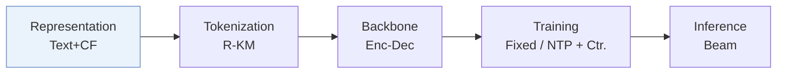
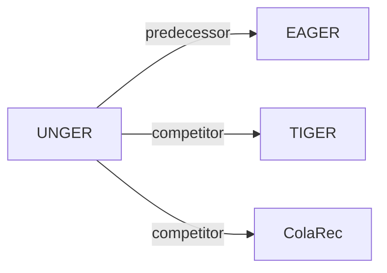

# UNGER

| **Title** | *Generative Recommendation with A Unified Code via Semantic and Collaborative Integration* |
| :-- | :-- |
| **Authors** | Xiao et al. |
| **Venue** | TOIS’25 |
| **Problem × Stage** | `I. Informativeness` · `Representation` |
| **Links** | [Paper](https://arxiv.org/abs/2502.06269) · [Matrix](../../README.md#i--representation) · [中文](../zh/papers/unger.md) |
| **Reading level** | Overview (Level 1) |

On this page: [TL;DR](#tldr) · [At a Glance](#at-a-glance) · [3. Experiments](#3-experimental-findings) · [5. Related Work](#5-connections-to-related-work)

- `R-KM`: Residual k-means.
- `Enc-Dec`: Encoder-decoder.
- `Fixed`: SIDs are built first and not changed while the generator trains.
- `NTP + Ctr.`: NTP plus a contrastive loss.

### TL;DR

> [!NOTE]
> UNGER learns one integrated semantic-collaborative embedding through cross-modality alignment and next-item prediction, quantizes it into a unified code, and adds intra-modality distillation, instead of separate codes per modality.

---

### At a Glance

| Aspect | Summary |
| :-- | :-- |
| Research Problem | I. Informativeness: Do the SIDs, or the model reading them, carry the collaborative and multimodal signals recommendation needs? |
| Key Contribution | UNGER learns one integrated semantic-collaborative embedding through cross-modality alignment and next-item prediction, quantizes it into a unified code, and adds intra-modality distillation, instead of separate codes per modality. |
| Modified Stage | Representation |

---

### 3. Experimental Findings

Experimental setup

- **Datasets**: Amazon Reviews 2014: Beauty, Sports and Outdoors, Toys and Games; user/item 5-core.
  - Source: [S4.SS1.SSS1.p1](https://arxiv.org/html/2502.06269v3#S4.SS1.SSS1.p1) ; Table 2.
- **Split**: Per-user chronological leave-one-out: last item test, penultimate validation, earlier items training; training history capped at 20 items.
  - Source: [S4.SS1.SSS2.p3](https://arxiv.org/html/2502.06269v3#S4.SS1.SSS2.p3)
- **Candidates**: not reported; full-catalog versus sampled evaluation and history exclusion are unspecified.
  - Source: [S4.SS1.SSS2](https://arxiv.org/html/2502.06269v3#S4.SS1.SSS2) ; evaluation reports Recall/NDCG@10/20 but no candidate-pool protocol.
- **Visibility**: warm; no unseen-item protocol is defined.
  - Source: [S4.SS1.SSS2.p3](https://arxiv.org/html/2502.06269v3#S4.SS1.SSS2.p3)
- **SID**: DIN collaborative and Llama2-7b textual representations are integrated before fixed hierarchical k-means residual quantization; 4 levels, 256 clusters per level; item-code lookup table; main-tokenizer collision handling not reported.
  - Source: [S3.SS3.SSS5](https://arxiv.org/html/2502.06269v3#S3.SS3.SSS5) ; Algorithm 1; [S4.T4](https://arxiv.org/html/2502.06269v3#S4.T4)
- **Inference budget**: Autoregressive beam search, width 100; lookup and confidence ranking for top-k. Beauty speed comparison separately uses top-5 and beam 100; inference hardware and batch size not reported.
  - Source: [S3.SS5.SSS2.p1](https://arxiv.org/html/2502.06269v3#S3.SS5.SSS2.p1) ; [S4.T4](https://arxiv.org/html/2502.06269v3#S4.T4) ; [S1.F4.fig1](https://arxiv.org/html/2502.06269v3#S1.F4.fig1)
- **Results from**: UNGER experiments averaged over 5 runs (seeds 2020–2024), with standard errors in Table 3; unstarred baseline scores copied from Zhou et al. (2020) and Wang et al. (2024c), starred TIGER and ColaRec scores reimplemented for missing statistics.
  - Source: [S4.SS2.SSS2.p1](https://arxiv.org/html/2502.06269v3#S4.SS2.SSS2.p1) ; [S4.T3](https://arxiv.org/html/2502.06269v3#S4.T3)

---

### 5. Connections to Related Work

- **Predecessor** · [EAGER](eager.md): Its dual-code design motivates UNGER's unified code.
  - Source: https://arxiv.org/html/2502.06269v3#S1.p3 ; §3.3.5 follows its quantization approach; §4.2 baseline.
- **Competitor** · [TIGER](tiger.md): Semantic-only generative baseline reimplemented in Table 3.
  - Source: https://arxiv.org/html/2502.06269v3#S4.SS2.SSS1.p3 ; https://arxiv.org/html/2502.06269v3#S4.T3
- **Competitor** · [ColaRec](colarec.md): Collaborative/content baseline reimplemented in Table 3.
  - Source: https://arxiv.org/html/2502.06269v3#S4.SS2.SSS1.p3 ; https://arxiv.org/html/2502.06269v3#S4.T3

[View all papers in this cell](../../README.md#i--representation)
