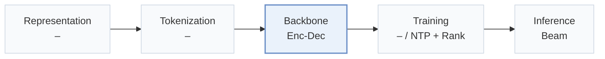
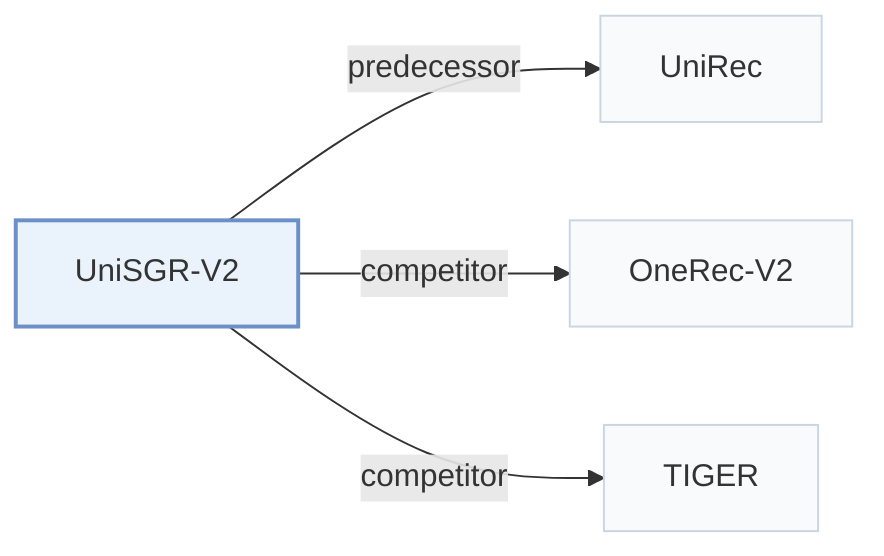

# UniSGR-V2

[← Problem × Stage Matrix](../../README.md#i--backbone) · [Papers by Stage](../index/stages.md) · [Papers by Modality](../index/modality.md) · English | [中文](../zh/papers/unisgr-v2.md)

| **Title** | *Stepwise Target-Side Feature Anticipation and Crossing for Generative Recommendation* |
| :-- | :-- |
| **Authors** | Yang et al. |
| **Venue** | arXiv’26 |
| **Problem × Stage** | `I. Informativeness` · `Backbone` |
| **Links** | [Paper](https://arxiv.org/abs/2610.16132) |
| **Reading level** | Overview (Level 1) |

**On this page**: [TL;DR](#tldr) · [At a Glance](#at-a-glance) · [3. Experiments](#3-experimental-findings) · [5. Related Work](#5-connections-to-related-work)

- `Enc-Dec`: Encoder-decoder.
- `NTP + Rank`: NTP plus a ranking loss.
- `Beam`: Autoregressive beam search over Semantic ID tokens.

### TL;DR

> [!NOTE]
> UniSGR-V2 anticipates a continuous target-side feature vector before each codeword and crosses it with the semantic prefix and user behavior inside the decoder, using it for generation and ranking.

---

### At a Glance

| Aspect | Summary |
| :-- | :-- |
| Research Problem | I. Informativeness: Do the SIDs, or the model reading them, carry the collaborative and multimodal signals recommendation needs? |
| Key Contribution | UniSGR-V2 anticipates a continuous target-side feature vector before each codeword and crosses it with the semantic prefix and user behavior inside the decoder, using it for generation and ranking. |
| Modified Stage | Backbone |

---

### 3. Experimental Findings

Experimental setup

- **Datasets**: Lazada recommendation logs with impression, click, add-to-cart and pay behaviors; training: 2.42 billion samples, 6.46 million users, 7.53 million items.
  - Source: [S4.SS1.p1](https://arxiv.org/html/2610.16132v2#S4.SS1.p1)
- **Split**: Chronological: first 30 days training, following day testing; validation split not reported.
  - Source: [S4.SS1.p1](https://arxiv.org/html/2610.16132v2#S4.SS1.p1)
- **Candidates**: not reported; full-catalog versus sampled retrieval evaluation and history exclusion are unspecified; ranking sample construction not reported.
  - Source: [S4.SS1.p3](https://arxiv.org/html/2610.16132v2#S4.SS1.p3) ; HR@100/500 are output cutoffs, not a stated evaluation pool.
- **Visibility**: warm; no unseen-item protocol is defined.
  - Source: [S4.SS1.p1](https://arxiv.org/html/2610.16132v2#S4.SS1.p1) ; Appendix A's cold-start prediction refers to the initial anticipation slot.
- **SID**: 3-level semantic IDs with 2,048 codewords per level; tokenizer inputs, quantization algorithm, training visibility and collision handling not reported.
  - Source: [S4.SS1.p4](https://arxiv.org/html/2610.16132v2#S4.SS1.p4)
- **Inference budget**: Beam search width not reported; paired prediction/code execution uses 3 sequential decoder calls; maximum history 1,024. Full TacGR: 701 QPS, mean latency 75.6 ms, P99 83.8 ms under matched production hardware/load; hardware specification, batch size and numerical memory-funnel schedule not reported; anchoring tower is training-only.
  - Source: [S3.SS5.SSS4.p1](https://arxiv.org/html/2610.16132v2#S3.SS5.SSS4.p1) ; [S4.SS1.p4](https://arxiv.org/html/2610.16132v2#S4.SS1.p4) ; [A2.T5](https://arxiv.org/html/2610.16132v2#A2.T5) ; [S3.SS4.SSS2.p3](https://arxiv.org/html/2610.16132v2#S3.SS4.SSS2.p3) ; [S3.SS7.SSS2](https://arxiv.org/html/2610.16132v2#S3.SS7.SSS2)
- **Results from**: Own Lazada offline comparison, ablations and serving benchmarks; Table 1 averages 5 seeds. UniRec CoA reproduced on the same backbone; other baseline implementation provenance not reported. Own 40-day online A/B test on 10% traffic replaces UniSGR in one retrieval channel: IPV +0.79%, Order +5.55%, GMV +3.09%; other channels and downstream ranking retained.
  - Source: [S4.SS1.p2](https://arxiv.org/html/2610.16132v2#S4.SS1.p2) ; [S4.T1](https://arxiv.org/html/2610.16132v2#S4.T1) ; [S4.SS5.p1](https://arxiv.org/html/2610.16132v2#S4.SS5.p1) ; [A2.p1](https://arxiv.org/html/2610.16132v2#A2.p1)

---

### 5. Connections to Related Work

- **Predecessor** · [UniRec](unirec.md): Its discrete attribute chain is the closest motivation and a same-backbone baseline.
  - Source: [S1.p5](https://arxiv.org/html/2610.16132v2#S1.p5) ; [S4.SS1.p2](https://arxiv.org/html/2610.16132v2#S4.SS1.p2)
- **Competitor** · [OneRec-V2](onerec-v2.md): Industrial generative retrieval baseline in Table 1.
  - Source: [S4.SS1.p2](https://arxiv.org/html/2610.16132v2#S4.SS1.p2) ; bibliography identifies Zhou et al. (2025) as arXiv:2508.20900.
- **Competitor** · [TIGER](tiger.md): Semantic-ID generative retrieval baseline in Table 1.
  - Source: [S4.SS1.p2](https://arxiv.org/html/2610.16132v2#S4.SS1.p2) ; [S4.T1](https://arxiv.org/html/2610.16132v2#S4.T1)

[View all papers in this cell](../../README.md#i--backbone)
