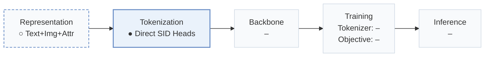
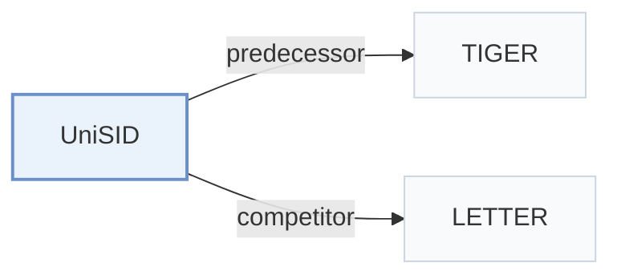

# UniSID

[← Problem × Stage Matrix](../../README.md#i--tokenization) · [Papers by Stage](../index/stages.md) · [Papers by Modality](../index/modality.md) · [Papers by Domain](../index/domain.md) · English | [中文](../zh/papers/unisid.md)

| **Title** | *End-to-End Semantic ID Generation for Generative Advertisement Recommendation* |
| :-- | :-- |
| **Authors** | Jiang et al. |
| **Venue** | arXiv’26 |
| **Problem × Stage** | `I. Informativeness` · `Tokenization` |
| **Changes** | ○ Representation · ● Tokenization |
| **SID inputs** | `Text` + `Img` |
| **Domain** | `Ads` · `E-commerce` |
| **Links** | [Paper](https://arxiv.org/abs/2602.10445) |
| **Reading level** | Overview (Level 1) |

**On this page**: [TL;DR](#tldr) · [3. Experiments](#3-experimental-findings) · [5. Related Work](#5-connections-to-related-work)

- `Text+Img+Attr`: Text, images, and structured item attributes.
- `Direct SID Heads`: Prediction heads that directly assign semantic-ID codes.

### TL;DR

> [!NOTE]
> UniSID optimizes embeddings and Semantic IDs end to end from raw advertising data with multi-granularity contrastive learning and summary-based reconstruction, instead of embedding first and quantizing afterwards.

---

### 3. Experimental Findings

Experimental setup

- **Datasets**: Tencent Ad-60W and Ad-100W multimodal advertising datasets, plus Amazon Beauty. Filtering rules not reported; public preprocessing is described only as standard practice.
  - Source: [S4.SS1.p1](https://arxiv.org/html/2602.10445v3#S4.SS1.p1) ; #S4.T1
- **Split**: Table 1 train/test counts: Ad-60W 500K/100K, Ad-100W 1M/1M, Beauty 12101/12101. Split procedure, count granularity and validation allocation not reported.
  - Source: [S4.T1](https://arxiv.org/html/2602.10445v3#S4.T1) ; #S4.SS1.p1
- **Candidates**: Embedding retrieval sampled: 1000 total (one positive plus 999 negatives); negative sampling distribution and history exclusion not reported. Next-ad and Beauty recommendation candidate protocols not reported.
  - Source: [S4.SS1.p3](https://arxiv.org/html/2602.10445v3#S4.SS1.p3)
- **Visibility**: warm; no unseen-item protocol is defined. SID-model fitting exposure to test items not reported.
  - Source: [S4.SS1.p1](https://arxiv.org/html/2602.10445v3#S4.SS1.p1) ; #S4.SS1.p3 ; #A1.SS3.p1
- **SID**: Three direct categorical SID heads x 2048 entries, using per-layer argmax on Qwen2.5-VL-3B outputs rather than residual quantization. Collision handling not reported.
  - Source: [S3.SS2.p3](https://arxiv.org/html/2602.10445v3#S3.SS2.p3) ; #A1.SS3.p1
- **Inference budget**: Beauty replaces the TIGER tokenizer with UniSID; industrial next-ad predictor details not reported. Metrics at K=1/5/10/20. Downstream decoding/beam, inference hardware, batch size and latency not reported; tokenizer training batch 512 is not an inference setting.
  - Source: [S4.SS1.p3](https://arxiv.org/html/2602.10445v3#S4.SS1.p3) ; #S4.SS2.p5 ; #A1.SS3.p1
- **Results from**: Original Table 2: SID quality/next-ad prediction; Table 3: embedding retrieval; Table 5: ablations. Table 4: UniSID in TIGER on Beauty, with baseline results explicitly taken from LETTER.
  - Source: [S4.T2](https://arxiv.org/html/2602.10445v3#S4.T2) ; #S4.T3 ; #S4.T4 ; #S4.T5 ; #S4.SS2.p5

---

### 5. Connections to Related Work

- **Predecessor** · [TIGER](tiger.md): On Beauty, UniSID replaces TIGER RQ-VAE tokenization with direct multimodal SID heads while retaining the TIGER training and evaluation framework.
  - Source: UniSID v3, Section 4.2 and Table 4: [S4.SS2.p5](https://arxiv.org/html/2602.10445v3#S4.SS2.p5); [S4.T4](https://arxiv.org/html/2602.10445v3#S4.T4).
- **Competitor** · [LETTER](letter.md): LETTER supplies the published Beauty baseline results, including TIGER-LETTER; UniSID jointly learns embeddings and direct SIDs from raw features.
  - Source: UniSID v3, Sections 3/4.2 and Table 4; baseline numbers are reused: [S3.p1](https://arxiv.org/html/2602.10445v3#S3.p1); [S4.SS2.p5](https://arxiv.org/html/2602.10445v3#S4.SS2.p5); [S4.T4](https://arxiv.org/html/2602.10445v3#S4.T4).

[View all papers in this cell](../../README.md#i--tokenization)
