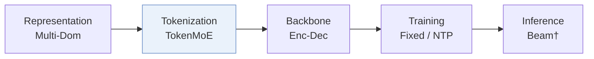
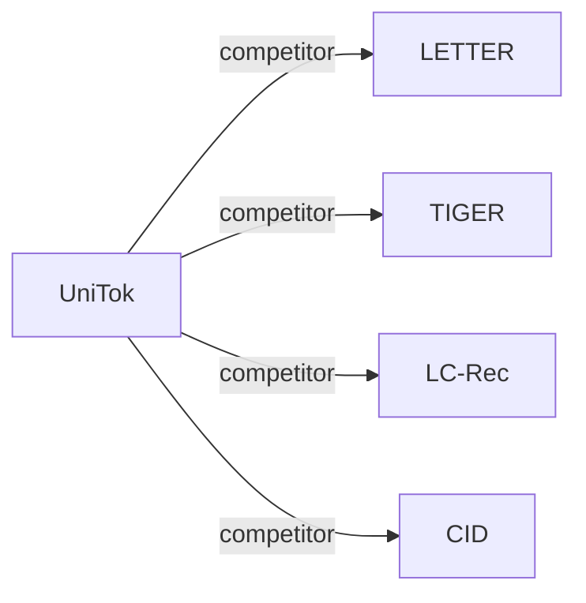

# UniTok

*Tokenize Once, Recommend Anywhere: Unified Item Tokenization for Multi-domain LLM-based Recommendation* — Hou and Shin · AAAI’26

`VI. Generalization` · `Tokenization` · [Paper](https://arxiv.org/abs/2511.12922) · [Code](https://github.com/jackfrost168/UniTok) · [Matrix](../../README.md#vi--tokenization) · [中文](../zh/papers/unitok.md)

Reading level: Overview (Level 1) · On this page: [TL;DR](#tldr) · [At a Glance](#at-a-glance) · [3. Experiments](#3-experimental-findings) · [5. Related Work](#5-connections-to-related-work)

- `Enc-Dec`: Encoder-decoder.
- `Fixed`: SIDs are built first and not changed while the generator trains.
- `NTP`: Next-token prediction loss only; continuing from a pretrained LLM (SFT) also counts as NTP.

### TL;DR

> [!NOTE]

> UniTok tokenizes items from multiple domains with a shared encoder, domain-specific and shared experts, and codebooks, calibrating mutual information across domains, instead of one tokenizer per domain.

### At a Glance

| Aspect | Summary |
| :-- | :-- |
| Research Problem | VI. Generalization: Does it still work for new items, new domains, and shifting interests? |
| Key Contribution | UniTok tokenizes items from multiple domains with a shared encoder, domain-specific and shared experts, and codebooks, calibrating mutual information across domains, instead of one tokenizer per domain. |
| Modified Stage | Tokenization |

### 3. Experimental Findings

Experimental setup

- **Datasets**: Ten domains: Amazon Beauty, Cellphones, Grocery, Instruments, Office, Pet Supplies, Tools, Toys, Games, and Yelp, with title, category, and feature metadata; zero-shot targets Clothing, Health, and Sports. Sizes are in Appendix Table 6 (e.g. Beauty 22,363 users / 12,101 items; Yelp 30,431 / 20,033); filtering rules: not reported.
  - Source: Ten domains: [Sx4.SSx1.SSSx1.p1](https://arxiv.org/html/2511.12922v1#Sx4.SSx1.SSSx1.p1); zero-shot targets: [Sx4.SSx4.p1](https://arxiv.org/html/2511.12922v1#Sx4.SSx4.p1); statistics: [A4.SSx1.p1](https://arxiv.org/html/2511.12922v1#A4.SSx1.p1) and [A4.T6](https://arxiv.org/html/2511.12922v1#A4.T6).
- **Split**: not reported in the main text (full-ranking evaluation per dataset; the train/test division is not restated). Zero-shot study: the tokenizer is trained on the ten source datasets and tested on three unseen domains.
  - Source: Split not restated in the extracted text.
- **Candidates**: full catalog (all non-interacted items are ranked for each user, so user history items are excluded).
  - Source: Full ranking over all non-interacted items: [Sx4.SSx1.SSSx3.p1](https://arxiv.org/html/2511.12922v1#Sx4.SSx1.SSSx3.p1).
- **Visibility**: Main: warm; no unseen-item protocol is defined. Zero-shot: items of the three target domains are unseen by the UniTok tokenizer; whether the T5 recommender saw them: not reported.
  - Source: Zero-shot domains unseen by the tokenizer: [Sx4.SSx4.p1](https://arxiv.org/html/2511.12922v1#Sx4.SSx4.p1).
- **SID**: 4-level residual quantization x 256 codes (dimension 32) inside each expert of a TokenMoE: one shared expert plus 10 domain experts (top-N routing, N = 1 or 2) over 2,048-dimensional language-model embeddings, with mutual-information calibration. Collision handling: not reported.
  - Source: 4 levels x 256 x 32 per expert, TokenMoE with shared and domain experts: [Sx4.SSx1.SSSx4.p1](https://arxiv.org/html/2511.12922v1#Sx4.SSx1.SSSx4.p1), [A4.SSx4.p3](https://arxiv.org/html/2511.12922v1#A4.SSx4.p3), [Sx3.SSx3.SSSx2.p3](https://arxiv.org/html/2511.12922v1#Sx3.SSx3.SSSx2.p3).
- **Inference budget**: Recommendation uses TIGER's T5 generator; beam width not reported. Experiments on two NVIDIA RTX 3090 GPUs; inference batch size and latency: not reported. Table 2 compares trainable parameters (9.11M versus 87.78M accumulated for per-dataset tokenizers).
  - Source: TIGER T5 recommender and hardware: [A4.SSx4.p1](https://arxiv.org/html/2511.12922v1#A4.SSx4.p1) and [Sx4.SSx1.SSSx4.p1](https://arxiv.org/html/2511.12922v1#Sx4.SSx1.SSSx4.p1).
- **Results from**: Table 1 (ten datasets versus CF and tokenization-aided baselines); Table 2 (trainable parameters); Table 3 (competitors trained jointly across domains); Table 4 (zero-shot on unseen domains); Table 5 and later (ablations).
  - Source: Main: [Sx3.T1](https://arxiv.org/html/2511.12922v1#Sx3.T1); parameters: [Sx4.T2](https://arxiv.org/html/2511.12922v1#Sx4.T2); unified training: [Sx4.T3](https://arxiv.org/html/2511.12922v1#Sx4.T3); zero-shot and ablation in later tables.

### 5. Connections to Related Work

- **同期对比** · [LETTER](letter.md): LETTER trains one regularized RQ-VAE tokenizer per dataset; UniTok shares one tokenizer across ten domains with a mixture of quantization experts.
  - Source: UniTok v1, baselines: https://arxiv.org/html/2511.12922v1#Sx4.SSx1.SSSx2.p1; Tables 1-3: https://arxiv.org/html/2511.12922v1#Sx3.T1, https://arxiv.org/html/2511.12922v1#Sx4.T2, https://arxiv.org/html/2511.12922v1#Sx4.T3.
- **同期对比** · [TIGER](tiger.md): TIGER is both a tokenizer baseline and the downstream T5 recommender; UniTok replaces per-domain RQ codebooks with routed experts.
  - Source: UniTok v1, baselines and backbone: https://arxiv.org/html/2511.12922v1#Sx4.SSx1.SSSx2.p1 and https://arxiv.org/html/2511.12922v1#A4.SSx4.p1; Table 1: https://arxiv.org/html/2511.12922v1#Sx3.T1.
- **同期对比** · [LC-Rec](lc-rec.md): LC-Rec aligns an LLM to per-domain indices; UniTok targets one tokenizer for many domains.
  - Source: UniTok v1, baselines: https://arxiv.org/html/2511.12922v1#Sx4.SSx1.SSSx2.p1; Tables 1 and 3: https://arxiv.org/html/2511.12922v1#Sx3.T1 and https://arxiv.org/html/2511.12922v1#Sx4.T3.
- **同期对比** · [CID](cid.md): P5-TID and P5-SemID (Hua et al., 2023) use titles or categories as IDs; UniTok learns codebook IDs.
  - Source: UniTok v1, baselines: https://arxiv.org/html/2511.12922v1#Sx4.SSx1.SSSx2.p1; Table 1: https://arxiv.org/html/2511.12922v1#Sx3.T1.

[查看同格全部论文](../../README.md#vi--tokenization)
