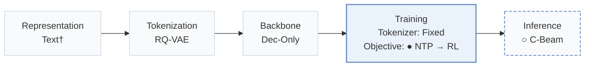
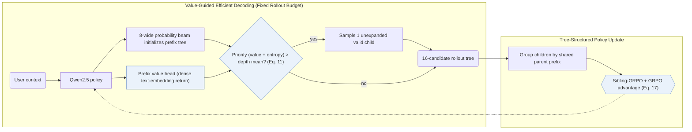
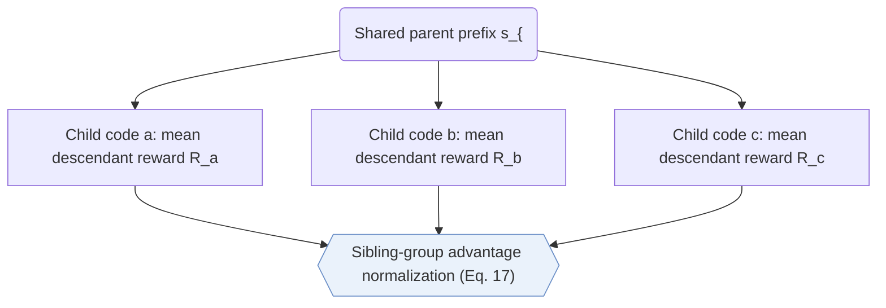
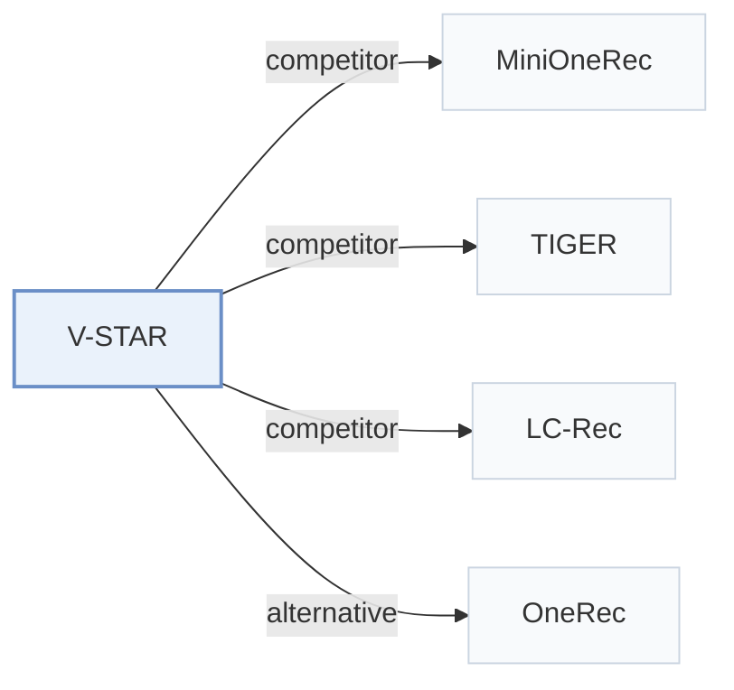

# V-STAR

[← Problem × Stage Matrix](../../README.md#iv--training) · [Papers by Stage](../index/stages.md) · [Papers by Modality](../index/modality.md) · [Papers by Domain](../index/domain.md) · English | [中文](../zh/papers/v-star.md)

| **Title** | *Spend Search Where It Pays: Value-Guided Structured Sampling and Optimization for Generative Recommendation* |
| :-- | :-- |
| **Authors** | Jiang et al. |
| **Venue** | KDD’26 |
| **Problem × Stage** | `IV. Utility` · `Training` |
| **Changes** | ● Objective · ○ Inference |
| **SID inputs** | `unknown` |
| **Domain** | `E-commerce` · `Ads` |
| **Links** | [Paper](https://arxiv.org/abs/2602.10699) |
| **Reading level** | Reading Notes (Level 2) |

**On this page**: [TL;DR](#tldr) · [At a Glance](#at-a-glance) · [1. Why It Matters](#1-why-this-paper-matters) · [2. Method](#2-how-it-works) · [3. Experiments](#3-experimental-findings) · [4. Limitations](#4-limitations--critical-analysis) · [5. Related Work](#5-connections-to-related-work)

- `Text†`: Textual item representations (inferred).
- `RQ-VAE`: Residual-Quantized Variational AutoEncoder.
- `Dec-Only`: Decoder-only.
- `Fixed`: SIDs are built first and not changed while the generator trains.
- `NTP → RL`: NTP, then reinforcement learning (GRPO, GBPO, etc.).
- `C-Beam`: Constrained beam search.

### TL;DR

> [!NOTE]
> V-STAR deepens high-value prefixes with value-guided decoding during reinforcement learning sampling and computes sibling-relative advantages with Sibling-GRPO, instead of likelihood-driven beam search.

---

### At a Glance

| Aspect | Summary |
| :-- | :-- |
| Key Findings | Under matched training-time decoding budgets, V-STAR outperforms beam-search RL baselines including MiniOneRec on Amazon Industrial and Office and lifts live advertising GMV by +1.23% in a WeChat Channels online A/B test (Sec. 5.3–5.5, Tables 1 and 4, Fig. 4). |
| Limitation | Value-guided tree expansion applies only to training-time RL rollout construction, leaving online serving on standard likelihood beam search (Sec. 4.4). |

---

### 1. Why This Paper Matters

Sampling RL rollouts via likelihood-driven beam search prunes high-reward items hidden behind low-probability early prefixes while packing the candidate pool with sibling trajectories that share high-probability prefixes and correlated rewards (Abstract). Simply widening the beam wastes compute on redundant head branches (Sec. 1). V-STAR reallocates rollout expansion toward high-value, high-entropy prefix nodes and normalizes policy advantages among sibling branches on the prefix tree.

> "Our V-STAR primarily focuses on training-time improvement." (Sec. 4.4)

---

### 2. How It Works

#### Value Head

A lightweight value head reads the policy's hidden state at each Semantic ID (SID) prefix and predicts expected return, supervised by dense semantic similarity targets computed from a frozen item text encoder (Sec. 4.1).

#### Value-Guided Efficient Decoding

Value-Guided Efficient Decoding (VED) constructs the RL rollout tree under a fixed token-evaluation budget (Sec. 4.2). Starting from an initial probability-guided beam, VED scores each tree node by combining its predicted value with policy entropy; nodes exceeding the mean priority at their depth expand one additional valid child sampled proportionally to normalized policy probability (Eq. 11).

> "We develop Value-Guided Efficient Decoding (VED) for budgeted candidate construction by allocating decoding compute to high-value and high-ambiguity nodes." (Sec. 1)

#### Sibling-GRPO

Rather than normalizing rewards flatly across correlated full sequences, Sibling-GRPO groups sibling nodes under each parent prefix, assigns each child the mean reward of its descendant leaf candidates, and normalizes advantages within each sibling group (Sec. 4.3, Eq. 17).

> "We introduce Sibling-GRPO, a tree-structured objective that uses sibling groups to mitigate advantage compression under correlated candidates." (Sec. 1)

---

### 3. Experimental Findings

Experimental setup

- **Datasets**: Amazon Reviews 2023 Industrial and Scientific and Office Products, preprocessed following MiniOneRec (Kong et al., 2025b); online: WeChat Channels advertising traffic. Filtering and sizes: not restated.
  - Source: Datasets and MiniOneRec preprocessing: [S5.SS1.p1](https://arxiv.org/html/2602.10699v2#S5.SS1.p1).
- **Split**: Chronological next-item prediction following MiniOneRec's preprocessing (allocation not restated). Online: 5-day A/B test on 5% of live requests, against beam search plus GRPO.
  - Source: Chronological next-item protocol: [S5.SS1.p1](https://arxiv.org/html/2602.10699v2#S5.SS1.p1); online A/B: [S5.SS3.p1](https://arxiv.org/html/2602.10699v2#S5.SS3.p1).
- **Candidates**: not reported (full catalog versus sampled); generation is restricted to valid catalog SIDs, with HR and NDCG at 3, 5, 10.
  - Source: Valid-SID constraint and metrics: [S5.SS1.p1](https://arxiv.org/html/2602.10699v2#S5.SS1.p1).
- **Visibility**: warm; no unseen-item protocol is defined.
  - Source: No unseen-item protocol: [S5.SS1.p1](https://arxiv.org/html/2602.10699v2#S5.SS1.p1).
- **SID**: 3-level RQ-VAE semantic IDs (citing TIGER); the paper states each item is represented by a unique fixed-length SID. Codebook size and the mechanism that ensures uniqueness: not reported.
  - Source: 3-level RQ-VAE SIDs: [S5.SS1.p1](https://arxiv.org/html/2602.10699v2#S5.SS1.p1); each item has a unique fixed-length SID: [S3.SS1.p1](https://arxiv.org/html/2602.10699v2#S3.SS1.p1).
- **Inference budget**: Training rollouts use value-guided decoding (VED) with 16 candidates per query and an 8-wide beam to initialize the prefix tree; at inference, standard beam search is the default decoder (width not reported). Qwen2.5-1.5B on 8 GPUs; inference batch size and latency: not reported.
  - Source: VED budget, beam settings, inference decoder: [S5.SS1.p2](https://arxiv.org/html/2602.10699v2#S5.SS1.p2).
- **Results from**: Table 1 (Industrial and Office versus sequential, generative, and RL baselines including MiniOneRec); Tables 2-4 (decoding, expansion rules, training objective); Table 6 (candidate diversity and max reward); Section 5.3 (online GMV +1.23%).
  - Source: Main: [S4.T1](https://arxiv.org/html/2602.10699v2#S4.T1); ablations: [S5.T2](https://arxiv.org/html/2602.10699v2#S5.T2), [S5.T3](https://arxiv.org/html/2602.10699v2#S5.T3), [S5.T4](https://arxiv.org/html/2602.10699v2#S5.T4); diversity: [S5.T6](https://arxiv.org/html/2602.10699v2#S5.T6); online: [S5.SS3.p1](https://arxiv.org/html/2602.10699v2#S5.SS3.p1).

- Budgeted rollout efficiency: across matched counts of model-evaluated tokens during RL candidate construction, VED consistently outperforms standard beam search on HR and NDCG (Sec. 5.5, Fig. 4).
- Objective ablation and live A/B test: combining sequence-level GRPO with tree-level Sibling-GRPO achieves the highest accuracy among all tested RL objectives on Industrial and Office (Sec. 5.4, Table 4) and yields +1.23% GMV in a 5-day online A/B test on WeChat Channels advertising (Sec. 5.3).

---

### 4. Limitations & Critical Analysis

**Our analysis.**

- MiniOneRec shares the same 3-level `RQ-VAE` SIDs, Qwen2.5 `Dec-Only` backbone, and `NTP → RL` schedule with constrained beam rollouts; V-STAR replaces uniform likelihood beam rollouts with value-and-entropy tree expansion and sibling-relative advantages.

---

### 5. Connections to Related Work

- **Competitor** · [MiniOneRec](minionerec.md): MiniOneRec samples RL candidates by beam search and applies GRPO; V-STAR replaces candidate construction with value-guided prefix expansion and uses sibling-group advantages, while keeping MiniOneRec's preprocessing.
  - Source: V-STAR v2, preprocessing follows Kong et al. (2025b): [S5.SS1.p1](https://arxiv.org/html/2602.10699v2#S5.SS1.p1); strongest RL baseline: [S5.SS2.p1](https://arxiv.org/html/2602.10699v2#S5.SS2.p1); Table 1: [S4.T1](https://arxiv.org/html/2602.10699v2#S4.T1).
- **Competitor** · [TIGER](tiger.md): TIGER's SIDs and beam search are the base; V-STAR targets the pruning of high-reward low-probability prefixes during RL sampling.
  - Source: V-STAR v2, SID-based baselines: [S5.SS2.p1](https://arxiv.org/html/2602.10699v2#S5.SS2.p1); Table 1: [S4.T1](https://arxiv.org/html/2602.10699v2#S4.T1).
- **Competitor** · [LC-Rec](lc-rec.md): LC-Rec is an SID-based LLM recommender without RL; V-STAR adds value-guided RL on top of SFT.
  - Source: V-STAR v2, baselines: [S5.SS2.p1](https://arxiv.org/html/2602.10699v2#S5.SS2.p1); Table 1: [S4.T1](https://arxiv.org/html/2602.10699v2#S4.T1).
- **Alternative** · [OneRec](onerec.md): OneRec applies preference alignment with beam-sampled responses; V-STAR argues that probability-based beam sampling under-explores high-reward items.
  - Source: V-STAR v2, Sections 1 and 2.3 cite OneRec: [S1.p1](https://arxiv.org/html/2602.10699v2#S1.p1) and [S2.SS3.p1](https://arxiv.org/html/2602.10699v2#S2.SS3.p1).

[View all papers in this cell](../../README.md#iv--training)
