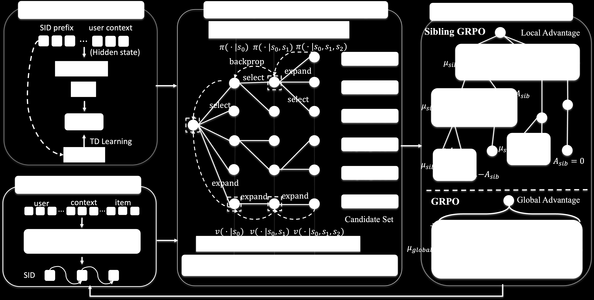
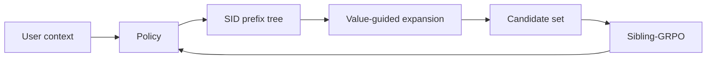

# V-STAR

*Spend Search Where It Pays: Value-Guided Structured Sampling and Optimization for Generative Recommendation* — Jiang et al. · KDD’26

`IV. Utility` · `Training`

[Paper](https://arxiv.org/abs/2602.10699) · [Matrix](../../README.md#iv--training)

Reading level: Reading Notes (Level 2) · On this page: [TL;DR](#tldr) · [At a Glance](#at-a-glance) · [1. Why This Paper Matters](#1-why-this-paper-matters) · [2. How It Works](#2-how-it-works) · [3. Experimental Findings](#3-experimental-findings) · [4. Limitations & Critical Analysis](#4-limitations--critical-analysis) · [5. Connections to Related Work](#5-connections-to-related-work)

| Representation | Tokenization | Backbone | Training | Inference |
| :-: | :-: | :-: | :-: | :-: |
| `Text†` | `RQ-VAE` | `Dec-Only` | **`Fixed / NTP → RL`** | `C-Beam` |

- `Dec-Only`: Decoder-only.
- `Fixed`: SIDs are built first and not changed while the generator trains.
- `NTP → RL`: NTP, then reinforcement learning (GRPO, GBPO, etc.).
- `C-Beam`: Constrained beam search.

### TL;DR

V-STAR deepens high-value prefixes with value-guided decoding during reinforcement learning sampling and computes sibling-relative advantages with Sibling-GRPO, instead of likelihood-driven beam search.

### At a Glance

| Aspect | Summary |
| :-- | :-- |
| Research Problem | IV. Utility: Are training and search aimed at what users and the platform value, rather than at token likelihood? |
| Key Contribution | V-STAR deepens high-value prefixes with value-guided decoding during reinforcement learning sampling and computes sibling-relative advantages with Sibling-GRPO, instead of likelihood-driven beam search. |
| Modified Stage | Training |

### 1. Why This Paper Matters

RL fine-tuning of generative recommenders samples candidates with likelihood-driven decoding such as beam search (Abstract). The authors name two failures of this setup. High-reward items in low-probability branches are pruned early, and candidates that share a high-probability prefix receive correlated rewards, which weakens the comparison signal for RL. A larger beam does not fix this, because it spends most extra compute on redundant high-probability candidates (Sec. 1). V-STAR changes how RL candidates are built and how their advantages are computed.

> "Our V-STAR primarily focuses on training-time improvement." (Sec. 4.4)

Based on arXiv v2.

### 2. How It Works

*Figure source: Fig. 2, original paper.*

#### Value Head

A value head reads the policy's hidden state for each Semantic ID (SID) prefix and predicts its value (Sec. 4.1). Dense semantic returns for its training come from item embeddings computed by a frozen text encoder.

#### Value-Guided Efficient Decoding

VED treats SID decoding as building a candidate set on the prefix tree under a fixed compute budget (Sec. 4.2). A probability-guided beam initializes the tree. Each node's priority combines its predicted value with the policy entropy, and a node whose priority exceeds the average at its depth receives one new child (Eq. 11). The child is sampled from the unexpanded valid children by normalized policy probability.

> "We develop Value-Guided Efficient Decoding (VED) for budgeted candidate construction by allocating decoding compute to high-value and high-ambiguity nodes." (Sec. 1)

#### Sibling-GRPO

Sibling-GRPO groups the children of each parent prefix (Sec. 4.3). Each child's score is the mean reward of its descendant candidates, and advantages are normalized among siblings (Eq. 17).

> "We introduce Sibling-GRPO, a tree-structured objective that uses sibling groups to mitigate advantage compression under correlated candidates." (Sec. 1)

### 3. Experimental Findings

**Experimental setup**

- **Datasets**: Amazon Reviews 2023 Industrial and Scientific and Office Products, preprocessed following MiniOneRec (Kong et al., 2025b); online: WeChat Channels advertising traffic. Filtering and sizes: not restated.
  - Source: Datasets and MiniOneRec preprocessing: https://arxiv.org/html/2602.10699v2#S5.SS1.p1.
- **Split**: Chronological next-item prediction following MiniOneRec's preprocessing (allocation not restated). Online: 5-day A/B test on 5% of live requests, against beam search plus GRPO.
  - Source: Chronological next-item protocol: https://arxiv.org/html/2602.10699v2#S5.SS1.p1; online A/B: https://arxiv.org/html/2602.10699v2#S5.SS3.p1.
- **Candidates**: not reported (full catalog versus sampled); generation is restricted to valid catalog SIDs, with HR and NDCG at 3, 5, 10.
  - Source: Valid-SID constraint and metrics: https://arxiv.org/html/2602.10699v2#S5.SS1.p1.
- **Visibility**: warm; no unseen-item protocol is defined.
  - Source: No unseen-item protocol: https://arxiv.org/html/2602.10699v2#S5.SS1.p1.
- **SID**: 3-level RQ-VAE semantic IDs (citing TIGER); the paper states each item is represented by a unique fixed-length SID. Codebook size and the mechanism that ensures uniqueness: not reported.
  - Source: 3-level RQ-VAE SIDs: https://arxiv.org/html/2602.10699v2#S5.SS1.p1; each item has a unique fixed-length SID: https://arxiv.org/html/2602.10699v2#S3.SS1.p1.
- **Inference budget**: Training rollouts use value-guided decoding (VED) with 16 candidates per query and an 8-wide beam to initialize the prefix tree; at inference, standard beam search is the default decoder (width not reported). Qwen2.5-1.5B on 8 GPUs; inference batch size and latency: not reported.
  - Source: VED budget, beam settings, inference decoder: https://arxiv.org/html/2602.10699v2#S5.SS1.p2.
- **Results from**: Table 1 (Industrial and Office versus sequential, generative, and RL baselines including MiniOneRec); Tables 2-4 (decoding, expansion rules, training objective); Table 6 (candidate diversity and max reward); Section 5.3 (online GMV +1.23%).
  - Source: Main: https://arxiv.org/html/2602.10699v2#S4.T1; ablations: https://arxiv.org/html/2602.10699v2#S5.T2, https://arxiv.org/html/2602.10699v2#S5.T3, https://arxiv.org/html/2602.10699v2#S5.T4; diversity: https://arxiv.org/html/2602.10699v2#S5.T6; online: https://arxiv.org/html/2602.10699v2#S5.SS3.p1.

- Decoding budget: under matched training-time decoding budgets, VED outperforms beam search on the tested metrics (Sec. 5.5, Fig. 4). The budget counts model-evaluated tokens during candidate construction, not end-to-end latency.
- Training objective: combining GRPO with Sibling-GRPO gives the highest NDCG and HR among the tested objectives (Sec. 5.4, Table 4).

### 4. Limitations & Critical Analysis

**Our analysis.**

- MiniOneRec uses the same `RQ-VAE` SIDs, `Dec-Only` generator, and `NTP → RL` training; V-STAR changes only how RL candidates are sampled and how advantages are computed.

### 5. Connections to Related Work

- **Competitor** · [MiniOneRec](minionerec.md): MiniOneRec samples RL candidates by beam search and applies GRPO; V-STAR replaces candidate construction with value-guided prefix expansion and uses sibling-group advantages, while keeping MiniOneRec's preprocessing.
  - Source: V-STAR v2, preprocessing follows Kong et al. (2025b): https://arxiv.org/html/2602.10699v2#S5.SS1.p1; strongest RL baseline: https://arxiv.org/html/2602.10699v2#S5.SS2.p1; Table 1: https://arxiv.org/html/2602.10699v2#S4.T1.
- **Competitor** · [TIGER](tiger.md): TIGER's SIDs and beam search are the base; V-STAR targets the pruning of high-reward low-probability prefixes during RL sampling.
  - Source: V-STAR v2, SID-based baselines: https://arxiv.org/html/2602.10699v2#S5.SS2.p1; Table 1: https://arxiv.org/html/2602.10699v2#S4.T1.
- **Competitor** · [LC-Rec](lc-rec.md): LC-Rec is an SID-based LLM recommender without RL; V-STAR adds value-guided RL on top of SFT.
  - Source: V-STAR v2, baselines: https://arxiv.org/html/2602.10699v2#S5.SS2.p1; Table 1: https://arxiv.org/html/2602.10699v2#S4.T1.
- **Alternative** · [OneRec](onerec.md): OneRec applies preference alignment with beam-sampled responses; V-STAR argues that probability-based beam sampling under-explores high-reward items.
  - Source: V-STAR v2, Sections 1 and 2.3 cite OneRec: https://arxiv.org/html/2602.10699v2#S1.p1 and https://arxiv.org/html/2602.10699v2#S2.SS3.p1.

[View all papers in this cell](../../README.md#iv--training)
