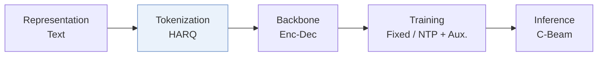
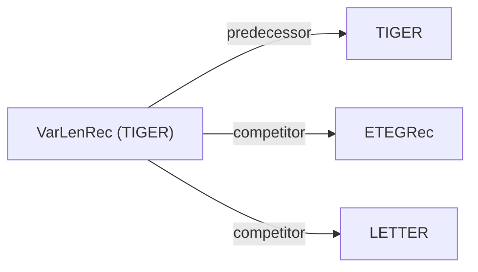

# VarLenRec (TIGER)

*Learning Variable-Length Tokenization for Generative Recommendation* — Wang et al. · arXiv’26

`I. Informativeness` · `Tokenization`

[Paper](https://arxiv.org/abs/2605.17779) · [Matrix](../../README.md#i--tokenization)

Reading level: Overview (Level 1) · On this page: [TL;DR](#tldr) · [At a Glance](#at-a-glance) · [3. Experimental Findings](#3-experimental-findings) · [5. Connections to Related Work](#5-connections-to-related-work)

- `HARQ`: Hyperbolic Adaptive Residual Quantization.
- `Enc-Dec`: Encoder-decoder.
- `Fixed`: SIDs are built first and not changed while the generator trains.
- `NTP + Aux.`: NTP plus another auxiliary loss.
- `C-Beam`: Constrained beam search.

### TL;DR

VarLenRec (TIGER) gives popular items shorter Semantic IDs and tail items longer ones through hyperbolic residual quantization and a soft length controller, instead of fixed-length tokenization.

### At a Glance

| Aspect | Summary |
| :-- | :-- |
| Research Problem | I. Informativeness: Do the SIDs, or the model reading them, carry the collaborative and multimodal signals recommendation needs? |
| Key Contribution | VarLenRec (TIGER) gives popular items shorter Semantic IDs and tail items longer ones through hyperbolic residual quantization and a soft length controller, instead of fixed-length tokenization. |
| Modified Stage | Tokenization |

### 3. Experimental Findings

**Experimental setup**

- **Datasets**: Amazon Beauty, Sports and Outdoors, Toys and Games, and Yelp; exclude users/items with fewer than five interactions. Maximum history length not reported.
- **Split**: Per-user leave-one-out: most recent item test, second most recent validation, all remaining items training.
- **Candidates**: full catalog; full ranking without negative sampling.
- **Visibility**: warm; no unseen-item protocol is defined. Cold-start maximum-length assignment is discussed for deployment, not evaluated as a held-out-item protocol; tokenizer exposure to test items not reported.
- **SID**: HARQ on Sentence-T5 embeddings: variable semantic length up to 10 levels x 256 codes, in hyperbolic space with curvature 1. Colliding IDs receive unique appended tokens from a disjoint 256-entry auxiliary vocabulary.
- **Inference budget**: VarLenRec-TIGER uses T5, a user-side target-length predictor and trie-constrained beam 30, decoding exactly the predicted length; Recall/NDCG@5/10. Table III test seconds/epoch on Beauty/Sports/Toys/Yelp: 63.7/81.2/70.0/83.3. Experiments use A800 GPUs; count, inference batch size and per-request latency not reported.
- **Results from**: Original v2 Table I: VarLenRec-TIGER and VarLenRec-LCRec comparisons; Table II: VarLenRec-TIGER ablations; Table III: timing. Baseline-result reuse not stated. This record covers the TIGER generative branch; SASRec is only a baseline in v2.

Sources

- **Datasets**: [S4.SS1.SSS1.p1](https://arxiv.org/html/2605.17779v2#S4.SS1.SSS1.p1)
- **Split**: [S4.SS1.SSS4.p1](https://arxiv.org/html/2605.17779v2#S4.SS1.SSS4.p1)
- **Candidates**: [S4.SS1.SSS3.p1](https://arxiv.org/html/2605.17779v2#S4.SS1.SSS3.p1)
- **Visibility**: [S4.SS1.SSS4.p1](https://arxiv.org/html/2605.17779v2#S4.SS1.SSS4.p1) ; #S3.SS4.p6
- **SID**: [S4.SS1.SSS4.p1](https://arxiv.org/html/2605.17779v2#S4.SS1.SSS4.p1) ; #S3.SS4.p2
- **Inference budget**: [S3.SS4.p4](https://arxiv.org/html/2605.17779v2#S3.SS4.p4) ; #S3.SS4.p5 ; #S4.SS1.SSS4.p1 ; #S4.T3
- **Results from**: [S4.SS2.p1](https://arxiv.org/html/2605.17779v2#S4.SS2.p1) ; #S4.T2 ; #S4.T3 ; #S4.SS1.SSS2.p1

### 5. Connections to Related Work

- **Predecessor** · [TIGER](tiger.md): VarLenRec-TIGER replaces uniform-length RQ tokenization with hyperbolic variable-length IDs and adds user-conditioned length prediction before constrained generation.
  - Source: VarLenRec v2, Sections III-D/IV-B: https://arxiv.org/html/2605.17779v2#S3.SS4.p3; https://arxiv.org/html/2605.17779v2#S4.SS2.p1.
- **Competitor** · [ETEGRec](etegrec.md): ETEGRec is a fixed-length generative baseline with joint-training optimization; VarLenRec changes the per-item encoding budget and target decoding length.
  - Source: VarLenRec v2, Sections IV-A/IV-B: https://arxiv.org/html/2605.17779v2#S4.SS1.SSS2.p1; https://arxiv.org/html/2605.17779v2#S4.SS2.p2.
- **Competitor** · [LETTER](letter.md): LETTER improves codebook learning on TIGER/LCRec backbones; VarLenRec instead allocates variable ID lengths and compares against LETTER-TIGER.
  - Source: VarLenRec v2, Sections IV-A/IV-B: https://arxiv.org/html/2605.17779v2#S4.SS1.SSS2.p1; https://arxiv.org/html/2605.17779v2#S4.SS2.p2.

[View all papers in this cell](../../README.md#i--tokenization)
