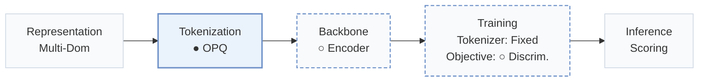
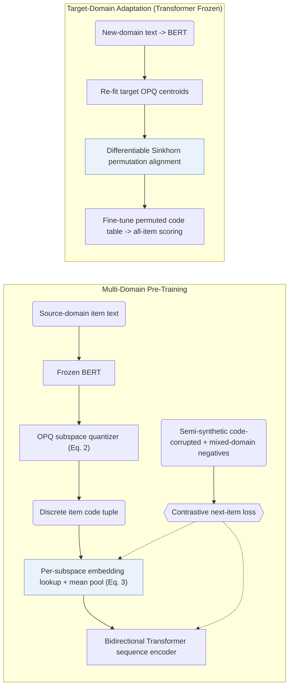
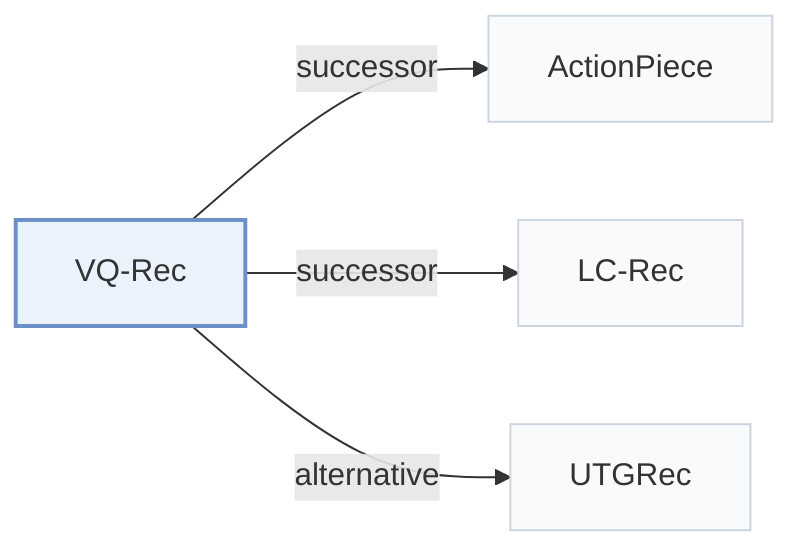

# VQ-Rec

[← Problem × Stage Matrix](../../README.md#vi--tokenization) · [Papers by Stage](../index/stages.md) · [Papers by Modality](../index/modality.md) · [Papers by Domain](../index/domain.md) · English | [中文](../zh/papers/vq-rec.md)

| **Title** | *Learning Vector-Quantized Item Representation for Transferable Sequential Recommenders* |
| :-- | :-- |
| **Authors** | Hou et al. |
| **Venue** | WWW’23 |
| **Problem × Stage** | `VI. Generalization` · `Tokenization` |
| **Changes** | ● Tokenization · ○ Backbone · ○ Objective |
| **SID inputs** | `Text` |
| **Domain** | `E-commerce` |
| **Settings** | `cross-domain` |
| **Links** | [Paper](https://arxiv.org/abs/2210.12316) · [Code](https://github.com/RUCAIBox/VQ-Rec) |
| **Reading level** | Reading Notes (Level 2) |

**On this page**: [TL;DR](#tldr) · [At a Glance](#at-a-glance) · [1. Why It Matters](#1-why-this-paper-matters) · [2. Method](#2-how-it-works) · [3. Experiments](#3-experimental-findings) · [4. Limitations](#4-limitations--critical-analysis) · [5. Related Work](#5-connections-to-related-work)

- `Multi-Dom`: Unified item representations built jointly across multiple domains.
- `OPQ`: Optimized product quantization.
- `Encoder`: Bidirectional encoder backbone without autoregressive token generation.
- `Fixed`: SIDs are built first and not changed while the generator trains.
- `Discrim.`: Scores items; does not generate SIDs.
- `Scoring`: Direct candidate scoring without step-by-step SID generation.

### TL;DR

> [!NOTE]
> VQ-Rec maps item text to discrete codes and looks up code embeddings as item representations, with contrastive pre-training and cross-domain fine-tuning, to loosen the binding between text and representation.

---

### At a Glance

| Aspect | Summary |
| :-- | :-- |
| Key Findings | Pre-trained across five Amazon source domains, VQ-Rec ranks first or second on all six cross-domain and cross-platform downstream datasets and outperforms SASRec in every item-popularity bucket, particularly cold-start items (Sec. 3.4.3, Table 2, Fig. 4). |
| Limitation | Evaluating the pre-trained encoder without downstream code-embedding fine-tuning causes a sharp drop in accuracy across target domains (Sec. 3.3, Table 3). |

---

### 1. Why This Paper Matters

Directly feeding continuous pre-trained language model (PLM) embeddings into transferable sequential recommenders over-couples predictions to surface text style and amplifies cross-domain distribution shifts (Abstract, Sec. 4). VQ-Rec inserts discrete optimized product quantization (`OPQ`) item codes between text encodings and learnable lookup tables inside a bidirectional sequence encoder (`Scoring`), establishing the parallel subspace code representation adopted by later Semantic ID (SID) generators (Sec. 2.1).

---

### 2. How It Works

#### Text to Code

A frozen BERT encoder embeds item text, and optimized product quantization (OPQ) partitions the vector into orthogonal subspaces to assign one discrete centroid index per subspace independently across all source domains (Sec. 2.2.1, Eq. 2).

#### Code to Representation

Each subspace position maintains its own learnable code embedding table decoupled from the OPQ centroids, and averaging the looked-up subspace vectors forms the item representation (Sec. 2.2.2, Eq. 3).

#### Contrastive Pre-Training

A Transformer sequence encoder reads user histories of pooled code embeddings and optimizes a contrastive objective pairing the true next item against both in-batch mixed-domain negatives and semi-synthetic negatives formed by randomly perturbing subset code indices (Sec. 2.3, Sec. 2.3.1, Sec. 2.4).

#### Cross-Domain Fine-Tuning

When transferring to a downstream domain, VQ-Rec refits OPQ centroids on the target catalog, aligns new centroids to the pre-trained code embedding tables via a differentiable permutation matrix, and fine-tunes only the permuted lookup tables with the sequence Transformer frozen (Sec. 2.4, Sec. 2.4.1). Emerging items within an adapted domain require only text encoding and table lookup without retraining (Sec. 2.4.2).

> "During fine-tuning, we fix the Transformer sequence encoder (transferred across different domains), and only optimize the parameters involved in item representations, enabling parameter-efficient fine-tuning." (Sec. 2.4)

> "When a new item emerges, one can encode its item text into discrete indices, and then obtain the corresponding item representations by embedding lookup." (Sec. 2.4.2)

---

### 3. Experimental Findings

Experimental setup

- **Datasets**: Pre-training on five Amazon domains (Food, Home, CDs, Kindle, Movies; 1,361,408 users / 446,975 items); downstream on Amazon Scientific, Pantry, Instruments, Arts, Office and the cross-platform Online Retail dataset. Users and items with fewer than 5 interactions are filtered (following UniSRec); item text truncated to 512 tokens.
  - Source: Pre-training and downstream domains: [S3.SS1.SSS1.p1](https://arxiv.org/html/2210.12316v2#S3.SS1.SSS1.p1); filtering: [S3.SS1.SSS1.p2](https://arxiv.org/html/2210.12316v2#S3.SS1.SSS1.p2); statistics: [S2.T1](https://arxiv.org/html/2210.12316v2#S2.T1).
- **Split**: Leave-one-out: latest item for test, the one before for validation, the rest for training; pre-train on source domains, then fine-tune per downstream dataset.
  - Source: Leave-one-out allocation: [S3.SS1.SSS3.p1](https://arxiv.org/html/2210.12316v2#S3.SS1.SSS3.p1).
- **Candidates**: full catalog (the ground-truth item is ranked among all other items).
  - Source: Ranked among all other items: [S3.SS1.SSS3.p1](https://arxiv.org/html/2210.12316v2#S3.SS1.SSS3.p1).
- **Visibility**: warm; no unseen-item protocol is defined. Figure 4 groups test items by popularity (e.g. [0, 5) interactions on Office), which are low-frequency rather than strictly unseen; the inductive no-retraining claim is not separately tested.
  - Source: Cold-start groups by popularity, inductive capability without a dedicated unseen-item test: [S3.SS4.SSS3.p1](https://arxiv.org/html/2210.12316v2#S3.SS4.SSS3.p1) and [S3.SS2.p3](https://arxiv.org/html/2210.12316v2#S3.SS2.p3).
- **SID**: OPQ codes over item text embeddings, written as (M=32) x (D=256) PQ indices in the implementation; the method section uses D for the number of code sets and M for the centroids per set, so the two notations do not state the same split unambiguously. The paper argues that K-means-trained OPQ tends to give near-uniform code distributions, which keeps collisions low; a rule for items sharing a code: not reported. Downstream domains re-train PQ centroids with a permutation-based code-embedding alignment.
  - Source: (M=32) x (D=256) PQ indices: [S3.SS1.SSS4.p1](https://arxiv.org/html/2210.12316v2#S3.SS1.SSS4.p1); D sets of M centroids in the method: [S2.SS2.SSS1.p3](https://arxiv.org/html/2210.12316v2#S2.SS2.SSS1.p3); uniform code distribution argument: [S2.SS2.SSS3.p1](https://arxiv.org/html/2210.12316v2#S2.SS2.SSS3.p1); domain re-training of centroids: [S2.SS4.SSS1.p2](https://arxiv.org/html/2210.12316v2#S2.SS4.SSS1.p2).
- **Inference budget**: n/a for generation (a Transformer sequence encoder scores items through pooled code embeddings; implemented with Faiss and RecBole). Hardware, inference batch size, and latency: not reported.
  - Source: Discriminative ranking with Faiss and RecBole: [S3.SS1.SSS4.p1](https://arxiv.org/html/2210.12316v2#S3.SS1.SSS4.p1).
- **Results from**: Table 2 (cross-domain and cross-platform comparison with ID, text, and transferable baselines); Table 3 (ablations); Figure 4 (popularity groups).
  - Source: Main: [S3.T2](https://arxiv.org/html/2210.12316v2#S3.T2); ablation: [S3.T3](https://arxiv.org/html/2210.12316v2#S3.T3); cold-start groups: [S3.F4](https://arxiv.org/html/2210.12316v2#S3.F4).

- Cross-domain and cross-platform transfer: across six downstream Amazon and Online Retail benchmarks, VQ-Rec achieves the best or second-best ranking accuracy against ID-based, text-based, and transferable sequential baselines (Table 2).
- Pre-training and fine-tuning ablations: skipping target-domain code-table fine-tuning degrades accuracy sharply, while removing multi-domain pre-training consistently lowers results across all six datasets (Sec. 3.3, Table 3).
- Cold-start and popularity buckets: VQ-Rec beats SASRec across every item-popularity group, with the widest gains on low-interaction cold-start items (Sec. 3.4.3, Fig. 4).

  > "VQ-Rec has better performance than SASRec in all groups, especially in cold-start groups." (Sec. 3.4.3)

---

### 4. Limitations & Critical Analysis

**Our analysis.**

- ActionPiece and RPG both build on unordered `OPQ` subspace codes, where ActionPiece merges co-occurring code patterns for `Enc-Dec` generation and RPG decodes long `OPQ` tuples over an item graph; VQ-Rec pools code embeddings for discriminative all-catalog `Scoring` with a frozen-transfer `Encoder`.
- UTGRec likewise targets multi-domain transfer (`Multi-Dom`) by replacing `OPQ` lookup scoring with `Tree` codebooks and autoregressive `Beam` generation.

---

### 5. Connections to Related Work

- **Successor** · [ActionPiece](actionpiece.md): ActionPiece later follows VQ-Rec in quantizing sentence embeddings with OPQ into unordered codes and merges them into context-dependent tokens for generation.
  - Source: Evidence is from the later ActionPiece paper, Appendix F: [A6.I1.i3.p1](https://arxiv.org/html/2502.13581v3#A6.I1.i3.p1); VQ-Rec is a Table 4 baseline: [S3.T4](https://arxiv.org/html/2502.13581v3#S3.T4).
- **Successor** · [LC-Rec](lc-rec.md): LC-Rec later borrows VQ-Rec's idea of learned discrete indices for items and builds RQ indices for LLM tuning.
  - Source: Evidence is from the later LC-Rec paper, Section 3.2.1: [S3.SS2.SSS1.p1](https://arxiv.org/html/2311.09049v4#S3.SS2.SSS1.p1) and [S3.SS2.SSS1.p4](https://arxiv.org/html/2311.09049v4#S3.SS2.SSS1.p4).
- **Alternative** · [UTGRec](utgrec.md): UTGRec later compares against VQ-Rec for cross-domain transfer and replaces PQ codes with a universal tree tokenizer for generative recommendation.
  - Source: Evidence is from the later UTGRec paper: content-based baselines and Table 2: [S3.SS1.SSS2.p11](https://arxiv.org/html/2504.04405v3#S3.SS1.SSS2.p11) and [S3.T2](https://arxiv.org/html/2504.04405v3#S3.T2).

[View all papers in this cell](../../README.md#vi--tokenization)
