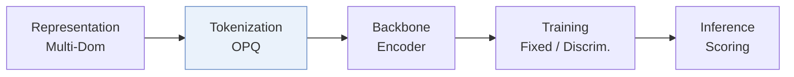
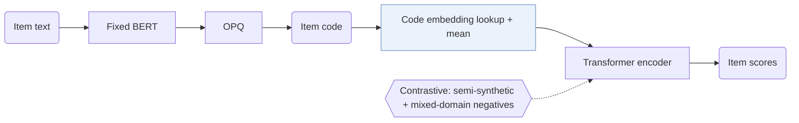
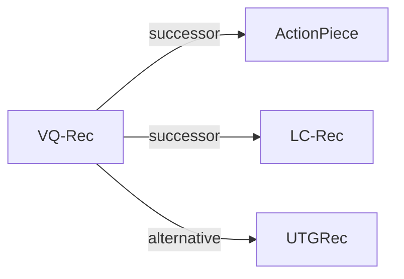

# VQ-Rec

| **Title** | *Learning Vector-Quantized Item Representation for Transferable Sequential Recommenders* |
| :-- | :-- |
| **Authors** | Hou et al. |
| **Venue** | WWW’23 |
| **Problem × Stage** | `VI. Generalization` · `Tokenization` |
| **Links** | [Paper](https://arxiv.org/abs/2210.12316) · [Code](https://github.com/RUCAIBox/VQ-Rec) · [Matrix](../../README.md#vi--tokenization) · [中文](../zh/papers/vq-rec.md) |
| **Reading level** | Reading Notes (Level 2) |

On this page: [TL;DR](#tldr) · [At a Glance](#at-a-glance) · [1. Why It Matters](#1-why-this-paper-matters) · [2. Method](#2-how-it-works) · [3. Experiments](#3-experimental-findings) · [4. Limitations](#4-limitations--critical-analysis) · [5. Related Work](#5-connections-to-related-work)

- `OPQ`: Optimized product quantization.
- `Fixed`: SIDs are built first and not changed while the generator trains.
- `Discrim.`: Scores items; does not generate SIDs.

### TL;DR

> [!NOTE]
> VQ-Rec maps item text to discrete codes and looks up code embeddings as item representations, with contrastive pre-training and cross-domain fine-tuning, to loosen the binding between text and representation.

---

### At a Glance

| Aspect | Summary |
| :-- | :-- |
| Research Problem | VI. Generalization: Does it still work for new items, new domains, and shifting interests? |
| Key Contribution | VQ-Rec maps item text to discrete codes and looks up code embeddings as item representations, with contrastive pre-training and cross-domain fine-tuning, to loosen the binding between text and representation. |
| Modified Stage | Tokenization |

---

### 1. Why This Paper Matters

Transferable recommenders encode item text with a pre-trained language model (PLM) and use the encoding as the item representation (Abstract). The authors argue that this tight binding over-emphasizes text features and enlarges the effect of the domain gap (Abstract, Sec. 4). VQ-Rec inserts discrete codes between text and representation: item text maps to a vector of discrete indices, called an item code, and the code looks up the item representation in an embedding table (Sec. 2.1). VQ-Rec is a discriminative sequential recommender, not a generative one; later Semantic ID (SID) papers reuse its code scheme.

---

### 2. How It Works

#### Text to Code

A fixed BERT encoder embeds item text, and optimized product quantization (OPQ) splits the embedding into subspaces and assigns an index in each subspace independently (Sec. 2.2.1, Eq. 2). The PQ centroids are learned from the text encodings of all training domains.

#### Code to Representation

Each code position has its own code embedding table, and the item representation is the mean of the looked-up embeddings (Sec. 2.2.2, Eq. 3). The code embeddings are separate parameters from the PQ centroids.

#### Contrastive Pre-Training

A Transformer encodes the sequence of item representations (Sec. 2.3.1). The ground-truth next item is the positive. Semi-synthetic negatives replace part of an item's code at random, and mixed-domain negatives are other items in the batch (Sec. 2.3). Pre-training updates the code embeddings and the Transformer; BERT stays fixed and PQ is computed beforehand (Sec. 2.4).

#### Cross-Domain Fine-Tuning

In a new domain, VQ-Rec re-trains the PQ centroids and aligns them to the existing code embeddings with a differentiable permutation network, then fine-tunes the permuted embedding table (Sec. 2.4.1).

> "During fine-tuning, we fix the Transformer sequence encoder (transferred across different domains), and only optimize the parameters involved in item representations, enabling parameter-efficient fine-tuning." (Sec. 2.4)

A new item in a known domain needs no retraining.

> "When a new item emerges, one can encode its item text into discrete indices, and then obtain the corresponding item representations by embedding lookup." (Sec. 2.4.2)

---

### 3. Experimental Findings

Experimental setup

- **Datasets**: Pre-training on five Amazon domains (Food, Home, CDs, Kindle, Movies; 1,361,408 users / 446,975 items); downstream on Amazon Scientific, Pantry, Instruments, Arts, Office and the cross-platform Online Retail dataset. Users and items with fewer than 5 interactions are filtered (following UniSRec); item text truncated to 512 tokens.
  - Source: Pre-training and downstream domains: [S3.SS1.SSS1.p1](https://arxiv.org/html/2210.12316v2#S3.SS1.SSS1.p1); filtering: [S3.SS1.SSS1.p2](https://arxiv.org/html/2210.12316v2#S3.SS1.SSS1.p2); statistics: [S2.T1](https://arxiv.org/html/2210.12316v2#S2.T1).
- **Split**: Leave-one-out: latest item for test, the one before for validation, the rest for training; pre-train on source domains, then fine-tune per downstream dataset.
  - Source: Leave-one-out allocation: [S3.SS1.SSS3.p1](https://arxiv.org/html/2210.12316v2#S3.SS1.SSS3.p1).
- **Candidates**: full catalog (the ground-truth item is ranked among all other items).
  - Source: Ranked among all other items: [S3.SS1.SSS3.p1](https://arxiv.org/html/2210.12316v2#S3.SS1.SSS3.p1).
- **Visibility**: warm; no unseen-item protocol is defined. Figure 4 groups test items by popularity (e.g. [0, 5) interactions on Office), which are low-frequency rather than strictly unseen; the inductive no-retraining claim is not separately tested.
  - Source: Cold-start groups by popularity, inductive capability without a dedicated unseen-item test: [S3.SS4.SSS3.p1](https://arxiv.org/html/2210.12316v2#S3.SS4.SSS3.p1) and [S3.SS2.p3](https://arxiv.org/html/2210.12316v2#S3.SS2.p3).
- **SID**: OPQ codes over item text embeddings, written as (M=32) x (D=256) PQ indices in the implementation; the method section uses D for the number of code sets and M for the centroids per set, so the two notations do not state the same split unambiguously. The paper argues that K-means-trained OPQ tends to give near-uniform code distributions, which keeps collisions low; a rule for items sharing a code: not reported. Downstream domains re-train PQ centroids with a permutation-based code-embedding alignment.
  - Source: (M=32) x (D=256) PQ indices: [S3.SS1.SSS4.p1](https://arxiv.org/html/2210.12316v2#S3.SS1.SSS4.p1); D sets of M centroids in the method: [S2.SS2.SSS1.p3](https://arxiv.org/html/2210.12316v2#S2.SS2.SSS1.p3); uniform code distribution argument: [S2.SS2.SSS3.p1](https://arxiv.org/html/2210.12316v2#S2.SS2.SSS3.p1); domain re-training of centroids: [S2.SS4.SSS1.p2](https://arxiv.org/html/2210.12316v2#S2.SS4.SSS1.p2).
- **Inference budget**: n/a for generation (a Transformer sequence encoder scores items through pooled code embeddings; implemented with Faiss and RecBole). Hardware, inference batch size, and latency: not reported.
  - Source: Discriminative ranking with Faiss and RecBole: [S3.SS1.SSS4.p1](https://arxiv.org/html/2210.12316v2#S3.SS1.SSS4.p1).
- **Results from**: Table 2 (cross-domain and cross-platform comparison with ID, text, and transferable baselines); Table 3 (ablations); Figure 4 (popularity groups).
  - Source: Main: [S3.T2](https://arxiv.org/html/2210.12316v2#S3.T2); ablation: [S3.T3](https://arxiv.org/html/2210.12316v2#S3.T3); cold-start groups: [S3.F4](https://arxiv.org/html/2210.12316v2#S3.F4).

- Main comparison: VQ-Rec is the best or second-best method on each of the six downstream datasets in the cross-domain and cross-platform settings (Table 2).
- Ablation: without fine-tuning the pre-trained model, performance drops sharply, and removing pre-training also lowers results on all tested datasets (Sec. 3.3, Table 3).
- Popularity groups: VQ-Rec performs better than SASRec in every item-popularity group (Sec. 3.4.3, Fig. 4).

  > "VQ-Rec has better performance than SASRec in all groups, especially in cold-start groups." (Sec. 3.4.3)

---

### 4. Limitations & Critical Analysis

**Our analysis.**

- ActionPiece starts from the same kind of `OPQ` codes but merges them into context-dependent tokens and generates them with an `Enc-Dec` generator; VQ-Rec scores items with an `Encoder` (`Scoring`).
- UTGRec also targets multi-domain transfer (`Multi-Dom`) but replaces product quantization with a `Tree` tokenizer and decodes with `Beam`.

---

### 5. Connections to Related Work

- **Successor** · [ActionPiece](actionpiece.md): ActionPiece later follows VQ-Rec in quantizing sentence embeddings with OPQ into unordered codes and merges them into context-dependent tokens for generation.
  - Source: Evidence is from the later ActionPiece paper, Appendix F: https://arxiv.org/html/2502.13581v3#A6.I1.i3.p1; VQ-Rec is a Table 4 baseline: https://arxiv.org/html/2502.13581v3#S3.T4.
- **Successor** · [LC-Rec](lc-rec.md): LC-Rec later borrows VQ-Rec's idea of learned discrete indices for items and builds RQ indices for LLM tuning.
  - Source: Evidence is from the later LC-Rec paper, Section 3.2.1: https://arxiv.org/html/2311.09049v4#S3.SS2.SSS1.p1 and https://arxiv.org/html/2311.09049v4#S3.SS2.SSS1.p4.
- **Alternative** · [UTGRec](utgrec.md): UTGRec later compares against VQ-Rec for cross-domain transfer and replaces PQ codes with a universal tree tokenizer for generative recommendation.
  - Source: Evidence is from the later UTGRec paper: content-based baselines and Table 2: https://arxiv.org/html/2504.04405v3#S3.SS1.SSS2.p11 and https://arxiv.org/html/2504.04405v3#S3.T2.

[View all papers in this cell](../../README.md#vi--tokenization)
