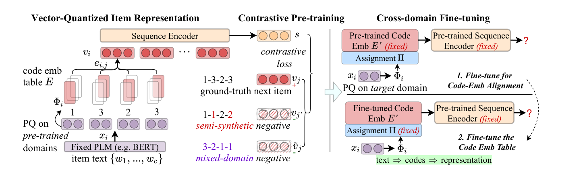

# VQ-Rec

*Learning Vector-Quantized Item Representation for Transferable Sequential Recommenders* — Hou et al., WWW’23

[arXiv](https://arxiv.org/abs/2210.12316) · [Record](../../data/papers/vq-rec.yaml) · [← Catalog](../../README.md#vi--tokenization)

> Abstract: "exaggerating the negative impact of domain gap".

| Problem it fixes | Stage it changes |
| :-- | :-- |
| **VI. Generalization**: Does it still work for new items, new domains, and shifting interests? | **Tokenization** |

## Pipeline

| Representation | Tokenization | Backbone | Training | Inference |
| :-: | :-: | :-: | :-: | :-: |
| `Multi-Dom` | **`OPQ`** | `Encoder` | `Fixed / Discrim.` | `Scoring` |

- `OPQ`: Optimized product quantization.
- `Fixed`: SIDs are built first and not changed while the generator trains.
- `Discrim.`: Scores items; does not generate SIDs.

## Architecture

## Evidence

- **`problem`** (arXiv abstract): Abstract: "exaggerating the negative impact of domain gap".
- **`tokenizer`** (§2.3.2, p4; §2.4, p4–5): Location from the pre-10-26 Training evidence in the appendix.
- **`objective`** (§2.3.2, p4; §2.4, p4–5): Location from the pre-10-26 Training evidence in the appendix.

## 旧卡片说明

迁自 `d61aa6c:papers/vqrec.md`。保留方法说明、实验叙述与局限；本轮只对照现有记录处理明确冲突，未重新逐句核查原论文。分类和规格以页面上方由记录生成的表格为准。

### VQ-Rec：可迁移序列推荐的向量量化物品表示

> VQ-Rec 将物品文本编码为离散 code，再查表获得序列推荐器的物品表示，以提升跨域迁移能力。

### 研究动机与问题定义

传统物品 ID 与具体物品绑定，难以跨域迁移；直接使用文本又会让推荐器表示不稳定。VQ-Rec 关注的是可迁移的物品表示学习，而不是生成式检索。

### TL;DR（核心摘要）

`物品文本 → PLM表示 → 产品量化code → code embedding → 序列编码器评分`

模型用固定 PLM 编码物品文本，再通过优化产品量化得到离散 code，并查表聚合为物品向量。推荐器使用该向量进行对比预训练和跨域微调，最终通过全物品评分排序，而非生成完整 SID。

### 输入与使用场景

| 方面 | 说明 |
|---|---|
| 使用信息 | 物品文本、用户交互和跨域数据 |
| 信息融入位置 | 物品表示和序列编码器输入 |
| 语义标识结构 | 多维离散 code 向量 |
| 适用场景 | 可迁移序列推荐 |

### 方法设计

#### 2.1 向量量化物品表示
VQ-Rec 先用固定 BERT/PLM 把物品文本编码为向量，再用优化产品量化将向量拆分成多个离散 code。每个 code 维度有独立 codebook，多个 code 的 embedding 查表后平均得到物品表示。

#### 2.2 对比式推荐器预训练
模型构造真实下一物品、半合成负样本和混合域负样本，训练序列编码器区分它们。code embedding 表在该阶段学习，使离散表示能承载可迁移协同关系。

#### 2.3 跨域推荐器微调
迁移到目标域时，论文分别微调 code 与序列推荐器。文本到 code 的映射可在新物品上重新分配，推荐器则使用共享 code embedding 适应目标域。

#### 2.4 讨论与范围
VQ-Rec 最终通过序列编码器对物品进行全物品评分，而不是自回归生成完整 SID。因此它是语义/量化表示学习相关方法。

### 实验结论

- 量化 code 表示改善了跨域序列推荐和冷启动物品表现。
- 对比预训练与跨域微调均有作用。

### 局限性与研究定位

#### 局限性
- 不属于直接生成完整 SID 的生成式推荐方法。
- 全物品评分需要维护物品表示并进行候选计算。

#### 研究定位
VQ-Rec 适合放在“语义标识生成式推荐的前置表示学习与相关工作”章节。

### 相关资源

- [论文原文](https://arxiv.org/abs/2210.12316)

### 标签

`向量量化` · `可迁移推荐` · `产品量化` · `序列推荐`

### 架构图来源

*图源：原论文，图1（[论文原文](https://arxiv.org/abs/2210.12316)）。图片使用许可待核实。*

---

### 检索方式补充

迁自 `d61aa6c:tables/boundary-and-excluded-methods.md` 的机制说明。

量化 code 仅作为序列推荐器表示，最终依赖全物品评分。

旧表的“核心／边界／排除”分组已由当前问题与阶段分类取代。

## Same cell: VI × Tokenization (8 more)

| Paper | Venue | Pipeline |
| :-- | :-- | :-- |
| [GMC](gmc.md) | arXiv’25 | `Cross-Dom` → **`Unified RQ`** → `Enc-Dec` → `Fixed / NTP` → `C-Beam` |
| [UTGRec](utgrec.md) | arXiv’25 | `Multi-Dom` → **`Tree`** → `Enc-Dec` → `Fixed / NTP` → `Beam` |
| [DACT](dact.md) | SIGIR’26 | `Text+CF` → **`RQ-VAE`** → `Enc-Dec / Dec-Only` → `Fixed / NTP` → `–` |
| [DREAM](dream.md) | arXiv’26 | `Text+CF` → **`CART`** → `Dec-Only` → `Altern. / NTP + Aux.` → `C-Beam` |
| [GenCDR](gencdr.md) | AAAI’26 | `Cross-Dom` → **`RQ+LoRA`** → `Dec-Only` → `Fixed / NTP` → `C-Beam` |
| [MBGR](mbgr.md) | arXiv’26 | `Text+CF` → **`RQ`** → `Dec-Only` → `Fixed† / NTP + Aux.` → `C-Beam` |
| [OneLive](onelive.md) | KDD’26 ADS | `Text+Img+Audio+CF` → **`R-KM`** → `Lazy Dec-Only` → `Fixed / NTP → RL` → `Beam` |
| [UniTok](unitok.md) | AAAI’26 | `Multi-Dom` → **`TokenMoE`** → `Enc-Dec` → `Fixed / NTP` → `Beam†` |
