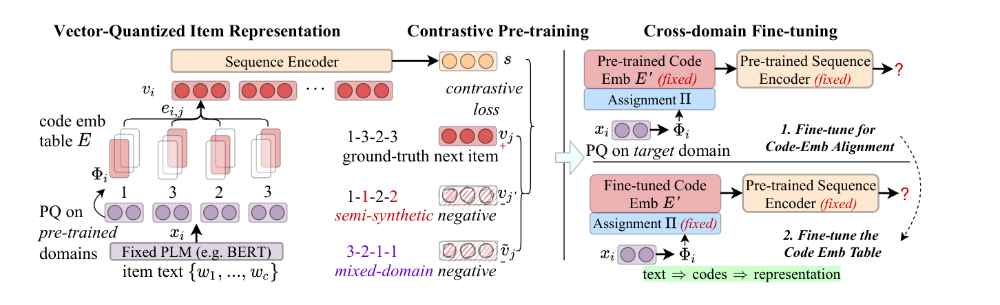

# VQ-Rec

*Learning Vector-Quantized Item Representation for Transferable Sequential Recommenders* — Hou et al. · WWW’23

`VI. Generalization` · `Tokenization`

[Paper](https://arxiv.org/abs/2210.12316) · [Code](https://github.com/RUCAIBox/VQ-Rec) · [Matrix](../../README.md#vi--tokenization)

Reading level: Overview (Level 1) · On this page: [At a Glance](#at-a-glance) · [2. How It Works](#2-how-it-works) · [3. Experimental Findings](#3-experimental-findings) · [5. Connections to Related Work](#5-connections-to-related-work)

| Representation | Tokenization | Backbone | Training | Inference |
| :-: | :-: | :-: | :-: | :-: |
| `Multi-Dom` | **`OPQ`** | `Encoder` | `Fixed / Discrim.` | `Scoring` |

- `OPQ`: Optimized product quantization.
- `Fixed`: SIDs are built first and not changed while the generator trains.
- `Discrim.`: Scores items; does not generate SIDs.

### At a Glance

| Aspect | Summary |
| :-- | :-- |
| Research Problem | VI. Generalization: Does it still work for new items, new domains, and shifting interests? |
| Modified Stage | Tokenization |

### 2. How It Works

### 3. Experimental Findings

**Experimental setup**

- **Datasets**: Pre-training on five Amazon domains (Food, Home, CDs, Kindle, Movies; 1,361,408 users / 446,975 items); downstream on Amazon Scientific, Pantry, Instruments, Arts, Office and the cross-platform Online Retail dataset. Users and items with fewer than 5 interactions are filtered (following UniSRec); item text truncated to 512 tokens.
  - Source: Pre-training and downstream domains: https://arxiv.org/html/2210.12316v2#S3.SS1.SSS1.p1; filtering: https://arxiv.org/html/2210.12316v2#S3.SS1.SSS1.p2; statistics: https://arxiv.org/html/2210.12316v2#S2.T1.
- **Split**: Leave-one-out: latest item for test, the one before for validation, the rest for training; pre-train on source domains, then fine-tune per downstream dataset.
  - Source: Leave-one-out allocation: https://arxiv.org/html/2210.12316v2#S3.SS1.SSS3.p1.
- **Candidates**: full catalog (the ground-truth item is ranked among all other items).
  - Source: Ranked among all other items: https://arxiv.org/html/2210.12316v2#S3.SS1.SSS3.p1.
- **Visibility**: warm; no unseen-item protocol is defined. Figure 4 groups test items by popularity (e.g. [0, 5) interactions on Office), which are low-frequency rather than strictly unseen; the inductive no-retraining claim is not separately tested.
  - Source: Cold-start groups by popularity, inductive capability without a dedicated unseen-item test: https://arxiv.org/html/2210.12316v2#S3.SS4.SSS3.p1 and https://arxiv.org/html/2210.12316v2#S3.SS2.p3.
- **SID**: OPQ codes over item text embeddings, written as (M=32) x (D=256) PQ indices in the implementation; the method section uses D for the number of code sets and M for the centroids per set, so the two notations do not state the same split unambiguously. The paper argues that K-means-trained OPQ tends to give near-uniform code distributions, which keeps collisions low; a rule for items sharing a code: not reported. Downstream domains re-train PQ centroids with a permutation-based code-embedding alignment.
  - Source: (M=32) x (D=256) PQ indices: https://arxiv.org/html/2210.12316v2#S3.SS1.SSS4.p1; D sets of M centroids in the method: https://arxiv.org/html/2210.12316v2#S2.SS2.SSS1.p3; uniform code distribution argument: https://arxiv.org/html/2210.12316v2#S2.SS2.SSS3.p1; domain re-training of centroids: https://arxiv.org/html/2210.12316v2#S2.SS4.SSS1.p2.
- **Inference budget**: n/a for generation (a Transformer sequence encoder scores items through pooled code embeddings; implemented with Faiss and RecBole). Hardware, inference batch size, and latency: not reported.
  - Source: Discriminative ranking with Faiss and RecBole: https://arxiv.org/html/2210.12316v2#S3.SS1.SSS4.p1.
- **Results from**: Table 2 (cross-domain and cross-platform comparison with ID, text, and transferable baselines); Table 3 (ablations); Figure 4 (popularity groups).
  - Source: Main: https://arxiv.org/html/2210.12316v2#S3.T2; ablation: https://arxiv.org/html/2210.12316v2#S3.T3; cold-start groups: https://arxiv.org/html/2210.12316v2#S3.F4.

## 旧卡片说明

迁自 `d61aa6c:papers/vqrec.md`。保留方法说明、实验叙述与局限；本轮只对照现有记录处理明确冲突，未重新逐句核查原论文。分类和规格以页面上方由记录生成的表格为准。

### VQ-Rec：可迁移序列推荐的向量量化物品表示

> VQ-Rec 将物品文本编码为离散 code，再查表获得序列推荐器的物品表示，以提升跨域迁移能力。

### 研究动机与问题定义

传统物品 ID 与具体物品绑定，难以跨域迁移；直接使用文本又会让推荐器表示不稳定。VQ-Rec 关注的是可迁移的物品表示学习，而不是生成式检索。

### TL;DR（核心摘要）

`物品文本 → PLM表示 → 产品量化code → code embedding → 序列编码器评分`

模型用固定 PLM 编码物品文本，再通过优化产品量化得到离散 code，并查表聚合为物品向量。推荐器使用该向量进行对比预训练和跨域微调，最终通过全物品评分排序，而非生成完整 SID。

### 输入与使用场景

| 方面 | 说明 |
|---|---|
| 使用信息 | 物品文本、用户交互和跨域数据 |
| 信息融入位置 | 物品表示和序列编码器输入 |
| 语义标识结构 | 多维离散 code 向量 |
| 适用场景 | 可迁移序列推荐 |

### 方法设计

#### 2.1 向量量化物品表示
VQ-Rec 先用固定 BERT/PLM 把物品文本编码为向量，再用优化产品量化将向量拆分成多个离散 code。每个 code 维度有独立 codebook，多个 code 的 embedding 查表后平均得到物品表示。

#### 2.2 对比式推荐器预训练
模型构造真实下一物品、半合成负样本和混合域负样本，训练序列编码器区分它们。code embedding 表在该阶段学习，使离散表示能承载可迁移协同关系。

#### 2.3 跨域推荐器微调
迁移到目标域时，论文分别微调 code 与序列推荐器。文本到 code 的映射可在新物品上重新分配，推荐器则使用共享 code embedding 适应目标域。

#### 2.4 讨论与范围
VQ-Rec 最终通过序列编码器对物品进行全物品评分，而不是自回归生成完整 SID。因此它是语义/量化表示学习相关方法。

### 实验结论

- 量化 code 表示改善了跨域序列推荐和冷启动物品表现。
- 对比预训练与跨域微调均有作用。

### 局限性与研究定位

#### 局限性
- 不属于直接生成完整 SID 的生成式推荐方法。
- 全物品评分需要维护物品表示并进行候选计算。

#### 研究定位
VQ-Rec 适合放在“语义标识生成式推荐的前置表示学习与相关工作”章节。

### 相关资源

- [论文原文](https://arxiv.org/abs/2210.12316)

### 标签

`向量量化` · `可迁移推荐` · `产品量化` · `序列推荐`

### 架构图来源

*图源：原论文，图1（[论文原文](https://arxiv.org/abs/2210.12316)）。图片使用许可待核实。*

---

### 检索方式补充

迁自 `d61aa6c:tables/boundary-and-excluded-methods.md` 的机制说明。

量化 code 仅作为序列推荐器表示，最终依赖全物品评分。

旧表的“核心／边界／排除”分组已由当前问题与阶段分类取代。

### 5. Connections to Related Work

- **Successor** · [ActionPiece](actionpiece.md): ActionPiece later follows VQ-Rec in quantizing sentence embeddings with OPQ into unordered codes and merges them into context-dependent tokens for generation.
  - Source: Evidence is from the later ActionPiece paper, Appendix F: https://arxiv.org/html/2502.13581v3#A6.I1.i3.p1; VQ-Rec is a Table 4 baseline: https://arxiv.org/html/2502.13581v3#S3.T4.
- **Successor** · [LC-Rec](lc-rec.md): LC-Rec later borrows VQ-Rec's idea of learned discrete indices for items and builds RQ indices for LLM tuning.
  - Source: Evidence is from the later LC-Rec paper, Section 3.2.1: https://arxiv.org/html/2311.09049v4#S3.SS2.SSS1.p1 and https://arxiv.org/html/2311.09049v4#S3.SS2.SSS1.p4.
- **Alternative** · [UTGRec](utgrec.md): UTGRec later compares against VQ-Rec for cross-domain transfer and replaces PQ codes with a universal tree tokenizer for generative recommendation.
  - Source: Evidence is from the later UTGRec paper: content-based baselines and Table 2: https://arxiv.org/html/2504.04405v3#S3.SS1.SSS2.p11 and https://arxiv.org/html/2504.04405v3#S3.T2.

[View all papers in this cell](../../README.md#vi--tokenization)
