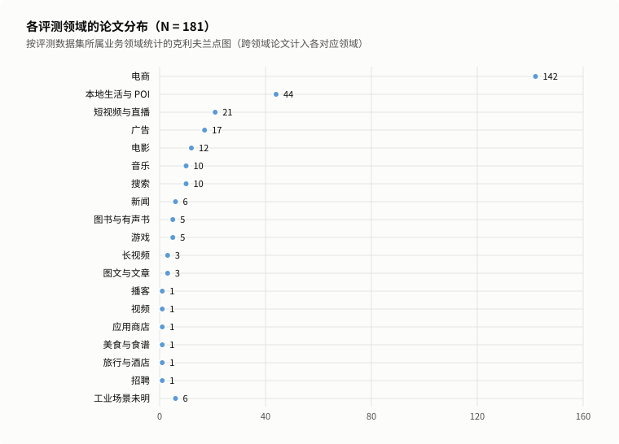

# 按领域找论文

[← README](../../../README.zh.md#按领域找论文) · [English](../../index/domain.md) | 中文

本页按实验数据集所属的业务领域分组列出论文；涉及多个领域的论文同时列入各对应小节。下图按论文数从多到少展示各领域的收录规模：

数据

| 领域 | 类别 | 论文数 |
| :--- | :--- | :--- |
| 电商 | 电商与本地服务 | 142 |
| 本地生活与 POI | 电商与本地服务 | 44 |
| 短视频与直播 | 视频与数字内容 | 21 |
| 广告 | 平台服务与工业其他 | 17 |
| 电影 | 视频与数字内容 | 12 |
| 音乐 | 视频与数字内容 | 10 |
| 搜索 | 平台服务与工业其他 | 10 |
| 新闻 | 资讯、阅读与图文 | 6 |
| 图书与有声书 | 资讯、阅读与图文 | 5 |
| 游戏 | 视频与数字内容 | 5 |
| 长视频 | 视频与数字内容 | 3 |
| 图文与文章 | 资讯、阅读与图文 | 3 |
| 播客 | 视频与数字内容 | 1 |
| 视频 | 视频与数字内容 | 1 |
| 应用商店 | 平台服务与工业其他 | 1 |
| 美食与食谱 | 电商与本地服务 | 1 |
| 旅行与酒店 | 电商与本地服务 | 1 |
| 招聘 | 平台服务与工业其他 | 1 |
| 工业场景未明 | 平台服务与工业其他 | 6 |

点击下表中的领域名称可直接跳到对应小节：

| 类别 | 领域 |
| :--- | :--- |
| **电商与本地服务** | [电商（142）](#电商) · [本地生活与 POI（44）](#本地生活与-poi) · [美食与食谱（1）](#美食与食谱) · [旅行与酒店（1）](#旅行与酒店) |
| **视频与数字内容** | [短视频与直播（21）](#短视频与直播) · [电影（12）](#电影) · [音乐（10）](#音乐) · [游戏（5）](#游戏) · [长视频（3）](#长视频) · [播客（1）](#播客) · [视频（1）](#视频) |
| **资讯、阅读与图文** | [新闻（6）](#新闻) · [图书与有声书（5）](#图书与有声书) · [图文与文章（3）](#图文与文章) |
| **平台服务与工业其他** | [广告（17）](#广告) · [搜索（10）](#搜索) · [应用商店（1）](#应用商店) · [招聘（1）](#招聘) · [工业场景未明（6）](#工业场景未明) |

## 电商

> 共 142 篇。电商商品推荐（含 Amazon 各评测子集、淘宝、京东等）。

| 论文 | 发表 | 问题 × 阶段 | 领域 | 构码输入 |
| :--- | :--- | :--- | :--- | :--- |
| [CID](../papers/cid.md) | SIGIR-AP’23 | II × Tokenization | `电商` · `本地生活与 POI` | `CF` |
| [TIGER](../papers/tiger.md) | NeurIPS’23 | 范式、系统与基准 | `电商` | `Text` |
| [VQ-Rec](../papers/vq-rec.md) | WWW’23 | VI × Tokenization | `电商` | `Text` |
| [ColaRec](../papers/colarec.md) | CIKM’24 | I × Backbone | `电商` · `美食与食谱` | `CF` |
| [CoST](../papers/cost.md) | RecSys’24 | I × Tokenization | `新闻` · `电商` | `Text` |
| [EAGER](../papers/eager.md) | KDD’24 | I × Backbone | `电商` · `本地生活与 POI` | semantic: `Text` · behavior: `CF` |
| [IDGenRec](../papers/idgenrec.md) | SIGIR’24 | III × Tokenization | `电商` · `本地生活与 POI` | `Text` |
| [LC-Rec](../papers/lc-rec.md) | ICDE’24 | III × Training | `电商` | `Text` |
| [LETTER](../papers/letter.md) | CIKM’24 | I × Tokenization | `电商` · `本地生活与 POI` | `Text` + `CF` |
| [LIGER](../papers/liger.md) | arXiv’24 | VI × Inference | `电商` · `游戏` | `Text` |
| [LMIndexer](../papers/lmindexer.md) | ICML’24 | I × Tokenization | `电商` · `搜索` | `Text` |
| [MBGen](../papers/mbgen.md) | CIKM’24 | I × Training | `电商` | `CF` |
| [Molar](../papers/molar.md) | arXiv’24 | I × Representation | `电商` · `电影` · `短视频与直播` | `n/a` |
| [SEATER](../papers/seater.md) | SIGIR-AP’24 | V × Tokenization | `本地生活与 POI` · `电商` · `新闻` · `短视频与直播` | `CF` |
| [SIIT](../papers/siit.md) | arXiv’24 | III × Tokenization | `电商` · `本地生活与 POI` | `Text` |
| [TransRec](../papers/transrec.md) | KDD’24 | II × Tokenization | `电商` · `本地生活与 POI` | id: – · title: `Text` · attribute: `Text` |
| [ActionPiece](../papers/actionpiece.md) | ICML’25 | I × Tokenization | `电商` | `Text` |
| [ADC-SID](../papers/adc-sid.md) | arXiv’25 | I × Tokenization | `电商` · `广告` | `Text` + `Img` + `CF` |
| [AtSpeed](../papers/atspeed.md) | ICLR’25 | V × Inference | `电商` · `电影` · `图书与有声书` | `Text` |
| [COBRA](../papers/cobra.md) | NeurIPS’25 | I × Backbone | `电商` · `广告` | `Text` |
| [DiscRec](../papers/discrec.md) | arXiv’25 | I × Backbone | `电商` | A: `Text` · B: `Text` + `CF` |
| [EAGER-LLM](../papers/eager-llm.md) | WWW’25 | I × Tokenization | `电商` | semantic: `Text` · behavior: `CF` |
| [ETEGRec](../papers/etegrec.md) | SIGIR’25 | III × Training | `电商` | `CF` |
| [FlexCode](../papers/flexcode.md) | arXiv’25 | I × Tokenization | `电商` · `短视频与直播` · `工业场景未明` | semantic: `Text` + `CF` · collaborative: `CF` |
| [FORGE](../papers/forge.md) | KDD’26 | 范式、系统与基准 | `电商` · `搜索` | `Text` + `Img` + `CF` |
| [GenSAR](../papers/gensar.md) | RecSys’25 | I × Tokenization | `电商` · `搜索` | semantic: `Text` + `CF` · collaborative: `Text` + `CF` |
| [GMC](../papers/gmc.md) | arXiv’25 | VI × Tokenization | `电商` | `Text` |
| [GRAM](../papers/gram.md) | ACL’25 | I × Tokenization | `电商` · `本地生活与 POI` | `Text` |
| [GREAM](../papers/gream.md) | arXiv’25 | III × Training | `电商` | `Text` |
| [GRID](../papers/grid.md) | CIKM’25 | 范式、系统与基准 | `电商` | `Text` |
| [HiD-VAE](../papers/hid-vae.md) | arXiv’25 | II × Tokenization | `电商` · `短视频与直播` | `Text` + `Attr` |
| [LLaDA-Rec](../papers/llada-rec.md) | arXiv’25 | III × Backbone | `电商` | `Text` |
| [MiniOneRec](../papers/minionerec.md) | arXiv’25 | 范式、系统与基准 | `电商` | `Text` |
| [MME-SID](../papers/mme-sid.md) | CIKM’25 | I × Tokenization | `电商` | collaborative: `CF` · text: `Text` · visual: `Img` |
| [MQL4GRec](../papers/mql4grec.md) | ICLR’25 | I × Tokenization | `电商` | text: `Text` · image: `Img` |
| [OneRec-Think](../papers/onerec-think.md) | arXiv’25 | III × Training | `电商` · `短视频与直播` | `MM` + `CF` |
| [PSI](../papers/psi.md) | arXiv’25 | II × Tokenization | `电商` · `搜索` | `Text` |
| [PSRQ](../papers/psrq.md) | CIKM’25 | I × Tokenization | `电商` · `音乐` | text: `Text` · image: `Img` · audio: `Audio` · joint_Amazon: `Text` + `Img` · joint_Music: `Text` + `Audio` |
| [Q-BERT4Rec](../papers/q-bert4rec.md) | arXiv’25 | I × Representation | `电商` | `Text` + `Img` |
| [RecBase](../papers/recbase.md) | EMNLP’25 | VI × Training | `新闻` · `电影` · `短视频与直播` · `图书与有声书` · `本地生活与 POI` · `游戏` · `电商` · `旅行与酒店` | `Text` |
| [RPG](../papers/rpg.md) | KDD’25 | V × Backbone | `电商` | `Text` |
| [SemConv](../papers/semconv.md) | AAAI’25 | III × Tokenization | `电商` | `Text` + `CF` |
| [TokenRec](../papers/tokenrec.md) | TKDE’25 | I × Tokenization | `音乐` · `电影` · `电商` | `CF` |
| [UNGER](../papers/unger.md) | TOIS’25 | I × Representation | `电商` | `Text` + `CF` |
| [UTGRec](../papers/utgrec.md) | arXiv’25 | VI × Tokenization | `电商` | `Text` + `Img` + `CF` |
| [ACERec](../papers/acerec.md) | arXiv’26 | V × Backbone | `电商` | `Text` |
| [AdaSID](../papers/adasid.md) | arXiv’26 | II × Tokenization | `电商` | `Text` + `Img` + `CF` |
| [Align3GR](../papers/align3gr.md) | AAAI’26 | III × Tokenization | `电商` · `本地生活与 POI` · `广告` | `Text` + `CF` |
| [APAO](../papers/apao.md) | KDD’26 | IV × Training | `电商` · `本地生活与 POI` | `Text` |
| [API](../papers/api.md) | arXiv’26 | II × Tokenization | `电商` | `Text` |
| [CAPE](../papers/cape.md) | arXiv’26 | I × Inference | `电商` · `音乐` | `Text` |
| [CapsID](../papers/capsid.md) | arXiv’26 | I × Tokenization | `电商` · `工业场景未明` | A: `unknown` · B: `Text` + `Img` + `CF` |
| [CARD](../papers/card.md) | arXiv’26 | II × Tokenization | `电商` | `Text` + `Img` + `CF` |
| [ChronoID](../papers/chronoid.md) | arXiv’26 | I × Tokenization | `电商` | `Text` + `Time` |
| [CITE](../papers/cite.md) | Electronics’26 | I × Inference | `电商` · `本地生活与 POI` | `Text` |
| [CMRec](../papers/cmrec.md) | CIKM’26 Short | VI × Training | `广告` · `电商` | `Text` + `Img` + `CF` |
| [CogRec](../papers/cogrec.md) | arXiv’26 | III × Tokenization | `电商` | `Text` |
| [DACT](../papers/dact.md) | SIGIR’26 | VI × Tokenization | `电商` | `Text` + `CF` |
| [DASO](../papers/daso.md) | arXiv’26 | IV × Training | `电商` · `工业场景未明` | `Text` + `unknown` |
| [Deco](../papers/deco.md) | arXiv’26 | V × Backbone | `电商` · `电影` · `音乐` | A: `Text` · B: `unknown` |
| [DECOR](../papers/decor.md) | SIGIR’26 | III × Backbone | `电商` | `Text` |
| [DIGER](../papers/diger.md) | SIGIR’26 | II × Tokenization | `电商` · `本地生活与 POI` | `Text` |
| [DiGR](../papers/digr.md) | arXiv’26 | IV × Backbone | `电商` | `unknown` |
| [DPE-Rec](../papers/dpe-rec.md) | arXiv’26 | IV × Training | `音乐` · `电商` | A: `unknown` · B: `Text` + `Img` |
| [DREAM](../papers/dream.md) | arXiv’26 | VI × Tokenization | `电商` | `Text` + `CF` |
| [Dynamic-Single-Codebook](../papers/dynamic-single-codebook.md) | arXiv’26 | V × Tokenization | `电商` · `短视频与直播` · `工业场景未明` | `unknown` |
| [Evo-Rec](../papers/evo-rec.md) | arXiv’26 | III × Training | `电商` | `Text` |
| [FedCGR](../papers/fedcgr.md) | CIKM’26 | VI × Backbone | `电商` | `Text` |
| [FLASH](../papers/flash.md) | NeurIPS’26 | III × Backbone | `电商` | `Text` |
| [GEM-Rec](../papers/gem-rec.md) | arXiv’26 | IV × Training | `游戏` · `电商` · `广告` | `Text` |
| [GenCDR](../papers/gencdr.md) | AAAI’26 | VI × Tokenization | `电商` · `图书与有声书` · `电影` | `Text` + `unknown` |
| [GenRec-JD](../papers/genrec-jd.md) | SIGIR’26 | IV × Training | `电商` | `Text` + `Img` + `CF` |
| [GFlowGR](../papers/gflowgr.md) | SIGIR’26 | IV × Training | `本地生活与 POI` · `电商` · `广告` · `搜索` | A: `Text` · B: `Text` + `CF` |
| [Ghost](../papers/ghost.md) | NeurIPS’26 | IV × Training | `电商` | `Text` |
| [GR-Generalize](../papers/gr-generalize.md) | arXiv’26 | 范式、系统与基准 | `电商` · `游戏` · `本地生活与 POI` | `Text` |
| [GRC](../papers/grc.md) | CIKM’26 | III × Inference | `电商` · `广告` | `Text` |
| [GrIS (RecDMoN / RQ-GAE)](../papers/gris-recdmon-rq-gae.md) | CIKM’26 | I × Tokenization | `电商` · `新闻` · `本地生活与 POI` | `Text` + `CF` |
| [GRLM](../papers/grlm.md) | arXiv’26 | III × Tokenization | `电商` | `Text` |
| [GTI](../papers/gti.md) | arXiv’26 | III × Training | `招聘` · `电商` | A: `Text` + `CF` · B: `Text` |
| [HASTE](../papers/haste.md) | arXiv’26 | IV × Training | `电商` | A: `Text` · B: `MM` |
| [HCGRec](../papers/hcgrec.md) | CIKM’26 | IV × Training | `电商` | `unknown` |
| [HoloRec](../papers/holorec.md) | arXiv’26 | III × Tokenization | `电商` | `unknown` |
| [IBA](../papers/iba.md) | arXiv’26 | V × Backbone | `电商` · `短视频与直播` | `Text` |
| [IDM/CMM](../papers/idm-cmm.md) | arXiv’26 | IV × Training | `电商` | `Text` |
| [ISD](../papers/isd.md) | arXiv’26 | IV × Inference | `电商` | `Text` |
| [JevRec](../papers/jevrec.md) | arXiv’26 | V × Tokenization | `电商` | `Text` |
| [KL-MOPD](../papers/kl-mopd.md) | arXiv’26 | IV × Training | `电商` · `广告` | `CF` |
| [Latte](../papers/latte.md) | arXiv’26 | III × Backbone | `电商` · `音乐` | `unknown` |
| [LESSRec](../papers/lessrec.md) | arXiv’26 | III × Backbone | `电商` | A: `Text` · B: `Text` + `CF` |
| [LION](../papers/lion.md) | CIKM’26 | VI × Backbone | `电商` | `Text` |
| [LoopGR](../papers/loopgr.md) | arXiv’26 | V × Backbone | `电商` · `工业场景未明` | `Text` |
| [MACRec](../papers/macrec.md) | AAAI’26 | I × Tokenization | `电商` | text: `Text` · image: `Img` |
| [MDGR](../papers/mdgr.md) | arXiv’26 | III × Backbone | `电商` | `Text` |
| [Merge-and-Branch](../papers/merge-and-branch.md) | arXiv’26 | V × Backbone | `电商` | `Text` |
| [MMQ](../papers/mmq.md) | WSDM’26 | I × Tokenization | `电商` · `广告` | `Text` + `Img` |
| [MSCGRec](../papers/mscgrec.md) | arXiv’26 | I × Tokenization | `电商` · `短视频与直播` | image: `Img` · text: `Text` · collaborative: `CF` |
| [MuSID-KD](../papers/musid-kd.md) | arXiv’26 | IV × Training | `电商` · `游戏` | `unknown` |
| [NAU](../papers/nau.md) | arXiv’26 | IV × Training | `电商` | `unknown` |
| [NEZHA](../papers/nezha.md) | WWW’26 Industry | V × Inference | `电商` · `本地生活与 POI` · `广告` · `搜索` | `Text` |
| [OneChord](../papers/onechord.md) | arXiv’26 | IV × Training | `电商` | `unknown` |
| [OneMall](../papers/onemall.md) | CIKM’26 | 范式、系统与基准 | `电商` | A: `Text` + `Img` + `CF` · B: `Text` + `Img` + `CF` · C: `CF` + `unknown` |
| [PAD-Rec](../papers/pad-rec.md) | arXiv’26 | V × Inference | `电商` · `本地生活与 POI` | `Text` + `CF` |
| [Pctx](../papers/pctx.md) | CIKM’26 | I × Tokenization | `电商` | `Text` + `CF` |
| [PFA](../papers/pfa.md) | arXiv’26 | V × Inference | `电商` · `广告` | `unknown` |
| [PROMISE](../papers/promise.md) | arXiv’26 | III × Inference | `电商` · `短视频与直播` | `Text` |
| [QuaSID](../papers/quasid.md) | KDD’26 ADS | II × Tokenization | `电商` | `Text` + `Img` + `CF` |
| [R3-VAE](../papers/r3-vae.md) | arXiv’26 | II × Tokenization | `电商` · `音乐` · `电影` · `新闻` | `Text` |
| [RAGR](../papers/ragr.md) | arXiv’26 | I × Training | `电商` | item: `Text` · review: `Text` |
| [RecoChain](../papers/recochain.md) | arXiv’26 | IV × Backbone | `电商` | `MM` |
| [REGER](../papers/reger.md) | arXiv’26 | I × Training | `电商` | `Text` |
| [ReSID](../papers/resid.md) | arXiv’26 | I × Representation | `电商` | `Attr` + `CF` |
| [Retrieval-Grounded-Credit](../papers/retrieval-grounded-credit.md) | arXiv’26 | IV × Training | `电商` | `Text` |
| [RoFiGR](../papers/rofigr.md) | arXiv’26 | I × Tokenization | `电商` | text: `Text` + `Img` + `CF` · image: `Text` + `Img` + `CF` |
| [S2GR](../papers/s2gr.md) | KDD’26 | III × Backbone | `电商` · `短视频与直播` | `Text` + `CF` |
| [SAGE-SID](../papers/sage-sid.md) | arXiv’26 | IV × Training | `电商` · `短视频与直播` · `广告` | `Text` + `Img` |
| [SAHL](../papers/sahl.md) | arXiv’26 | IV × Training | `电商` | `Text` |
| [SAPO](../papers/sapo.md) | arXiv’26 | IV × Training | `电商` | `Text` |
| [SCRec](../papers/screc.md) | RecSys’26 | I × Representation | `电商` | `Text` + `CF` |
| [SID-MLP](../papers/sid-mlp.md) | arXiv’26 | V × Backbone | `电商` | `Text` |
| [SIDReasoner](../papers/sidreasoner.md) | KDD’26 | III × Training | `电商` | `Text` |
| [SIDScope](../papers/sidscope.md) | arXiv’26 | 范式、系统与基准 | `电商` · `本地生活与 POI` | `unknown` |
| [SLIDE](../papers/slide.md) | arXiv’26 | IV × Training | `电商` · `搜索` | `unknown` |
| [SpecGR](../papers/specgr.md) | AAAI’26 | VI × Inference | `电商` | `Text` |
| [SPRINT](../papers/sprint.md) | arXiv’26 | V × Backbone | `电商` · `本地生活与 POI` | `Text` |
| [SST](../papers/sst.md) | CIKM’26 | III × Tokenization | `电商` · `本地生活与 POI` | `Text` |
| [STAMP](../papers/stamp.md) | arXiv’26 | V × Backbone | `电商` | A: `Text` · B: `Text` + `Img` + `unknown` |
| [STATIC](../papers/static.md) | KDD’26 ADS | V × Inference | `电商` · `视频` | `unknown` |
| [SynGR](../papers/syngr.md) | ICML’26 | I × Training | `电商` | text: `Text` · image: `Img` |
| [TCBSA](../papers/tcbsa.md) | arXiv’26 | IV × Inference | `电商` · `本地生活与 POI` | `Text` |
| [Tlow](../papers/tlow.md) | CIKM’26 Applied | I × Tokenization | `电商` · `图文与文章` | A: `Text` · B: `Text` + `Img` |
| [Token-Weighted](../papers/token-weighted.md) | CIKM’26 | IV × Training | `电商` · `本地生活与 POI` · `电影` | `Text` |
| [TopoGR](../papers/topogr.md) | arXiv’26 | III × Tokenization | `电商` | `Text` |
| [TRACER](../papers/tracer.md) | NeurIPS’26 | IV × Tokenization | `电商` | `Text` |
| [TriAlignGR](../papers/trialigngr.md) | arXiv’26 | I × Representation | `电商` | `Text` + `Img` |
| [TrieRec](../papers/trierec.md) | NeurIPS’26 | III × Backbone | `电商` · `电影` | `Text` |
| [UGR](../papers/ugr.md) | KDD’26 | IV × Training | `电商` · `本地生活与 POI` | `Text` |
| [UniRec](../papers/unirec.md) | arXiv’26 | I × Tokenization | `电商` | `MM` + `Attr` |
| [UniSGR-V2](../papers/unisgr-v2.md) | arXiv’26 | I × Backbone | `电商` | `unknown` |
| [UniSID](../papers/unisid.md) | arXiv’26 | I × Tokenization | `广告` · `电商` | `Text` + `Img` |
| [UniTok](../papers/unitok.md) | AAAI’26 | VI × Tokenization | `电商` · `本地生活与 POI` | `Text` |
| [V-STAR](../papers/v-star.md) | KDD’26 | IV × Training | `电商` · `广告` | `unknown` |
| [VarLenRec (TIGER)](../papers/varlenrec-tiger.md) | arXiv’26 | I × Tokenization | `电商` · `本地生活与 POI` | `Text` |

## 本地生活与 POI

> 共 44 篇。兴趣点（POI）、签到与本地生活服务推荐（含 Yelp、Gowalla、Foursquare 等）。

| 论文 | 发表 | 问题 × 阶段 | 领域 | 构码输入 |
| :--- | :--- | :--- | :--- | :--- |
| [CID](../papers/cid.md) | SIGIR-AP’23 | II × Tokenization | `电商` · `本地生活与 POI` | `CF` |
| [EAGER](../papers/eager.md) | KDD’24 | I × Backbone | `电商` · `本地生活与 POI` | semantic: `Text` · behavior: `CF` |
| [IDGenRec](../papers/idgenrec.md) | SIGIR’24 | III × Tokenization | `电商` · `本地生活与 POI` | `Text` |
| [LETTER](../papers/letter.md) | CIKM’24 | I × Tokenization | `电商` · `本地生活与 POI` | `Text` + `CF` |
| [SEATER](../papers/seater.md) | SIGIR-AP’24 | V × Tokenization | `本地生活与 POI` · `电商` · `新闻` · `短视频与直播` | `CF` |
| [SIIT](../papers/siit.md) | arXiv’24 | III × Tokenization | `电商` · `本地生活与 POI` | `Text` |
| [TransRec](../papers/transrec.md) | KDD’24 | II × Tokenization | `电商` · `本地生活与 POI` | id: – · title: `Text` · attribute: `Text` |
| [GNPR-SID](../papers/gnpr-sid.md) | KDD’25 | I × Tokenization | `本地生活与 POI` | `Attr` + `Geo` + `Time` + `CF` |
| [GRAM](../papers/gram.md) | ACL’25 | I × Tokenization | `电商` · `本地生活与 POI` | `Text` |
| [KGTB](../papers/kgtb.md) | arXiv’25 | I × Tokenization | `本地生活与 POI` | `Attr` + `Geo` + `CF` |
| [OneLoc](../papers/oneloc.md) | arXiv’25 | I × Representation | `本地生活与 POI` | `MM` + `Geo` |
| [QT-Mob](../papers/qt-mob.md) | KDD’25 | I × Tokenization | `本地生活与 POI` | `Text` + `Geo` |
| [RecBase](../papers/recbase.md) | EMNLP’25 | VI × Training | `新闻` · `电影` · `短视频与直播` · `图书与有声书` · `本地生活与 POI` · `游戏` · `电商` · `旅行与酒店` | `Text` |
| [Spacetime-GR](../papers/spacetime-gr.md) | arXiv’25 | I × Backbone | `本地生活与 POI` | `Geo` |
| [Align3GR](../papers/align3gr.md) | AAAI’26 | III × Tokenization | `电商` · `本地生活与 POI` · `广告` | `Text` + `CF` |
| [APAO](../papers/apao.md) | KDD’26 | IV × Training | `电商` · `本地生活与 POI` | `Text` |
| [AWARE](../papers/aware.md) | arXiv’26 | VI × Training | `本地生活与 POI` | `Text` + `Geo` |
| [CausalDPO](../papers/causaldpo.md) | ICML’26 | VI × Training | `本地生活与 POI` · `电影` · `图书与有声书` | `n/a` |
| [CITE](../papers/cite.md) | Electronics’26 | I × Inference | `电商` · `本地生活与 POI` | `Text` |
| [DIGER](../papers/diger.md) | SIGIR’26 | II × Tokenization | `电商` · `本地生活与 POI` | `Text` |
| [DOS](../papers/dos.md) | WWW’26 Short | III × Tokenization | `本地生活与 POI` | `Text` + `CF` |
| [GeoGR](../papers/geogr.md) | arXiv’26 | I × Representation | `本地生活与 POI` · `搜索` | `Text` + `Geo` + `CF` |
| [GFlowGR](../papers/gflowgr.md) | SIGIR’26 | IV × Training | `本地生活与 POI` · `电商` · `广告` · `搜索` | A: `Text` · B: `Text` + `CF` |
| [GR-Generalize](../papers/gr-generalize.md) | arXiv’26 | 范式、系统与基准 | `电商` · `游戏` · `本地生活与 POI` | `Text` |
| [GrIS (RecDMoN / RQ-GAE)](../papers/gris-recdmon-rq-gae.md) | CIKM’26 | I × Tokenization | `电商` · `新闻` · `本地生活与 POI` | `Text` + `CF` |
| [Gwhere](../papers/gwhere.md) | RecSys’26 | II × Tokenization | `本地生活与 POI` | `Text` + `Img` + `Geo` + `CF` |
| [HF-SID](../papers/hf-sid.md) | arXiv’26 | I × Representation | `本地生活与 POI` | `Text` + `Attr` + `Geo` |
| [LGRID](../papers/lgrid.md) | arXiv’26 | I × Representation | `本地生活与 POI` | `Text` + `Geo` |
| [LGSID](../papers/lgsid.md) | AAAI’26 | I × Representation | `本地生活与 POI` | `Text` + `Geo` + `Attr` + `CF` |
| [NEZHA](../papers/nezha.md) | WWW’26 Industry | V × Inference | `电商` · `本地生活与 POI` · `广告` · `搜索` | `Text` |
| [OneLatent](../papers/onelatent.md) | arXiv’26 | V × Training | `广告` · `本地生活与 POI` | `MM` |
| [PAD-Rec](../papers/pad-rec.md) | arXiv’26 | V × Inference | `电商` · `本地生活与 POI` | `Text` + `CF` |
| [ProGEO](../papers/progeo.md) | arXiv’26 | I × Tokenization | `本地生活与 POI` · `搜索` | `Text` + `Geo` |
| [ROS](../papers/ros.md) | ACL’26 | I × Tokenization | `本地生活与 POI` | `Text` + `Geo` |
| [SIDScope](../papers/sidscope.md) | arXiv’26 | 范式、系统与基准 | `电商` · `本地生活与 POI` | `unknown` |
| [SPAR](../papers/spar.md) | arXiv’26 | I × Representation | `本地生活与 POI` | `Text` + `Geo` |
| [SPRINT](../papers/sprint.md) | arXiv’26 | V × Backbone | `电商` · `本地生活与 POI` | `Text` |
| [SST](../papers/sst.md) | CIKM’26 | III × Tokenization | `电商` · `本地生活与 POI` | `Text` |
| [TCBSA](../papers/tcbsa.md) | arXiv’26 | IV × Inference | `电商` · `本地生活与 POI` | `Text` |
| [Think2Go](../papers/think2go.md) | KDD’26 | III × Training | `本地生活与 POI` | `unknown` |
| [Token-Weighted](../papers/token-weighted.md) | CIKM’26 | IV × Training | `电商` · `本地生活与 POI` · `电影` | `Text` |
| [UGR](../papers/ugr.md) | KDD’26 | IV × Training | `电商` · `本地生活与 POI` | `Text` |
| [UniTok](../papers/unitok.md) | AAAI’26 | VI × Tokenization | `电商` · `本地生活与 POI` | `Text` |
| [VarLenRec (TIGER)](../papers/varlenrec-tiger.md) | arXiv’26 | I × Tokenization | `电商` · `本地生活与 POI` | `Text` |

## 短视频与直播

> 共 21 篇。短视频信息流与直播推荐（含快手、KuaiRand、抖音等）。

| 论文 | 发表 | 问题 × 阶段 | 领域 | 构码输入 |
| :--- | :--- | :--- | :--- | :--- |
| [Molar](../papers/molar.md) | arXiv’24 | I × Representation | `电商` · `电影` · `短视频与直播` | `n/a` |
| [SEATER](../papers/seater.md) | SIGIR-AP’24 | V × Tokenization | `本地生活与 POI` · `电商` · `新闻` · `短视频与直播` | `CF` |
| [FlexCode](../papers/flexcode.md) | arXiv’25 | I × Tokenization | `电商` · `短视频与直播` · `工业场景未明` | semantic: `Text` + `CF` · collaborative: `CF` |
| [HiD-VAE](../papers/hid-vae.md) | arXiv’25 | II × Tokenization | `电商` · `短视频与直播` | `Text` + `Attr` |
| [OneRec](../papers/onerec.md) | arXiv’25 | 范式、系统与基准 | `短视频与直播` | `MM` + `CF` |
| [OneRec-Think](../papers/onerec-think.md) | arXiv’25 | III × Training | `电商` · `短视频与直播` | `MM` + `CF` |
| [OneRec-V2](../papers/onerec-v2.md) | arXiv’25 | V × Backbone | `短视频与直播` | `Text` + `Img` + `CF` |
| [RecBase](../papers/recbase.md) | EMNLP’25 | VI × Training | `新闻` · `电影` · `短视频与直播` · `图书与有声书` · `本地生活与 POI` · `游戏` · `电商` · `旅行与酒店` | `Text` |
| [DualGR](../papers/dualgr.md) | WWW’26 Short | VI × Backbone | `短视频与直播` | `unknown` |
| [Dynamic-Single-Codebook](../papers/dynamic-single-codebook.md) | arXiv’26 | V × Tokenization | `电商` · `短视频与直播` · `工业场景未明` | `unknown` |
| [IBA](../papers/iba.md) | arXiv’26 | V × Backbone | `电商` · `短视频与直播` | `Text` |
| [MMGRec](../papers/mmgrec.md) | TOMM’26 | I × Tokenization | `电影` · `短视频与直播` | `Text` + `Img` + `Audio` + `CF` |
| [MSCGRec](../papers/mscgrec.md) | arXiv’26 | I × Tokenization | `电商` · `短视频与直播` | image: `Img` · text: `Text` · collaborative: `CF` |
| [OneLive](../papers/onelive.md) | KDD’26 ADS | VI × Tokenization | `短视频与直播` | `Text` + `Img` + `Audio` + `CF` |
| [OneRec-V2-Quantized](../papers/onerec-v2-quantized.md) | arXiv’26 | V × Inference | `短视频与直播` | `Text` + `Img` + `CF` |
| [PLUM](../papers/plum.md) | WWW’26 | 范式、系统与基准 | `长视频` · `短视频与直播` | `MM` + `CF` |
| [PROMISE](../papers/promise.md) | arXiv’26 | III × Inference | `电商` · `短视频与直播` | `Text` |
| [ReRankID](../papers/rerankid.md) | arXiv’26 | 范式、系统与基准 | `短视频与直播` | `Text` |
| [S2GR](../papers/s2gr.md) | KDD’26 | III × Backbone | `电商` · `短视频与直播` | `Text` + `CF` |
| [SAGE-SID](../papers/sage-sid.md) | arXiv’26 | IV × Training | `电商` · `短视频与直播` · `广告` | `Text` + `Img` |
| [SnapLGR](../papers/snaplgr.md) | arXiv’26 | II × Tokenization | `短视频与直播` | `Text` + `Img` + `CF` |

## 广告

> 共 17 篇。在线广告与商业化推荐。

| 论文 | 发表 | 问题 × 阶段 | 领域 | 构码输入 |
| :--- | :--- | :--- | :--- | :--- |
| [ADC-SID](../papers/adc-sid.md) | arXiv’25 | I × Tokenization | `电商` · `广告` | `Text` + `Img` + `CF` |
| [COBRA](../papers/cobra.md) | NeurIPS’25 | I × Backbone | `电商` · `广告` | `Text` |
| [DAS](../papers/das.md) | CIKM’25 | I × Tokenization | `广告` | `Text` + `CF` |
| [Align3GR](../papers/align3gr.md) | AAAI’26 | III × Tokenization | `电商` · `本地生活与 POI` · `广告` | `Text` + `CF` |
| [CMRec](../papers/cmrec.md) | CIKM’26 Short | VI × Training | `广告` · `电商` | `Text` + `Img` + `CF` |
| [GEM-Rec](../papers/gem-rec.md) | arXiv’26 | IV × Training | `游戏` · `电商` · `广告` | `Text` |
| [GFlowGR](../papers/gflowgr.md) | SIGIR’26 | IV × Training | `本地生活与 POI` · `电商` · `广告` · `搜索` | A: `Text` · B: `Text` + `CF` |
| [GR4AD-X](../papers/gr4ad-x.md) | arXiv’26 | III × Tokenization | `广告` | `unknown` |
| [GRC](../papers/grc.md) | CIKM’26 | III × Inference | `电商` · `广告` | `Text` |
| [KL-MOPD](../papers/kl-mopd.md) | arXiv’26 | IV × Training | `电商` · `广告` | `CF` |
| [MMQ](../papers/mmq.md) | WSDM’26 | I × Tokenization | `电商` · `广告` | `Text` + `Img` |
| [NEZHA](../papers/nezha.md) | WWW’26 Industry | V × Inference | `电商` · `本地生活与 POI` · `广告` · `搜索` | `Text` |
| [OneLatent](../papers/onelatent.md) | arXiv’26 | V × Training | `广告` · `本地生活与 POI` | `MM` |
| [PFA](../papers/pfa.md) | arXiv’26 | V × Inference | `电商` · `广告` | `unknown` |
| [SAGE-SID](../papers/sage-sid.md) | arXiv’26 | IV × Training | `电商` · `短视频与直播` · `广告` | `Text` + `Img` |
| [UniSID](../papers/unisid.md) | arXiv’26 | I × Tokenization | `广告` · `电商` | `Text` + `Img` |
| [V-STAR](../papers/v-star.md) | KDD’26 | IV × Training | `电商` · `广告` | `unknown` |

## 电影

> 共 12 篇。电影推荐（含 MovieLens、豆瓣电影、Netflix 等）。

| 论文 | 发表 | 问题 × 阶段 | 领域 | 构码输入 |
| :--- | :--- | :--- | :--- | :--- |
| [Molar](../papers/molar.md) | arXiv’24 | I × Representation | `电商` · `电影` · `短视频与直播` | `n/a` |
| [AtSpeed](../papers/atspeed.md) | ICLR’25 | V × Inference | `电商` · `电影` · `图书与有声书` | `Text` |
| [RecBase](../papers/recbase.md) | EMNLP’25 | VI × Training | `新闻` · `电影` · `短视频与直播` · `图书与有声书` · `本地生活与 POI` · `游戏` · `电商` · `旅行与酒店` | `Text` |
| [TokenRec](../papers/tokenrec.md) | TKDE’25 | I × Tokenization | `音乐` · `电影` · `电商` | `CF` |
| [CausalDPO](../papers/causaldpo.md) | ICML’26 | VI × Training | `本地生活与 POI` · `电影` · `图书与有声书` | `n/a` |
| [Deco](../papers/deco.md) | arXiv’26 | V × Backbone | `电商` · `电影` · `音乐` | A: `Text` · B: `unknown` |
| [GenCDR](../papers/gencdr.md) | AAAI’26 | VI × Tokenization | `电商` · `图书与有声书` · `电影` | `Text` + `unknown` |
| [MMGRec](../papers/mmgrec.md) | TOMM’26 | I × Tokenization | `电影` · `短视频与直播` | `Text` + `Img` + `Audio` + `CF` |
| [R3-VAE](../papers/r3-vae.md) | arXiv’26 | II × Tokenization | `电商` · `音乐` · `电影` · `新闻` | `Text` |
| [SPRIG](../papers/sprig.md) | CIKM’26 Short | I × Tokenization | `电影` · `音乐` | A: `Text` · B: `Audio` |
| [Token-Weighted](../papers/token-weighted.md) | CIKM’26 | IV × Training | `电商` · `本地生活与 POI` · `电影` | `Text` |
| [TrieRec](../papers/trierec.md) | NeurIPS’26 | III × Backbone | `电商` · `电影` | `Text` |

## 音乐

> 共 10 篇。音乐曲目与艺人推荐（含 Last.fm、Spotify 等）。

| 论文 | 发表 | 问题 × 阶段 | 领域 | 构码输入 |
| :--- | :--- | :--- | :--- | :--- |
| [PSRQ](../papers/psrq.md) | CIKM’25 | I × Tokenization | `电商` · `音乐` | text: `Text` · image: `Img` · audio: `Audio` · joint_Amazon: `Text` + `Img` · joint_Music: `Text` + `Audio` |
| [TokenRec](../papers/tokenrec.md) | TKDE’25 | I × Tokenization | `音乐` · `电影` · `电商` | `CF` |
| [CAPE](../papers/cape.md) | arXiv’26 | I × Inference | `电商` · `音乐` | `Text` |
| [Deco](../papers/deco.md) | arXiv’26 | V × Backbone | `电商` · `电影` · `音乐` | A: `Text` · B: `unknown` |
| [DPE-Rec](../papers/dpe-rec.md) | arXiv’26 | IV × Training | `音乐` · `电商` | A: `unknown` · B: `Text` + `Img` |
| [Gryphon](../papers/gryphon.md) | CIKM’26 Short | IV × Backbone | `音乐` | `unknown` |
| [Latte](../papers/latte.md) | arXiv’26 | III × Backbone | `电商` · `音乐` | `unknown` |
| [NEO](../papers/neo.md) | arXiv’26 | 范式、系统与基准 | `音乐` · `播客` · `图书与有声书` · `搜索` | A: `Text` · B: `Audio` |
| [R3-VAE](../papers/r3-vae.md) | arXiv’26 | II × Tokenization | `电商` · `音乐` · `电影` · `新闻` | `Text` |
| [SPRIG](../papers/sprig.md) | CIKM’26 Short | I × Tokenization | `电影` · `音乐` | A: `Text` · B: `Audio` |

## 搜索

> 共 10 篇。商品搜索、内容搜索及搜推联合场景。

| 论文 | 发表 | 问题 × 阶段 | 领域 | 构码输入 |
| :--- | :--- | :--- | :--- | :--- |
| [LMIndexer](../papers/lmindexer.md) | ICML’24 | I × Tokenization | `电商` · `搜索` | `Text` |
| [FORGE](../papers/forge.md) | KDD’26 | 范式、系统与基准 | `电商` · `搜索` | `Text` + `Img` + `CF` |
| [GenSAR](../papers/gensar.md) | RecSys’25 | I × Tokenization | `电商` · `搜索` | semantic: `Text` + `CF` · collaborative: `Text` + `CF` |
| [PSI](../papers/psi.md) | arXiv’25 | II × Tokenization | `电商` · `搜索` | `Text` |
| [GeoGR](../papers/geogr.md) | arXiv’26 | I × Representation | `本地生活与 POI` · `搜索` | `Text` + `Geo` + `CF` |
| [GFlowGR](../papers/gflowgr.md) | SIGIR’26 | IV × Training | `本地生活与 POI` · `电商` · `广告` · `搜索` | A: `Text` · B: `Text` + `CF` |
| [NEO](../papers/neo.md) | arXiv’26 | 范式、系统与基准 | `音乐` · `播客` · `图书与有声书` · `搜索` | A: `Text` · B: `Audio` |
| [NEZHA](../papers/nezha.md) | WWW’26 Industry | V × Inference | `电商` · `本地生活与 POI` · `广告` · `搜索` | `Text` |
| [ProGEO](../papers/progeo.md) | arXiv’26 | I × Tokenization | `本地生活与 POI` · `搜索` | `Text` + `Geo` |
| [SLIDE](../papers/slide.md) | arXiv’26 | IV × Training | `电商` · `搜索` | `unknown` |

## 新闻

> 共 6 篇。新闻资讯推荐（含 MIND 等）。

| 论文 | 发表 | 问题 × 阶段 | 领域 | 构码输入 |
| :--- | :--- | :--- | :--- | :--- |
| [CoST](../papers/cost.md) | RecSys’24 | I × Tokenization | `新闻` · `电商` | `Text` |
| [SEATER](../papers/seater.md) | SIGIR-AP’24 | V × Tokenization | `本地生活与 POI` · `电商` · `新闻` · `短视频与直播` | `CF` |
| [RecBase](../papers/recbase.md) | EMNLP’25 | VI × Training | `新闻` · `电影` · `短视频与直播` · `图书与有声书` · `本地生活与 POI` · `游戏` · `电商` · `旅行与酒店` | `Text` |
| [GrIS (RecDMoN / RQ-GAE)](../papers/gris-recdmon-rq-gae.md) | CIKM’26 | I × Tokenization | `电商` · `新闻` · `本地生活与 POI` | `Text` + `CF` |
| [Intent-Driven-News](../papers/intent-driven-news.md) | ACL’26 Industry | III × Training | `新闻` | `Text` |
| [R3-VAE](../papers/r3-vae.md) | arXiv’26 | II × Tokenization | `电商` · `音乐` · `电影` · `新闻` | `Text` |

## 图书与有声书

> 共 5 篇。图书与有声书推荐（含豆瓣读书、Goodreads 等）。

| 论文 | 发表 | 问题 × 阶段 | 领域 | 构码输入 |
| :--- | :--- | :--- | :--- | :--- |
| [AtSpeed](../papers/atspeed.md) | ICLR’25 | V × Inference | `电商` · `电影` · `图书与有声书` | `Text` |
| [RecBase](../papers/recbase.md) | EMNLP’25 | VI × Training | `新闻` · `电影` · `短视频与直播` · `图书与有声书` · `本地生活与 POI` · `游戏` · `电商` · `旅行与酒店` | `Text` |
| [CausalDPO](../papers/causaldpo.md) | ICML’26 | VI × Training | `本地生活与 POI` · `电影` · `图书与有声书` | `n/a` |
| [GenCDR](../papers/gencdr.md) | AAAI’26 | VI × Tokenization | `电商` · `图书与有声书` · `电影` | `Text` + `unknown` |
| [NEO](../papers/neo.md) | arXiv’26 | 范式、系统与基准 | `音乐` · `播客` · `图书与有声书` · `搜索` | A: `Text` · B: `Audio` |

## 游戏

> 共 5 篇。游戏平台推荐（含 Steam 等）。

| 论文 | 发表 | 问题 × 阶段 | 领域 | 构码输入 |
| :--- | :--- | :--- | :--- | :--- |
| [LIGER](../papers/liger.md) | arXiv’24 | VI × Inference | `电商` · `游戏` | `Text` |
| [RecBase](../papers/recbase.md) | EMNLP’25 | VI × Training | `新闻` · `电影` · `短视频与直播` · `图书与有声书` · `本地生活与 POI` · `游戏` · `电商` · `旅行与酒店` | `Text` |
| [GEM-Rec](../papers/gem-rec.md) | arXiv’26 | IV × Training | `游戏` · `电商` · `广告` | `Text` |
| [GR-Generalize](../papers/gr-generalize.md) | arXiv’26 | 范式、系统与基准 | `电商` · `游戏` · `本地生活与 POI` | `Text` |
| [MuSID-KD](../papers/musid-kd.md) | arXiv’26 | IV × Training | `电商` · `游戏` | `unknown` |

## 长视频

> 共 3 篇。长视频平台推荐。

| 论文 | 发表 | 问题 × 阶段 | 领域 | 构码输入 |
| :--- | :--- | :--- | :--- | :--- |
| [Netflix-SID-Comparison](../papers/netflix-sid-comparison.md) | NeurIPS’26 PALM Workshop | 范式、系统与基准 | `长视频` | `unknown` |
| [PLUM](../papers/plum.md) | WWW’26 | 范式、系统与基准 | `长视频` · `短视频与直播` | `MM` + `CF` |
| [SPAR-Youku](../papers/spar-youku.md) | arXiv’26 | I × Backbone | `长视频` | `unknown` |

## 图文与文章

> 共 3 篇。图片发现与文章内容推荐。

| 论文 | 发表 | 问题 × 阶段 | 领域 | 构码输入 |
| :--- | :--- | :--- | :--- | :--- |
| [PinGER](../papers/pinger.md) | arXiv’26 | V × Backbone | `图文与文章` | `Text` + `Img` + `CF` |
| [PrefixMem](../papers/prefixmem.md) | arXiv’26 | III × Backbone | `图文与文章` | `MM` |
| [Tlow](../papers/tlow.md) | CIKM’26 Applied | I × Tokenization | `电商` · `图文与文章` | A: `Text` · B: `Text` + `Img` |

## 播客

> 共 1 篇。播客节目与单集推荐。

| 论文 | 发表 | 问题 × 阶段 | 领域 | 构码输入 |
| :--- | :--- | :--- | :--- | :--- |
| [NEO](../papers/neo.md) | arXiv’26 | 范式、系统与基准 | `音乐` · `播客` · `图书与有声书` · `搜索` | A: `Text` · B: `Audio` |

## 视频

> 共 1 篇。通用视频平台推荐。

| 论文 | 发表 | 问题 × 阶段 | 领域 | 构码输入 |
| :--- | :--- | :--- | :--- | :--- |
| [STATIC](../papers/static.md) | KDD’26 ADS | V × Inference | `电商` · `视频` | `unknown` |

## 应用商店

> 共 1 篇。移动应用商店推荐。

| 论文 | 发表 | 问题 × 阶段 | 领域 | 构码输入 |
| :--- | :--- | :--- | :--- | :--- |
| [PCR-CA](../papers/pcr-ca.md) | KDD’26 | I × Tokenization | `应用商店` | `Text` + `CF` |

## 美食与食谱

> 共 1 篇。美食与食谱推荐。

| 论文 | 发表 | 问题 × 阶段 | 领域 | 构码输入 |
| :--- | :--- | :--- | :--- | :--- |
| [ColaRec](../papers/colarec.md) | CIKM’24 | I × Backbone | `电商` · `美食与食谱` | `CF` |

## 旅行与酒店

> 共 1 篇。旅行与酒店住宿推荐。

| 论文 | 发表 | 问题 × 阶段 | 领域 | 构码输入 |
| :--- | :--- | :--- | :--- | :--- |
| [RecBase](../papers/recbase.md) | EMNLP’25 | VI × Training | `新闻` · `电影` · `短视频与直播` · `图书与有声书` · `本地生活与 POI` · `游戏` · `电商` · `旅行与酒店` | `Text` |

## 招聘

> 共 1 篇。职位与招聘推荐。

| 论文 | 发表 | 问题 × 阶段 | 领域 | 构码输入 |
| :--- | :--- | :--- | :--- | :--- |
| [GTI](../papers/gti.md) | arXiv’26 | III × Training | `招聘` · `电商` | A: `Text` + `CF` · B: `Text` |

## 工业场景未明

> 共 6 篇。论文未披露具体业务垂直领域的工业日志数据。

| 论文 | 发表 | 问题 × 阶段 | 领域 | 构码输入 |
| :--- | :--- | :--- | :--- | :--- |
| [FlexCode](../papers/flexcode.md) | arXiv’25 | I × Tokenization | `电商` · `短视频与直播` · `工业场景未明` | semantic: `Text` + `CF` · collaborative: `CF` |
| [CapsID](../papers/capsid.md) | arXiv’26 | I × Tokenization | `电商` · `工业场景未明` | A: `unknown` · B: `Text` + `Img` + `CF` |
| [DASO](../papers/daso.md) | arXiv’26 | IV × Training | `电商` · `工业场景未明` | `Text` + `unknown` |
| [Dynamic-Single-Codebook](../papers/dynamic-single-codebook.md) | arXiv’26 | V × Tokenization | `电商` · `短视频与直播` · `工业场景未明` | `unknown` |
| [LoopGR](../papers/loopgr.md) | arXiv’26 | V × Backbone | `电商` · `工业场景未明` | `Text` |
| [MBGR](../papers/mbgr.md) | arXiv’26 | VI × Tokenization | `工业场景未明` | `unknown` |
