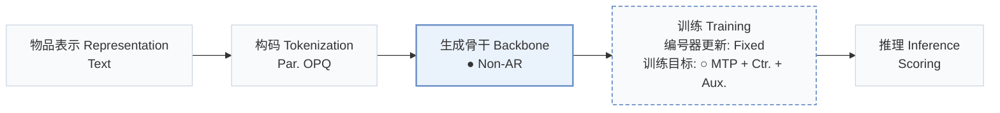
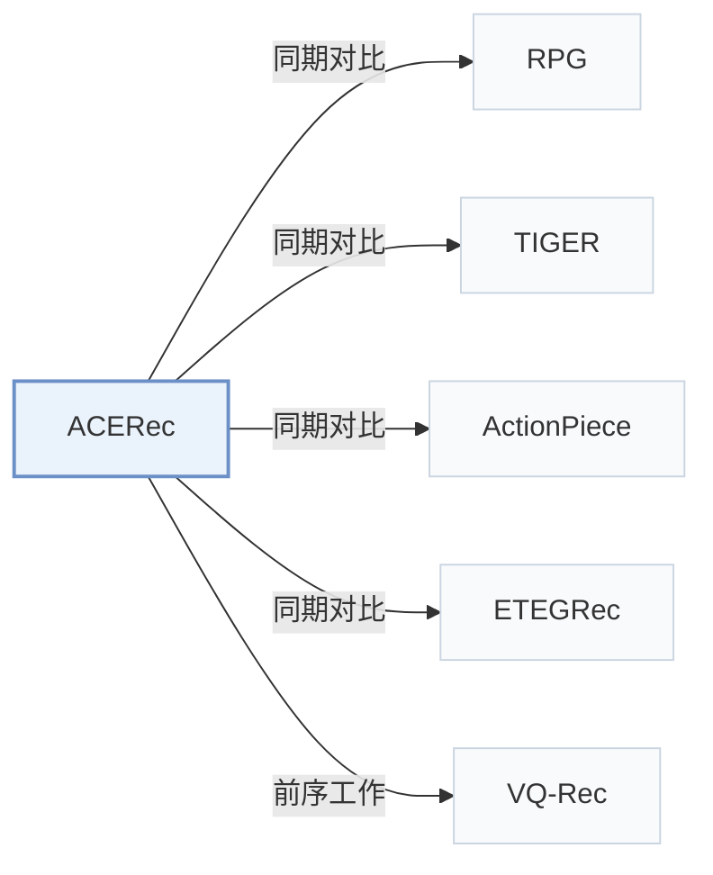

# ACERec

[← 问题 × 阶段矩阵](../../../README.zh.md#v--backbone) · [按阶段索引](../index/stages.md) · [按模态找论文](../index/modality.md) · [按领域找论文](../index/domain.md) · [English](../../papers/acerec.md) | 中文

| **题目** | *Unleash the Potential of Long Semantic IDs for Generative Recommendation* |
| :-- | :-- |
| **作者** | Xia et al. |
| **发表** | arXiv’26 |
| **问题与阶段** | `V. 效率` · `生成骨干（Backbone）` |
| **改动** | ● 生成骨干 · ○ 训练目标 |
| **构码输入** | `Text` |
| **领域** | `电商` |
| **链接** | [论文](https://arxiv.org/abs/2602.13573) |
| **阅读级别** | 概览（第 1 级） |

**本页目录**：[TL;DR](#tldr) · [3. 实验发现](#3-实验发现) · [5. 相关工作](#5-相关工作)

- `Text`：物品文本元数据（标题、描述、类目或提示词）。
- `Par. OPQ`：并行优化乘积量化，生成无序多子空间码。
- `Non-AR`：非自回归（Non-autoregressive）并行预测架构。
- `Fixed`：先独立训练并冻结编号器，生成器训练期间 SID 保持不变。
- `MTP + Ctr. + Aux.`：多 token 预测、对比损失与辅助目标联合优化。
- `Scoring`：直接计算候选物品得分，不逐位生成 SID。

### TL;DR

> [!NOTE]
> ACERec 用注意力 token 合并器将长 SID 压缩为紧凑隐 token，并加入意图 token 与双粒度训练目标，以短 ID 的开销保留长 ID 的表达力。

---

### 3. 实验发现

实验设置

- **数据集**：Nine Amazon domains: Sports, Beauty, Toys, CDs, Office, Pets, Baby (2014 edition) and Science, Instruments (2023 edition); users with fewer than 5 interactions excluded; training histories truncated to the 50 most recent items. Sizes: Appendix Table 5 (not restated here).
  - 出处：Nine Amazon domains and preprocessing: [S4.SS1.p1](https://arxiv.org/html/2602.13573v2#S4.SS1.p1), [A1.SS3.p1](https://arxiv.org/html/2602.13573v2#A1.SS3.p1), [A1.SS3.p2](https://arxiv.org/html/2602.13573v2#A1.SS3.p2).
- **切分**：Chronological leave-last-out: last interaction for test, second-to-last for validation, the rest for training.
  - 出处：Leave-last-out allocation: [S4.SS1.p1](https://arxiv.org/html/2602.13573v2#S4.SS1.p1).
- **候选集**：full catalog (exact scoring over the entire item pool).
  - 出处：Full candidate ranking: [S4.SS1.p3](https://arxiv.org/html/2602.13573v2#S4.SS1.p3) and [S3.SS3.p1](https://arxiv.org/html/2602.13573v2#S3.SS3.p1).
- **可见性**：warm; no unseen-item protocol is defined. The cold-start analysis buckets test items by training frequency [0, 5] to [16, 20], mixing zero-frequency and low-frequency items; tokenizer exposure is not separated.
  - 出处：Frequency buckets of test items in training: [S4.SS5.p1](https://arxiv.org/html/2602.13573v2#S4.SS5.p1).
- **SID 规格**：OPQ semantic IDs with m=32 orthogonal subspaces (8 to 64 tested), each with its own codebook of size M (value not restated); an Attentive Token Merger compresses the 32 tokens into 4 latent tokens for the sequence model. Collision handling: not reported.
  - 出处：OPQ long semantic IDs m=32 with subspace codebooks: [S3.SS1.SSSx1.p1](https://arxiv.org/html/2602.13573v2#S3.SS1.SSSx1.p1) and [S4.SS3.p3](https://arxiv.org/html/2602.13573v2#S4.SS3.p3); no collision rule found.
- **推理预算**：No beam search: per-subspace log-probabilities are computed once and every candidate is scored by gathering and summing its code log-probabilities (exact full-catalog scoring). Hardware, inference batch size, and measured latency: not reported in the main text.
  - 出处：Parallel subspace matching and score gathering: [S3.SS3.p1](https://arxiv.org/html/2602.13573v2#S3.SS3.p1), [S3.SS3.p3](https://arxiv.org/html/2602.13573v2#S3.SS3.p3), [S3.SS3.p5](https://arxiv.org/html/2602.13573v2#S3.SS3.p5).
- **结果来源**：Tables 1-2 (six representative datasets versus ID-based and semantic-ID baselines; the other three in Appendix C.1; HGN, SASRec, S3-Rec, TIGER on Sports, Beauty, Toys copied from the TIGER paper, others reproduced); Figure 3 (semantic ID length); Figure 5 (cold-start buckets on Pets and Baby).
  - 出处：Main: [S3.T1](https://arxiv.org/html/2602.13573v2#S3.T1) and [S3.T2](https://arxiv.org/html/2602.13573v2#S3.T2), scope stated in [S4.SS2.p1](https://arxiv.org/html/2602.13573v2#S4.SS2.p1); ID length: [S4.F3](https://arxiv.org/html/2602.13573v2#S4.F3); cold start: [S4.F5](https://arxiv.org/html/2602.13573v2#S4.F5); copied baselines: [A1.SS4.p1](https://arxiv.org/html/2602.13573v2#A1.SS4.p1).

---

### 5. 相关工作

- **同期对比** · [RPG](rpg.md): RPG predicts long OPQ IDs in parallel and decodes over an item graph; ACERec compresses the long IDs into a few latent tokens for sequence modeling and scores all items exactly.
  - 出处：ACERec v2, baselines: [S4.SS1.p2](https://arxiv.org/html/2602.13573v2#S4.SS1.p2); Tables 1-2: [S3.T1](https://arxiv.org/html/2602.13573v2#S3.T1) and [S3.T2](https://arxiv.org/html/2602.13573v2#S3.T2); ID-length comparison: [S4.SS3.p3](https://arxiv.org/html/2602.13573v2#S4.SS3.p3).
- **同期对比** · [TIGER](tiger.md): TIGER generates short RQ-VAE IDs by beam search; ACERec uses long OPQ IDs with parallel scoring.
  - 出处：ACERec v2, baselines: [S4.SS1.p2](https://arxiv.org/html/2602.13573v2#S4.SS1.p2); Table 1 (numbers copied from TIGER): [S3.T1](https://arxiv.org/html/2602.13573v2#S3.T1) and [A1.SS4.p1](https://arxiv.org/html/2602.13573v2#A1.SS4.p1).
- **同期对比** · [ActionPiece](actionpiece.md): ActionPiece merges feature tokens contextually; ACERec merges long OPQ codes into latent tokens with attention.
  - 出处：ACERec v2, baselines: [S4.SS1.p2](https://arxiv.org/html/2602.13573v2#S4.SS1.p2); Tables 1-2: [S3.T1](https://arxiv.org/html/2602.13573v2#S3.T1) and [S3.T2](https://arxiv.org/html/2602.13573v2#S3.T2).
- **同期对比** · [ETEGRec](etegrec.md): ETEGRec learns the tokenizer end to end; ACERec keeps fixed OPQ codes and compresses them.
  - 出处：ACERec v2, baselines: [S4.SS1.p2](https://arxiv.org/html/2602.13573v2#S4.SS1.p2); Tables 1-2: [S3.T1](https://arxiv.org/html/2602.13573v2#S3.T1) and [S3.T2](https://arxiv.org/html/2602.13573v2#S3.T2).
- **前序工作** · [VQ-Rec](vq-rec.md): ACERec follows VQ-Rec and RPG in using OPQ-based semantic IDs and their evaluation protocol.
  - 出处：ACERec v2, Section 4.1 protocol follows Hou et al. (2023): [S4.SS1.p1](https://arxiv.org/html/2602.13573v2#S4.SS1.p1); related work: [S2.p1](https://arxiv.org/html/2602.13573v2#S2.p1).

[查看同格全部论文](../../../README.zh.md#v--backbone)
