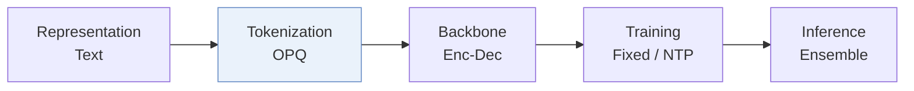
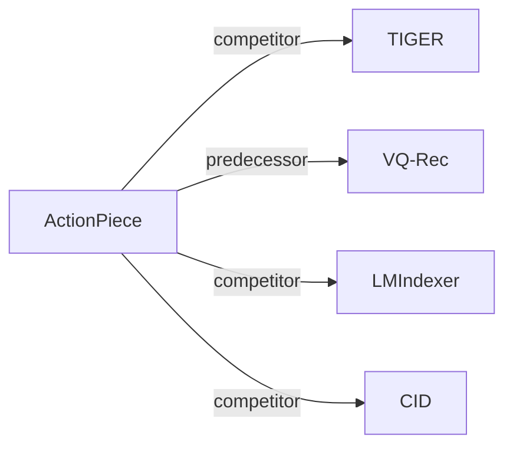

# ActionPiece

*Contextually Tokenizing Action Sequences for Generative Recommendation* — Hou et al. · ICML’25

`I. 信息量` · `Tokenization` · [论文](https://arxiv.org/abs/2502.13581) · [代码](https://github.com/google-deepmind/action_piece) · [矩阵](../../../README.zh.md#i--tokenization) · [English](../../papers/actionpiece.md)

阅读级别：概览（第 1 级） · 本页目录：[TL;DR](#tldr) · [速览](#速览) · [2. 方法](#2-方法) · [3. 实验发现](#3-实验发现) · [5. 相关工作](#5-相关工作)

- `OPQ`: Optimized product quantization.
- `Enc-Dec`: Encoder-decoder.
- `Fixed`: SIDs are built first and not changed while the generator trains.
- `NTP`: Next-token prediction loss only; continuing from a pretrained LLM (SFT) also counts as NTP.

### TL;DR

> [!NOTE]
> ActionPiece 将每次交互表示为物品特征集合，把共现特征模式合并为新 token，使相同动作获得随上下文变化的 token，而非固定独立的 token。

### 速览

| 维度 | 摘要 |
| :-- | :-- |
| 研究问题 | I. 信息量：Do the SIDs, or the model reading them, carry the collaborative and multimodal signals recommendation needs? |
| 核心贡献 | ActionPiece 将每次交互表示为物品特征集合，把共现特征模式合并为新 token，使相同动作获得随上下文变化的 token，而非固定独立的 token。 |
| 主要改动阶段 | Tokenization |

### 2. 方法

### 3. 实验发现

实验设置

- **数据集**：Amazon Reviews: Sports and Outdoors, Beauty, and CDs and Vinyl. Users with fewer than 5 reviews are filtered; an item-frequency filter is not reported. Processed sizes (users / items / actions): Sports 35,598 / 18,357 / 260,739; Beauty 22,363 / 12,101 / 176,139; CDs 75,258 / 64,443 / 1,022,334.
  - 出处：Dataset categories: [S4.SS1.p1](https://arxiv.org/html/2502.13581v3#S4.SS1.p1); user filter and truncation: [A6.p2](https://arxiv.org/html/2502.13581v3#A6.p2); processed sizes: [S3.T3](https://arxiv.org/html/2502.13581v3#S3.T3).
- **切分**：Per-user chronological leave-last-out: last item for test, second-to-last for validation, earlier items for training. Histories are truncated to 20 items for generative methods and 50 items for ID-based and feature-enhanced baselines.
  - 出处：Leave-last-out allocation: [S4.SS1.p1](https://arxiv.org/html/2502.13581v3#S4.SS1.p1); history truncation: [A6.p2](https://arxiv.org/html/2502.13581v3#A6.p2).
- **候选集**：not reported (full catalog versus sampled evaluation candidates); top-K lists are produced by beam search.
  - 出处：Evaluation settings name metrics only: [S4.SS1.p3](https://arxiv.org/html/2502.13581v3#S4.SS1.p3); top-K lists come from beam search: [A8.p4](https://arxiv.org/html/2502.13581v3#A8.p4).
- **可见性**：warm; no unseen-item protocol is defined.
  - 出处：Standard leave-last-out protocol with no cold-start experiment: [S4.SS1.p1](https://arxiv.org/html/2502.13581v3#S4.SS1.p1).
- **SID 规格**：Each item is an unordered set of 4 OPQ codes x 256 codewords (sentence-t5-base text embeddings) plus 1 extra identification code to prevent conflicts. ActionPiece then merges co-occurring feature sets into a context-dependent vocabulary of 40,000 tokens (tuned over 5k-40k), so the same item can map to different tokens in different sequences.
  - 出处：OPQ features, 256 codewords per digit, extra identification code: [A6.I1.i3.p1](https://arxiv.org/html/2502.13581v3#A6.I1.i3.p1); vocabulary size 40,000 and tuning range: [A7.T7](https://arxiv.org/html/2502.13581v3#A7.T7) and [A8.p2](https://arxiv.org/html/2502.13581v3#A8.p2).
- **推理预算**：Beam search with beam size 50; inference-time ensemble over q=5 set-permutation segmentations, with item scores averaged across the 5 ranking lists. Recall and NDCG at K=5 and 10. Inference hardware, inference batch size, and measured latency: not reported (each model is trained on one 40GB NVIDIA A100; the paper states only that latency stays comparable when segments run in parallel).
  - 出处：Beam size 50 and q=5 segmentations: [A8.p2](https://arxiv.org/html/2502.13581v3#A8.p2) and [A7.T7](https://arxiv.org/html/2502.13581v3#A7.T7); score averaging: [S3.SS3.SSS2.p1](https://arxiv.org/html/2502.13581v3#S3.SS3.SSS2.p1); GPU statement is for training: [A8.p3](https://arxiv.org/html/2502.13581v3#A8.p3); qualitative latency statement: [S3.SS4.p3](https://arxiv.org/html/2502.13581v3#S3.SS4.p3).
- **结果来源**：Table 4 (main comparison on Sports, Beauty, and CDs; averages over five seeds); Table 5 (ablations, including TIGER with varied vocabulary sizes); Figures 4-6 (vocabulary size, token utilization, and ensemble size). BERT4Rec, SASRec, FDSA, S3-Rec, TIGER, and LMIndexer numbers on Sports and Beauty are copied from earlier papers; other results are the authors' reimplementations.
  - 出处：Main table: [S3.T4](https://arxiv.org/html/2502.13581v3#S3.T4) and [S4.SS2.p1](https://arxiv.org/html/2502.13581v3#S4.SS2.p1); ablation: [S4.T5](https://arxiv.org/html/2502.13581v3#S4.T5); five seeds: [S4.SS1.p3](https://arxiv.org/html/2502.13581v3#S4.SS1.p3); copied baseline numbers: [A8.p1](https://arxiv.org/html/2502.13581v3#A8.p1).

### 5. 相关工作

- **同期对比** · [TIGER](tiger.md): TIGER tokenizes each item independently into ordered RQ-VAE codes, whereas ActionPiece merges unordered feature sets into context-dependent tokens; both use the same encoder-decoder and beam search.
  - 出处：ActionPiece v3, Section 4.1 baselines: https://arxiv.org/html/2502.13581v3#S4.SS1.p2; Table 4: https://arxiv.org/html/2502.13581v3#S3.T4; same architecture statement: https://arxiv.org/html/2502.13581v3#A8.p2.
- **前序工作** · [VQ-Rec](vq-rec.md): ActionPiece follows VQ-Rec in quantizing sentence embeddings with OPQ into unordered codes, then builds a merged contextual vocabulary over those codes for generation.
  - 出处：ActionPiece v3, Appendix F follows Hou et al. (2023) for OPQ features: https://arxiv.org/html/2502.13581v3#A6.I1.i3.p1; VQ-Rec is a Table 4 baseline: https://arxiv.org/html/2502.13581v3#S3.T4.
- **同期对比** · [LMIndexer](lmindexer.md): LMIndexer learns text-based semantic indexes item by item, while ActionPiece tokenizes whole action sequences with context-aware merges.
  - 出处：ActionPiece v3, Table 1 and Section 4.1 baselines: https://arxiv.org/html/2502.13581v3#S1.T1 and https://arxiv.org/html/2502.13581v3#S4.SS1.p2; Table 4: https://arxiv.org/html/2502.13581v3#S3.T4.
- **同期对比** · [CID](cid.md): P5-CID builds item IDs by hierarchical clustering, independent of sequence context; ActionPiece's tokens depend on neighboring actions.
  - 出处：ActionPiece v3, Table 1 and Section 4.1 baselines: https://arxiv.org/html/2502.13581v3#S1.T1 and https://arxiv.org/html/2502.13581v3#S4.SS1.p2; Table 4: https://arxiv.org/html/2502.13581v3#S3.T4.

[查看同格全部论文](../../../README.zh.md#i--tokenization)
