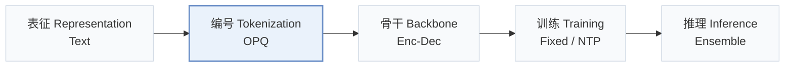
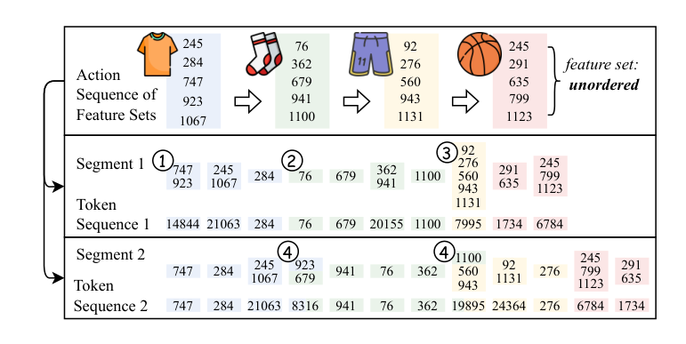
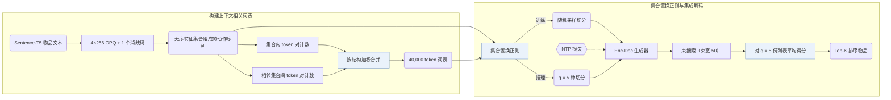
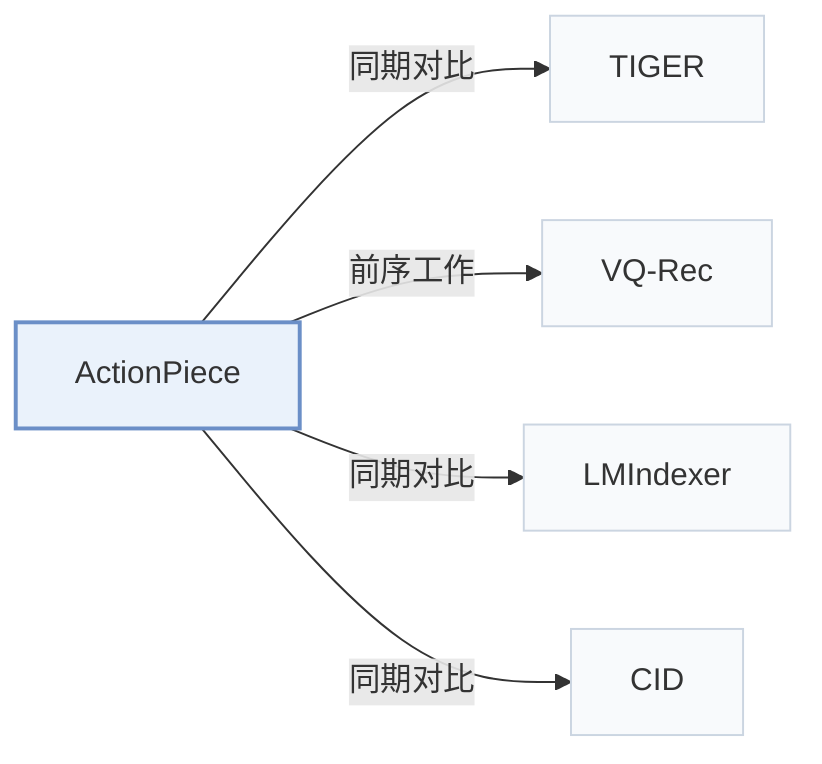

# ActionPiece

[← 问题 × 阶段矩阵](../../../README.zh.md#i--tokenization) · [按阶段索引](../index/stages.md) · [按模态索引](../index/modality.md) · [English](../../papers/actionpiece.md) | 中文

| **题目** | *Contextually Tokenizing Action Sequences for Generative Recommendation* |
| :-- | :-- |
| **作者** | Hou et al. |
| **发表** | ICML’25 |
| **问题与阶段** | `I. 信息量` · `编号（Tokenization）` |
| **链接** | [论文](https://arxiv.org/abs/2502.13581) · [代码](https://github.com/google-deepmind/action_piece) |
| **阅读级别** | 阅读笔记（第 2 级） |

**本页目录**：[TL;DR](#tldr) · [速览](#速览) · [1. 为什么重要](#1-为什么重要) · [2. 方法](#2-方法) · [3. 实验发现](#3-实验发现) · [4. 局限与分析](#4-局限与分析) · [5. 相关工作](#5-相关工作)

- `Text`：物品文本元数据（标题、描述、类目或提示词）。
- `OPQ`：优化乘积量化（Optimized Product Quantization）。
- `Enc-Dec`：编码器-解码器（Encoder-decoder）架构。
- `Fixed`：先独立训练并冻结编号器，生成器训练期间 SID 保持不变。
- `NTP`：标准下一 token 预测（Next-Token Prediction）交叉熵损失；基于预训练 LLM 的指令微调（SFT）亦归入此类。
- `Ensemble`：对同一历史的多种随机切分或多路径解码结果聚合排序。

### TL;DR

> [!NOTE]
> ActionPiece 将每次交互表示为物品特征集合，把共现特征模式合并为新 token，使相同动作获得随上下文变化的 token，而非固定独立的 token。

---

### 速览

| 维度 | 摘要 |
| :-- | :-- |
| 研究问题 | I. 信息量：SID 或读取它的模型是否充分携带了推荐所需的协同、多模态与时空信号？ |
| 核心贡献 | ActionPiece 将每次交互表示为物品特征集合，把共现特征模式合并为新 token，使相同动作获得随上下文变化的 token，而非固定独立的 token。 |
| 主要改动阶段 | 编号（Tokenization） |
| 主要发现 | 在 Amazon Sports and Outdoors、Beauty 和 CDs and Vinyl 上，将 OPQ 物品特征集合合并为 40,000 token 的上下文相关词表提升了 Recall@5/10 与 NDCG@5/10 并缩短归一化序列长度，而单纯缩放 TIGER 词表规模无法取得同等收益（Sec. 4.3，Sec. 4.4.1，Table 4，Table 5，Fig. 4）。 |
| 局限 | 推理需对 q = 5 种随机集合置换切分分别执行束宽 50 的束搜索再平均得分，且论文未报告实测推理延迟及评测是否覆盖全量物品目录（Sec. 3.3.2，Sec. 3.4，Sec. 4.1）。 |

---

### 1. 为什么重要

常规生成式推荐（GR）模型孤立地将每个物品映射为固定的语义 ID（Semantic ID，SID），使同一交互动作在任何历史序列中都获得相同的固定 token（Abstract）。由于同一物品在不同交互上下文中承载的意图不同，ActionPiece 将每次动作表示为无序的 OPQ 特征码集合，并将相邻动作间的共现特征模式合并为随上下文变化的 token。

> "However, existing GR models tokenize each action independently, assigning the same fixed tokens to identical actions across all sequences without considering contextual relationships."（Abstract）

---

### 2. 方法

#### 行为即特征集合

ActionPiece 将 Sentence-T5 物品文本嵌入量化为 4 个无序 OPQ 码（每个码本含 256 个码字）加 1 个防冲突标识码，把每次交互表示为含 5 个特征的无序集合，用户历史随之表示为特征集合序列（Abstract，Appendix F）。

#### 构建词表

从基础特征 token 出发，ActionPiece 同时统计单个动作集合内部和相邻动作集合之间的共现 token 对，迭代合并构建含 40,000 个 token 的上下文相关词表（Abstract，Appendix G）。集合内与跨集合两类 token 对按结构差异赋予不同合并权重（Sec. 1）。

> "Considering the structural differences between token pairs, e.g., whether they occur within a single set or between two adjacent sets, we assign different weights to different pairs."（Sec. 1）

#### 集合置换正则

由于单个动作的特征集合无内在顺序，在应用合并规则前随机置换集合元素，能为同一动作序列生成多份语义等价的 token 切分（Abstract）。训练时随机采样切分增强下一 token 预测；推理时生成 $`q = 5`$ 份置换切分，以束宽 50 解码并对 5 份候选列表的物品得分取平均（Sec. 3.2.2，Sec. 3.3.2）。

---

### 3. 实验发现

实验设置

- **数据集**：Amazon Reviews: Sports and Outdoors, Beauty, and CDs and Vinyl. Users with fewer than 5 reviews are filtered; an item-frequency filter is not reported. Processed sizes (users / items / actions): Sports 35,598 / 18,357 / 260,739; Beauty 22,363 / 12,101 / 176,139; CDs 75,258 / 64,443 / 1,022,334.
  - 出处：Dataset categories: [S4.SS1.p1](https://arxiv.org/html/2502.13581v3#S4.SS1.p1); user filter and truncation: [A6.p2](https://arxiv.org/html/2502.13581v3#A6.p2); processed sizes: [S3.T3](https://arxiv.org/html/2502.13581v3#S3.T3).
- **切分**：Per-user chronological leave-last-out: last item for test, second-to-last for validation, earlier items for training. Histories are truncated to 20 items for generative methods and 50 items for ID-based and feature-enhanced baselines.
  - 出处：Leave-last-out allocation: [S4.SS1.p1](https://arxiv.org/html/2502.13581v3#S4.SS1.p1); history truncation: [A6.p2](https://arxiv.org/html/2502.13581v3#A6.p2).
- **候选集**：not reported (full catalog versus sampled evaluation candidates); top-K lists are produced by beam search.
  - 出处：Evaluation settings name metrics only: [S4.SS1.p3](https://arxiv.org/html/2502.13581v3#S4.SS1.p3); top-K lists come from beam search: [A8.p4](https://arxiv.org/html/2502.13581v3#A8.p4).
- **可见性**：warm; no unseen-item protocol is defined.
  - 出处：Standard leave-last-out protocol with no cold-start experiment: [S4.SS1.p1](https://arxiv.org/html/2502.13581v3#S4.SS1.p1).
- **SID 规格**：Each item is an unordered set of 4 OPQ codes x 256 codewords (sentence-t5-base text embeddings) plus 1 extra identification code to prevent conflicts. ActionPiece then merges co-occurring feature sets into a context-dependent vocabulary of 40,000 tokens (tuned over 5k-40k), so the same item can map to different tokens in different sequences.
  - 出处：OPQ features, 256 codewords per digit, extra identification code: [A6.I1.i3.p1](https://arxiv.org/html/2502.13581v3#A6.I1.i3.p1); vocabulary size 40,000 and tuning range: [A7.T7](https://arxiv.org/html/2502.13581v3#A7.T7) and [A8.p2](https://arxiv.org/html/2502.13581v3#A8.p2).
- **推理预算**：Beam search with beam size 50; inference-time ensemble over q=5 set-permutation segmentations, with item scores averaged across the 5 ranking lists. Recall and NDCG at K=5 and 10. Inference hardware, inference batch size, and measured latency: not reported (each model is trained on one 40GB NVIDIA A100; the paper states only that latency stays comparable when segments run in parallel).
  - 出处：Beam size 50 and q=5 segmentations: [A8.p2](https://arxiv.org/html/2502.13581v3#A8.p2) and [A7.T7](https://arxiv.org/html/2502.13581v3#A7.T7); score averaging: [S3.SS3.SSS2.p1](https://arxiv.org/html/2502.13581v3#S3.SS3.SSS2.p1); GPU statement is for training: [A8.p3](https://arxiv.org/html/2502.13581v3#A8.p3); qualitative latency statement: [S3.SS4.p3](https://arxiv.org/html/2502.13581v3#S3.SS4.p3).
- **结果来源**：Table 4 (main comparison on Sports, Beauty, and CDs; averages over five seeds); Table 5 (ablations, including TIGER with varied vocabulary sizes); Figures 4-6 (vocabulary size, token utilization, and ensemble size). BERT4Rec, SASRec, FDSA, S3-Rec, TIGER, and LMIndexer numbers on Sports and Beauty are copied from earlier papers; other results are the authors' reimplementations.
  - 出处：Main table: [S3.T4](https://arxiv.org/html/2502.13581v3#S3.T4) and [S4.SS2.p1](https://arxiv.org/html/2502.13581v3#S4.SS2.p1); ablation: [S4.T5](https://arxiv.org/html/2502.13581v3#S4.T5); five seeds: [S4.SS1.p3](https://arxiv.org/html/2502.13581v3#S4.SS1.p3); copied baseline numbers: [A8.p1](https://arxiv.org/html/2502.13581v3#A8.p1).

- 主实验与词表规模：在 Sports and Outdoors、Beauty 和 CDs and Vinyl 上（5 个随机种子平均），将合并词表扩大至 40,000 token 可提升 Recall@5/10 与 NDCG@5/10 并缩短归一化序列长度（NSL），以更大的嵌入表换取更短的解码序列（Sec. 4.2，Sec. 4.4.1，Table 4，Fig. 4）。
- 词表缩放消融：仅调整 TIGER 的词表大小无法复现 ActionPiece 的提升，说明收益来自上下文相关合并而非词表容量本身（Sec. 4.3，Table 5）。

  > "These results suggest that the performance improvement of ActionPiece is not simply due to scaling the vocabulary size up or down."（Sec. 4.3）

- token 利用与案例分析：根据相邻历史为同一物品分配不同 token 提高了词表 token 使用率，兼具序列级数据增强效果，并在案例分析中捕获跨动作组合模式（Sec. 4.3，Sec. 4.4.2，Sec. 4.5）。
- 集成规模：随 $`q`$ 增大，对 $`q = 5`$ 份置换切分平均排序得分稳定优于单一切分解码（Sec. 3.3.2，Fig. 6）。

---

### 4. 局限与分析

**Stated by the authors.** 仅当 $`q = 5`$ 份置换切分并行推理时，整体延迟才与单切分解码相当（Sec. 3.4）。

**Our analysis.**

- 对 $`q = 5`$ 路束宽 50 的解码做集成会使计算量与显存开销随 $`q`$ 线性增加，在线服务吞吐受限时开销更为突出。
- VQ-Rec 将无序 `OPQ` 码输入双向 `Encoder` 做判别式 `Scoring`；ActionPiece 同样从无序 `OPQ` 特征集合出发，但通过跨动作合并由 `Enc-Dec` 生成器自回归生成合并 token。

---

### 5. 相关工作

- **同期对比** · [TIGER](tiger.md): TIGER tokenizes each item independently into ordered RQ-VAE codes, whereas ActionPiece merges unordered feature sets into context-dependent tokens; both use the same encoder-decoder and beam search.
  - 出处：ActionPiece v3, Section 4.1 baselines: [S4.SS1.p2](https://arxiv.org/html/2502.13581v3#S4.SS1.p2); Table 4: [S3.T4](https://arxiv.org/html/2502.13581v3#S3.T4); same architecture statement: [A8.p2](https://arxiv.org/html/2502.13581v3#A8.p2).
- **前序工作** · [VQ-Rec](vq-rec.md): ActionPiece follows VQ-Rec in quantizing sentence embeddings with OPQ into unordered codes, then builds a merged contextual vocabulary over those codes for generation.
  - 出处：ActionPiece v3, Appendix F follows Hou et al. (2023) for OPQ features: [A6.I1.i3.p1](https://arxiv.org/html/2502.13581v3#A6.I1.i3.p1); VQ-Rec is a Table 4 baseline: [S3.T4](https://arxiv.org/html/2502.13581v3#S3.T4).
- **同期对比** · [LMIndexer](lmindexer.md): LMIndexer learns text-based semantic indexes item by item, while ActionPiece tokenizes whole action sequences with context-aware merges.
  - 出处：ActionPiece v3, Table 1 and Section 4.1 baselines: [S1.T1](https://arxiv.org/html/2502.13581v3#S1.T1) and [S4.SS1.p2](https://arxiv.org/html/2502.13581v3#S4.SS1.p2); Table 4: [S3.T4](https://arxiv.org/html/2502.13581v3#S3.T4).
- **同期对比** · [CID](cid.md): P5-CID builds item IDs by hierarchical clustering, independent of sequence context; ActionPiece's tokens depend on neighboring actions.
  - 出处：ActionPiece v3, Table 1 and Section 4.1 baselines: [S1.T1](https://arxiv.org/html/2502.13581v3#S1.T1) and [S4.SS1.p2](https://arxiv.org/html/2502.13581v3#S4.SS1.p2); Table 4: [S3.T4](https://arxiv.org/html/2502.13581v3#S3.T4).

[查看同格全部论文](../../../README.zh.md#i--tokenization)
