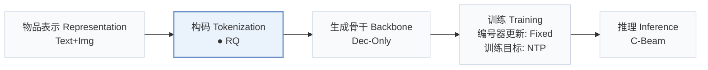
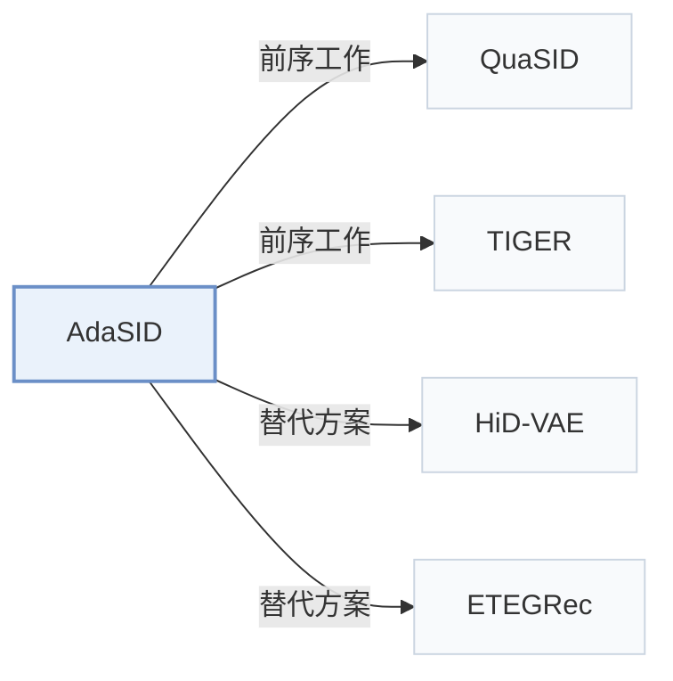

# AdaSID

[← 问题 × 阶段矩阵](../../../README.zh.md#ii--tokenization) · [按阶段索引](../index/stages.md) · [按模态找论文](../index/modality.md) · [按领域找论文](../index/domain.md) · [English](../../papers/adasid.md) | 中文

| **题目** | *Beyond Static Collision Handling: Adaptive Semantic ID Learning for Multimodal Recommendation at Industrial Scale* |
| :-- | :-- |
| **作者** | Pan et al. |
| **发表** | arXiv’26 |
| **问题与阶段** | `II. 唯一性与合法性` · `构码（Tokenization）` |
| **改动** | ● 构码 |
| **构码输入** | `Text` + `Img` + `CF` |
| **领域** | `电商` |
| **链接** | [论文](https://arxiv.org/abs/2604.23522) |
| **阅读级别** | 概览（第 1 级） |

**本页目录**：[TL;DR](#tldr) · [3. 实验发现](#3-实验发现) · [5. 相关工作](#5-相关工作)

- `Text+Img`：文本与视觉图像表征。
- `RQ`：残差向量量化（Residual Quantization）。
- `Dec-Only`：仅解码器（Decoder-only）自回归架构。
- `Fixed`：先独立训练并冻结编号器，生成器训练期间 SID 保持不变。
- `NTP`：标准下一 token 预测（Next-Token Prediction）交叉熵损失；基于预训练 LLM 的指令微调（SFT）亦归入此类。
- `C-Beam`：受合法物品集合约束的束搜索（Constrained beam search）。

### TL;DR

> [!NOTE]
> AdaSID 在编号器训练中对语义相近物品放松排斥，并按局部冲突负载缩放其余排斥项，替代固定强度的重叠正则。

---

### 3. 实验发现

实验设置

- **数据集**：Offline: Amazon 2018 Reviews, Beauty and Toys and Games, with 5-core filtering of users and items. Sizes (users / items / interactions): Toys 19,412 / 11,924 / 905,253; Beauty 22,363 / 12,101 / 1,048,296. Industrial: Kuaishou e-commerce short-video items with multimodal features (images, text, keyframes, audio transcripts); filtering rules not reported.
  - 出处：Amazon 2018 categories, 5-core filtering, leave-one-out: [S5.SS1.SSS1.p1](https://arxiv.org/html/2604.23522v1#S5.SS1.SSS1.p1); sizes: [S5.T1](https://arxiv.org/html/2604.23522v1#S5.T1); industrial setting: [S5.SS3.p1](https://arxiv.org/html/2604.23522v1#S5.SS3.p1).
- **切分**：Offline: leave-one-out into training, validation, and test; the exact validation/test position allocation is not reported beyond the leave-one-out label. Industrial: 4-day online A/B test on the retrieval model and a 4-day offline study on the ranking model.
  - 出处：Leave-one-out named without position allocation: [S5.SS1.SSS1.p1](https://arxiv.org/html/2604.23522v1#S5.SS1.SSS1.p1); industrial test periods: [S5.SS3.p1](https://arxiv.org/html/2604.23522v1#S5.SS3.p1).
- **候选集**：not reported (full catalog versus sampled evaluation candidates).
  - 出处：Metrics and backbone only: [S5.SS1.SSS2.p1](https://arxiv.org/html/2604.23522v1#S5.SS1.SSS2.p1).
- **可见性**：Offline: warm; no unseen-item protocol is defined. Industrial ranking reports a cold-start CVR subset; generator/tokenizer visibility for those items is not reported.
  - 出处：Offline protocol: [S5.SS1.SSS1.p1](https://arxiv.org/html/2604.23522v1#S5.SS1.SSS1.p1); industrial cold-start CVR subset without a visibility definition: [S5.T3](https://arxiv.org/html/2604.23522v1#S5.T3) and [S5.I2.i2.p1](https://arxiv.org/html/2604.23522v1#S5.I2.i2.p1).
- **SID 规格**：3 residual-quantization levels x 256 codes, 32-dimensional code embeddings, 768-dimensional input features. Collisions are reduced during tokenizer training by an adaptive overlap-repulsion loss; a post-hoc disambiguation suffix or other collision-resolution rule is not reported.
  - 出处：SID length 3, 256 codes, 32-dimensional code embeddings: [S5.SS1.SSS4.p1](https://arxiv.org/html/2604.23522v1#S5.SS1.SSS4.p1); collision handled by a training-time adaptive overlap loss, with no added suffix described: [S4.SS4.p1](https://arxiv.org/html/2604.23522v1#S4.SS4.p1) and [S4.SS4.p2](https://arxiv.org/html/2604.23522v1#S4.SS4.p2).
- **推理预算**：Downstream generation uses the same TIGER configuration for all tokenizers; beam width, hardware, inference batch size, and latency: not reported. Recall and NDCG at K=3 and 5.
  - 出处：Downstream TIGER configuration only: [S5.SS1.SSS2.p1](https://arxiv.org/html/2604.23522v1#S5.SS1.SSS2.p1) and [S5.SS1.SSS4.p1](https://arxiv.org/html/2604.23522v1#S5.SS1.SSS4.p1); no extra online cost claim: [S4.SS4.p2](https://arxiv.org/html/2604.23522v1#S4.SS4.p2).
- **结果来源**：Table 2 (tokenizer comparison on Toys and Beauty under a shared TIGER backbone); Table 3 (Kuaishou online retrieval A/B and offline ranking AUC); Table 4 (ablations); Figure 3 (codebook statistics); Figure 4 (hyperparameter sensitivity on Beauty).
  - 出处：Main offline table: [S5.T2](https://arxiv.org/html/2604.23522v1#S5.T2); industrial table: [S5.T3](https://arxiv.org/html/2604.23522v1#S5.T3); ablation: [S5.T4](https://arxiv.org/html/2604.23522v1#S5.T4); codebook statistics: [S5.F3](https://arxiv.org/html/2604.23522v1#S5.F3).

---

### 5. 相关工作

- **前序工作** · [QuaSID](quasid.md): QuaSID applies a fixed qualification-aware collision regularizer; AdaSID instantiates its collision term following QuaSID and makes the repulsion adaptive to semantic compatibility, local load, and training progress.
  - 出处：AdaSID v1, Section 4.1 follows Hu et al. (2026) for the collision term: [S4.SS1.p2](https://arxiv.org/html/2604.23522v1#S4.SS1.p2); QuaSID is the collision-aware baseline in Section 5.1.3 and Table 2: [S5.SS1.SSS3.p1](https://arxiv.org/html/2604.23522v1#S5.SS1.SSS3.p1) and [S5.T2](https://arxiv.org/html/2604.23522v1#S5.T2).
- **前序工作** · [TIGER](tiger.md): TIGER is the shared downstream generative backbone; AdaSID changes only how the SIDs are learned.
  - 出处：AdaSID v1, Section 5.1.2: [S5.SS1.SSS2.p1](https://arxiv.org/html/2604.23522v1#S5.SS1.SSS2.p1); Section 5.1.4: [S5.SS1.SSS4.p1](https://arxiv.org/html/2604.23522v1#S5.SS1.SSS4.p1).
- **替代方案** · [HiD-VAE](hid-vae.md): HiD-VAE suppresses SID overlaps with an explicit objective under a fixed standard, while AdaSID relaxes or strengthens repulsion adaptively.
  - 出处：AdaSID v1, Section 1 and Section 2.2 cite Fang et al. (2025) among static overlap-aware objectives: [S1.p3](https://arxiv.org/html/2604.23522v1#S1.p3) and [S2.SS2.p1](https://arxiv.org/html/2604.23522v1#S2.SS2.p1); not a baseline in Table 2.
- **替代方案** · [ETEGRec](etegrec.md): ETEGRec aligns the tokenizer with downstream recommendation through end-to-end supervision, whereas AdaSID keeps a pre-trained tokenizer and regulates code overlaps adaptively.
  - 出处：AdaSID v1, Section 2.2 cites Liu et al. (2025) for end-to-end downstream supervision: [S2.SS2.p1](https://arxiv.org/html/2604.23522v1#S2.SS2.p1); not a baseline in Table 2.

[查看同格全部论文](../../../README.zh.md#ii--tokenization)
