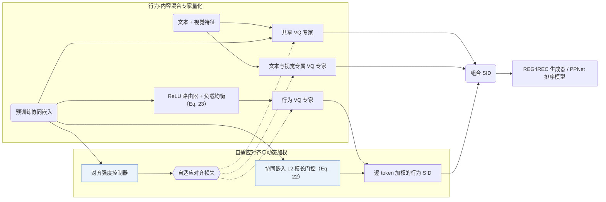
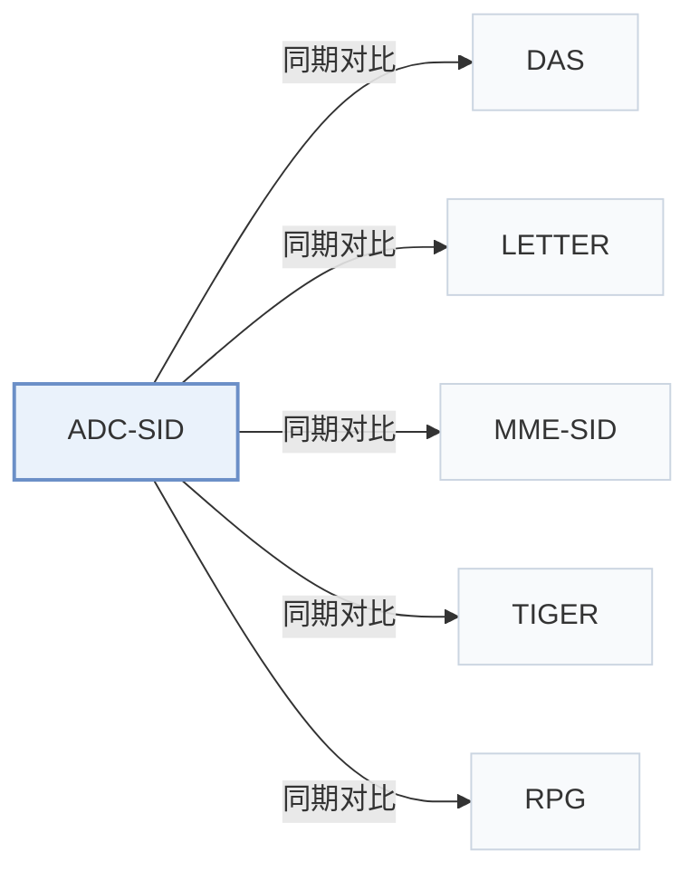

# ADC-SID

[← 问题 × 阶段矩阵](../../../README.zh.md#i--tokenization) · [按阶段索引](../index/stages.md) · [按模态找论文](../index/modality.md) · [按领域找论文](../index/domain.md) · [English](../../papers/adc-sid.md) | 中文

| **题目** | *Taming the Long Tail: Denoising Collaborative Information for Robust Semantic ID Generation* |
| :-- | :-- |
| **作者** | Xu et al. |
| **发表** | arXiv’25 |
| **问题与阶段** | `I. 信息量` · `构码（Tokenization）` |
| **改动** | ● 构码 · ○ 训练目标 |
| **构码输入** | `Text` + `Img` + `CF` |
| **领域** | `电商` · `广告` |
| **应用场景** | `一般物品推荐`；`线上实验或部署` |
| **链接** | [论文](https://arxiv.org/abs/2510.25622) |
| **阅读级别** | 阅读笔记（第 2 级） |

**本页目录**：[TL;DR](#tldr) · [速览](#速览) · [1. 为什么重要](#1-为什么重要) · [2. 方法](#2-方法) · [3. 实验发现](#3-实验发现) · [4. 局限与分析](#4-局限与分析) · [5. 相关工作](#5-相关工作)

- `Text+Img+CF`：文本、图像表征结合协同过滤信号。
- `MoE-VQ`：混合专家向量量化（Mixture-of-Experts VQ）。
- `Enc-Dec`：编码器-解码器（Encoder-decoder）架构。
- `Fixed†`：生成器训练期间冻结编号器（由配置推断）。
- `NTP`：标准下一 token 预测（Next-Token Prediction）交叉熵损失；基于预训练 LLM 的指令微调（SFT）亦归入此类。

### TL;DR

> [!NOTE]
> ADC-SID 在 SID 量化中引入随协同噪声自适应的对齐强度与可学习的行为 ID 权重，替代统一强度的对齐和等权重聚合。

---

### 速览

| 维度 | 摘要 |
| :-- | :-- |
| 主要发现 | 在含 48,106,880 个广告的工业数据集与 Amazon Beauty 上，ADC-SID 在 R@100、N@100 和 AUC 上全面优于纯内容基线（RQ-VAE、OPQ）及固定强度对齐基线（LETTER），在曝光量后 25% 的长尾物品上取得最大 AUC 增幅，并通过 5 天在线 A/B 测试验证收益（Sec. 4.2，Sec. 4.5，Sec. 5，Table 2，Table 5，Fig. 6）。 |
| 局限 | 行为 token 权重直接由预训练协同嵌入的 L2 模长计算，效果受制于上游协同模型的标定质量，且论文未报告冲突处理策略与推理延迟（Sec. 3.4.1，Sec. 4.1.3）。 |

---

### 1. 为什么重要

语义 ID（Semantic ID，SID）通过量化物品内容特征实现跨物品知识共享，协同感知编号器则进一步将用户-物品交互信号注入离散编码（Abstract）。由于真实交互呈长尾偏斜分布，长尾物品的协同信号稀疏且含噪：统一强度的跨视图对齐会污染尾部物品的内容表征，等权重聚合又无法区分有效与含噪的行为 SID。ADC-SID 按物品自适应调节对齐强度，并为行为 token 学习动态权重。

> "unlike relatively uniform content features, user-item interactions are highly skewed, resulting in a significant quality gap in collaborative information between popular and long-tail items."（Abstract）

---

### 2. 方法

#### 行为-内容混合量化

ADC-SID 将量化码本拆分为学习跨模态共性信息的共享专家，以及分别建模文本、视觉与交互行为特异性的专属专家（Sec. 3.2）。

#### 自适应行为-内容对齐

对齐强度控制器不再对全部物品施加恒定拉近约束，而是根据物品热度调节行为表征与内容表征的对齐权重，防止稀疏交互噪声破坏长尾物品的内容语义（Sec. 3.3.1）。

> "To adaptively align behavior and content information for head and long-tail items, the alignment strength controller is proposed to calculate the alignment strength."（Sec. 3.3.1）

#### 动态行为加权

门控网络依据物品预训练协同嵌入的 L2 模长为每个行为 SID token 计算重要度权重，压低低置信度行为码（Sec. 3.4.1，Eq. 22）。行为分支内部配合带负载均衡损失的 ReLU 路由器，缓解行为专家间的负载失衡（Sec. 3.4.2，Eq. 23）。

> "This gate suppresses noisy behavioral SIDs, improving the robustness of behavioral SIDs when incorporated with downstream recommendations."（Sec. 3.4.1）

---

### 3. 实验发现

实验设置

- **数据集**：Industrial: Southeast Asian e-commerce advertising platform, October 2024 to May 2025, about 30 million users and 40 million ads (Table 1: 35,154,135 users, 48,106,880 items), average sequence length 128; filtering rules not reported. Public: Amazon Product Reviews Beauty (May 1996-September 2014); generative retrieval uses 5-core filtering of users and items, 22,363 users and 12,101 items; ranking uses the rating data with ratings above 3 as positives.
  - 出处：Industrial data: [S4.SS1.SSS1.p2](https://arxiv.org/html/2510.25622v3#S4.SS1.SSS1.p2); Beauty filtering and sequence construction: [S4.SS1.SSS1.p3](https://arxiv.org/html/2510.25622v3#S4.SS1.SSS1.p3); sizes: [S4.T1](https://arxiv.org/html/2510.25622v3#S4.T1).
- **切分**：Beauty generative retrieval: chronological sequences capped at 20 items; the train/validation/test allocation is not reported. Beauty ranking: chronological 90%/10% train/test split. Industrial offline split: not reported. Online: 5-day A/B test with 10% random user traffic.
  - 出处：Beauty ranking split and retrieval sequence construction: [S4.SS1.SSS1.p3](https://arxiv.org/html/2510.25622v3#S4.SS1.SSS1.p3); online test: [S5.p1](https://arxiv.org/html/2510.25622v3#S5.p1).
- **候选集**：not reported (full catalog versus sampled evaluation candidates); retrieval uses Recall and NDCG at N=50 and 100.
  - 出处：Retrieval metrics only: [S4.SS1.SSS2.p3](https://arxiv.org/html/2510.25622v3#S4.SS1.SSS2.p3).
- **可见性**：warm; no unseen-item protocol is defined. The long-tail analysis stratifies items by 30-day impression counts (top 25% versus bottom 25%).
  - 出处：No cold-start protocol; the popularity analysis groups items by 30-day impressions: [S4.SS5.p1](https://arxiv.org/html/2510.25622v3#S4.SS5.p1).
- **SID 规格**：Industrial: SID length 10 with codebook size printed as "3,00" (shared 2, text 2, visual 2, behavioral 4 codes for ADC-SID). Public: SID length 6 with codebook size 100 (shared 1, text 1, visual 1, behavioral 3). The online system uses an 8-token SID. Collision handling: not reported.
  - 出处：Codebook settings: [S4.SS1.SSS3.p3](https://arxiv.org/html/2510.25622v3#S4.SS1.SSS3.p3); online SID length: [S5.p1](https://arxiv.org/html/2510.25622v3#S5.p1); no collision rule found in Sections 3-5.
- **推理预算**：Generative retrieval uses the REG4REC encoder-decoder; ranking uses PPNet. Beam width, hardware, inference batch size, and latency: not reported.
  - 出处：Downstream backbones only: [S4.SS1.SSS3.p2](https://arxiv.org/html/2510.25622v3#S4.SS1.SSS3.p2).
- **结果来源**：Table 2 (generative retrieval and discriminative ranking on industrial data and Beauty, with quantization metrics); Table 3 (industrial ablation); Table 4 and Figure 5 (hyperparameters); Figure 6 (popular versus long-tail AUC); Table 5 (5-day online A/B test).
  - 出处：Main table: [S4.T2](https://arxiv.org/html/2510.25622v3#S4.T2); ablation: [S4.T3](https://arxiv.org/html/2510.25622v3#S4.T3); hyperparameters: [S4.T4](https://arxiv.org/html/2510.25622v3#S4.T4); popularity: [S4.F6](https://arxiv.org/html/2510.25622v3#S4.F6); online: [S5.T5](https://arxiv.org/html/2510.25622v3#S5.T5).

- 生成式检索与排序主实验：在东南亚电商广告数据集（35,154,135 用户、48,106,880 广告）和 Amazon Beauty（22,363 用户、12,101 物品）上，融合行为与内容的 SID（RQ-Kmeans、LETTER）在生成式检索（基于 REG4REC 的 R@50、R@100、N@50、N@100）和判别式排序（基于 PPNet 的 AUC）上均优于纯内容 SID（RQ-VAE、OPQ），ADC-SID 在两类任务中整体最优（Abstract，Sec. 4.1，Sec. 4.2，Table 1，Table 2）。
- 组件消融：工业数据集消融验证了共享-专属 MoE-VQ 结构、自适应对齐控制器，以及相对等权重方案的动态行为加权收益（Sec. 4.3.2，Table 3）。
- 热度分层表现：按最近 30 天曝光量将物品划分为热门组（前 25%）和长尾组（后 25%），ADC-SID 在长尾组取得最大的 AUC 提升，同时保持热门组精度（Sec. 4.5，Fig. 6）。
- 在线 A/B 测试：采用 8 位 SID 在 10% 随机广告流量上开展 5 天在线 A/B 实验，验证了线上业务指标收益（Sec. 5，Table 5）。

---

### 4. 局限与分析

**Our analysis.**

- 行为门控直接依赖上游协同嵌入的 L2 范数，若预训练协同模型的嵌入模长未良好校准，将影响行为 token 的权重分配（Sec. 3.4.1）。
- 论文未说明 SID 冲突消解规则，且 Sec. 4.1.3 中工业数据集的码本大小存在排版笔误。
- MME-SID 同样融合文本、视觉与协同三路特征，但采用 `MM-RQ` 编号器配 `Dec-Only` 模型做判别式 `Scoring`；ADC-SID 则用 `MoE-VQ` 混合专家编号器连接 `Enc-Dec` 生成器（`REG4REC`）与 `PPNet`。

---

### 5. 相关工作

- **同期对比** · [DAS](das.md): DAS aligns SIDs with collaborative signals by multi-view contrastive learning; ADC-SID adds adaptive alignment strength and dynamic weighting to denoise behavior signals for long-tail items.
  - 出处：ADC-SID v3, Section 4.1.2 baselines: [S4.I3.i4.p1](https://arxiv.org/html/2510.25622v3#S4.I3.i4.p1); Table 2: [S4.T2](https://arxiv.org/html/2510.25622v3#S4.T2).
- **同期对比** · [LETTER](letter.md): LETTER fuses semantic and collaborative signals in one RQ-VAE tokenizer with fixed regularization; ADC-SID uses mixture-of-quantization experts with popularity-aware alignment.
  - 出处：ADC-SID v3, Section 4.1.2 baselines: [S4.I3.i5.p1](https://arxiv.org/html/2510.25622v3#S4.I3.i5.p1); Table 2: [S4.T2](https://arxiv.org/html/2510.25622v3#S4.T2).
- **同期对比** · [MME-SID](mme-sid.md): MM-RQ-VAE produces separate collaborative, textual, and visual SIDs with contrastive alignment; ADC-SID adds shared and specific experts and a learned per-token weighting of behavioral SIDs.
  - 出处：ADC-SID v3, Section 4.1.2 baselines: [S4.I3.i6.p1](https://arxiv.org/html/2510.25622v3#S4.I3.i6.p1); Table 2: [S4.T2](https://arxiv.org/html/2510.25622v3#S4.T2).
- **同期对比** · [TIGER](tiger.md): The RQ-VAE baseline is attributed to TIGER's content-only semantic IDs; ADC-SID injects denoised collaborative information.
  - 出处：ADC-SID v3, Section 4.1.2 describes the RQ-VAE baseline as TIGER: [S4.I3.i1.p1](https://arxiv.org/html/2510.25622v3#S4.I3.i1.p1); Table 2 row RQ-VAE: [S4.T2](https://arxiv.org/html/2510.25622v3#S4.T2).
- **同期对比** · [RPG](rpg.md): The OPQ baseline is attributed to RPG's unordered content codes; ADC-SID builds hierarchical behavior-content codes instead.
  - 出处：ADC-SID v3, Section 4.1.2 describes the OPQ baseline as RPG: [S4.I3.i2.p1](https://arxiv.org/html/2510.25622v3#S4.I3.i2.p1); Table 2 row OPQ: [S4.T2](https://arxiv.org/html/2510.25622v3#S4.T2).

[查看同格全部论文](../../../README.zh.md#i--tokenization)
