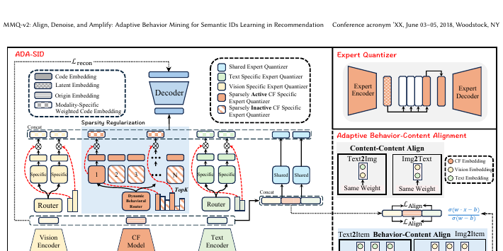
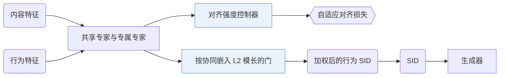
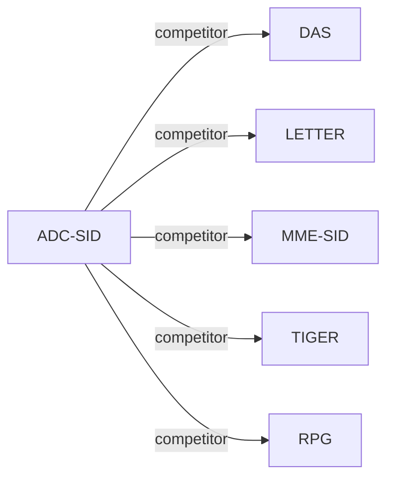

# ADC-SID

| **题目** | *Taming the Long Tail: Denoising Collaborative Information for Robust Semantic ID Generation* |
| :-- | :-- |
| **作者** | Xu et al. |
| **会议** | arXiv’25 |
| **问题与阶段** | `I. 信息量` · `Tokenization` |
| **链接** | [论文](https://arxiv.org/abs/2510.25622) · [矩阵](../../../README.zh.md#i--tokenization) · [English](../../papers/adc-sid.md) |
| **阅读级别** | 阅读笔记（第 2 级） |

本页目录：[TL;DR](#tldr) · [速览](#速览) · [1. 为什么重要](#1-为什么重要) · [2. 方法](#2-方法) · [3. 实验发现](#3-实验发现) · [4. 局限与分析](#4-局限与分析) · [5. 相关工作](#5-相关工作)

- `Enc-Dec`: Encoder-decoder.
- `NTP`: Next-token prediction loss only; continuing from a pretrained LLM (SFT) also counts as NTP.
- `–`: Not reported in the paper.

### TL;DR

> [!NOTE]
> ADC-SID 在 SID 量化中引入随协同噪声自适应的对齐强度与可学习的行为 ID 权重，替代统一强度的对齐和等权重聚合。

---

### 速览

| 维度 | 摘要 |
| :-- | :-- |
| 研究问题 | I. 信息量：Do the SIDs, or the model reading them, carry the collaborative and multimodal signals recommendation needs? |
| 核心贡献 | ADC-SID 在 SID 量化中引入随协同噪声自适应的对齐强度与可学习的行为 ID 权重，替代统一强度的对齐和等权重聚合。 |
| 主要改动阶段 | Tokenization |
| 局限 | 行为权重由预训练协同嵌入的模长算出，因此取决于这个嵌入的质量（Sec. 3.4.1）。 |

---

### 1. 为什么重要

语义 ID（Semantic ID，SID）把物品内容特征量化，让物品之间能共享知识；已有方法再往 SID 里加入协同信息（Abstract）。用户和物品的交互高度偏斜，长尾物品的协同信息弱得多（Abstract）。作者指出两个后果：不加区分的对齐让这些噪声污染尾部物品的内容表示；等权重又看不出哪些行为 SID 有用（Abstract）。

> "unlike relatively uniform content features, user-item interactions are highly skewed, resulting in a significant quality gap in collaborative information between popular and long-tail items."（Abstract）（交互高度偏斜，热门和长尾物品的协同信息质量差距很大。）

---

### 2. 方法

#### 行为-内容混合量化

共享专家学习行为和内容共有的信息，专属专家学习各自模态的信息（Sec. 3.2）。

#### 自适应行为-内容对齐

对齐强度控制器决定热门物品和长尾物品的行为与内容对齐得多紧（Sec. 3.3.1）。

> "To adaptively align behavior and content information for head and long-tail items, the alignment strength controller is proposed to calculate the alignment strength."（Sec. 3.3.1）（控制器为热门和长尾物品分别计算对齐强度。）

#### 动态行为加权

一个门根据预训练协同嵌入的 L2 模长，为每个行为 SID 学一个重要度分数（Sec. 3.4.1，Eq. 22）。带负载均衡的 ReLU 路由器减轻行为专家之间的训练不均（Sec. 3.4.2，Eq. 23）。

> "This gate suppresses noisy behavioral SIDs, improving the robustness of behavioral SIDs when incorporated with downstream recommendations."（Sec. 3.4.1）（这个门压低有噪声的行为 SID。）

---

### 3. 实验发现

实验设置

- **数据集**：Industrial: Southeast Asian e-commerce advertising platform, October 2024 to May 2025, about 30 million users and 40 million ads (Table 1: 35,154,135 users, 48,106,880 items), average sequence length 128; filtering rules not reported. Public: Amazon Product Reviews Beauty (May 1996-September 2014); generative retrieval uses 5-core filtering of users and items, 22,363 users and 12,101 items; ranking uses the rating data with ratings above 3 as positives.
  - 出处：Industrial data: [S4.SS1.SSS1.p2](https://arxiv.org/html/2510.25622v3#S4.SS1.SSS1.p2); Beauty filtering and sequence construction: [S4.SS1.SSS1.p3](https://arxiv.org/html/2510.25622v3#S4.SS1.SSS1.p3); sizes: [S4.T1](https://arxiv.org/html/2510.25622v3#S4.T1).
- **切分**：Beauty generative retrieval: chronological sequences capped at 20 items; the train/validation/test allocation is not reported. Beauty ranking: chronological 90%/10% train/test split. Industrial offline split: not reported. Online: 5-day A/B test with 10% random user traffic.
  - 出处：Beauty ranking split and retrieval sequence construction: [S4.SS1.SSS1.p3](https://arxiv.org/html/2510.25622v3#S4.SS1.SSS1.p3); online test: [S5.p1](https://arxiv.org/html/2510.25622v3#S5.p1).
- **候选集**：not reported (full catalog versus sampled evaluation candidates); retrieval uses Recall and NDCG at N=50 and 100.
  - 出处：Retrieval metrics only: [S4.SS1.SSS2.p3](https://arxiv.org/html/2510.25622v3#S4.SS1.SSS2.p3).
- **可见性**：warm; no unseen-item protocol is defined. The long-tail analysis stratifies items by 30-day impression counts (top 25% versus bottom 25%).
  - 出处：No cold-start protocol; the popularity analysis groups items by 30-day impressions: [S4.SS5.p1](https://arxiv.org/html/2510.25622v3#S4.SS5.p1).
- **SID 规格**：Industrial: SID length 10 with codebook size printed as "3,00" (shared 2, text 2, visual 2, behavioral 4 codes for ADC-SID). Public: SID length 6 with codebook size 100 (shared 1, text 1, visual 1, behavioral 3). The online system uses an 8-token SID. Collision handling: not reported.
  - 出处：Codebook settings: [S4.SS1.SSS3.p3](https://arxiv.org/html/2510.25622v3#S4.SS1.SSS3.p3); online SID length: [S5.p1](https://arxiv.org/html/2510.25622v3#S5.p1); no collision rule found in Sections 3-5.
- **推理预算**：Generative retrieval uses the REG4REC encoder-decoder; ranking uses PPNet. Beam width, hardware, inference batch size, and latency: not reported.
  - 出处：Downstream backbones only: [S4.SS1.SSS3.p2](https://arxiv.org/html/2510.25622v3#S4.SS1.SSS3.p2).
- **结果来源**：Table 2 (generative retrieval and discriminative ranking on industrial data and Beauty, with quantization metrics); Table 3 (industrial ablation); Table 4 and Figure 5 (hyperparameters); Figure 6 (popular versus long-tail AUC); Table 5 (5-day online A/B test).
  - 出处：Main table: [S4.T2](https://arxiv.org/html/2510.25622v3#S4.T2); ablation: [S4.T3](https://arxiv.org/html/2510.25622v3#S4.T3); hyperparameters: [S4.T4](https://arxiv.org/html/2510.25622v3#S4.T4); popularity: [S4.F6](https://arxiv.org/html/2510.25622v3#S4.F6); online: [S5.T5](https://arxiv.org/html/2510.25622v3#S5.T5).

- 基线类别：RQ-Kmeans、LETTER 这类行为-内容对齐的 SID，在 R@100、N@100 和 AUC 上都好于 RQ-VAE、OPQ 这类只用内容的 SID（Sec. 4.2，Table 2）。
- 任务：SID 在生成式和判别式两类任务上都做了评估（Abstract）。
- 行为加权：消融把学到的权重和等权重做了对比（Sec. 4.3.2）。
- 热度分组：按最近 30 天的曝光把物品分成热门组（前 25%）和长尾组（后 25%），ADC-SID 在尾部物品上提升最多（Sec. 4.5，Fig. 6）。

---

### 4. 局限与分析

**Our analysis.**

- MME-SID 用同样三种输入，配 `MM-RQ` 码和 `Dec-Only` 生成器，用 `Scoring` 打分；ADC-SID 用 `MoE-VQ` 码和 `Enc-Dec` 生成器。

---

### 5. 相关工作

- **同期对比** · [DAS](das.md): DAS aligns SIDs with collaborative signals by multi-view contrastive learning; ADC-SID adds adaptive alignment strength and dynamic weighting to denoise behavior signals for long-tail items.
  - 出处：ADC-SID v3, Section 4.1.2 baselines: https://arxiv.org/html/2510.25622v3#S4.I3.i4.p1; Table 2: https://arxiv.org/html/2510.25622v3#S4.T2.
- **同期对比** · [LETTER](letter.md): LETTER fuses semantic and collaborative signals in one RQ-VAE tokenizer with fixed regularization; ADC-SID uses mixture-of-quantization experts with popularity-aware alignment.
  - 出处：ADC-SID v3, Section 4.1.2 baselines: https://arxiv.org/html/2510.25622v3#S4.I3.i5.p1; Table 2: https://arxiv.org/html/2510.25622v3#S4.T2.
- **同期对比** · [MME-SID](mme-sid.md): MM-RQ-VAE produces separate collaborative, textual, and visual SIDs with contrastive alignment; ADC-SID adds shared and specific experts and a learned per-token weighting of behavioral SIDs.
  - 出处：ADC-SID v3, Section 4.1.2 baselines: https://arxiv.org/html/2510.25622v3#S4.I3.i6.p1; Table 2: https://arxiv.org/html/2510.25622v3#S4.T2.
- **同期对比** · [TIGER](tiger.md): The RQ-VAE baseline is attributed to TIGER's content-only semantic IDs; ADC-SID injects denoised collaborative information.
  - 出处：ADC-SID v3, Section 4.1.2 describes the RQ-VAE baseline as TIGER: https://arxiv.org/html/2510.25622v3#S4.I3.i1.p1; Table 2 row RQ-VAE: https://arxiv.org/html/2510.25622v3#S4.T2.
- **同期对比** · [RPG](rpg.md): The OPQ baseline is attributed to RPG's unordered content codes; ADC-SID builds hierarchical behavior-content codes instead.
  - 出处：ADC-SID v3, Section 4.1.2 describes the OPQ baseline as RPG: https://arxiv.org/html/2510.25622v3#S4.I3.i2.p1; Table 2 row OPQ: https://arxiv.org/html/2510.25622v3#S4.T2.

[查看同格全部论文](../../../README.zh.md#i--tokenization)
