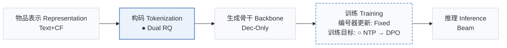
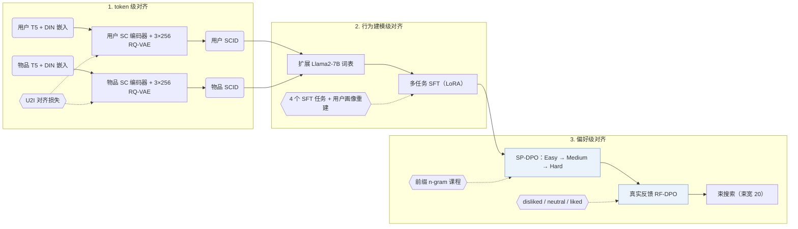
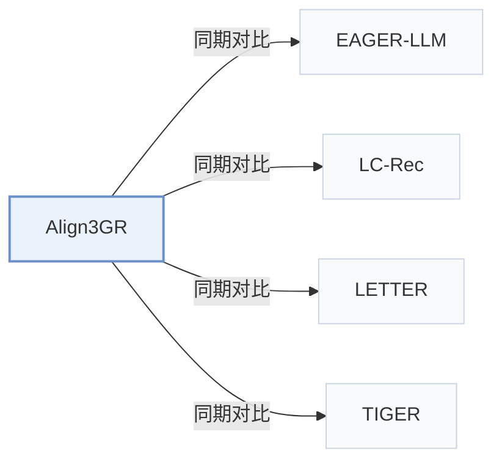

# Align3GR

[← 问题 × 阶段矩阵](../../../README.zh.md#iii--tokenization) · [按阶段索引](../index/stages.md) · [按模态找论文](../index/modality.md) · [按领域找论文](../index/domain.md) · [English](../../papers/align3gr.md) | 中文

| **题目** | *Align$^3$GR: Unified Multi-Level Alignment for LLM-based Generative Recommendation* |
| :-- | :-- |
| **作者** | Ye et al. |
| **发表** | AAAI’26 |
| **问题与阶段** | `III. SID 与模型对齐` · `构码（Tokenization）` |
| **改动** | ● 构码 · ○ 训练目标 |
| **构码输入** | `Text` + `CF` |
| **领域** | `电商` · `本地生活与 POI` · `广告` |
| **链接** | [论文](https://arxiv.org/abs/2511.11255) |
| **阅读级别** | 阅读笔记（第 2 级） |

**本页目录**：[TL;DR](#tldr) · [速览](#速览) · [1. 为什么重要](#1-为什么重要) · [2. 方法](#2-方法) · [3. 实验发现](#3-实验发现) · [4. 局限与分析](#4-局限与分析) · [5. 相关工作](#5-相关工作)

- `Text+CF`：文本表征结合协同过滤信号。
- `Dual RQ`：面向双表征流或双侧实体的双路残差量化。
- `Dec-Only`：仅解码器（Decoder-only）自回归架构。
- `Fixed`：先独立训练并冻结编号器，生成器训练期间 SID 保持不变。
- `NTP → DPO`：先进行下一 token 预测微调，再执行直接偏好优化（DPO）。
- `Beam`：在 SID token 上执行自回归束搜索（Beam search）。

### TL;DR

> [!NOTE]
> Align3GR 从双语义-协同编号、行为建模中的双向语义对齐，以及结合自博弈与真实反馈的渐进式 DPO 三个层面，对齐 LLM 推荐模型。

---

### 速览

| 维度 | 摘要 |
| :-- | :-- |
| 主要发现 | 在公开基准数据集上，Align3GR 相比最强基线的 Recall@10 最高提升 +17.8%、NDCG@10 最高提升 +20.2%，并在工业广告平台的离线 Recall@100 与线上收入指标上取得提升（Abstract，Table 1，Table 2）。 |
| 局限 | Align3GR 需在 Llama2-7B 上依次完成用户/物品双路 3 层 RQ-VAE 编号、四任务 SFT、3 阶段 SP-DPO 和 RF-DPO 训练，且论文未报告冲突消解规则与推理延迟（Experimental Settings）。 |

---

### 1. 为什么重要

将预训练大语言模型（LLM）迁移至生成式推荐时，自然语言 token 空间与协同行为模式之间存在语义和行为双重错位（Abstract）。LC-Rec 等早期 LLM 推荐器主要通过监督微调任务对齐物品语义 ID（Semantic ID，SID）。Align3GR 将对齐扩展至三个统一层级：用户与物品双路语义-协同编号、双向多任务 SFT，以及自博弈课程结合真实反馈的渐进式 DPO。

> "To bridge this gap, we propose Align3GR, a novel framework that unifies token-level, behavior modeling-level, and preference-level alignment."（Abstract）

---

### 2. 方法

#### token 级对齐

双路语义-协同（SC）编码器分别为用户和物品融合 T5 文本嵌入与 DIN 行为嵌入，并由两个独立的 3 层 RQ-VAE（每层码本含 256 个 32 维码字）量化为用户 SCID 与物品 SCID（Fig. 2 caption，Experimental Settings）。将两类离散 SCID token 直接扩充进 Llama2-7B 词表，可避免自回归生成时的词表外切分。

> "Following previous work (Zheng et al. 2024), we first expand the LLM vocabulary to include the SCID tokens of the user and the item, thus avoiding out-of-vocabulary issues and ensuring smooth integration with autoregressive generation tasks."（Behavior Modeling-level Alignment）

#### 行为建模级对齐

监督微调（SFT）沿用并扩展 LC-Rec 的四个子任务：序列物品预测、非对称物品预测、基于意图的物品预测，以及个性化偏好推断（Multi-task SFT）。每个任务的提示词均嵌入用户 SCID token，除预测目标物品 SCID 外，还要求从用户 SCID 逆向重建用户画像文本，实现双向对齐（Multi-task SFT）。

#### 偏好级对齐

自博弈 DPO（SP-DPO）依据 3 层层级 SCID 的前缀 n-gram 匹配度，按 Easy、Medium、Hard 三个由易到难的课程阶段构造负样本（Preference-level Alignment）。随后的真实反馈 DPO（RF-DPO）利用日志中划分为 disliked、neutral 和 liked 三档的真实反馈继续微调策略（Preference-level Alignment）。

> "Specifically, considering the hierarchical nature of SCID, we divide progressive SP-DPO learning into three stages: Easy, Medium, and Hard, using a prefix-ngram match metric (Zheng et al. 2025)"（Preference-level Alignment）

---

### 3. 实验发现

实验设置

- **数据集**：Amazon Instruments, Amazon Beauty, and Yelp; users and items with fewer than 5 interactions are filtered. Retained corpus sizes: not reported in the body. Industrial: internal data from a large-scale advertising recommendation platform; filtering not reported.
  - 出处：Datasets, 5-interaction filter, leave-one-out, history cap: [Sx4.SSx1.p1](https://arxiv.org/html/2511.11255v2#Sx4.SSx1.p1); industrial platform: [Sx4.SSx3.p1](https://arxiv.org/html/2511.11255v2#Sx4.SSx3.p1).
- **切分**：Leave-one-out into training, validation, and test; histories capped at the 20 most recent items. The exact position allocation is not reported beyond the leave-one-out label. Online: 10% of traffic (about 40+ million users) over multiple weeks.
  - 出处：Leave-one-out and 20-item cap: [Sx4.SSx1.p1](https://arxiv.org/html/2511.11255v2#Sx4.SSx1.p1) and [Sx4.SSx1.p3](https://arxiv.org/html/2511.11255v2#Sx4.SSx1.p3); online traffic: [Sx4.SSx3.p1](https://arxiv.org/html/2511.11255v2#Sx4.SSx3.p1).
- **候选集**：not reported (full catalog versus sampled evaluation candidates); industrial retrieval reports Recall@100.
  - 出处：Metrics and beam width only: [Sx4.SSx1.p3](https://arxiv.org/html/2511.11255v2#Sx4.SSx1.p3).
- **可见性**：warm; no unseen-item protocol is defined.
  - 出处：Standard leave-one-out with no cold-start experiment: [Sx4.SSx1.p1](https://arxiv.org/html/2511.11255v2#Sx4.SSx1.p1).
- **SID 规格**：Item SCID: 3-level RQ-VAE x 256 codewords (dimension 32) over concatenated semantic (T5) and collaborative (DIN) embeddings; users receive their own SCIDs from a separate user RQ-VAE. Both are added to the LLM vocabulary. Collision handling: not reported.
  - 出处：3-level RQ-VAE x 256 codes of dimension 32, user and item SCIDs added to the vocabulary: [Sx4.SSx1.p4](https://arxiv.org/html/2511.11255v2#Sx4.SSx1.p4); dual user/item tokenizer: [Sx3.SSx2.p2](https://arxiv.org/html/2511.11255v2#Sx3.SSx2.p2) and [Sx3.SSx2.p4](https://arxiv.org/html/2511.11255v2#Sx3.SSx2.p4).
- **推理预算**：Beam search with beam width 20 for generative methods (following EAGER-LLM); Recall and NDCG at K=5 and 10. All experiments use 4 NVIDIA GPUs (model not stated); inference batch size and latency: not reported. Backbone: Llama2-7B with LoRA.
  - 出处：Beam width 20 following EAGER-LLM: [Sx4.SSx1.p3](https://arxiv.org/html/2511.11255v2#Sx4.SSx1.p3); 4 GPUs for all experiments: [Sx4.SSx1.p4](https://arxiv.org/html/2511.11255v2#Sx4.SSx1.p4).
- **结果来源**：Table 1 (Instruments, Beauty, Yelp; averages over five seeds); Table 2 (industrial Recall@100 and online revenue versus a two-tower baseline and TIGER); Tables 3-5 and Figure 4 (tokenization, SFT-task, and DPO ablations).
  - 出处：Main table: [Sx3.T1](https://arxiv.org/html/2511.11255v2#Sx3.T1); industrial: [Sx4.T2](https://arxiv.org/html/2511.11255v2#Sx4.T2); ablations: [Sx4.T3](https://arxiv.org/html/2511.11255v2#Sx4.T3), [Sx4.T4](https://arxiv.org/html/2511.11255v2#Sx4.T4), [Sx4.T5](https://arxiv.org/html/2511.11255v2#Sx4.T5); five seeds: [Sx4.SSx1.p4](https://arxiv.org/html/2511.11255v2#Sx4.SSx1.p4).

- 公开基准对比：在 5-core 过滤后的 Amazon Instruments、Amazon Beauty 和 Yelp 上（5 个随机种子平均，束宽 20），Align3GR 优于传统序列推荐、生成式模型（TIGER、LETTER）与 LLM 基线（LC-Rec、EAGER-LLM），相比最强基线的 Recall@10 最高提升 +17.8%、NDCG@10 最高提升 +20.2%（Abstract，Experimental Settings，Table 1）。
- 多层级消融：消融实验分别验证了双路用户-物品 SCID 编号（Table 3）、双向 SFT 任务（Table 4），以及 3 阶段 SP-DPO 叠加 RF-DPO 的逐步增益（Table 5，Fig. 4）。
- 工业部署：在大规模广告推荐平台上，Align3GR 在离线 Recall@100 上超过双塔基线与 TIGER，并在 10% 流量（超 40 million 用户）的多周在线 A/B 测试中带来广告收入提升，随后全量上线（Abstract，Table 2）。

---

### 4. 局限与分析

**Our analysis.**

- 训练流程依次串联双路 SCID 编号器、四任务 SFT、3 阶段 SP-DPO 与 RF-DPO，物品目录或用户分布更新时需重跑多阶段训练。
- 用户 SCID 依赖历史交互离线量化，无历史交互的冷启动用户缺少预置的用户 SCID token。
- EAGER-LLM 同样将语义和协同信号输入 `Dec-Only` LLM，但仅对物品做 `Dual H-KM` 编码；Align3GR 对用户与物品双侧执行 `Dual RQ`（`RQ-VAE`）编号，并引入两阶段 DPO（`NTP → DPO`）。

---

### 5. 相关工作

- **同期对比** · [EAGER-LLM](eager-llm.md): EAGER-LLM aligns item tokens with collaborative signals; Align3GR also tokenizes users and adds progressive self-play and real-feedback DPO.
  - 出处：Align3GR v2, Experimental Settings baselines (13) and beam-width protocol: [Sx4.SSx1.p2](https://arxiv.org/html/2511.11255v2#Sx4.SSx1.p2) and [Sx4.SSx1.p3](https://arxiv.org/html/2511.11255v2#Sx4.SSx1.p3); Table 1: [Sx3.T1](https://arxiv.org/html/2511.11255v2#Sx3.T1).
- **同期对比** · [LC-Rec](lc-rec.md): LC-Rec aligns LLMs to item codes with auxiliary tasks; Align3GR adds dual user-item SCIDs and preference-level DPO on top of multi-task SFT.
  - 出处：Align3GR v2, baselines (11): [Sx4.SSx1.p2](https://arxiv.org/html/2511.11255v2#Sx4.SSx1.p2); Table 1: [Sx3.T1](https://arxiv.org/html/2511.11255v2#Sx3.T1).
- **同期对比** · [LETTER](letter.md): LETTER learns a regularized item tokenizer; Align3GR fuses semantic and collaborative features for both users and items through a U2I loss.
  - 出处：Align3GR v2, baselines (12): [Sx4.SSx1.p2](https://arxiv.org/html/2511.11255v2#Sx4.SSx1.p2); Table 1: [Sx3.T1](https://arxiv.org/html/2511.11255v2#Sx3.T1).
- **同期对比** · [TIGER](tiger.md): TIGER uses content-only RQ-VAE item codes with a small Transformer; Align3GR uses an LLM backbone with dual SCIDs and DPO.
  - 出处：Align3GR v2, baselines (10): [Sx4.SSx1.p2](https://arxiv.org/html/2511.11255v2#Sx4.SSx1.p2); Table 1: [Sx3.T1](https://arxiv.org/html/2511.11255v2#Sx3.T1); industrial Table 2: [Sx4.T2](https://arxiv.org/html/2511.11255v2#Sx4.T2).

[查看同格全部论文](../../../README.zh.md#iii--tokenization)
