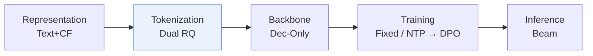
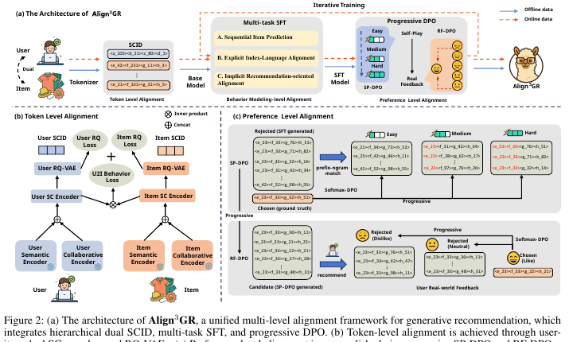
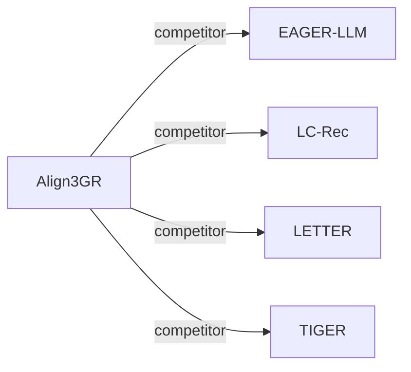

# Align3GR

*Align$^3$GR: Unified Multi-Level Alignment for LLM-based Generative Recommendation* — Ye et al. · AAAI’26

`III. SID 与模型对齐` · `Tokenization` · [论文](https://arxiv.org/abs/2511.11255) · [矩阵](../../../README.zh.md#iii--tokenization) · [English](../../papers/align3gr.md)

阅读级别：阅读笔记（第 2 级） · 本页目录：[TL;DR](#tldr) · [速览](#速览) · [1. 为什么重要](#1-为什么重要) · [2. 方法](#2-方法) · [3. 实验发现](#3-实验发现) · [4. 局限与分析](#4-局限与分析) · [5. 相关工作](#5-相关工作)

- `Dec-Only`: Decoder-only.
- `Fixed`: SIDs are built first and not changed while the generator trains.
- `NTP → DPO`: NTP, then preference optimization.

### TL;DR

> [!NOTE]
> Align3GR 从双语义-协同编号、行为建模中的双向语义对齐，以及结合自博弈与真实反馈的渐进式 DPO 三个层面，对齐 LLM 推荐模型。

### 速览

| 维度 | 摘要 |
| :-- | :-- |
| 研究问题 | III. SID 与模型对齐：Can the generator read, write, and reason over SIDs, and do the tokenizer and generator work toward the same goal? |
| 核心贡献 | Align3GR 从双语义-协同编号、行为建模中的双向语义对齐，以及结合自博弈与真实反馈的渐进式 DPO 三个层面，对齐 LLM 推荐模型。 |
| 主要改动阶段 | Tokenization |
| 主要发现 | 在公开数据集上，Align3GR 比最强基线的 Recall@10 高 +17.8%，NDCG@10 高 +20.2%（Abstract）。 |

### 1. 为什么重要

把大语言模型（LLM）改造成推荐器，会遇到语义和行为两方面的错位（Abstract）。LC-Rec 等早期 LLM 推荐器用监督任务对齐物品 token。Align3GR 把 token、行为建模和偏好三个层级的对齐放在一起处理。

> "To bridge this gap, we propose Align3GR, a novel framework that unifies token-level, behavior modeling-level, and preference-level alignment."（Abstract）（把 token、行为建模、偏好三级对齐统一起来。）

### 2. 方法

#### token 级对齐

两路语义-协同（SC）编码器配 RQ-VAE，为用户和物品都生成 SCID（Fig. 2 caption）。这些 token 加进 LLM 的词表。

> "Following previous work (Zheng et al. 2024), we first expand the LLM vocabulary to include the SCID tokens of the user and the item, thus avoiding out-of-vocabulary issues and ensuring smooth integration with autoregressive generation tasks."（Behavior Modeling-level Alignment）（先把用户和物品的 SCID token 加进词表，避免词表外问题。）

#### 行为建模级对齐

监督微调（SFT）沿用 LC-Rec 的四个任务：序列物品预测、非对称物品预测、按用户意图预测物品、个性化偏好推断（Multi-task SFT）。每个任务的提示里都有用户的 SCID token，其中一个任务要从用户 SCID 还原用户画像文本（Multi-task SFT）。

#### 偏好级对齐

自博弈 DPO（SP-DPO）分 Easy、Medium、Hard 三个阶段，阶段按层级 SCID 的前缀 n-gram 匹配划分（Preference-level Alignment）。之后的真实反馈 DPO（RF-DPO）使用标为 disliked、neutral、liked 的反馈（Preference-level Alignment）。

> "Specifically, considering the hierarchical nature of SCID, we divide progressive SP-DPO learning into three stages: Easy, Medium, and Hard, using a prefix-ngram match metric (Zheng et al. 2025)"（Preference-level Alignment）（按前缀 n-gram 匹配把 SP-DPO 分成三个由易到难的阶段。）

### 3. 实验发现

实验设置

- **数据集**：Amazon Instruments, Amazon Beauty, and Yelp; users and items with fewer than 5 interactions are filtered. Retained corpus sizes: not reported in the body. Industrial: internal data from a large-scale advertising recommendation platform; filtering not reported.
  - 出处：Datasets, 5-interaction filter, leave-one-out, history cap: [Sx4.SSx1.p1](https://arxiv.org/html/2511.11255v2#Sx4.SSx1.p1); industrial platform: [Sx4.SSx3.p1](https://arxiv.org/html/2511.11255v2#Sx4.SSx3.p1).
- **切分**：Leave-one-out into training, validation, and test; histories capped at the 20 most recent items. The exact position allocation is not reported beyond the leave-one-out label. Online: 10% of traffic (about 40+ million users) over multiple weeks.
  - 出处：Leave-one-out and 20-item cap: [Sx4.SSx1.p1](https://arxiv.org/html/2511.11255v2#Sx4.SSx1.p1) and [Sx4.SSx1.p3](https://arxiv.org/html/2511.11255v2#Sx4.SSx1.p3); online traffic: [Sx4.SSx3.p1](https://arxiv.org/html/2511.11255v2#Sx4.SSx3.p1).
- **候选集**：not reported (full catalog versus sampled evaluation candidates); industrial retrieval reports Recall@100.
  - 出处：Metrics and beam width only: [Sx4.SSx1.p3](https://arxiv.org/html/2511.11255v2#Sx4.SSx1.p3).
- **可见性**：warm; no unseen-item protocol is defined.
  - 出处：Standard leave-one-out with no cold-start experiment: [Sx4.SSx1.p1](https://arxiv.org/html/2511.11255v2#Sx4.SSx1.p1).
- **SID 规格**：Item SCID: 3-level RQ-VAE x 256 codewords (dimension 32) over concatenated semantic (T5) and collaborative (DIN) embeddings; users receive their own SCIDs from a separate user RQ-VAE. Both are added to the LLM vocabulary. Collision handling: not reported.
  - 出处：3-level RQ-VAE x 256 codes of dimension 32, user and item SCIDs added to the vocabulary: [Sx4.SSx1.p4](https://arxiv.org/html/2511.11255v2#Sx4.SSx1.p4); dual user/item tokenizer: [Sx3.SSx2.p2](https://arxiv.org/html/2511.11255v2#Sx3.SSx2.p2) and [Sx3.SSx2.p4](https://arxiv.org/html/2511.11255v2#Sx3.SSx2.p4).
- **推理预算**：Beam search with beam width 20 for generative methods (following EAGER-LLM); Recall and NDCG at K=5 and 10. All experiments use 4 NVIDIA GPUs (model not stated); inference batch size and latency: not reported. Backbone: Llama2-7B with LoRA.
  - 出处：Beam width 20 following EAGER-LLM: [Sx4.SSx1.p3](https://arxiv.org/html/2511.11255v2#Sx4.SSx1.p3); 4 GPUs for all experiments: [Sx4.SSx1.p4](https://arxiv.org/html/2511.11255v2#Sx4.SSx1.p4).
- **结果来源**：Table 1 (Instruments, Beauty, Yelp; averages over five seeds); Table 2 (industrial Recall@100 and online revenue versus a two-tower baseline and TIGER); Tables 3-5 and Figure 4 (tokenization, SFT-task, and DPO ablations).
  - 出处：Main table: [Sx3.T1](https://arxiv.org/html/2511.11255v2#Sx3.T1); industrial: [Sx4.T2](https://arxiv.org/html/2511.11255v2#Sx4.T2); ablations: [Sx4.T3](https://arxiv.org/html/2511.11255v2#Sx4.T3), [Sx4.T4](https://arxiv.org/html/2511.11255v2#Sx4.T4), [Sx4.T5](https://arxiv.org/html/2511.11255v2#Sx4.T5); five seeds: [Sx4.SSx1.p4](https://arxiv.org/html/2511.11255v2#Sx4.SSx1.p4).

- 工业部署：作者报告了在工业推荐平台上的在线 A/B 测试收益和全量部署（Abstract）。

### 4. 局限与分析

**Our analysis.**

- 流程依次训练 SCID 编号器、多任务 SFT 和两轮 DPO。由此推断，物品库一变就要重跑好几个阶段。
- EAGER-LLM 同样把语义和协同信号输入 `Dec-Only` LLM，但用 `Dual H-KM` 码；Align3GR 用 `Dual RQ` 码，并加了 DPO。

### 5. 相关工作

- **同期对比** · [EAGER-LLM](eager-llm.md): EAGER-LLM aligns item tokens with collaborative signals; Align3GR also tokenizes users and adds progressive self-play and real-feedback DPO.
  - 出处：Align3GR v2, Experimental Settings baselines (13) and beam-width protocol: https://arxiv.org/html/2511.11255v2#Sx4.SSx1.p2 and https://arxiv.org/html/2511.11255v2#Sx4.SSx1.p3; Table 1: https://arxiv.org/html/2511.11255v2#Sx3.T1.
- **同期对比** · [LC-Rec](lc-rec.md): LC-Rec aligns LLMs to item codes with auxiliary tasks; Align3GR adds dual user-item SCIDs and preference-level DPO on top of multi-task SFT.
  - 出处：Align3GR v2, baselines (11): https://arxiv.org/html/2511.11255v2#Sx4.SSx1.p2; Table 1: https://arxiv.org/html/2511.11255v2#Sx3.T1.
- **同期对比** · [LETTER](letter.md): LETTER learns a regularized item tokenizer; Align3GR fuses semantic and collaborative features for both users and items through a U2I loss.
  - 出处：Align3GR v2, baselines (12): https://arxiv.org/html/2511.11255v2#Sx4.SSx1.p2; Table 1: https://arxiv.org/html/2511.11255v2#Sx3.T1.
- **同期对比** · [TIGER](tiger.md): TIGER uses content-only RQ-VAE item codes with a small Transformer; Align3GR uses an LLM backbone with dual SCIDs and DPO.
  - 出处：Align3GR v2, baselines (10): https://arxiv.org/html/2511.11255v2#Sx4.SSx1.p2; Table 1: https://arxiv.org/html/2511.11255v2#Sx3.T1; industrial Table 2: https://arxiv.org/html/2511.11255v2#Sx4.T2.

[查看同格全部论文](../../../README.zh.md#iii--tokenization)
