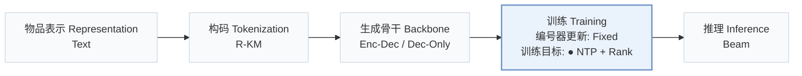
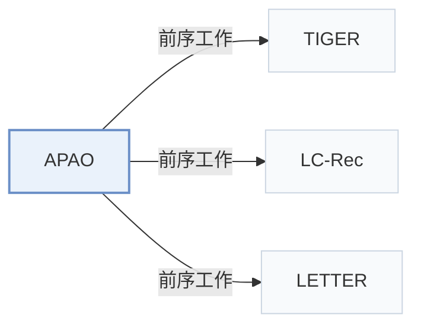

# APAO

[← 问题 × 阶段矩阵](../../../README.zh.md#iv--training) · [按阶段索引](../index/stages.md) · [按模态找论文](../index/modality.md) · [按领域找论文](../index/domain.md) · [English](../../papers/apao.md) | 中文

| **题目** | *Bridging the Training-Inference Gap in Generative Recommendation via Adaptive Prefix-Aware Optimization* |
| :-- | :-- |
| **作者** | Yu et al. |
| **发表** | KDD’26 |
| **问题与阶段** | `IV. 实用目标` · `训练（Training）` |
| **改动** | ● 训练目标 |
| **构码输入** | `Text` |
| **领域** | `电商` · `本地生活与 POI` |
| **应用场景** | `一般物品推荐`；`线上实验或部署` |
| **链接** | [论文](https://arxiv.org/abs/2603.02730) · [代码](https://github.com/yuyq18/APAO) |
| **阅读级别** | 概览（第 1 级） |

**本页目录**：[TL;DR](#tldr) · [3. 实验发现](#3-实验发现) · [5. 相关工作](#5-相关工作)

- `Text`：物品文本元数据（标题、描述、类目或提示词）。
- `R-KM`：残差 k-means 量化（Residual k-means）。
- `Enc-Dec / Dec-Only`：同时在编码器-解码器与仅解码器两种骨干上验证。
- `Fixed`：先独立训练并冻结编号器，生成器训练期间 SID 保持不变。
- `NTP + Rank`：下一 token 预测结合显式排序损失。
- `Beam`：在 SID token 上执行自回归束搜索（Beam search）。

### TL;DR

> [!NOTE]
> APAO 在训练中加入前缀级损失和自适应最差前缀策略，减少正确物品在束搜索剪枝中被淘汰的情况，弥合逐 token 交叉熵训练与束搜索推理的差距。

---

### 3. 实验发现

实验设置

- **数据集**：Amazon Office (4,905 users / 2,420 items), Grocery (14,681 / 8,713), Beauty (22,363 / 12,101), and Yelp (30,431 / 20,033), with 5-core filtering of users and items; histories truncated to the 20 most recent items.
  - 出处：Datasets, 5-core, leave-one-out: [S5.SS1.SSS1.p1](https://arxiv.org/html/2603.02730v4#S5.SS1.SSS1.p1); statistics: [S5.T2](https://arxiv.org/html/2603.02730v4#S5.T2).
- **切分**：Leave-one-out (following LETTER and LC-Rec; allocation not restated beyond the label).
  - 出处：Leave-one-out named: [S5.SS1.SSS1.p1](https://arxiv.org/html/2603.02730v4#S5.SS1.SSS1.p1).
- **候选集**：not reported (full catalog versus sampled evaluation candidates); top-K from beam search with Recall and NDCG at 10 and 20. Training losses use 100 uniformly sampled negatives; exclusion of history items for these negatives: not reported.
  - 出处：Metrics; training negatives fixed at 100 uniform: [S5.SS1.SSS1.p1](https://arxiv.org/html/2603.02730v4#S5.SS1.SSS1.p1) and [S5.SS1.SSS3.p2](https://arxiv.org/html/2603.02730v4#S5.SS1.SSS3.p2).
- **可见性**：warm; no unseen-item protocol is defined.
  - 出处：Standard split with no unseen-item protocol: [S5.SS1.SSS1.p1](https://arxiv.org/html/2603.02730v4#S5.SS1.SSS1.p1).
- **SID 规格**：4-level RQ-K-means codes over Llama-3.1-8B-Instruct item embeddings; codebook size and collision handling: not reported.
  - 出处：4-level RQ-K-means over Llama-3.1-8B embeddings: [S5.SS1.SSS3.p1](https://arxiv.org/html/2603.02730v4#S5.SS1.SSS3.p1); codebook size and collision rule not found.
- **推理预算**：Beam search with beam size 20 (scalability over K in Figure 6); TIGER encoder-decoder and Llama decoder backbones of about 0.01B parameters, trained on one NVIDIA A100-40GB. Inference batch size and latency: not reported (Table 4 reports training efficiency).
  - 出处：Beam size 20 and hardware: [S5.SS1.SSS3.p1](https://arxiv.org/html/2603.02730v4#S5.SS1.SSS3.p1); beam scalability: [S5.F6](https://arxiv.org/html/2603.02730v4#S5.F6); training efficiency: [S5.T4](https://arxiv.org/html/2603.02730v4#S5.T4).
- **结果来源**：Table 1 (four datasets, TIGER and Llama backbones, versus CE, MSL, DPO, DMPO, S-DPO losses); Table 3 (one-stage versus two-stage training); Table 4 (training efficiency); Figures 2-6 (ablations, prefix-level analysis, hyperparameters, beam size).
  - 出处：Main: [S5.T1](https://arxiv.org/html/2603.02730v4#S5.T1); paradigms: [S5.T3](https://arxiv.org/html/2603.02730v4#S5.T3); efficiency: [S5.T4](https://arxiv.org/html/2603.02730v4#S5.T4).

---

### 5. 相关工作

- **前序工作** · [TIGER](tiger.md): TIGER is the encoder-decoder backbone; APAO adds prefix-level losses so that training matches beam-search pruning.
  - 出处：APAO v4, backbones: [S5.SS1.SSS2.p3](https://arxiv.org/html/2603.02730v4#S5.SS1.SSS2.p3); Table 1: [S5.T1](https://arxiv.org/html/2603.02730v4#S5.T1); beam-search analysis: [S3.SS3.p3](https://arxiv.org/html/2603.02730v4#S3.SS3.p3).
- **前序工作** · [LC-Rec](lc-rec.md): APAO follows LC-Rec and LETTER for data processing and LLM-embedding tokenization, then changes only the training objective.
  - 出处：APAO v4, Section 5.1.1 and 5.1.3 follow Zheng et al. (2024): [S5.SS1.SSS1.p1](https://arxiv.org/html/2603.02730v4#S5.SS1.SSS1.p1) and [S5.SS1.SSS3.p1](https://arxiv.org/html/2603.02730v4#S5.SS1.SSS3.p1).
- **前序工作** · [LETTER](letter.md): APAO follows LETTER's preprocessing protocol; LETTER also adds a ranking-guided loss, whereas APAO supervises every prefix level.
  - 出处：APAO v4, Section 5.1.1 follows Wang et al. (2024): [S5.SS1.SSS1.p1](https://arxiv.org/html/2603.02730v4#S5.SS1.SSS1.p1); Section 1: [S1.p2](https://arxiv.org/html/2603.02730v4#S1.p2).

[查看同格全部论文](../../../README.zh.md#iv--training)
