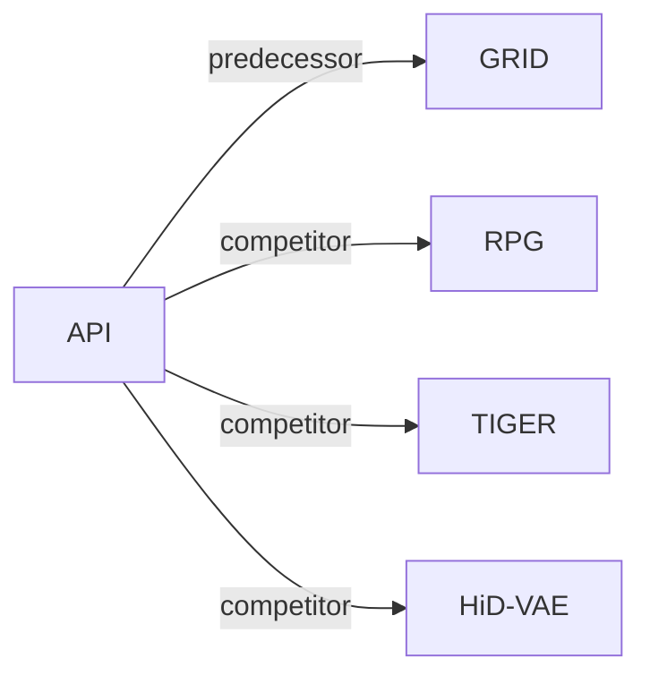

# API

| **题目** | *The Vocabulary Is Already Here: Adapting Pretrained Interpretable Features for Generative Recommendation* |
| :-- | :-- |
| **作者** | Luo et al. |
| **会议** | arXiv’26 |
| **问题与阶段** | `II. 唯一性与合法性` · `Tokenization` |
| **链接** | [论文](https://arxiv.org/abs/2610.36763) · [代码](https://anonymous.4open.science/r/API-C1F9/) · [矩阵](../../../README.zh.md#ii--tokenization) · [English](../../papers/api.md) |
| **阅读级别** | 概览（第 1 级） |

本页目录：[TL;DR](#tldr) · [速览](#速览) · [3. 实验发现](#3-实验发现) · [5. 相关工作](#5-相关工作)

- `PID (P-SAE)`: Pretrained Interpretable ID (Pretrained Sparse Autoencoder).
- `Enc-Dec / Dec-Only (AR); Non-AR (PR)`: Encoder–decoder or decoder-only autoregressive variants, and parallel non-autoregressive variants.
- `Fixed`: SIDs are built first and not changed while the generator trains.
- `NTP + Rank + Aux. / MTP + Rank + Aux.`: Autoregressive or parallel token prediction jointly optimized with ranking and auxiliary objectives.
- `C-Beam / Scoring`: Constrained beam search or direct item scoring, depending on the configuration.

### TL;DR

> [!NOTE]
> API 直接复用预训练稀疏自编码器的特征下标作为可解释 SID 词表，并训练适配器预测下标与激活强度，无需重新拟合词表。

---

### 速览

| 维度 | 摘要 |
| :-- | :-- |
| 研究问题 | II. 唯一性与合法性：Does every item get its own SID, every generated SID name a real item, and the codebook get used evenly? |
| 核心贡献 | API 直接复用预训练稀疏自编码器的特征下标作为可解释 SID 词表，并训练适配器预测下标与激活强度，无需重新拟合词表。 |
| 主要改动阶段 | Tokenization |

---

### 3. 实验发现

实验设置

- **数据集**：Amazon Beauty, Sports, and Toys as preprocessed in prior work (P5, GRID), keeping their splits; item text from title, brand, category, and price. Sizes: Appendix A (not restated here).
  - 出处：Benchmark aligned with P5 and GRID: [S5.SS1.p1](https://arxiv.org/html/2610.36763v1#S5.SS1.p1).
- **切分**：The prior-work (P5 / GRID) splits and evaluation protocol are retained (allocation not restated); checkpoints selected by validation Recall@5.
  - 出处：Inherited splits; PID statistics from training items only: [S5.SS1.p1](https://arxiv.org/html/2610.36763v1#S5.SS1.p1).
- **候选集**：full catalog (complete test split, full catalog without sampled negatives).
  - 出处：Full catalog without sampled negatives: [S5.SS1.p4](https://arxiv.org/html/2610.36763v1#S5.SS1.p4).
- **可见性**：warm; no unseen-item protocol is defined. PID selection statistics and activation calibration are estimated from training-item contents.
  - 出处：PID statistics estimated from training-item contents; no unseen-item protocol: [S5.SS1.p1](https://arxiv.org/html/2610.36763v1#S5.SS1.p1).
- **SID 规格**：Pretrained Interpretable IDs: K in {4, 8, 16} feature indices selected by a priority rule from the 32 strongest of 24,576 labeled sparse-autoencoder features of a frozen GPT-2-small, plus their relative activation strengths, which separate items whose index sequences coincide. Collision-affected items at K=4: 15.16% on Beauty (77.37% with native SAE selection).
  - 出处：PID from frozen GPT-2 SAE features with K tokens and activation strengths: [S5.SS1.p3](https://arxiv.org/html/2610.36763v1#S5.SS1.p3), [S4.SS1.p3](https://arxiv.org/html/2610.36763v1#S4.SS1.p3); collisions: [S5.T3](https://arxiv.org/html/2610.36763v1#S5.T3).
- **推理预算**：Two decoders: parallel prediction (PR) with exact catalog scoring, and autoregressive (AR) with catalog-constrained beam search of width 50; T5- and GPT-2-style backbones trained from scratch. Hardware, inference batch size, and latency: not reported.
  - 出处：Decoding settings: [S5.SS1.p4](https://arxiv.org/html/2610.36763v1#S5.SS1.p4).
- **结果来源**：Table 1 (full API versus sequential and generative recommenders); Table 2 (tokenizers under T5 and GPT-2 backbones with AR and PR decoding); Table 3 (collision rates by token budget); Table 4 (content alignment); Table 5 (preference and strength ablation); Figure 3 (cross-domain vocabulary reuse).
  - 出处：Results: [S4.T1](https://arxiv.org/html/2610.36763v1#S4.T1), [S5.T2](https://arxiv.org/html/2610.36763v1#S5.T2), [S5.T3](https://arxiv.org/html/2610.36763v1#S5.T3), [S5.T4](https://arxiv.org/html/2610.36763v1#S5.T4), [S5.F3](https://arxiv.org/html/2610.36763v1#S5.F3).

---

### 5. 相关工作

- **前序工作** · [GRID](grid.md): API keeps GRID's preprocessed data and its residual-quantization tokenizer baselines, and replaces learned codes with pretrained interpretable SAE feature IDs.
  - 出处：API v1, benchmark and tokenization baselines aligned with GRID: https://arxiv.org/html/2610.36763v1#S5.SS1.p1 and https://arxiv.org/html/2610.36763v1#S5.SS1.p2; Table 2: https://arxiv.org/html/2610.36763v1#S5.T2.
- **同期对比** · [RPG](rpg.md): RPG's parallel-prediction implementation is the PR backbone; API swaps its OPQ codes for SAE feature indices with activation strengths.
  - 出处：API v1, PR implementation based on RPG: https://arxiv.org/html/2610.36763v1#S5.SS1.p2; Tables 1-2: https://arxiv.org/html/2610.36763v1#S4.T1 and https://arxiv.org/html/2610.36763v1#S5.T2.
- **同期对比** · [TIGER](tiger.md): TIGER's autoregressive implementation is the AR backbone and RQ-VAE is a tokenizer baseline.
  - 出处：API v1, AR implementation based on TIGER: https://arxiv.org/html/2610.36763v1#S5.SS1.p2; Tables 1-2: https://arxiv.org/html/2610.36763v1#S4.T1 and https://arxiv.org/html/2610.36763v1#S5.T2.
- **同期对比** · [HiD-VAE](hid-vae.md): HiD-VAE supervises quantization levels with category tags for interpretability; API takes interpretability from labeled pretrained SAE features.
  - 出处：API v1, tokenization baselines: https://arxiv.org/html/2610.36763v1#S5.SS1.p2; Table 2: https://arxiv.org/html/2610.36763v1#S5.T2.

[查看同格全部论文](../../../README.zh.md#ii--tokenization)
