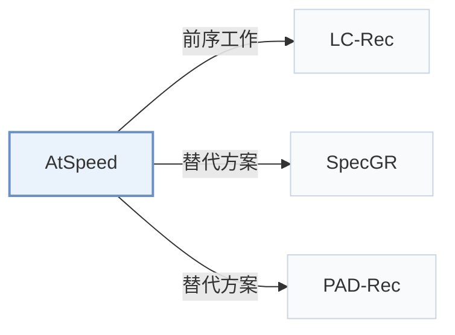

# AtSpeed

[← 问题 × 阶段矩阵](../../../README.zh.md#v--inference) · [按阶段索引](../index/stages.md) · [按模态找论文](../index/modality.md) · [按领域找论文](../index/domain.md) · [English](../../papers/atspeed.md) | 中文

| **题目** | *Efficient Inference for Large Language Model-based Generative Recommendation* |
| :-- | :-- |
| **作者** | Lin et al. |
| **发表** | ICLR’25 |
| **问题与阶段** | `V. 效率` · `推理（Inference）` |
| **改动** | ○ 训练目标 · ● 推理 |
| **构码输入** | `Text` |
| **领域** | `电商` · `电影` · `图书与有声书` |
| **应用场景** | `一般物品推荐`；`公开数据` |
| **链接** | [论文](https://arxiv.org/abs/2410.05165) · [代码](https://github.com/Linxyhaha/AtSpeed) |
| **阅读级别** | 概览（第 1 级） |

**本页目录**：[TL;DR](#tldr) · [3. 实验发现](#3-实验发现) · [5. 相关工作](#5-相关工作)

- `Text`：物品文本元数据（标题、描述、类目或提示词）。
- `RQ-VAE`：残差量化变分自编码器（Residual-Quantized VAE）。
- `Dec-Only`：仅解码器（Decoder-only）自回归架构。
- `Fixed`：先独立训练并冻结编号器，生成器训练期间 SID 保持不变。
- `NTP`：标准下一 token 预测（Next-Token Prediction）交叉熵损失；基于预训练 LLM 的指令微调（SFT）亦归入此类。
- `Spec. Dec.`：草稿模型与目标模型协同的投机解码（Speculative decoding）。

### TL;DR

> [!NOTE]
> AtSpeed 在 top-K 序列上对齐草稿模型与目标 LLM，并放宽投机解码的验证条件，以加速 LLM 生成式推荐中 top-K 物品的束搜索解码。

---

### 3. 实验发现

实验设置

- **数据集**：Amazon Beauty and Games (main), plus MovieLens-1M and Goodreads in Appendix Table 6. Filtering rules: not restated; statistics in Appendix Table 2.
  - 出处：Datasets: [S4.SS1.p1](https://arxiv.org/html/2410.05165v3#S4.SS1.p1); split and identifier length: [A1.SS3.SSS1.p1](https://arxiv.org/html/2410.05165v3#A1.SS3.SSS1.p1).
- **切分**：All interactions sorted by global timestamp and split 8:1:1 into training, validation, and test.
  - 出处：Global-timestamp 8:1:1 split: [A1.SS3.SSS1.p1](https://arxiv.org/html/2410.05165v3#A1.SS3.SSS1.p1).
- **候选集**：not reported (full catalog versus sampled); top-K (K = 1, 3, 5, 10, 20) from beam search of the target LLM, evaluated by Recall and NDCG plus walltime speedup.
  - 出处：Metrics: [S4.SS1.p3](https://arxiv.org/html/2410.05165v3#S4.SS1.p3).
- **可见性**：warm; no unseen-item protocol is defined (global temporal split, so test items may include items not seen in training, but this is not analyzed).
  - 出处：Global temporal split with no unseen-item protocol: [A1.SS3.SSS1.p1](https://arxiv.org/html/2410.05165v3#A1.SS3.SSS1.p1).
- **SID 规格**：RQ-VAE item identifiers following LC-Rec, length L=4; codebook size and collision handling: not reported.
  - 出处：RQ-VAE identifiers following LC-Rec, length 4: [S4.SS1.p1](https://arxiv.org/html/2410.05165v3#S4.SS1.p1) and [A1.SS3.SSS1.p1](https://arxiv.org/html/2410.05165v3#A1.SS3.SSS1.p1).
- **推理预算**：Speculative beam decoding: LLaMA-68M draft model with draft length 4 and draft beam size N=40 verifying top-K beams (K up to 20) of a LLaMA-7B LC-Rec target with tree-based attention. Figure 1 measures LC-Rec inference time on one NVIDIA A5000; draft training on 4 A5000 GPUs; speedup reported as walltime ratio (WS@K).
  - 出处：Draft settings and hardware: [S4.SS1.p4](https://arxiv.org/html/2410.05165v3#S4.SS1.p4) and [A1.SS3.SSS1.p2](https://arxiv.org/html/2410.05165v3#A1.SS3.SSS1.p2); target inference cost figure: [S1.F1](https://arxiv.org/html/2410.05165v3#S1.F1).
- **结果来源**：Table 1 (walltime speedup and accepted steps versus SFT, WordKD, SeqKD, TVDKD, DARE drafts); Appendix Table 5 (Recall and NDCG on Beauty and Games for the target LLM, the baselines, and AtSpeed instantiated on LC-Rec with LLaMA-7B); Appendix Tables 6-7 (MovieLens-1M, Goodreads, alignment-data cost).
  - 出处：Main: [S4.T1](https://arxiv.org/html/2410.05165v3#S4.T1); ranking results: [A1.T5](https://arxiv.org/html/2410.05165v3#A1.T5); appendix datasets and cost: [A1.T6](https://arxiv.org/html/2410.05165v3#A1.T6) and [A1.T7](https://arxiv.org/html/2410.05165v3#A1.T7).

---

### 5. 相关工作

- **前序工作** · [LC-Rec](lc-rec.md): AtSpeed accelerates an LC-Rec target model: it trains a small draft model aligned to LC-Rec's top-K beams and verifies drafted beams in parallel.
  - 出处：AtSpeed v3, instantiated on LC-Rec: [S4.SS1.p1](https://arxiv.org/html/2410.05165v3#S4.SS1.p1) and [S4.SS1.p4](https://arxiv.org/html/2410.05165v3#S4.SS1.p4); Figure 1 inference cost of LC-Rec: [S1.F1](https://arxiv.org/html/2410.05165v3#S1.F1).
- **替代方案** · [SpecGR](specgr.md): SpecGR uses speculative drafting to recommend new items inductively, whereas AtSpeed uses it only to speed up decoding while keeping the target model's top-K.
  - 出处：AtSpeed v3, Section 5 related work cites SpecGR: [S5.p1](https://arxiv.org/html/2410.05165v3#S5.p1).
- **替代方案** · [PAD-Rec](pad-rec.md): PAD-Rec later also applies speculative decoding to LLM generative recommendation, targeting list-wise generation with position-aware drafts.
  - 出处：Evidence is from the later PAD-Rec paper, Sections 1 and 2.3: [S1.p2](https://arxiv.org/html/2604.27747v1#S1.p2) and [S2.SS3.p1](https://arxiv.org/html/2604.27747v1#S2.SS3.p1).

[查看同格全部论文](../../../README.zh.md#v--inference)
