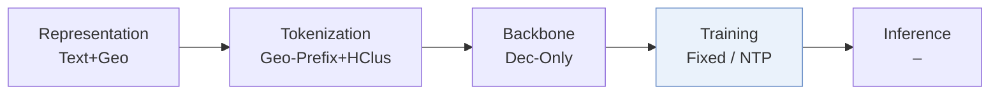
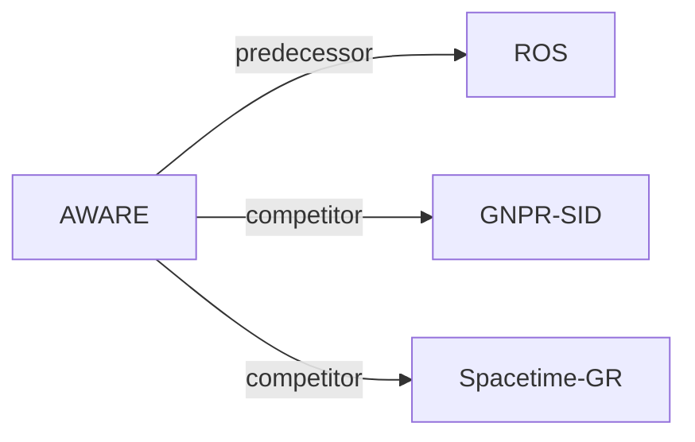

# AWARE

| **题目** | *Why Users Go There: World Knowledge-Augmented Generative Next POI Recommendation* |
| :-- | :-- |
| **作者** | Ding et al. |
| **会议** | arXiv’26 |
| **问题与阶段** | `VI. 泛化` · `Training` · `POI` |
| **链接** | [论文](https://arxiv.org/abs/2605.11807) · [矩阵](../../../README.zh.md#vi--training) · [English](../../papers/aware.md) |
| **阅读级别** | 概览（第 1 级） |

本页目录：[TL;DR](#tldr) · [速览](#速览) · [3. 实验发现](#3-实验发现) · [5. 相关工作](#5-相关工作)

- `Geo-Prefix+HClus`: Geographic prefixes combined with hierarchical clustering codes.
- `Dec-Only`: Decoder-only.
- `Fixed`: SIDs are built first and not changed while the generator trains.
- `NTP`: Next-token prediction loss only; continuing from a pretrained LLM (SFT) also counts as NTP.
- `–`: Not reported in the paper.

### TL;DR

> [!NOTE]
> AWARE 将智能体结合用户行为生成的本地活动、文化与时令叙事融入基于 LLM 的下一 POI 生成，弥补模型参数训练后知识固定的局限。

---

### 速览

| 维度 | 摘要 |
| :-- | :-- |
| 研究问题 | VI. 泛化：Does it still work for new items, new domains, and shifting interests? |
| 核心贡献 | AWARE 将智能体结合用户行为生成的本地活动、文化与时令叙事融入基于 LLM 的下一 POI 生成，弥补模型参数训练后知识固定的局限。 |
| 主要改动阶段 | Training |

---

### 3. 实验发现

实验设置

- **数据集**：Foursquare-NYC, Foursquare-TKY and Gowalla-CA; filter users/POIs with fewer than 10 check-ins; segment chronological trajectories at a 24-hour gap; reverse-geocode street addresses.
  - 出处：Sec.4.1 and Appendix A: [S4.SS1.p1](https://arxiv.org/html/2605.11807v1#S4.SS1.p1) and [A1.p1](https://arxiv.org/html/2605.11807v1#A1.p1)
- **切分**：Temporal 80/10/10 train/validation/test; per-user versus global allocation: not reported. History budget 150 entries, reserving 40% for matching day-of-week and filling the remainder with recent entries.
  - 出处：Appendix A and E: [A1.p1](https://arxiv.org/html/2605.11807v1#A1.p1) and [A5.p1](https://arxiv.org/html/2605.11807v1#A5.p1)
- **候选集**：not reported; full-catalog versus sampled evaluation and history-POI exclusion are unspecified.
  - 出处：Sec.4.1 reports prediction metrics without catalog/negative-sampling details: [S4.SS1.p3](https://arxiv.org/html/2605.11807v1#S4.SS1.p3)
- **可见性**：warm; main protocol: all validation/test users and POIs are observed during training. Cross-city transfer trains on NYC and evaluates TKY/CA without adaptation; pretrained-generator/tokenizer exposure to target-city POIs: not reported. Hard cases only exclude the target from the user's last five visits, not from training.
  - 出处：Appendix A guarantees seen users/POIs; Sec.4.6 defines cross-city transfer: [A1.p1](https://arxiv.org/html/2605.11807v1#A1.p1) and [S4.SS6.p1](https://arxiv.org/html/2605.11807v1#S4.SS6.p1) and [S4.SS4.p1](https://arxiv.org/html/2605.11807v1#S4.SS4.p1)
- **SID 规格**：ROS Spatial SIDs: hierarchical clustering of Qwen3-0.6B POI text embeddings plus multi-resolution S2-cell geospatial prefixes. Numerical SID length, branching/codebook sizes, S2 levels and collision handling: not reported.
  - 出处：Sec.3.3, Sec.4.1 and Appendix D: [S3.SS3.p1](https://arxiv.org/html/2605.11807v1#S3.SS3.p1) and [S4.SS1.p4](https://arxiv.org/html/2605.11807v1#S4.SS1.p4) and [A4.SS0.SSS0.Px12.p1](https://arxiv.org/html/2605.11807v1#A4.SS0.SSS0.Px12.p1)
- **推理预算**：Autoregressive SID prediction; HR@1 and HR/NDCG@5/10/20. Beam width, inference hardware/batch, generated-length cap and numerical latency: not reported. Qwen3-max knowledge acquisition is offline, capped at two retrieval rounds and 80/150-word narratives; no agent calls during serving. Eight MI308X GPUs are the training setup.
  - 出处：Sec.3.3/4.1, Appendix E and Limitations: [S3.SS3.p1](https://arxiv.org/html/2605.11807v1#S3.SS3.p1) and [S4.SS1.p3](https://arxiv.org/html/2605.11807v1#S4.SS1.p3) and [A5.p1](https://arxiv.org/html/2605.11807v1#A5.p1) and [Sx1.p1](https://arxiv.org/html/2605.11807v1#Sx1.p1)
- **结果来源**：Paper's Table1 main comparisons, Tables2-3 NYC ablations/hard cases, Table4 top-K and Figure5 cross-city transfer; scores average three inference runs, not three stated training seeds. ROS pretrained backbone is the controlled baseline. Other baselines' quoted-versus-rerun provenance: not reported.
  - 出处：Sec.4.2, Sec.4.1 metrics and Tables1-4/Figure5: [S4.SS2.p1](https://arxiv.org/html/2605.11807v1#S4.SS2.p1) and [S4.SS1.p3](https://arxiv.org/html/2605.11807v1#S4.SS1.p3) and [S4.T1](https://arxiv.org/html/2605.11807v1#S4.T1) and [S4.T4](https://arxiv.org/html/2605.11807v1#S4.T4) and [S4.F5.g1](https://arxiv.org/html/2605.11807v1#S4.F5.g1)

---

### 5. 相关工作

- **前序工作** · [ROS](ros.md): AWARE reuses ROS's SID-equipped pretrained backbone as the controlled baseline.
  - 出处：AWARE v1, Sec.4.2 and Appendix D: https://arxiv.org/html/2605.11807v1#S4.SS2.p1; https://arxiv.org/html/2605.11807v1#A4.SS0.SSS0.Px12.p1.
- **同期对比** · [GNPR-SID](gnpr-sid.md): GNPR-SID is a compared generative POI baseline.
  - 出处：AWARE v1, Sec.4.1 and Table1: https://arxiv.org/html/2605.11807v1#S4.SS1.p2; https://arxiv.org/html/2605.11807v1#S4.T1.
- **同期对比** · [Spacetime-GR](spacetime-gr.md): SpaceTime-GR is a compared spatial-temporal generative baseline.
  - 出处：AWARE v1, Appendix D and Table1: https://arxiv.org/html/2605.11807v1#A4.SS0.SSS0.Px7.p1; https://arxiv.org/html/2605.11807v1#S4.T1.

[查看同格全部论文](../../../README.zh.md#vi--training)
