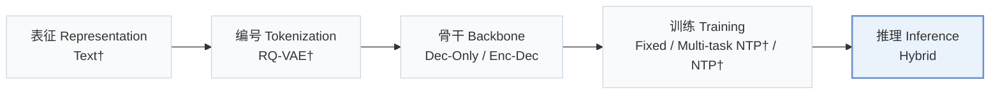
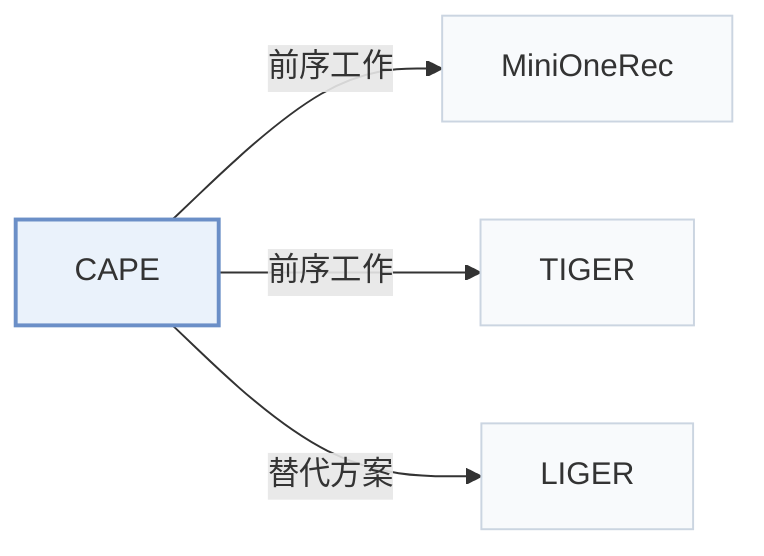

# CAPE

[← 问题 × 阶段矩阵](../../../README.zh.md#i--inference) · [按阶段索引](../index/stages.md) · [按模态索引](../index/modality.md) · [English](../../papers/cape.md) | 中文

| **题目** | *Generative Recommenders Forget the Long Tail: Restoring Memorization in Retrieval and Ranking* |
| :-- | :-- |
| **作者** | Huang et al. |
| **发表** | arXiv’26 |
| **问题与阶段** | `I. 信息量` · `推理（Inference）` |
| **链接** | [论文](https://arxiv.org/abs/2610.29298) |
| **阅读级别** | 概览（第 1 级） |

**本页目录**：[TL;DR](#tldr) · [速览](#速览) · [3. 实验发现](#3-实验发现) · [5. 相关工作](#5-相关工作)

- `Text†`：物品文本表征（由配置推断）。
- `RQ-VAE†`：残差量化变分自编码器（由配置推断）。
- `Dec-Only / Enc-Dec`：涵盖仅解码器与编码器-解码器两种骨干变体。
- `Fixed`：先独立训练并冻结编号器，生成器训练期间 SID 保持不变。
- `Multi-task NTP† / NTP†`：不同骨干下采用推断的多任务或单任务下一 token 预测初始化。
- `Hybrid`：结合生成式 SID 解码与稠密/共现检索的混合召回。

### TL;DR

> [!NOTE]
> CAPE 是免训练插件，在束搜索范围外召回有共现支撑的长尾物品并将共现证据融入排序，补足共享前缀生成缺失的物品级记忆能力。

---

### 速览

| 维度 | 摘要 |
| :-- | :-- |
| 研究问题 | I. 信息量：SID 或读取它的模型是否充分携带了推荐所需的协同、多模态与时空信号？ |
| 核心贡献 | CAPE 是免训练插件，在束搜索范围外召回有共现支撑的长尾物品并将共现证据融入排序，补足共享前缀生成缺失的物品级记忆能力。 |
| 主要改动阶段 | 推理（Inference） |

---

### 3. 实验发现

实验设置

- **数据集**：Amazon Industrial & Scientific, Office Products and Beauty (5-core), plus LastFM-1K (987 users, 40429 tracks). LastFM filtering thresholds: not reported. Histories contain the latest ten items.
  - 出处：Sec.5.1 and Appendix B: [S5.SS1.p2](https://arxiv.org/html/2610.29298v1#S5.SS1.p2) and [A2.p1](https://arxiv.org/html/2610.29298v1#A2.p1)
- **切分**：I&S/Office: chronological 80/10/10; per-user versus global allocation not reported. LastFM/Beauty: last user interaction test, penultimate validation, earlier interactions training.
  - 出处：Sec.5.1 and Appendix B: [S5.SS1.p2](https://arxiv.org/html/2610.29298v1#S5.SS1.p2) and [A2.p1](https://arxiv.org/html/2610.29298v1#A2.p1)
- **候选集**：Reported ranking pool: 75 retrieved items, comprising 50 beam outputs plus the 25 highest-co-occurrence tail items outside the beam; not a sampled-negative pool. Full-catalog versus sampled-negative evaluation label and history-item exclusion: not reported. Tail metrics count all tail test cases, including unretrieved targets.
  - 出处：Sec.4.1, Sec.2.1 and Appendix B: [S4.SS1.p1](https://arxiv.org/html/2610.29298v1#S4.SS1.p1) and [S2.SS1.p2](https://arxiv.org/html/2610.29298v1#S2.SS1.p2) and [A2.p3](https://arxiv.org/html/2610.29298v1#A2.p3)
- **可见性**：warm; no unseen-item protocol is defined. Tail is the bottom 80% by training frequency. Frequency, tail partition and user/event co-occurrence matrices use training data only; tokenizer exposure to test items: not reported.
  - 出处：Sec.2.1 and Appendix B: [S2.SS1.p2](https://arxiv.org/html/2610.29298v1#S2.SS1.p2) and [A2.p1](https://arxiv.org/html/2610.29298v1#A2.p1)
- **SID 规格**：Inherited frozen backbone identifiers: three tokens/item, with a fourth collision-resolution token for a small number of LastFM items. TIGER uses residual-quantized identifiers. Numerical codebook sizes and MiniOneRec tokenizer construction: not reported. CAPE leaves tokenization unchanged.
  - 出处：Sec.5.1 and Appendix B: [S5.SS1.p1](https://arxiv.org/html/2610.29298v1#S5.SS1.p1) and [A2.p2](https://arxiv.org/html/2610.29298v1#A2.p2)
- **推理预算**：Beam50 +25 co-occurrence tail candidates, one batched teacher-forcing pass, calibrated ranking with fixed top1; HR/NDCG@5/10. Validation-selected lambda=0.5 on I&S/Office and 5 on LastFM. FP32 on one A40; full-request means over first128 test users: 1.20s I&S, 1.22s Office, 1.55s LastFM-MiniOneRec, 0.19s LastFM-TIGER. Timing includes input preparation, beam, retrieval, teacher forcing, evidence and ranking after two-user warm-up; one-time loading takes 5-16s separately. Request batch size: not reported.
  - 出处：Sec.4.1/4.3, Sec.5.1, Table4 and Appendix B: [S4.SS1.p3](https://arxiv.org/html/2610.29298v1#S4.SS1.p3) and [S4.SS3.p2](https://arxiv.org/html/2610.29298v1#S4.SS3.p2) and [S5.SS1.p1](https://arxiv.org/html/2610.29298v1#S5.SS1.p1) and [S5.T4](https://arxiv.org/html/2610.29298v1#S5.T4) and [A2.p4](https://arxiv.org/html/2610.29298v1#A2.p4) and [A2.T7](https://arxiv.org/html/2610.29298v1#A2.T7) and [S5.SS1.p4](https://arxiv.org/html/2610.29298v1#S5.SS1.p4)
- **结果来源**：Paper's frozen-checkpoint inference comparisons/ablations. Released Amazon MiniOneRec checkpoints; LastFM continues SFT from that checkpoint; TIGER is trained from scratch with seeds42/43/44. Table2 main comparisons; Table3 Amazon TIGER evaluated after CAPE was frozen. Re-rankers share the 75-item pool/top1 and validation rule; 10000 user-bootstrap replicates quantify paired differences. No borrowed baseline scores are identified.
  - 出处：Sec.5.1, Tables2/3 and Appendix B: [S5.SS1.p2](https://arxiv.org/html/2610.29298v1#S5.SS1.p2) and [S5.T2](https://arxiv.org/html/2610.29298v1#S5.T2) and [S5.T3](https://arxiv.org/html/2610.29298v1#S5.T3) and [A2.p2](https://arxiv.org/html/2610.29298v1#A2.p2) and [A2.p4](https://arxiv.org/html/2610.29298v1#A2.p4)

---

### 5. 相关工作

- **前序工作** · [MiniOneRec](minionerec.md): MiniOneRec supplies a frozen backbone and released Amazon checkpoints.
  - 出处：CAPE v1, Sec.5.1 and Appendix B: [S5.SS1.p1](https://arxiv.org/html/2610.29298v1#S5.SS1.p1); [A2.p2](https://arxiv.org/html/2610.29298v1#A2.p2).
- **前序工作** · [TIGER](tiger.md): TIGER supplies the second backbone for cross-architecture evaluation.
  - 出处：CAPE v1, Sec.5.1 and Table3: [S5.SS1.p1](https://arxiv.org/html/2610.29298v1#S5.SS1.p1); [S5.T3](https://arxiv.org/html/2610.29298v1#S5.T3).
- **替代方案** · [LIGER](liger.md): LIGER is contrasted as a trained hybrid retrieval approach.
  - 出处：CAPE v1, Sec.6: [S6.p1](https://arxiv.org/html/2610.29298v1#S6.p1).

[查看同格全部论文](../../../README.zh.md#i--inference)
