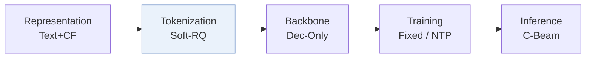
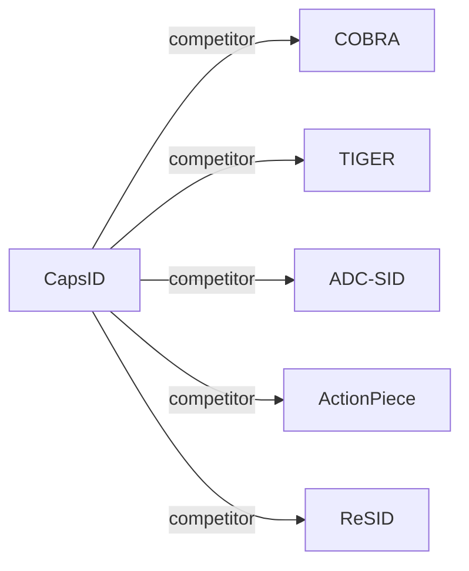

# CapsID

| **题目** | *Soft-Routed Variable-Length Semantic IDs for Generative Recommendation* |
| :-- | :-- |
| **作者** | Cheng et al. |
| **会议** | arXiv’26 |
| **问题与阶段** | `I. 信息量` · `Tokenization` |
| **链接** | [论文](https://arxiv.org/abs/2605.05096) · [矩阵](../../../README.zh.md#i--tokenization) · [English](../../papers/capsid.md) |
| **阅读级别** | 概览（第 1 级） |

本页目录：[TL;DR](#tldr) · [速览](#速览) · [3. 实验发现](#3-实验发现) · [5. 相关工作](#5-相关工作)

- `Soft-RQ`: Soft-routed RQ variant.
- `Dec-Only`: Decoder-only.
- `Fixed`: SIDs are built first and not changed while the generator trains.
- `NTP`: Next-token prediction loss only; continuing from a pretrained LLM (SFT) also counts as NTP.
- `C-Beam`: Constrained beam search.

### TL;DR

> [!NOTE]
> CapsID 用胶囊路由替代硬残差量化，将物品软路由到多个胶囊并在置信度足够高时终止生成，使各物品的 SID 长度按需变化。

---

### 速览

| 维度 | 摘要 |
| :-- | :-- |
| 研究问题 | I. 信息量：Do the SIDs, or the model reading them, carry the collaborative and multimodal signals recommendation needs? |
| 核心贡献 | CapsID 用胶囊路由替代硬残差量化，将物品软路由到多个胶囊并在置信度足够高时终止生成，使各物品的 SID 长度按需变化。 |
| 主要改动阶段 | Tokenization |

---

### 3. 实验发现

实验设置

- **数据集**：Amazon Beauty, Sports, and Toys with 5-core filtering (users / items: 22,363 / 12,101; 35,598 / 18,357; 19,412 / 11,924). Industrial: a proprietary 35M-item catalog from a large social media platform with text, image, and behavior embeddings (331.1M interactions); filtering not reported.
  - 出处：Datasets and filtering: [S4.SS1.SSS0.Px1.p1](https://arxiv.org/html/2605.05096v1#S4.SS1.SSS0.Px1.p1); statistics: [S4.T2](https://arxiv.org/html/2605.05096v1#S4.T2); preprocessing statement: [A2.SS5.p1](https://arxiv.org/html/2605.05096v1#A2.SS5.p1).
- **切分**：Leave-one-out with 5-core filtering on the Amazon datasets; the exact validation/test position allocation is not restated. Histories are truncated to the most recent 50 interactions. Industrial split: not reported.
  - 出处：Leave-one-out: [S4.SS1.SSS0.Px1.p1](https://arxiv.org/html/2605.05096v1#S4.SS1.SSS0.Px1.p1) and [S4.T2](https://arxiv.org/html/2605.05096v1#S4.T2); history truncation: [A1.SS3.SSS0.Px2.p1](https://arxiv.org/html/2605.05096v1#A1.SS3.SSS0.Px2.p1).
- **候选集**：full catalog (full-corpus ranking); decoding is constrained by a trie over item SIDs. Recall and NDCG at K=5 and 10 on Amazon, K=50 and 100 on the 35M-item catalog.
  - 出处：Full-corpus ranking: [S4.SS1.SSS0.Px3.p1](https://arxiv.org/html/2605.05096v1#S4.SS1.SSS0.Px3.p1); trie restricted to training-item SIDs: [A1.SS3.SSS0.Px3.p1](https://arxiv.org/html/2605.05096v1#A1.SS3.SSS0.Px3.p1).
- **可见性**：Main: warm; no unseen-item protocol is defined. Appendix B.2 isolates Beauty cold items, defined as items with fewer than 5 interactions in the training split (about 12% of items); these are low-frequency, not strictly unseen, and tokenizer exposure is not separately reported. The industrial cold-start tier is not defined.
  - 出处：Cold subset definition: [A2.SS2.p1](https://arxiv.org/html/2605.05096v1#A2.SS2.p1); industrial cold-start tier without definition: [S4.SS5.SSS0.Px5.p2](https://arxiv.org/html/2605.05096v1#S4.SS5.SSS0.Px5.p2).
- **SID 规格**：Variable-length SIDs: K=256 capsules per depth, up to L_max=6 levels, stopping on confidence (tau=0.82) or residual norm (epsilon=0.08); SemanticBPE then merges frequent code pairs (industrial: K=1024, mean length 3.3 after merging). Collision rates are reported: 13.4% on Beauty for CapsID and 19.4% for CapsID+SemanticBPE on the industrial catalog; a resolution rule for items sharing a SID is not reported.
  - 出处：Capsule configuration: [A1.SS1.SSS0.Px2.p1](https://arxiv.org/html/2605.05096v1#A1.SS1.SSS0.Px2.p1); industrial K=1024: [A1.SS3.SSS0.Px2.p1](https://arxiv.org/html/2605.05096v1#A1.SS3.SSS0.Px2.p1); measured collision rates: [S4.SS5.SSS0.Px4.p1](https://arxiv.org/html/2605.05096v1#S4.SS5.SSS0.Px4.p1) and [S4.SS5.SSS0.Px5.p2](https://arxiv.org/html/2605.05096v1#S4.SS5.SSS0.Px5.p2).
- **推理预算**：Beam size 50 with trie-based invalid-ID filtering and an end-of-item token. The industrial run uses 4 x A100-80GB; public benchmarks run on a single commodity GPU. CapsID+SemanticBPE runs at 51% of COBRA's per-query latency on the same ANN infrastructure; Table 4 reports cost normalized to TIGER beam search (B=50). Inference batch size and absolute latency: not reported.
  - 出处：Beam 50, trie, end-of-item token: [A1.SS3.SSS0.Px3.p1](https://arxiv.org/html/2605.05096v1#A1.SS3.SSS0.Px3.p1); hardware: [A2.SS5.p1](https://arxiv.org/html/2605.05096v1#A2.SS5.p1); latency versus COBRA: [S4.SS5.SSS0.Px5.p2](https://arxiv.org/html/2605.05096v1#S4.SS5.SSS0.Px5.p2); normalized cost: [S4.T4](https://arxiv.org/html/2605.05096v1#S4.T4).
- **结果来源**：Table 3 (Beauty, Sports, Toys; mean over three seeds); Table 4 (patching versus tokenizer-centric design, with normalized cost); Table 5 (ablations); Table 6 (35M-item industrial catalog, single run); Figure 3 (collision, purity, predictability); Table 10 (Beauty cold-item subset).
  - 出处：Main table: [S4.T3](https://arxiv.org/html/2605.05096v1#S4.T3); patching comparison: [S4.T4](https://arxiv.org/html/2605.05096v1#S4.T4); ablation: [S4.T5](https://arxiv.org/html/2605.05096v1#S4.T5); industrial: [S4.T6](https://arxiv.org/html/2605.05096v1#S4.T6); cold subset: [A2.SS2.p1](https://arxiv.org/html/2605.05096v1#A2.SS2.p1).

---

### 5. 相关工作

- **同期对比** · [COBRA](cobra.md): COBRA patches incomplete sparse IDs with a dense vector and BeamFusion at inference; CapsID instead makes the SID itself soft-routed and variable-length, without a dense path.
  - 出处：CapsID v1, Section 4.1 baselines and fairness controls: https://arxiv.org/html/2605.05096v1#S4.SS1.SSS0.Px2.p1 and https://arxiv.org/html/2605.05096v1#S4.SS1.SSS0.Px4.p1; Tables 3, 4, and 6: https://arxiv.org/html/2605.05096v1#S4.T3, https://arxiv.org/html/2605.05096v1#S4.T4, https://arxiv.org/html/2605.05096v1#S4.T6.
- **同期对比** · [TIGER](tiger.md): TIGER uses fixed-length hard RQ-VAE codes; CapsID routes residuals softly across capsules and stops at an item-specific length.
  - 出处：CapsID v1, Section 4.1 baselines: https://arxiv.org/html/2605.05096v1#S4.SS1.SSS0.Px2.p1; Tables 3 and 6: https://arxiv.org/html/2605.05096v1#S4.T3 and https://arxiv.org/html/2605.05096v1#S4.T6.
- **同期对比** · [ADC-SID](adc-sid.md): CapsID labels this baseline ADA-SID and cites arXiv:2510.25622; it adapts behavior-content quantization with fixed-length codes, whereas CapsID varies code length per item.
  - 出处：CapsID v1, Table 1 and Section 2 cite it as ADA-SID [34] (arXiv:2510.25622): https://arxiv.org/html/2605.05096v1#S2.T1; Section 4.1 baselines and Table 3: https://arxiv.org/html/2605.05096v1#S4.SS1.SSS0.Px2.p1 and https://arxiv.org/html/2605.05096v1#S4.T3.
- **同期对比** · [ActionPiece](actionpiece.md): ActionPiece merges feature tokens by co-occurrence frequency; CapsID's SemanticBPE uses a differentiable merge gate over learned capsule codes.
  - 出处：CapsID v1, Section 2 capsule-routing and subword paragraph: https://arxiv.org/html/2605.05096v1#S2.SS0.SSS0.Px6.p1; Section 4.1 baselines and Table 3: https://arxiv.org/html/2605.05096v1#S4.SS1.SSS0.Px2.p1 and https://arxiv.org/html/2605.05096v1#S4.T3.
- **同期对比** · [ReSID](resid.md): ReSID uses adaptive semantic quantization with residual knowledge transfer; CapsID uses capsule routing with confidence-driven stopping.
  - 出处：CapsID v1, Section 2: https://arxiv.org/html/2605.05096v1#S2.SS0.SSS0.Px4.p1; Section 4.1 baselines and Table 3: https://arxiv.org/html/2605.05096v1#S4.SS1.SSS0.Px2.p1 and https://arxiv.org/html/2605.05096v1#S4.T3; cold-start protocol follows ReSID: https://arxiv.org/html/2605.05096v1#A2.SS2.p1.

[查看同格全部论文](../../../README.zh.md#i--tokenization)
