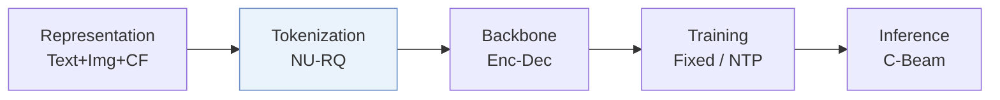
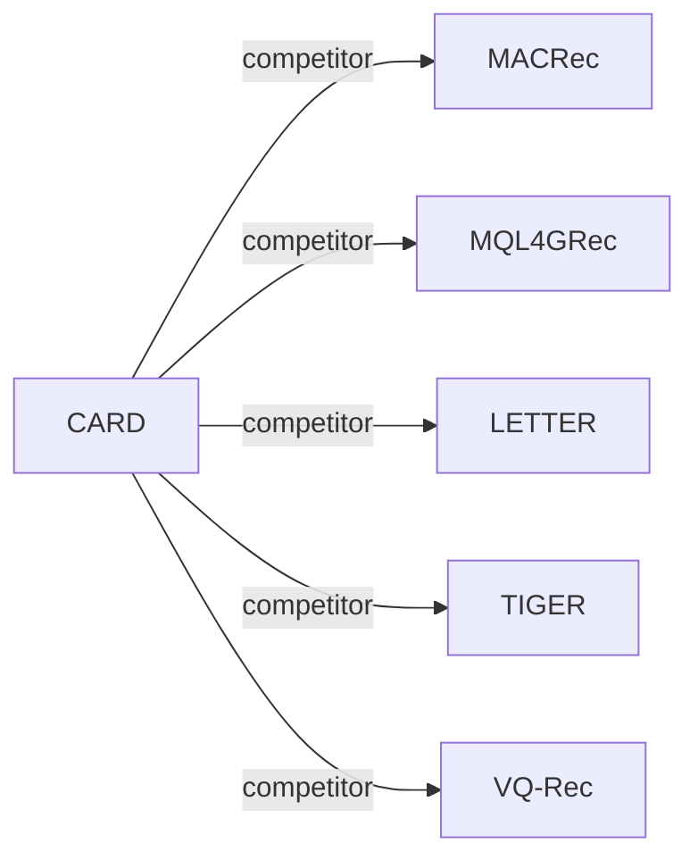

# CARD

| **题目** | *Non-Uniform Quantization of Visual Semantic Unit for Generative Recommendation* |
| :-- | :-- |
| **作者** | Wei et al. |
| **会议** | arXiv’26 |
| **问题与阶段** | `II. 唯一性与合法性` · `Tokenization` |
| **链接** | [论文](https://arxiv.org/abs/2604.26427) · [代码](https://github.com/HAI-UESTC/CARD) · [矩阵](../../../README.zh.md#ii--tokenization) · [English](../../papers/card.md) |
| **阅读级别** | 概览（第 1 级） |

本页目录：[TL;DR](#tldr) · [速览](#速览) · [3. 实验发现](#3-实验发现) · [5. 相关工作](#5-相关工作)

- `NU-RQ`: Non-uniform RQ variant.
- `Enc-Dec`: Encoder-decoder.
- `Fixed`: SIDs are built first and not changed while the generator trains.
- `NTP`: Next-token prediction loss only; continuing from a pretrained LLM (SFT) also counts as NTP.
- `C-Beam`: Constrained beam search.

### TL;DR

> [!NOTE]
> CARD 在编码前将文本、图像与协同信号融合为视觉语义单元，并用带可学习非均匀变换的 NU-RQ-VAE 量化，缓解嵌入分布偏斜。

---

### 速览

| 维度 | 摘要 |
| :-- | :-- |
| 研究问题 | II. 唯一性与合法性：Does every item get its own SID, every generated SID name a real item, and the codebook get used evenly? |
| 核心贡献 | CARD 在编码前将文本、图像与协同信号融合为视觉语义单元，并用带可学习非均匀变换的 NU-RQ-VAE 量化，缓解嵌入分布偏斜。 |
| 主要改动阶段 | Tokenization |

---

### 3. 实验发现

实验设置

- **数据集**：Amazon Reviews: Grocery and Gourmet Food (Food), Cell Phones and Accessories (Phones), and Clothing, Shoes and Jewelry (Clothing), with 5-core filtering of users and items. Sizes (users / items / interactions): Food 14,681 / 8,713 / 151,254; Phones 27,879 / 10,429 / 194,439; Clothing 39,387 / 23,033 / 278,677.
  - 出处：Categories, 5-core filtering, truncation: [S4.SS1.SSS1.p1](https://arxiv.org/html/2604.26427v1#S4.SS1.SSS1.p1); statistics: [S4.T1](https://arxiv.org/html/2604.26427v1#S4.T1).
- **切分**：Per-user leave-one-out: most recent interaction for test, second most recent for validation, the rest for training; histories truncated or padded to the 20 most recent items.
  - 出处：Leave-one-out allocation and history length: [S4.SS1.SSS1.p1](https://arxiv.org/html/2604.26427v1#S4.SS1.SSS1.p1).
- **候选集**：full catalog
  - 出处：Full ranking over the entire item set: [S4.SS1.SSS2.p1](https://arxiv.org/html/2604.26427v1#S4.SS1.SSS2.p1).
- **可见性**：warm; no unseen-item protocol is defined.
  - 出处：Standard leave-one-out with no cold-start experiment: [S4.SS1.SSS1.p1](https://arxiv.org/html/2604.26427v1#S4.SS1.SSS1.p1).
- **SID 规格**：4 non-uniform RQ-VAE levels x 256 codewords (dimension 32), quantizing a vision-language embedding of a 512 x 512 rendered card (item image, title, collaborative-neighbor thumbnails). Collision handling: not reported.
  - 出处：K=4 codebooks x 256 vectors of dimension 32: [S4.SS1.SSS3.p1](https://arxiv.org/html/2604.26427v1#S4.SS1.SSS3.p1); non-uniform RQ-VAE over a vision-language encoding of a rendered item card: [S3.SS2.SSS1.p1](https://arxiv.org/html/2604.26427v1#S3.SS2.SSS1.p1) and [S4.SS1.SSS3.p2](https://arxiv.org/html/2604.26427v1#S4.SS1.SSS3.p2); no collision rule found in Sections 3-4.
- **推理预算**：Beam search over the code vocabulary; numerical beam width not reported. T5-style encoder-decoder with 4 layers each and 6 heads. Recall and NDCG at K=5, 10, and 20. Hardware, inference batch size, and latency: not reported.
  - 出处：Beam search with top-B partial sequences, no numerical B: [S3.SS3.p2](https://arxiv.org/html/2604.26427v1#S3.SS3.p2); backbone: [S4.SS1.SSS3.p1](https://arxiv.org/html/2604.26427v1#S4.SS1.SSS3.p1).
- **结果来源**：Table 2 (Food, Phones, Clothing; paired t-tests against the best baseline); Tables 3-4 (ablations of the two CARD variants); Table 5 (non-uniform quantization with different quantizers); Table 6 (text-only encoding).
  - 出处：Main table: [S4.T2](https://arxiv.org/html/2604.26427v1#S4.T2); ablations: [S4.T3](https://arxiv.org/html/2604.26427v1#S4.T3) and [S4.T4](https://arxiv.org/html/2604.26427v1#S4.T4); plug-in quantizers: [S4.T5](https://arxiv.org/html/2604.26427v1#S4.T5); text-only variants: [S4.T6](https://arxiv.org/html/2604.26427v1#S4.T6).

---

### 5. 相关工作

- **同期对比** · [MACRec](macrec.md): MACRec reduces codebook conflicts by cross-modal quantization and multi-aspect alignment of separate modalities; CARD renders image, title, and neighbors into one card and quantizes it with a non-uniform RQ-VAE.
  - 出处：CARD v1, Section 4.1.4 baselines: https://arxiv.org/html/2604.26427v1#S4.I1.i9.p1; Table 2: https://arxiv.org/html/2604.26427v1#S4.T2; Section 2.1: https://arxiv.org/html/2604.26427v1#S2.SS1.p1.
- **同期对比** · [MQL4GRec](mql4grec.md): MQL4GRec quantizes each modality into its own SIDs with pre-training; CARD uses one unified visual semantic unit, and the comparison disables MQL4GRec's extra-category pre-training.
  - 出处：CARD v1, Section 4.1.4 baselines: https://arxiv.org/html/2604.26427v1#S4.I1.i8.p1; implementation note on pre-training: https://arxiv.org/html/2604.26427v1#S4.SS1.SSS3.p1; Table 2: https://arxiv.org/html/2604.26427v1#S4.T2.
- **同期对比** · [LETTER](letter.md): LETTER regularizes a uniform RQ-VAE with collaborative and diversity terms; CARD changes the quantizer to a non-uniform one and the input to a rendered multimodal card.
  - 出处：CARD v1, Section 4.1.4 baselines: https://arxiv.org/html/2604.26427v1#S4.I1.i7.p1; Table 2: https://arxiv.org/html/2604.26427v1#S4.T2.
- **同期对比** · [TIGER](tiger.md): TIGER quantizes text embeddings with a uniform RQ-VAE; CARD keeps the same codebook shape and generator but replaces the input and the quantization rule.
  - 出处：CARD v1, Section 4.1.4 baselines: https://arxiv.org/html/2604.26427v1#S4.I1.i6.p1; Table 2: https://arxiv.org/html/2604.26427v1#S4.T2; Table 6 text-only TIGER variants: https://arxiv.org/html/2604.26427v1#S4.T6.
- **同期对比** · [VQ-Rec](vq-rec.md): VQ-Rec pools product-quantized code embeddings in a discriminative model; CARD generates hierarchical non-uniform RQ codes autoregressively.
  - 出处：CARD v1, Section 4.1.4 baselines: https://arxiv.org/html/2604.26427v1#S4.I1.i5.p1; Table 2: https://arxiv.org/html/2604.26427v1#S4.T2.

[查看同格全部论文](../../../README.zh.md#ii--tokenization)
