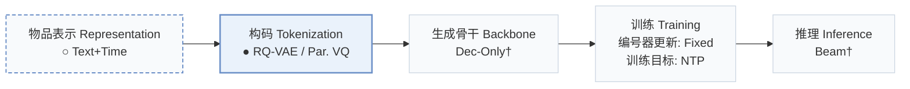
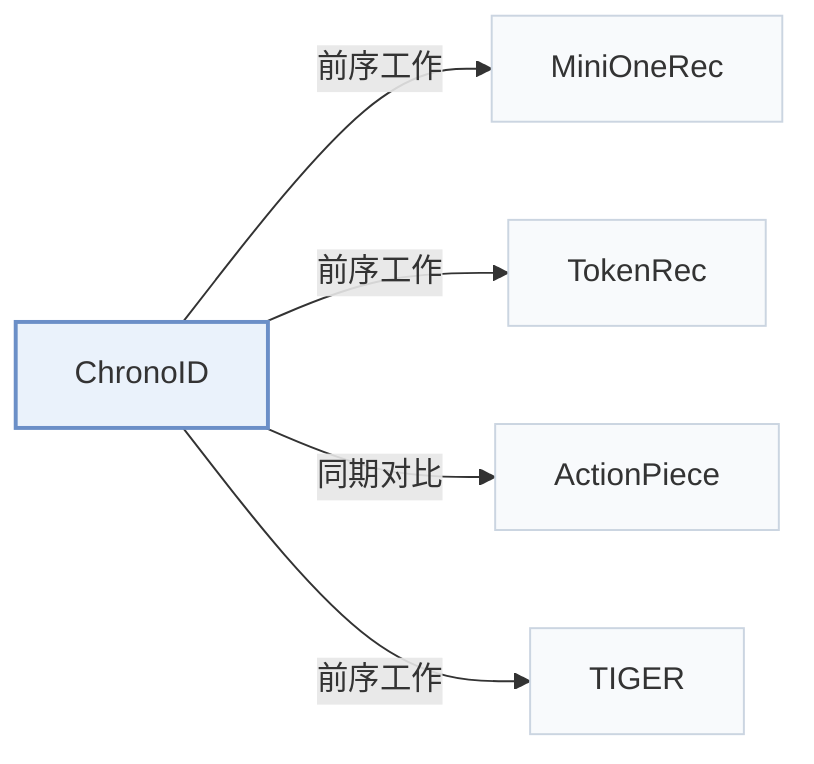

# ChronoID

[← 问题 × 阶段矩阵](../../../README.zh.md#i--tokenization) · [按阶段索引](../index/stages.md) · [按模态找论文](../index/modality.md) · [按领域找论文](../index/domain.md) · [English](../../papers/chronoid.md) | 中文

| **题目** | *Infusing Explicit Temporal Signals into Semantic IDs for Generative Recommendation* |
| :-- | :-- |
| **作者** | Nian et al. |
| **发表** | arXiv’26 |
| **问题与阶段** | `I. 信息量` · `构码（Tokenization）` |
| **改动** | ○ 物品表示 · ● 构码 |
| **构码输入** | `Text` + `Time` |
| **领域** | `电商` |
| **链接** | [论文](https://arxiv.org/abs/2606.14260) |
| **阅读级别** | 概览（第 1 级） |

**本页目录**：[TL;DR](#tldr) · [3. 实验发现](#3-实验发现) · [5. 相关工作](#5-相关工作)

- `Text+Time`：文本表征结合交互时间戳信息。
- `RQ-VAE / Par. VQ`：不同配置下分别采用层级 RQ-VAE 或并行向量量化。
- `Dec-Only†`：仅解码器自回归架构（由配置推断）。
- `Fixed`：先独立训练并冻结编号器，生成器训练期间 SID 保持不变。
- `NTP`：标准下一 token 预测（Next-Token Prediction）交叉熵损失；基于预训练 LLM 的指令微调（SFT）亦归入此类。
- `Beam†`：自回归束搜索（由配置推断）。

### TL;DR

> [!NOTE]
> ChronoID 系统评测显式时间编码、融合与量化方式对时间感知 SID 的影响，替代忽略时间动态的静态 SID。

---

### 3. 实验发现

实验设置

- **数据集**：Amazon Industrial and Office; Mercari. Item text plus interaction timestamps; interaction-count filtering not reported.
  - 出处：Section 4 and Appendix B.1/Table 1: [S4.p1](https://arxiv.org/html/2606.14260v1#S4.p1) ; [A2.SS1.p1](https://arxiv.org/html/2606.14260v1#A2.SS1.p1) ; [S5.T1](https://arxiv.org/html/2606.14260v1#S5.T1)
- **切分**：Global temporal cutoff: codebook/SFT training before cutoff, test targets on/after cutoff; Appendix B uses 2018 for Amazon. Exact Mercari cutoff and validation allocation not reported. Section 4 inconsistently prints 2028 and 2018.
  - 出处：Section 4 and Appendix B.3/B.5: [S4.p1](https://arxiv.org/html/2606.14260v1#S4.p1) ; [A2.SS3.SSS0.Px1.p1](https://arxiv.org/html/2606.14260v1#A2.SS3.SSS0.Px1.p1) ; [A2.T5](https://arxiv.org/html/2606.14260v1#A2.T5)
- **候选集**：not reported
  - 出处：Section 5.1 defines single-ground-truth ranking metrics but no candidate universe: [S5.SS1.SSS0.Px2.p1](https://arxiv.org/html/2606.14260v1#S5.SS1.SSS0.Px2.p1)
- **可见性**：Unseen by tokenizer too for future items, as claimed in Appendix B.6; codebook fitting uses only pre-2018 interacted items and SFT training uses pre-cutoff targets. Test-item overlap/new-item fraction not reported. Users first appearing after cutoff can be test-only.
  - 出处：Section 4 and Appendix B.2/B.6: [S4.p2](https://arxiv.org/html/2606.14260v1#S4.p2) ; [A2.SS2.SSS0.Px1.p1](https://arxiv.org/html/2606.14260v1#A2.SS2.SSS0.Px1.p1) ; [A2.SS6.SSS0.Px2.p1](https://arxiv.org/html/2606.14260v1#A2.SS6.SSS0.Px2.p1)
- **SID 规格**：Frozen text/time quantizer: residual early/late fusion or parallel quantization; default 3 codebooks x 256 entries, code dimension 42. Absolute/relative time encodings; text/time input dimensions 2560/768. Collision resolution not reported.
  - 出处：Sections 3.2/3.3 and Appendix B.3/D: [S3.SS2.p2](https://arxiv.org/html/2606.14260v1#S3.SS2.p2) ; [S3.SS2.p3](https://arxiv.org/html/2606.14260v1#S3.SS2.p3) ; [S3.SS3.p3](https://arxiv.org/html/2606.14260v1#S3.SS3.p3) ; [A2.SS3.SSS0.Px2.p1](https://arxiv.org/html/2606.14260v1#A2.SS3.SSS0.Px2.p1) ; [A4.T9](https://arxiv.org/html/2606.14260v1#A4.T9)
- **推理预算**：HR/NDCG@3/5/10. Decoding algorithm, beam, constraints, inference hardware/batch and latency not reported; batch 1024 per GPU is SFT training.
  - 出处：Table 1 and Appendix D/Table 9: [S5.T1](https://arxiv.org/html/2606.14260v1#S5.T1) ; [A4.T9](https://arxiv.org/html/2606.14260v1#A4.T9)
- **结果来源**：Original Table 1 compares five baselines and six ChronoID designs on three datasets; Tables 2/6-8/10-11 give fusion, temporal/capacity and hyperparameter analyses. Baseline implementation/result provenance not reported.
  - 出处：Sections 5.1/5.2 and Tables 1/2/6-8/10-11: [S5.SS1.SSS0.Px1.p1](https://arxiv.org/html/2606.14260v1#S5.SS1.SSS0.Px1.p1) ; [S5.SS2.p1](https://arxiv.org/html/2606.14260v1#S5.SS2.p1) ; [S5.T1](https://arxiv.org/html/2606.14260v1#S5.T1) ; [A3.T6](https://arxiv.org/html/2606.14260v1#A3.T6) ; [A4.T11](https://arxiv.org/html/2606.14260v1#A4.T11)

---

### 5. 相关工作

- **前序工作** · [MiniOneRec](minionerec.md): ChronoID extends MiniOneRec's time-agnostic tokenization with explicit temporal signals.
  - 出处：ChronoID v1, Introduction/Section 3 and Table 1: [S1.p2](https://arxiv.org/html/2606.14260v1#S1.p2) ; [S3.p1](https://arxiv.org/html/2606.14260v1#S3.p1) ; [S5.T1](https://arxiv.org/html/2606.14260v1#S5.T1).
- **前序工作** · [TokenRec](tokenrec.md): ChronoID adopts parallel quantization as one temporal-tokenization design.
  - 出处：ChronoID v1, Sections 3.3/6 and Table 1: [S3.SS3.p3](https://arxiv.org/html/2606.14260v1#S3.SS3.p3) ; [S6.p1](https://arxiv.org/html/2606.14260v1#S6.p1) ; [S5.T1](https://arxiv.org/html/2606.14260v1#S5.T1).
- **同期对比** · [ActionPiece](actionpiece.md): ActionPiece is a generative recommendation baseline in the temporal benchmark.
  - 出处：ChronoID v1, Section 5.1 and Table 1: [S5.SS1.SSS0.Px1.p1](https://arxiv.org/html/2606.14260v1#S5.SS1.SSS0.Px1.p1) ; [S5.T1](https://arxiv.org/html/2606.14260v1#S5.T1).
- **前序工作** · [TIGER](tiger.md): ChronoID extends the static residual-quantization paradigm with time-aware IDs.
  - 出处：ChronoID v1, Section 6: [S6.p1](https://arxiv.org/html/2606.14260v1#S6.p1).

[查看同格全部论文](../../../README.zh.md#i--tokenization)
