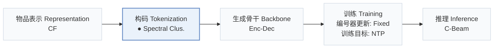
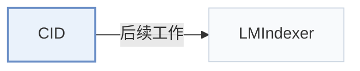

# CID

[← 问题 × 阶段矩阵](../../../README.zh.md#ii--tokenization) · [按阶段索引](../index/stages.md) · [按模态找论文](../index/modality.md) · [按领域找论文](../index/domain.md) · [English](../../papers/cid.md) | 中文

| **题目** | *How to Index Item IDs for Recommendation Foundation Models* |
| :-- | :-- |
| **作者** | Hua et al. |
| **发表** | SIGIR-AP’23 |
| **问题与阶段** | `II. 唯一性与合法性` · `构码（Tokenization）` |
| **改动** | ● 构码 |
| **构码输入** | `CF` |
| **领域** | `电商` · `本地生活与 POI` |
| **应用场景** | `一般物品推荐`；`公开数据` |
| **链接** | [论文](https://arxiv.org/abs/2305.06569) · [代码](https://github.com/Wenyueh/LLM-RecSys-ID) |
| **阅读级别** | 概览（第 1 级） |

**本页目录**：[TL;DR](#tldr) · [3. 实验发现](#3-实验发现) · [5. 相关工作](#5-相关工作)

- `CF`：纯协同过滤交互信号。
- `Spectral Clus.`：基于谱聚类的层级编号。
- `Enc-Dec`：编码器-解码器（Encoder-decoder）架构。
- `Fixed`：先独立训练并冻结编号器，生成器训练期间 SID 保持不变。
- `NTP`：标准下一 token 预测（Next-Token Prediction）交叉熵损失；基于预训练 LLM 的指令微调（SFT）亦归入此类。
- `C-Beam`：受合法物品集合约束的束搜索（Constrained beam search）。

### TL;DR

> [!NOTE]
> CID 研究 P5 基础模型的物品编号方式，提出顺序、协同、语义与混合索引，替代容易产生长输出或虚构物品的随机、标题和独立 ID。

---

### 3. 实验发现

实验设置

- **数据集**：Amazon Sports & Outdoors, Amazon Beauty, Yelp; paper states a Jan-Dec 2019 transaction window. Interaction-count filtering not reported.
  - 出处：Section 3.3: [S3.SS3.p1](https://arxiv.org/html/2305.06569v6#S3.SS3.p1)
- **切分**：Per-user leave-one-out: last interaction test, penultimate validation, earlier interactions training. Test history includes the validation interaction.
  - 出处：Section 3.3: [S3.SS3.p2](https://arxiv.org/html/2305.06569v6#S3.SS3.p2)
- **候选集**：not reported
  - 出处：Sections 3.3/5.1/5.2 do not define an evaluation candidate pool: [S3.SS3.p2](https://arxiv.org/html/2305.06569v6#S3.SS3.p2) ; [S5.SS1.p1](https://arxiv.org/html/2305.06569v6#S5.SS1.p1) ; [S5.SS2.p1](https://arxiv.org/html/2305.06569v6#S5.SS2.p1)
- **可见性**：warm; no unseen-item protocol is defined. CID co-occurrence edges/weights use training sequences only; graph nodes represent all items. Separate tokenizer/item holdouts not reported.
  - 出处：Sections 3.3/4.2: [S3.SS3.p2](https://arxiv.org/html/2305.06569v6#S3.SS3.p2) ; [S4.SS2.p1](https://arxiv.org/html/2305.06569v6#S4.SS2.p1) ; [S4.SS2.SSS1.p1](https://arxiv.org/html/2305.06569v6#S4.SS2.SSS1.p1)
- **SID 规格**：CID only: recursive N-way spectral clustering until clusters contain at most k items; k shared OOV tokens encode cluster paths plus a unique-within-cluster leaf token. Variable-length fixed IDs; recommended mean length 3-4. Table 6 sweeps N=10/20 and k=200/500/1000; Table 4 default N/k not reported.
  - 出处：Sections 4.2/5.5 and Tables 6/7: [S4.SS2.SSS1.p2](https://arxiv.org/html/2305.06569v6#S4.SS2.SSS1.p2) ; [S4.SS2.SSS2.p1](https://arxiv.org/html/2305.06569v6#S4.SS2.SSS2.p1) ; [S4.SS2.SSS2.p4](https://arxiv.org/html/2305.06569v6#S4.SS2.SSS2.p4) ; [S5.SS5.p4](https://arxiv.org/html/2305.06569v6#S5.SS5.p4) ; [S5.T6](https://arxiv.org/html/2305.06569v6#S5.T6) ; [S5.T7](https://arxiv.org/html/2305.06569v6#S5.T7)
- **推理预算**：Trie-constrained generation; HR/NDCG@5/10. Beam width, inference hardware/batch and latency not reported. Two RTX A5000 GPUs and batch 64 describe 20-epoch P5 training.
  - 出处：Introduction, Implementation Details and Table 4: [S1.p5](https://arxiv.org/html/2305.06569v6#S1.p5) ; [S5.SS2.p1](https://arxiv.org/html/2305.06569v6#S5.SS2.p1) ; [S5.T4](https://arxiv.org/html/2305.06569v6#S5.T4)
- **结果来源**：Original Table 4 CID row; Figures 4/5 and Tables 6/7 analyze CID clustering parameters and ID lengths. CID+IID is a separate hybrid variant, not CID. Baselines use the S3-Rec implementation; copied-versus-rerun provenance not stated.
  - 出处：Sections 5.1/5.3/5.5/5.7 and Tables 4/6/7: [S5.SS1.p1](https://arxiv.org/html/2305.06569v6#S5.SS1.p1) ; [S5.SS3.p2](https://arxiv.org/html/2305.06569v6#S5.SS3.p2) ; [S5.SS5.p2](https://arxiv.org/html/2305.06569v6#S5.SS5.p2) ; [S5.SS7.p1](https://arxiv.org/html/2305.06569v6#S5.SS7.p1) ; [S5.T4](https://arxiv.org/html/2305.06569v6#S5.T4) ; [S5.T6](https://arxiv.org/html/2305.06569v6#S5.T6) ; [S5.T7](https://arxiv.org/html/2305.06569v6#S5.T7)

---

### 5. 相关工作

- **后续工作** · [LMIndexer](lmindexer.md): LMIndexer cites this indexing study as earlier generative-recommendation work.
  - 出处：Evidence from LMIndexer v3, Section 2 and reference Hua et al. (2023): [S2.p2](https://arxiv.org/html/2310.07815v3#S2.p2) ; [bib.bib11](https://arxiv.org/html/2310.07815v3#bib.bib11).

[查看同格全部论文](../../../README.zh.md#ii--tokenization)
