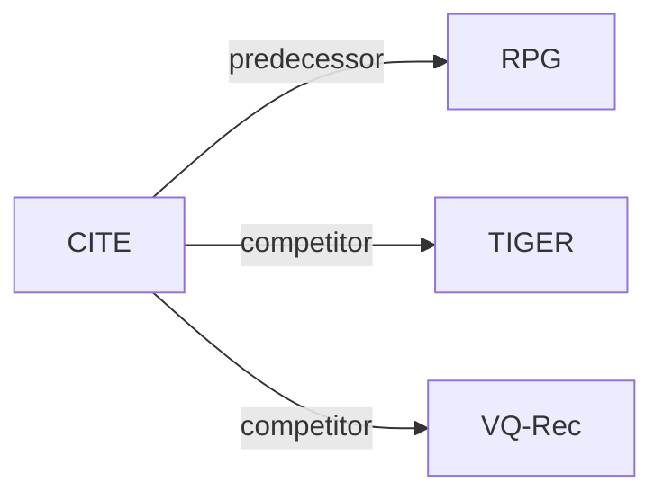

# CITE

*Contextual Item Transition Embeddings for Generative Recommendation with Parallel Semantic Identifiers* — Ma et al. · Electronics’26

`I. 信息量` · `Inference` · [论文](https://doi.org/10.3390/electronics15204749) · [矩阵](../../../README.zh.md#i--inference) · [English](../../papers/cite.md)

阅读级别：概览（第 1 级） · 本页目录：[TL;DR](#tldr) · [速览](#速览) · [3. 实验发现](#3-实验发现) · [5. 相关工作](#5-相关工作)

- `Non-AR`: Non-autoregressive.
- `Fixed`: SIDs are built first and not changed while the generator trains.
- `Discrim.`: Scores items; does not generate SIDs.

### TL;DR

> [!NOTE]
> CITE 在固定并行 SID 生成器上加入源嵌入与目标嵌入分离的物品级转移打分项，刻画最近交互物品到各候选物品的有向转移关系。

### 速览

| 维度 | 摘要 |
| :-- | :-- |
| 研究问题 | I. 信息量：Do the SIDs, or the model reading them, carry the collaborative and multimodal signals recommendation needs? |
| 核心贡献 | CITE 在固定并行 SID 生成器上加入源嵌入与目标嵌入分离的物品级转移打分项，刻画最近交互物品到各候选物品的有向转移关系。 |
| 主要改动阶段 | Inference |

### 3. 实验发现

实验设置

- **数据集**：Amazon Reviews 2014 Sports and Outdoors, Beauty, Toys and Games, CDs and Vinyl; RPG preprocessing, filtering threshold not reported. Additional Yelp 2019 review subset: iterative user/item 5-core, 30,431 users, 20,033 businesses, 316,354 interactions.
  - 出处：Publisher version, 15 October 2026, DOI 10.3390/electronics15204749: §5.1 pp.8–9/Table 1; §5.11 pp.20–21. [link](https://doi.org/10.3390/electronics15204749)
- **切分**：Per-user chronological: final item test, penultimate validation, earlier prefixes/next-item pairs training; histories capped at 50. Validation NDCG@10 selects CITE checkpoint and fusion weight; locked test evaluation. Yelp uses the same protocol.
  - 出处：Publisher version: §§5.1–5.2 p.9; §5.4 p.10; §5.11 pp.20–21. [link](https://doi.org/10.3390/electronics15204749)
- **候选集**：full catalog; identical full-sort item set for RPG and CITE; graph search is not used for reported ranking metrics; history exclusion not reported.
  - 出处：Publisher version: §3 pp.4–5; §4.6 pp.7–8/Algorithm 2; §5.4 p.10. [link](https://doi.org/10.3390/electronics15204749)
- **可见性**：Strict item-cold cohort has zero training-split occurrences (Sports/Beauty/Toys/CDs target counts 317/138/279/298); low-frequency means 1–5 occurrences. Tokenizer fitting exposure is not reported, so unseen by generator only versus unseen by tokenizer too is not established; CITE training scores every catalog destination.
  - 出处：Publisher version: §5.9 pp.18–19/Tables 8–9; §4.6 p.7. [link](https://doi.org/10.3390/electronics15204749)
- **SID 规格**：Fixed OPQ identifiers over text embeddings; 256 codes/position, lengths Sports 16, Beauty 32, Toys 16, CDs 64; collision handling and Yelp ID length not reported. Yelp text uses text-embedding-3-large. Default CITE freezes the reproduced RPG generator and learns only the transition module.
  - 出处：Publisher version: §3 p.4; §5.4 p.10/Table 2; §5.10 p.20; §5.11 p.20. [link](https://doi.org/10.3390/electronics15204749)
- **推理预算**：Parallel semantic scoring plus full-catalog transition matrix scoring, Recall/NDCG@5/10; no autoregressive beam or graph search in evaluation. Evaluation batch 512 (Sports/Beauty/Toys), 256 (CDs), NVIDIA A100 80GB/Intel Xeon Gold 5218. Inference latency not reported; Table 12 wall-clock includes loading, training, validation and testing.
  - 出处：Publisher version: §5.4 p.10; §5.12 pp.21–22/Table 12. [link](https://doi.org/10.3390/electronics15204749)
- **结果来源**：Own matched RPG reproductions and CITE experiments: main comparison/ablations and Yelp use means and sample SD over seeds 2024–2028; cold-start, learned-gating and joint-fine-tuning analyses use seed 2024. Table 3 also includes published reference baseline scores. RPG checkpoints are trained from scratch and frozen before default CITE fitting; Yelp separately tunes RPG by validation.
  - 出处：Publisher version: §5.4 p.10, §5.5 p.13/Table 3; §§5.8–5.11 pp.17–21/Tables 7–11; §6 p.22. [link](https://doi.org/10.3390/electronics15204749)

### 5. 相关工作

- **前序工作** · [RPG](rpg.md): CITE adds transition scoring to a frozen reproduced RPG generator.
  - 出处：Publisher version, 15 October 2026, §1 p.2; §3 pp.4–5; §6 p.22. https://doi.org/10.3390/electronics15204749
- **同期对比** · [TIGER](tiger.md): Autoregressive semantic-ID baseline with published reference scores.
  - 出处：Publisher version, §5.3 pp.9–10; Table 3 p.11; §5.5 p.13. https://doi.org/10.3390/electronics15204749
- **同期对比** · [VQ-Rec](vq-rec.md): Quantized-text recommendation reference in the main comparison.
  - 出处：Publisher version, §5.3 pp.9–10; Table 3 p.11; §5.5 p.13. https://doi.org/10.3390/electronics15204749

[查看同格全部论文](../../../README.zh.md#i--inference)
