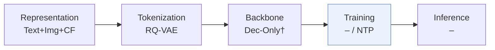
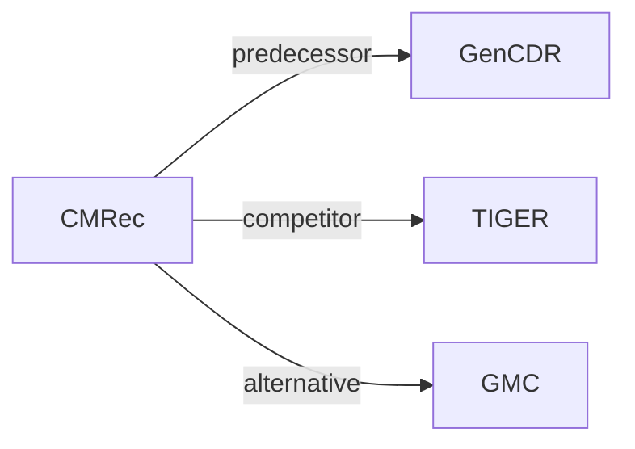

# CMRec

*Cross-Country Code-Mixing for Generative Recommendation* — Gao et al. · CIKM’26 Short

`VI. 泛化` · `Training` · [论文](https://arxiv.org/abs/2609.28972) · [矩阵](../../../README.zh.md#vi--training) · [English](../../papers/cmrec.md)

阅读级别：概览（第 1 级） · 本页目录：[TL;DR](#tldr) · [速览](#速览) · [3. 实验发现](#3-实验发现) · [5. 相关工作](#5-相关工作)

- `–`: Not reported in the paper.
- `NTP`: Next-token prediction loss only; continuing from a pretrained LLM (SFT) also counts as NTP.

### TL;DR

> [!NOTE]
> CMRec 学习跨国共享码本，并通过受约束的 token 替换合成跨国混合序列，在数据层面而不仅靠共享参数实现跨市场知识迁移。

### 速览

| 维度 | 摘要 |
| :-- | :-- |
| 研究问题 | VI. 泛化：Does it still work for new items, new domains, and shifting interests? |
| 核心贡献 | CMRec 学习跨国共享码本，并通过受约束的 token 替换合成跨国混合序列，在数据层面而不仅靠共享参数实现跨市场知识迁移。 |
| 主要改动阶段 | Training |

### 3. 实验发现

实验设置

- **数据集**：Industrial e-commerce advertising: >1 billion interactions, 19 million users, 25 million ads across 6 countries; largest country has about 10x the smallest's training interactions. Amazon M2/KDD Cup 2023: UK/DE/JP/IT/FR/ES; high-resource locales supply about 91% of training sessions. Filtering rules not reported.
  - 出处：[S4.SS1.p1](https://arxiv.org/html/2609.28972v1#S4.SS1.p1)
- **切分**：Offline train/validation/test allocation and chronology not reported; all baselines use the same dataset partition. Online A/B: May 10–20, 2026, 10% live traffic across all 6 countries.
  - 出处：[S4.SS1.p2](https://arxiv.org/html/2609.28972v1#S4.SS1.p2) ; [S4.SS2.p4](https://arxiv.org/html/2609.28972v1#S4.SS2.p4)
- **候选集**：not reported; evaluation pool and history exclusion are unspecified. Sampled-softmax negatives train the i2i model, and cross-country neighbor filtering supports training augmentation; neither defines evaluation negatives.
  - 出处：[S4.SS1.p1](https://arxiv.org/html/2609.28972v1#S4.SS1.p1) ; [S3.SS1.p3](https://arxiv.org/html/2609.28972v1#S3.SS1.p3) ; [S3.SS2.p2](https://arxiv.org/html/2609.28972v1#S3.SS2.p2)
- **可见性**：warm; no unseen-item protocol is defined. Countries have disjoint users/items but are pooled for joint training; tokenizer/i2i exposure to test items is not reported.
  - 出处：[S2.p1](https://arxiv.org/html/2609.28972v1#S2.p1) ; [S4.SS1](https://arxiv.org/html/2609.28972v1#S4.SS1)
- **SID 规格**：Shared 4-token RQ-VAE identifiers: Qwen-VL-32B encodes multimodal content to 64 dimensions, with joint cross-country behavioral i2i alignment described before quantization. Codebook sizes and collision handling not reported; dynamic market attributes filter substitutions rather than form SID inputs.
  - 出处：[S3.SS1.p2](https://arxiv.org/html/2609.28972v1#S3.SS1.p2) ; [S3.SS1.p3](https://arxiv.org/html/2609.28972v1#S3.SS1.p3) ; [S4.SS1.p2](https://arxiv.org/html/2609.28972v1#S4.SS1.p2) ; [S3.SS2.p2](https://arxiv.org/html/2609.28972v1#S3.SS2.p2)
- **推理预算**：Autoregressive GenCDR backbone, Recall/NDCG@10/100; decoding algorithm/beam width, history cap, inference hardware, batch size and latency not reported. Mixing rates p=k=0.1 and neighbor thresholds are training augmentation settings.
  - 出处：[S3.SS3.p1](https://arxiv.org/html/2609.28972v1#S3.SS3.p1) ; [S4.SS1.p1](https://arxiv.org/html/2609.28972v1#S4.SS1.p1) ; [S4.SS1.p2](https://arxiv.org/html/2609.28972v1#S4.SS1.p2)
- **结果来源**：Own offline comparisons on shared partitions (Table 1), industrial ablations (Table 2), and two-backbone sensitivity experiments (Figure 3); no imported baseline scores stated; run counts/variance not reported. Own online six-country aggregate: advertising revenue +1.77%, orders +2.64%; online control model not identified.
  - 出处：[S4.SS1.p2](https://arxiv.org/html/2609.28972v1#S4.SS1.p2) ; [S4.T1](https://arxiv.org/html/2609.28972v1#S4.T1) ; [S4.T2](https://arxiv.org/html/2609.28972v1#S4.T2) ; [S4.SS2.p4](https://arxiv.org/html/2609.28972v1#S4.SS2.p4)

### 5. 相关工作

- **前序工作** · [GenCDR](gencdr.md): CMRec uses GenCDR as its backbone and augments its training sequences.
  - 出处：https://arxiv.org/html/2609.28972v1#S4.SS1.p2
- **同期对比** · [TIGER](tiger.md): Generative recommendation baseline trained on the common partition.
  - 出处：https://arxiv.org/html/2609.28972v1#S4.SS1.p2 ; https://arxiv.org/html/2609.28972v1#S4.T1
- **替代方案** · [GMC](gmc.md): Shared-token cross-domain transfer contrasted with data-level code mixing.
  - 出处：https://arxiv.org/html/2609.28972v1#S1.p2

[查看同格全部论文](../../../README.zh.md#vi--training)
