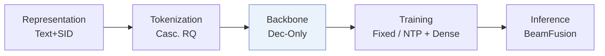
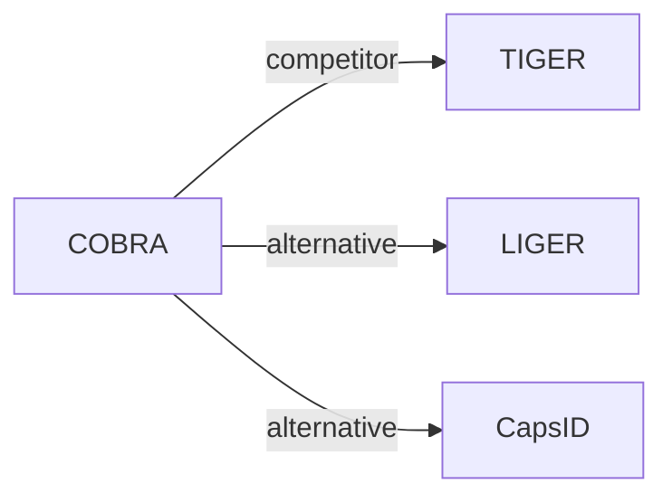

# COBRA

*Sparse Meets Dense: Unified Generative Recommendations with Cascaded Sparse-Dense Representations* — Yang et al. · NeurIPS’25

`I. 信息量` · `Backbone` · [论文](https://arxiv.org/abs/2503.02453) · [矩阵](../../../README.zh.md#i--backbone) · [English](../../papers/cobra.md)

阅读级别：概览（第 1 级） · 本页目录：[TL;DR](#tldr) · [速览](#速览) · [3. 实验发现](#3-实验发现) · [5. 相关工作](#5-相关工作)

- `Text+SID`: Text representation plus semantic IDs (hybrid dense and generative retrieval).
- `Dec-Only`: Decoder-only.
- `Fixed`: SIDs are built first and not changed while the generator trains.
- `NTP + Dense`: NTP plus dense-vector prediction.

### TL;DR

> [!NOTE]
> COBRA 先生成稀疏 SID 再以它为条件生成稠密向量，端到端联合训练二者，并在解码时用 BeamFusion 融合束搜索分数与最近邻相似度。

### 速览

| 维度 | 摘要 |
| :-- | :-- |
| 研究问题 | I. 信息量：Do the SIDs, or the model reading them, carry the collaborative and multimodal signals recommendation needs? |
| 核心贡献 | COBRA 先生成稀疏 SID 再以它为条件生成稠密向量，端到端联合训练二者，并在解码时用 BeamFusion 融合束搜索分数与最近邻相似度。 |
| 主要改动阶段 | Backbone |

### 3. 实验发现

实验设置

- **数据集**：Amazon Product Reviews (May 1996-September 2014): Beauty, Sports and Outdoors, Toys and Games, with 5-core filtering of users and items (users / items: 22,363 / 12,101; 35,598 / 18,357; 19,412 / 11,924). Industrial: Baidu advertising logs across list-page, dual-column, and short-video scenarios, about 5 million users and 2 million ads; filtering not reported.
  - 出处：Public categories, date range, 5-core filtering: [S4.SS1.SSS1.p1](https://arxiv.org/html/2503.02453v1#S4.SS1.SSS1.p1); statistics: [S4.T1](https://arxiv.org/html/2503.02453v1#S4.T1); industrial data: [S4.SS2.SSS1.p1](https://arxiv.org/html/2503.02453v1#S4.SS2.SSS1.p1).
- **切分**：Public datasets: train/validation/test allocation not reported. Industrial: first 60 days of logs for training and the following day for testing. Online: A/B test in January 2025 with 10% of user traffic.
  - 出处：Public split not stated: [S4.SS1.SSS1.p1](https://arxiv.org/html/2503.02453v1#S4.SS1.SSS1.p1); industrial 60-day train and next-day test: [S4.SS2.SSS1.p1](https://arxiv.org/html/2503.02453v1#S4.SS2.SSS1.p1); online A/B: [S4.SS4.p1](https://arxiv.org/html/2503.02453v1#S4.SS4.p1).
- **候选集**：not reported (full catalog versus sampled evaluation candidates); top-K lists are formed by ANN retrieval among items under the top-M generated sparse IDs, fused by BeamFusion. Public K=5 and 10; industrial K=50 to 800.
  - 出处：Retrieval combines beam search over sparse IDs with ANN over items under each ID: [S3.SS4.p2](https://arxiv.org/html/2503.02453v1#S3.SS4.p2) and [S3.SS4.p5](https://arxiv.org/html/2503.02453v1#S3.SS4.p5); evaluation metrics: [S4.SS1.SSS1.p1](https://arxiv.org/html/2503.02453v1#S4.SS1.SSS1.p1).
- **可见性**：warm; no unseen-item protocol is defined.
  - 出处：Standard public protocol and next-day industrial test, with no cold-start experiment: [S4.SS1.SSS1.p1](https://arxiv.org/html/2503.02453v1#S4.SS1.SSS1.p1) and [S4.SS2.SSS1.p1](https://arxiv.org/html/2503.02453v1#S4.SS2.SSS1.p1).
- **SID 规格**：Public: 3-level semantic IDs with codebook size 32 per level, generated from T5 embeddings following TIGER's method. Industrial: 2-level 32 x 32 sparse IDs (the w/o Dense variant uses 3 levels of 256). Items under the same sparse ID are distinguished by a generated dense vector and ANN search within that ID's candidate set; a collision-resolution rule for the sparse IDs is not reported.
  - 出处：Public SID: [S4.SS1.SSS3.p1](https://arxiv.org/html/2503.02453v1#S4.SS1.SSS3.p1); industrial SID and the w/o Dense variant: [S4.SS2.SSS3.p1](https://arxiv.org/html/2503.02453v1#S4.SS2.SSS3.p1); items sharing a sparse ID are separated by the dense vector: [S3.SS4.p5](https://arxiv.org/html/2503.02453v1#S3.SS4.p5).
- **推理预算**：Beam search returns the top M sparse IDs, then ANN retrieves the top N items per ID and BeamFusion combines beam and cosine scores; numerical M and N are not reported. The recall-diversity analysis selects tau=0.9 with the second coefficient fixed at 16. Public model: 1-layer encoder and 2-layer decoder. Hardware, inference batch size, and latency: not reported.
  - 出处：Beam search top-M, ANN top-N, BeamFusion coefficients: [S3.SS4.p2](https://arxiv.org/html/2503.02453v1#S3.SS4.p2), [S3.SS4.p5](https://arxiv.org/html/2503.02453v1#S3.SS4.p5), [S3.SS4.p6](https://arxiv.org/html/2503.02453v1#S3.SS4.p6); tau setting: [S4.SS3.SSS2.p1](https://arxiv.org/html/2503.02453v1#S4.SS3.SSS2.p1); architecture: [S4.SS1.SSS3.p1](https://arxiv.org/html/2503.02453v1#S4.SS1.SSS3.p1).
- **结果来源**：Table 2 (Beauty, Sports, Toys); Table 3 (Baidu industrial Recall@50-800 with ablated variants); Section 4.4 (online A/B: +3.60% conversion, +4.15% ARPU); Figures 4-6 (embedding analysis and recall-diversity curves).
  - 出处：Public table: [S4.T2](https://arxiv.org/html/2503.02453v1#S4.T2); industrial variants: [S4.T3](https://arxiv.org/html/2503.02453v1#S4.T3); online: [S4.SS4.p1](https://arxiv.org/html/2503.02453v1#S4.SS4.p1); diversity curves: [S4.F6](https://arxiv.org/html/2503.02453v1#S4.F6).

### 5. 相关工作

- **同期对比** · [TIGER](tiger.md): TIGER retrieves items from sparse semantic IDs alone; COBRA follows TIGER's SID construction but generates a dense vector after each sparse ID and fuses beam and ANN scores.
  - 出处：COBRA v1, baselines and SID setting: https://arxiv.org/html/2503.02453v1#S4.I1.i9.p1 and https://arxiv.org/html/2503.02453v1#S4.SS1.SSS3.p1; Table 2: https://arxiv.org/html/2503.02453v1#S4.T2; the w/o Dense variant mirrors TIGER: https://arxiv.org/html/2503.02453v1#S4.I2.i2.p1.
- **替代方案** · [LIGER](liger.md): LIGER (Yang et al., 2024) unifies generative and dense retrieval as a hybrid, while COBRA cascades sparse-ID generation and dense-vector generation inside one decoder.
  - 出处：COBRA v1, Section 1 cites Yang et al. (2024), Unifying Generative and Dense Retrieval, for the fine-grained similarity gap of generative methods: https://arxiv.org/html/2503.02453v1#S1.p3; not a baseline in Table 2.
- **替代方案** · [CapsID](capsid.md): CapsID removes the dense patch and instead makes the SID soft-routed and variable-length, reporting about half of COBRA's per-query latency at similar Recall@100.
  - 出处：Evidence is from the later CapsID paper: COBRA is a patch-route baseline in Tables 3, 4, and 6: https://arxiv.org/html/2605.05096v1#S4.T3, https://arxiv.org/html/2605.05096v1#S4.T4, https://arxiv.org/html/2605.05096v1#S4.T6; latency comparison: https://arxiv.org/html/2605.05096v1#S4.SS5.SSS0.Px5.p2.

[查看同格全部论文](../../../README.zh.md#i--backbone)
