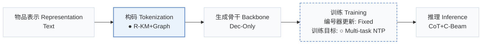
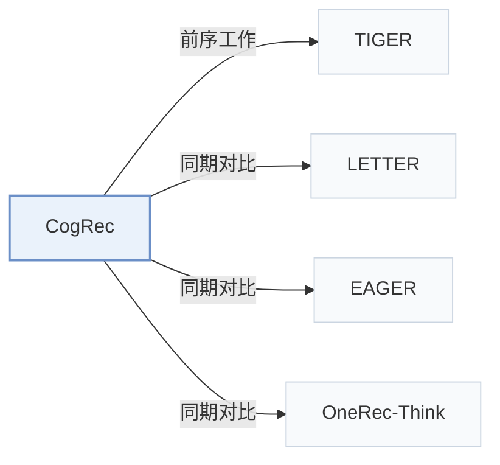

# CogRec

[← 问题 × 阶段矩阵](../../../README.zh.md#iii--tokenization) · [按阶段索引](../index/stages.md) · [按模态找论文](../index/modality.md) · [按领域找论文](../index/domain.md) · [English](../../papers/cogrec.md) | 中文

| **题目** | *Structure-Cognitive Fast-and-Slow Reasoning for Generative Recommendation* |
| :-- | :-- |
| **作者** | Liu et al. |
| **发表** | arXiv’26 |
| **问题与阶段** | `III. SID 与模型对齐` · `构码（Tokenization）` |
| **改动** | ● 构码 · ○ 训练目标 |
| **构码输入** | `Text` |
| **领域** | `电商` |
| **应用场景** | `一般物品推荐`；`公开数据` |
| **链接** | [论文](https://arxiv.org/abs/2607.24402) · [代码](https://github.com/caskcsg/CogRec) |
| **阅读级别** | 概览（第 1 级） |

**本页目录**：[TL;DR](#tldr) · [3. 实验发现](#3-实验发现) · [5. 相关工作](#5-相关工作)

- `Text`：物品文本元数据（标题、描述、类目或提示词）。
- `R-KM+Graph`：残差 k-means 结合语义码关联图。
- `Dec-Only`：仅解码器（Decoder-only）自回归架构。
- `Fixed`：先独立训练并冻结编号器，生成器训练期间 SID 保持不变。
- `Multi-task NTP`：在多个对齐或推荐子任务上联合优化下一 token 预测损失。
- `CoT+C-Beam`：显式推理后接合法前缀约束束搜索。

### TL;DR

> [!NOTE]
> CogRec 借助层内图、物品邻域以及匹配、横向跳转与探索三类路由步骤，把推理锚定在 SID 结构上，替代与 ID 关联松散的自然语言推理。

---

### 3. 实验发现

实验设置

- **数据集**：Amazon Reviews 2014: Beauty, Sports, Toys; user/item filtering not reported.
  - 出处：[S4.SS1.SSS1.p1](https://arxiv.org/html/2607.24402v1#S4.SS1.SSS1.p1)
- **切分**：Chronological per-user leave-one-out: last interaction test, penultimate validation, remainder training. Direct evaluation uses the complete test set; default CoT uses a predefined subset, with separate full-test CoT evaluation.
  - 出处：[S4.SS1.SSS1.p1](https://arxiv.org/html/2607.24402v1#S4.SS1.SSS1.p1) ; #S4.SS1.SSS3.p3
- **候选集**：not reported; all generative variants share a trie containing the complete valid four-layer candidate-item SID set, but evaluation catalog size/sampling and history exclusion are not specified.
  - 出处：[S4.SS1.SSS2.p1](https://arxiv.org/html/2607.24402v1#S4.SS1.SSS2.p1) ; #S4.SS1.SSS3.p1
- **可见性**：warm; no unseen-item protocol is defined. The SID mapping and topology are shared across training stages.
  - 出处：[S4.SS1.SSS1.p1](https://arxiv.org/html/2607.24402v1#S4.SS1.SSS1.p1) ; #S3.SS5.p2
- **SID 规格**：BGE-base-en-v1.5 metadata embeddings (title/description/category), 768 dimensions and L2 normalization; residual K-means, 4 layers x 256 codes, 30 iterations/layer; 1,024 layer-specific tokens plus 2 boundary tokens. Intra-layer top-16 centroid graphs retain cosine >=0.15 edges; the mapping/topology is fixed across later stages. Collision handling not reported.
  - 出处：[S4.SS1.SSS4.p1](https://arxiv.org/html/2607.24402v1#S4.SS1.SSS4.p1) ; #S4.SS1.SSS4.p2 ; #S3.SS5.p2
- **推理预算**：Qwen3-1.7B; trie-constrained SID beam 10, temperature 0.6, top-p 1.0, max 8 new SID tokens. Reasoning samples 5 traces (temperature 1.5, top-p 0.95), up to 50 trace-conditioned SID hypotheses. Full-test CoT alone tail-truncates histories to Beauty/Sports/Toys 21/20/18 items. Reasoning-token cap, inference hardware/batch size and latency not reported; A800 GPUs are specified for training.
  - 出处：[S3.T1](https://arxiv.org/html/2607.24402v1#S3.T1) ; #S4.SS1.SSS3.p2 ; #S4.SS1.SSS3.p3
- **结果来源**：Own CogRec experiments and controlled OneRec-Think Direct/CoT reproductions (Table 4/Figure 3); Table 3 mostly imports cited baseline scores, including standalone LETTER from RAGR and OneRec-Think from its original paper. Cross-source baselines do not share a guaranteed identical implementation/protocol.
  - 出处：[S4.SS3.p2](https://arxiv.org/html/2607.24402v1#S4.SS3.p2) ; #S4.SS2.p4 ; #S4.SS5.p1

---

### 5. 相关工作

- **前序工作** · [TIGER](tiger.md): Hierarchical SID recommendation provides the identifier-generation foundation; TIGER also appears in the broad baseline comparison.
  - 出处：[S2.p2](https://arxiv.org/html/2607.24402v1#S2.p2) ; #S4.SS2.p3
- **同期对比** · [LETTER](letter.md): Non-reasoning tokenization baseline; scores are standalone LETTER results reported by RAGR, not LETTER+RAGR.
  - 出处：[S4.SS2.p3](https://arxiv.org/html/2607.24402v1#S4.SS2.p3)
- **同期对比** · [EAGER](eager.md): Behavioral/semantic generative baseline in the broad cross-method comparison.
  - 出处：[S4.SS2.p3](https://arxiv.org/html/2607.24402v1#S4.SS2.p3)
- **同期对比** · [OneRec-Think](onerec-think.md): Textual rationale before item generation contrasts with SID-grounded routing; original scores enter Table 3 and reproduced Direct/CoT branches enter controlled comparisons.
  - 出处：[S4.SS2.p4](https://arxiv.org/html/2607.24402v1#S4.SS2.p4) ; #S4.SS5.p1

[查看同格全部论文](../../../README.zh.md#iii--tokenization)
