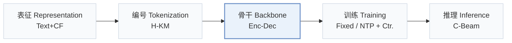
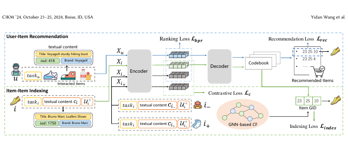
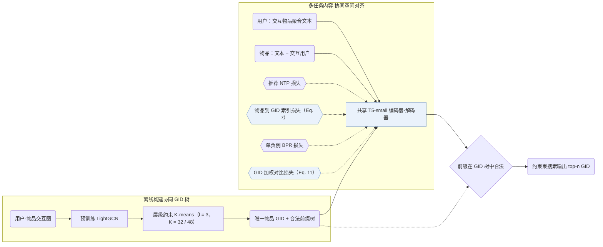
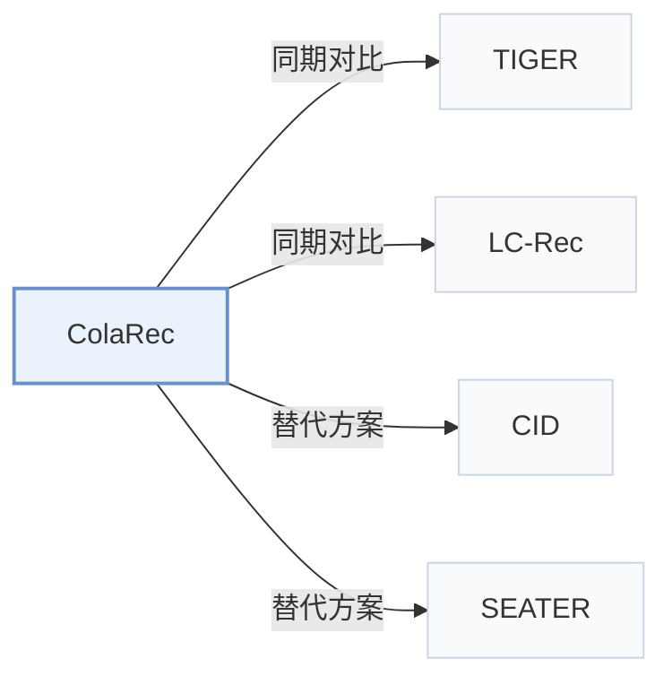

# ColaRec

[← 问题 × 阶段矩阵](../../../README.zh.md#i--backbone) · [按阶段索引](../index/stages.md) · [按模态索引](../index/modality.md) · [English](../../papers/colarec.md) | 中文

| **题目** | *Content-based collaborative generation for recommender systems* |
| :-- | :-- |
| **作者** | Wang et al. |
| **发表** | CIKM’24 |
| **问题与阶段** | `I. 信息量` · `骨干（Backbone）` |
| **链接** | [论文](https://arxiv.org/abs/2403.18480) · [代码](https://github.com/Junewang0614/ColaRec) |
| **阅读级别** | 阅读笔记（第 2 级） |

**本页目录**：[TL;DR](#tldr) · [速览](#速览) · [1. 为什么重要](#1-为什么重要) · [2. 方法](#2-方法) · [3. 实验发现](#3-实验发现) · [4. 局限与分析](#4-局限与分析) · [5. 相关工作](#5-相关工作)

- `Text+CF`：文本表征结合协同过滤信号。
- `H-KM`：层级 k-means 聚类（Hierarchical k-means）。
- `Enc-Dec`：编码器-解码器（Encoder-decoder）架构。
- `Fixed`：先独立训练并冻结编号器，生成器训练期间 SID 保持不变。
- `NTP + Ctr.`：下一 token 预测结合对比学习损失。
- `C-Beam`：受合法物品集合约束的束搜索（Constrained beam search）。

### TL;DR

> [!NOTE]
> ColaRec 从预训练协同过滤模型构造生成式标识，结合物品索引任务与对比损失对齐协同与内容空间，从交互物品内容生成目标 ID。

---

### 速览

| 维度 | 摘要 |
| :-- | :-- |
| 研究问题 | I. 信息量：SID 或读取它的模型是否充分携带了推荐所需的协同、多模态与时空信号？ |
| 核心贡献 | ColaRec 从预训练协同过滤模型构造生成式标识，结合物品索引任务与对比损失对齐协同与内容空间，从交互物品内容生成目标 ID。 |
| 主要改动阶段 | 骨干（Backbone） |
| 主要发现 | 在 Amazon Beauty、Sports and Outdoors、Cell Phones and Accessories 与 Food.com Recipe 的全量目录评测中，ColaRec 在 Recall@5/10 与 NDCG@5/10 上优于协同过滤、内容增强与生成式基线（含 TIGER 和 LC-Rec），消融实验证实了物品到 GID 索引任务及对比对齐的有效性（Sec. 5.2，Table 2，Table 3，Table 4）。 |
| 局限 | 生成式标识（GID）由预训练 LightGCN 嵌入经离线层级约束 K-means 聚类构建，无交互记录的冷启动物品缺少可用于聚类的协同表征（Sec. 4.2）。 |

---

### 1. 为什么重要

基于提示词的 LLM 推荐方法通过自然语言文本生成来融合内容与协同信号，开放式文本解码与全量物品目录排序目标并不一致（Abstract）。ColaRec 从预训练协同过滤图模型中为每个物品构建树状语义 ID（Semantic ID，SID）——论文称为生成式标识（GID）——并用 T5-small 编码器-解码器从用户交互物品的聚合文本中解码目标 GID，同时对齐内容空间与协同空间。

> "To model collaborative signals, the GIDs are constructed from a pretrained collaborative filtering model, and the user is represented as the content aggregation of interacted items."（Abstract）

---

### 2. 方法

#### 构建生成式标识

ColaRec 从预训练 LightGCN 模型提取物品嵌入，递归调用容量受限的 K-means 算法（层数 $`l = 3`$，Amazon 每层簇数 $`K = 32`$，Recipe 为 $`K = 48`$），限制第 $`t`$ 层每个簇最多包含 $`K^{l-t}`$ 个物品，保证每个叶节点唯一对应一个物品（Sec. 4.2，Sec. 5.4）。

> "Specifically, we first extract item representations from a pretrained LightGCN model. Then the constrained K-means algorithm is called hierarchically based on the item representations."（Sec. 4.2）

#### 物品索引任务

为弥合文本输入与协同 GID 之间的鸿沟，辅助物品索引任务将物品自身文本及交互过的用户集合输入共享的 T5-small 编码器-解码器，直接预测该物品对应的 GID（Sec. 4.4，Eq. 7）。

#### 训练目标

ColaRec 联合优化用户到 GID 的推荐生成损失、物品到 GID 的索引损失、带 1 个采样负例的 BPR 排序损失，以及按 GID 前缀重合度加权的对比损失（Sec. 4.5，Eq. 11）。

> "The idea is that items with similar GIDs should also be similar in the content-based semantic space."（Sec. 4.5）

#### 推理

推理阶段采用约束束搜索，每步屏蔽不在 GID 前缀树中的非法后继 token，确保生成的每条 GID 均对应目录中的真实物品（Sec. 4.5）。

---

### 3. 实验发现

实验设置

- **数据集**：Amazon Product Reviews: Beauty, Sports and Outdoors, Cell Phones and Accessories (Phone); Food.com Recipe. Users and items with fewer than 5 interactions are filtered. Sizes (users / items / interactions): Beauty 22,363 / 12,101 / 198,502; Sports 35,598 / 18,357 / 296,337; Phone 27,879 / 10,429 / 194,439; Recipe 17,813 / 41,240 / 555,618.
  - 出处：Datasets and 5-interaction filter: [S5.SS1.p1](https://arxiv.org/html/2403.18480v2#S5.SS1.p1); statistics: [S4.T1](https://arxiv.org/html/2403.18480v2#S4.T1).
- **切分**：General recommendation, not sequential: each user's interactions are randomly split 8:1:1 into training, validation, and test. Three runs are averaged.
  - 出处：Random 8:1:1 per-user split for general (non-sequential) recommendation: [S5.SS2.p1](https://arxiv.org/html/2403.18480v2#S5.SS2.p1).
- **候选集**：full catalog
  - 出处：Candidate set is the whole item set: [S5.SS2.p1](https://arxiv.org/html/2403.18480v2#S5.SS2.p1).
- **可见性**：warm; no unseen-item protocol is defined.
  - 出处：Random interaction split with no cold-start experiment: [S5.SS2.p1](https://arxiv.org/html/2403.18480v2#S5.SS2.p1); long-tail users are analyzed separately: [S5.T3](https://arxiv.org/html/2403.18480v2#S5.T3).
- **SID 规格**：GID length l=3 from hierarchical constrained K-means over pretrained LightGCN item embeddings, K=32 clusters per level (48 for Recipe). Collisions are avoided by construction: clusters hold at most K^(l-t) items and leaf positions are assigned randomly, so each item has a unique GID.
  - 出处：Constrained hierarchical K-means over LightGCN embeddings, random leaf assignment, one unique GID per item: [S4.SS2.p1](https://arxiv.org/html/2403.18480v2#S4.SS2.p1) and [S4.SS2.p2](https://arxiv.org/html/2403.18480v2#S4.SS2.p2); l=3, K=32 (Recipe 48): [S5.SS4.p1](https://arxiv.org/html/2403.18480v2#S5.SS4.p1).
- **推理预算**：Constrained beam search over valid GID prefixes; numerical beam width not reported. T5-small backbone. Recall and NDCG at n=5 and 10 (Table 2). Hardware, inference batch size, and latency: not reported.
  - 出处：Constrained beam search: [S4.SS5.p5](https://arxiv.org/html/2403.18480v2#S4.SS5.p5); no numerical width found in Section 5.
- **结果来源**：Table 2 (four datasets; mean of three runs); Table 3 (long-tail users); Table 4 (multi-task ablation and GID types); Figures 4-5 (GID length and cluster number).
  - 出处：Main: [S4.T2](https://arxiv.org/html/2403.18480v2#S4.T2); long-tail users: [S5.T3](https://arxiv.org/html/2403.18480v2#S5.T3); ablation and GID types: [S5.T4](https://arxiv.org/html/2403.18480v2#S5.T4); GID length and K: [S5.SS7.SSS2.p1](https://arxiv.org/html/2403.18480v2#S5.SS7.SSS2.p1) and [S5.SS7.SSS2.p2](https://arxiv.org/html/2403.18480v2#S5.SS7.SSS2.p2).

- 全量目录对比：按每用户 8:1:1 随机切分（3 次运行取平均），在 Beauty（22,363 用户 / 12,101 物品）、Sports and Outdoors（35,598 / 18,357）、Cell Phones and Accessories（27,879 / 10,429）和 Food.com Recipe（17,813 / 41,240）四个数据集上，ColaRec 在 Recall@5/10 和 NDCG@5/10 上均优于协同过滤、内容协同与生成式基线（Abstract，Table 1，Table 2）。
- 长尾用户分析：按交互频次对用户分桶的实验显示，ColaRec 在稀疏历史用户上同样保持优势（Table 3）。
- 多任务与标识消融：移除物品文本、索引任务、BPR 损失或加权对比损失均导致指标下降，且基于 LightGCN 的协同 GID 优于随机 ID、纯文本 K-means ID 与扁平 ID（Table 4，Fig. 4，Fig. 5）。

---

### 4. 局限与分析

**Our analysis.**

- 加权对比损失强行将内容表征拉向协同 GID 树结构，据此推断，低频物品若因交互稀疏而被分入含噪协同簇，其内容语义相似度也会受到扭曲。
- 论文未报告约束束搜索的具体束宽数值及推理延迟（Sec. 4.5，Sec. 5）。
- SEATER 同样基于纯协同信号（`CF`）构建均衡树状标识（`Tree-Clus.`）；ColaRec 则同时引入物品文本与协同结构（`Text+CF`），并通过物品索引任务与对比损失对齐两侧空间。

---

### 5. 相关工作

- **同期对比** · [TIGER](tiger.md): TIGER builds content-only RQ-VAE identifiers; ColaRec builds collaborative GIDs from LightGCN embeddings and aligns them with item content through item-item indexing.
  - 出处：ColaRec v2, Section 5.3 baselines: [S5.SS3.p1](https://arxiv.org/html/2403.18480v2#S5.SS3.p1) and [S5.I2.i8.p1](https://arxiv.org/html/2403.18480v2#S5.I2.i8.p1) (adapted without sequential order); Table 2: [S4.T2](https://arxiv.org/html/2403.18480v2#S4.T2).
- **同期对比** · [LC-Rec](lc-rec.md): LC-Rec learns TIGER-style indices and aligns an LLM through language tasks; ColaRec uses a T5-small generator with collaborative GIDs and a contrastive ranking loss.
  - 出处：ColaRec v2, Section 5.3 baselines: [S5.I2.i9.p1](https://arxiv.org/html/2403.18480v2#S5.I2.i9.p1); Table 2: [S4.T2](https://arxiv.org/html/2403.18480v2#S4.T2).
- **替代方案** · [CID](cid.md): P5-CID builds collaborative IDs for prompt-based P5 models that rank a candidate list in the prompt; ColaRec generates GIDs over the whole item set.
  - 出处：ColaRec v2, Section 5.3 explains why P5-based methods including Hua et al. (2023) are excluded as baselines: [S5.SS3.p2](https://arxiv.org/html/2403.18480v2#S5.SS3.p2); related work: [S2.SS2.p3](https://arxiv.org/html/2403.18480v2#S2.SS2.p3).
- **替代方案** · [SEATER](seater.md): SEATER also builds tree-structured identifiers for generative recommendation; ColaRec derives its tree from collaborative LightGCN embeddings and adds content-based item-item indexing.
  - 出处：ColaRec v2, Section 1 and Section 2.2 cite SEATER among generative identifier methods: [S1.p3](https://arxiv.org/html/2403.18480v2#S1.p3) and [S2.SS2.p3](https://arxiv.org/html/2403.18480v2#S2.SS2.p3); not a baseline in Table 2.

[查看同格全部论文](../../../README.zh.md#i--backbone)
