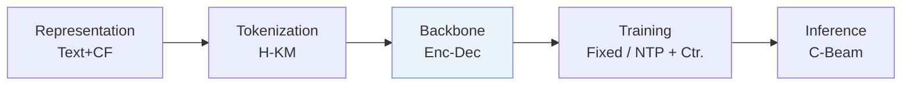
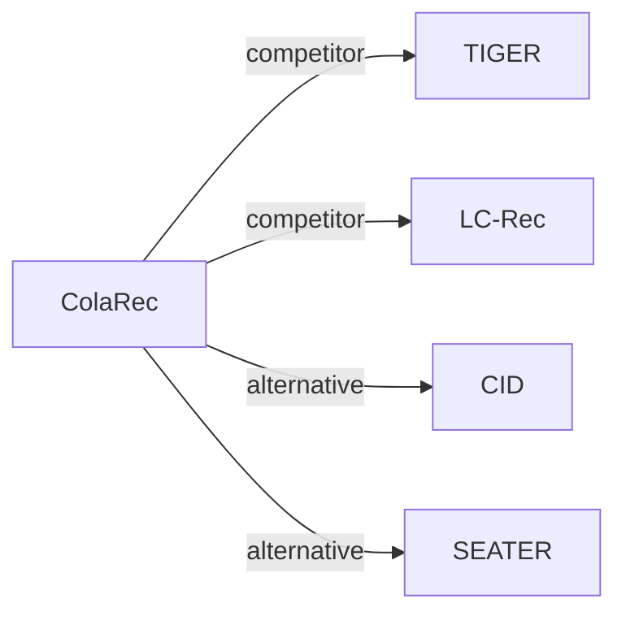

# ColaRec

*Content-based collaborative generation for recommender systems* — Wang et al. · CIKM’24

`I. 信息量` · `Backbone` · [论文](https://arxiv.org/abs/2403.18480) · [代码](https://github.com/Junewang0614/ColaRec) · [矩阵](../../../README.zh.md#i--backbone) · [English](../../papers/colarec.md)

阅读级别：概览（第 1 级） · 本页目录：[TL;DR](#tldr) · [速览](#速览) · [2. 方法](#2-方法) · [3. 实验发现](#3-实验发现) · [5. 相关工作](#5-相关工作)

- `H-KM`: Hierarchical k-means.
- `Enc-Dec`: Encoder-decoder.
- `Fixed`: SIDs are built first and not changed while the generator trains.
- `NTP + Ctr.`: NTP plus a contrastive loss.
- `C-Beam`: Constrained beam search.

### TL;DR

> [!NOTE]
> ColaRec 从预训练协同过滤模型构造生成式标识，结合物品索引任务与对比损失对齐协同与内容空间，从交互物品内容生成目标 ID。

### 速览

| 维度 | 摘要 |
| :-- | :-- |
| 研究问题 | I. 信息量：Do the SIDs, or the model reading them, carry the collaborative and multimodal signals recommendation needs? |
| 核心贡献 | ColaRec 从预训练协同过滤模型构造生成式标识，结合物品索引任务与对比损失对齐协同与内容空间，从交互物品内容生成目标 ID。 |
| 主要改动阶段 | Backbone |

### 2. 方法

### 3. 实验发现

实验设置

- **数据集**：Amazon Product Reviews: Beauty, Sports and Outdoors, Cell Phones and Accessories (Phone); Food.com Recipe. Users and items with fewer than 5 interactions are filtered. Sizes (users / items / interactions): Beauty 22,363 / 12,101 / 198,502; Sports 35,598 / 18,357 / 296,337; Phone 27,879 / 10,429 / 194,439; Recipe 17,813 / 41,240 / 555,618.
  - 出处：Datasets and 5-interaction filter: [S5.SS1.p1](https://arxiv.org/html/2403.18480v2#S5.SS1.p1); statistics: [S4.T1](https://arxiv.org/html/2403.18480v2#S4.T1).
- **切分**：General recommendation, not sequential: each user's interactions are randomly split 8:1:1 into training, validation, and test. Three runs are averaged.
  - 出处：Random 8:1:1 per-user split for general (non-sequential) recommendation: [S5.SS2.p1](https://arxiv.org/html/2403.18480v2#S5.SS2.p1).
- **候选集**：full catalog
  - 出处：Candidate set is the whole item set: [S5.SS2.p1](https://arxiv.org/html/2403.18480v2#S5.SS2.p1).
- **可见性**：warm; no unseen-item protocol is defined.
  - 出处：Random interaction split with no cold-start experiment: [S5.SS2.p1](https://arxiv.org/html/2403.18480v2#S5.SS2.p1); long-tail users are analyzed separately: [S5.T3](https://arxiv.org/html/2403.18480v2#S5.T3).
- **SID 规格**：GID length l=3 from hierarchical constrained K-means over pretrained LightGCN item embeddings, K=32 clusters per level (48 for Recipe). Collisions are avoided by construction: clusters hold at most K^(l-t) items and leaf positions are assigned randomly, so each item has a unique GID.
  - 出处：Constrained hierarchical K-means over LightGCN embeddings, random leaf assignment, one unique GID per item: [S4.SS2.p1](https://arxiv.org/html/2403.18480v2#S4.SS2.p1) and [S4.SS2.p2](https://arxiv.org/html/2403.18480v2#S4.SS2.p2); l=3, K=32 (Recipe 48): [S5.SS4.p1](https://arxiv.org/html/2403.18480v2#S5.SS4.p1).
- **推理预算**：Constrained beam search over valid GID prefixes; numerical beam width not reported. T5-small backbone. Recall and NDCG at n=5 and 10 (Table 2). Hardware, inference batch size, and latency: not reported.
  - 出处：Constrained beam search: [S4.SS5.p5](https://arxiv.org/html/2403.18480v2#S4.SS5.p5); no numerical width found in Section 5.
- **结果来源**：Table 2 (four datasets; mean of three runs); Table 3 (long-tail users); Table 4 (multi-task ablation and GID types); Figures 4-5 (GID length and cluster number).
  - 出处：Main: [S4.T2](https://arxiv.org/html/2403.18480v2#S4.T2); long-tail users: [S5.T3](https://arxiv.org/html/2403.18480v2#S5.T3); ablation and GID types: [S5.T4](https://arxiv.org/html/2403.18480v2#S5.T4); GID length and K: [S5.SS7.SSS2.p1](https://arxiv.org/html/2403.18480v2#S5.SS7.SSS2.p1) and [S5.SS7.SSS2.p2](https://arxiv.org/html/2403.18480v2#S5.SS7.SSS2.p2).

### 5. 相关工作

- **同期对比** · [TIGER](tiger.md): TIGER builds content-only RQ-VAE identifiers; ColaRec builds collaborative GIDs from LightGCN embeddings and aligns them with item content through item-item indexing.
  - 出处：ColaRec v2, Section 5.3 baselines: https://arxiv.org/html/2403.18480v2#S5.SS3.p1 and https://arxiv.org/html/2403.18480v2#S5.I2.i8.p1 (adapted without sequential order); Table 2: https://arxiv.org/html/2403.18480v2#S4.T2.
- **同期对比** · [LC-Rec](lc-rec.md): LC-Rec learns TIGER-style indices and aligns an LLM through language tasks; ColaRec uses a T5-small generator with collaborative GIDs and a contrastive ranking loss.
  - 出处：ColaRec v2, Section 5.3 baselines: https://arxiv.org/html/2403.18480v2#S5.I2.i9.p1; Table 2: https://arxiv.org/html/2403.18480v2#S4.T2.
- **替代方案** · [CID](cid.md): P5-CID builds collaborative IDs for prompt-based P5 models that rank a candidate list in the prompt; ColaRec generates GIDs over the whole item set.
  - 出处：ColaRec v2, Section 5.3 explains why P5-based methods including Hua et al. (2023) are excluded as baselines: https://arxiv.org/html/2403.18480v2#S5.SS3.p2; related work: https://arxiv.org/html/2403.18480v2#S2.SS2.p3.
- **替代方案** · [SEATER](seater.md): SEATER also builds tree-structured identifiers for generative recommendation; ColaRec derives its tree from collaborative LightGCN embeddings and adds content-based item-item indexing.
  - 出处：ColaRec v2, Section 1 and Section 2.2 cite SEATER among generative identifier methods: https://arxiv.org/html/2403.18480v2#S1.p3 and https://arxiv.org/html/2403.18480v2#S2.SS2.p3; not a baseline in Table 2.

[查看同格全部论文](../../../README.zh.md#i--backbone)
