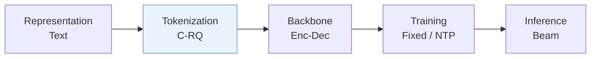
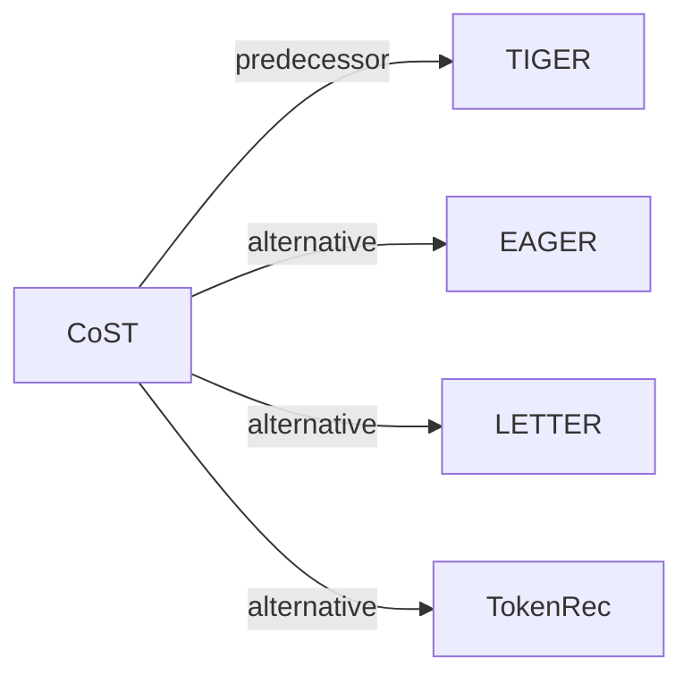

# CoST

*Contrastive quantization based semantic tokenization for generative recommendation* — Zhu et al. · RecSys’24

`I. 信息量` · `Tokenization` · [论文](https://arxiv.org/abs/2404.14774) · [矩阵](../../../README.zh.md#i--tokenization) · [English](../../papers/cost.md)

阅读级别：概览（第 1 级） · 本页目录：[TL;DR](#tldr) · [速览](#速览) · [3. 实验发现](#3-实验发现) · [5. 相关工作](#5-相关工作)

- `Enc-Dec`: Encoder-decoder.
- `Fixed`: SIDs are built first and not changed while the generator trains.
- `NTP`: Next-token prediction loss only; continuing from a pretrained LLM (SFT) also counts as NTP.

### TL;DR

> [!NOTE]
> CoST 用刻画物品邻域关系的对比量化目标训练物品编号器，替代 RQ-VAE 使用的重构损失。

### 速览

| 维度 | 摘要 |
| :-- | :-- |
| 研究问题 | I. 信息量：Do the SIDs, or the model reading them, carry the collaborative and multimodal signals recommendation needs? |
| 核心贡献 | CoST 用刻画物品邻域关系的对比量化目标训练物品编号器，替代 RQ-VAE 使用的重构损失。 |
| 主要改动阶段 | Tokenization |

### 3. 实验发现

实验设置

- **数据集**：MIND news (preprocessing following Feng et al. 2022: interactions with at least 15 users kept, sequences capped at 70; 29,207 users / 12,251 items) and Amazon Office (users with fewer than 5 interactions removed), split by item count into Office (S) (2,868 users / 14,618 items) and Office (L) (16,696 users / 37,347 items).
  - 出处：Datasets and filters: [S4.SS1.p1](https://arxiv.org/html/2404.14774v2#S4.SS1.p1); statistics: [S3.T1](https://arxiv.org/html/2404.14774v2#S3.T1).
- **切分**：Leave-one-out: last item for test, penultimate for validation, the remaining items for training.
  - 出处：Leave-one-out allocation: [S4.SS1.p3](https://arxiv.org/html/2404.14774v2#S4.SS1.p3).
- **候选集**：not reported (full catalog versus sampled evaluation candidates).
  - 出处：Metrics only: [S4.SS1.p3](https://arxiv.org/html/2404.14774v2#S4.SS1.p3).
- **可见性**：warm; no unseen-item protocol is defined.
  - 出处：Standard leave-one-out with no cold-start experiment: [S4.SS1.p3](https://arxiv.org/html/2404.14774v2#S4.SS1.p3).
- **SID 规格**：3 residual-quantization levels with a codebook of size 64 shared across levels, 96-dimensional latent; Sentence-T5 768-dimensional input. The paper states each item receives a unique 3-tuple, but the mechanism that guarantees uniqueness is not reported.
  - 出处：3 shared codebooks of size 64, 96-dimensional latent, unique 3-tuples: [S4.SS1.p2](https://arxiv.org/html/2404.14774v2#S4.SS1.p2); sensitivity: [S4.F4](https://arxiv.org/html/2404.14774v2#S4.F4).
- **推理预算**：TIGER-style encoder-decoder; decoding method and beam width not reported. Recall and NDCG at K=5, 10, 20, 40 (MIND) and 10, 20 (Office). Hardware, inference batch size, and latency: not reported.
  - 出处：Generator follows TIGER's structure, no decoding settings: [S4.SS1.p2](https://arxiv.org/html/2404.14774v2#S4.SS1.p2) and [S3.SS2.p1](https://arxiv.org/html/2404.14774v2#S3.SS2.p1).
- **结果来源**：Table 2 (MIND) and Table 3 (Office (S) and Office (L)), comparing random hashing, reconstruction-only RQ-VAE, contrastive-only, and combined losses; Figures 3-4 (temperature, epochs, codebook size, number of codebooks, embedding dimension).
  - 出处：MIND: [S4.T2](https://arxiv.org/html/2404.14774v2#S4.T2); Office: [S4.T3](https://arxiv.org/html/2404.14774v2#S4.T3); sensitivity: [S4.F3](https://arxiv.org/html/2404.14774v2#S4.F3) and [S4.F4](https://arxiv.org/html/2404.14774v2#S4.F4).

### 5. 相关工作

- **前序工作** · [TIGER](tiger.md): TIGER's RQ-VAE is trained only with reconstruction loss; CoST keeps TIGER's generator and adds a contrastive loss so that neighboring items get distinguishable codes.
  - 出处：CoST v2, Section 1 identifies RQ-VAE from TIGER as the starting point: https://arxiv.org/html/2404.14774v2#S1.p3; Section 3.2 follows TIGER's architecture: https://arxiv.org/html/2404.14774v2#S3.SS2.p1; the reconstruction-only row in Tables 2-3 is the TIGER-style tokenizer: https://arxiv.org/html/2404.14774v2#S4.T2 and https://arxiv.org/html/2404.14774v2#S4.T3.
- **替代方案** · [EAGER](eager.md): EAGER tokenizes items by hierarchical k-means and also integrates collaborative information, whereas CoST trains a residual quantizer with a contrastive objective over item neighborhoods.
  - 出处：CoST v2, Section 1 and Section 2 cite Wang et al. (2024b), EAGER, for hierarchical k-means and semantic-collaborative tokenization: https://arxiv.org/html/2404.14774v2#S1.p3 and https://arxiv.org/html/2404.14774v2#S2.p2; not compared in Tables 2-3.
- **替代方案** · [LETTER](letter.md): LETTER integrates collaborative signals into the RQ-VAE tokenizer, while CoST uses contrastive quantization on semantic embeddings.
  - 出处：CoST v2, Section 2 cites LETTER among semantic-collaborative tokenizers: https://arxiv.org/html/2404.14774v2#S2.p2; not compared in Tables 2-3.
- **替代方案** · [TokenRec](tokenrec.md): TokenRec also combines semantic and collaborative information when tokenizing items; CoST relies on contrastive learning over semantic embeddings.
  - 出处：CoST v2, Section 2 cites Qu et al. (2024), TokenRec: https://arxiv.org/html/2404.14774v2#S2.p2; not compared in Tables 2-3.

[查看同格全部论文](../../../README.zh.md#i--tokenization)
