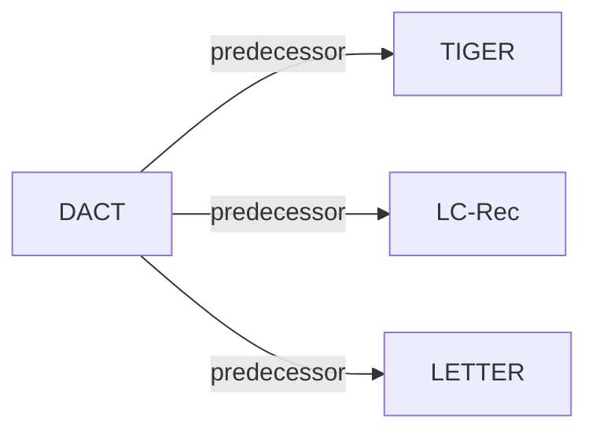

# DACT

| **题目** | *Drift-Aware Continual Tokenization for Generative Recommendation* |
| :-- | :-- |
| **作者** | Feng et al. |
| **会议** | SIGIR’26 |
| **问题与阶段** | `VI. 泛化` · `Tokenization` |
| **链接** | [论文](https://arxiv.org/abs/2603.29705) · [代码](https://github.com/HomesAmaranta/DACT) · [矩阵](../../../README.zh.md#vi--tokenization) · [English](../../papers/dact.md) |
| **阅读级别** | 概览（第 1 级） |

本页目录：[TL;DR](#tldr) · [速览](#速览) · [3. 实验发现](#3-实验发现) · [5. 相关工作](#5-相关工作)

- `Enc-Dec / Dec-Only`: Evaluated on both Encoder-Decoder and Decoder-Only backbones.
- `Fixed`: SIDs are built first and not changed while the generator trains.
- `NTP`: Next-token prediction loss only; continuing from a pretrained LLM (SFT) also counts as NTP.
- `–`: Not reported in the paper.

### TL;DR

> [!NOTE]
> DACT 在交互分布漂移时利用物品级漂移检测器与由松到紧的码重分配机制微调协同编号器，在不完全重训或大规模变动 ID 的前提下更新 SID。

---

### 速览

| 维度 | 摘要 |
| :-- | :-- |
| 研究问题 | VI. 泛化：Does it still work for new items, new domains, and shifting interests? |
| 核心贡献 | DACT 在交互分布漂移时利用物品级漂移检测器与由松到紧的码重分配机制微调协同编号器，在不完全重训或大规模变动 ID 的前提下更新 SID。 |
| 主要改动阶段 | Tokenization |

---

### 3. 实验发现

实验设置

- **数据集**：Amazon Beauty, Tools, Toys; users/items with <5 interactions removed. Amazon release year not reported.
  - 出处：[S4.SS1.SSS1.p1](https://arxiv.org/html/2603.29705v1#S4.SS1.SSS1.p1) ; #S4.SS1.SSS1.p2
- **切分**：Chronological interaction stream: P0 is the first 60% for pretraining; P1-P4 equally divide the remaining 40%. Sliding-window sequences and leave-one-out train/validation/test; exact window and held-out positions not reported. Fine-tuning uses the current period from the previous checkpoint; retraining uses all accumulated periods.
  - 出处：[S4.SS1.SSS1.p2](https://arxiv.org/html/2603.29705v1#S4.SS1.SSS1.p2) ; #S4.SS1.SSS2.p3
- **候选集**：not reported; only HR/NDCG@5,10 are specified, without evaluation catalog size, negative sampling or history exclusion.
  - 出处：[S4.SS1.SSS4.p1](https://arxiv.org/html/2603.29705v1#S4.SS1.SSS4.p1)
- **可见性**：Continual arrivals; warm items occur in P0 tokenizer training, cold items first appear after P0 (unseen by tokenizer too at initialization). TIGER/Toys warm-cold analysis evaluates P1 after current-period tokenizer/GRM updates; evaluation-time zero exposure is not established. CF is fine-tuned on current-period data; its validation/test-item exposure is not separately reported.
  - 出处：[S4.SS4.SSS3.p1](https://arxiv.org/html/2603.29705v1#S4.SS4.SSS3.p1) ; #S4.SS1.SSS2.p3 ; #S3.SS2.p4
- **SID 规格**：Title/description semantic embeddings plus LETTER-style CF regularization; RQ-VAE, 3 layers x 256 codes, 32-dimensional code embeddings. DACT fine-tunes with drift/stability constraints, reassigns layer 1, and updates deeper codes only when layer 1 changes. Content-encoder/CF-model identity and collision handling not reported.
  - 出处：[S2.SS1.p1](https://arxiv.org/html/2603.29705v1#S2.SS1.p1) ; #S2.SS1.p5 ; #S4.SS1.SSS3.p1 ; #S3.SS2.p2 ; #S3.SS2.p3
- **推理预算**：Autoregressive TIGER (T5 encoder-decoder; size not reported) or LCRec (Qwen2.5-1.5B-Instruct decoder). CDIM is training-only. Beam, decoding constraints, token cap, inference hardware/batch size and latency not reported; Figure 8 measures relative training time.
  - 出处：[S4.SS1.SSS2.p1](https://arxiv.org/html/2603.29705v1#S4.SS1.SSS2.p1) ; #S3.SS1.SSS1.p1 ; #S4.SS4.SSS5.p1
- **结果来源**：Own P1-P4 continual-update experiments: TIGER on Beauty/Tools/Toys and LCRec on Beauty/Tools, comparing frozen/fine-tuned/retrained components and Reformer; LCRec additionally compares LSAT/PESO. Baseline scores are presented as experiments in this study; no imported-score source is identified.
  - 出处：[S4.T2](https://arxiv.org/html/2603.29705v1#S4.T2) ; #S4.T3 ; #S4.SS1.SSS2.p2 ; #S4.SS2.SSS1.p1 ; #S4.SS2.SSS2.p1

---

### 5. 相关工作

- **前序工作** · [TIGER](tiger.md): T5-based SID generator is a backbone for testing DACT under period-wise tokenizer and recommender updates.
  - 出处：https://arxiv.org/html/2603.29705v1#S4.SS1.SSS2.p1 ; #S4.T2
- **前序工作** · [LC-Rec](lc-rec.md): LLM-based generative framework is adapted with Qwen2.5-1.5B-Instruct and continual LoRA updates to evaluate DACT.
  - 出处：https://arxiv.org/html/2603.29705v1#S4.SS1.SSS2.p1 ; #S4.T3
- **前序工作** · [LETTER](letter.md): DACT follows LETTER's CF-to-quantized-embedding collaborative regularization, then adds drift-aware continual adaptation.
  - 出处：https://arxiv.org/html/2603.29705v1#S2.SS1.p5

[查看同格全部论文](../../../README.zh.md#vi--tokenization)
