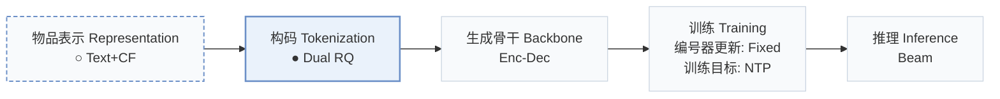
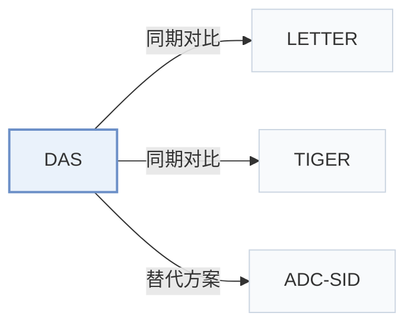

# DAS

[← 问题 × 阶段矩阵](../../../README.zh.md#i--tokenization) · [按阶段索引](../index/stages.md) · [按模态找论文](../index/modality.md) · [按领域找论文](../index/domain.md) · [English](../../papers/das.md) | 中文

| **题目** | *Dual-Aligned Semantic IDs Empowered Industrial Recommender System* |
| :-- | :-- |
| **作者** | Ye et al. |
| **发表** | CIKM’25 |
| **问题与阶段** | `I. 信息量` · `构码（Tokenization）` |
| **改动** | ○ 物品表示 · ● 构码 |
| **构码输入** | `Text` + `CF` |
| **领域** | `广告` |
| **链接** | [论文](https://arxiv.org/abs/2508.10584) |
| **阅读级别** | 概览（第 1 级） |

**本页目录**：[TL;DR](#tldr) · [3. 实验发现](#3-实验发现) · [5. 相关工作](#5-相关工作)

- `Text+CF`：文本表征结合协同过滤信号。
- `Dual RQ`：面向双表征流或双侧实体的双路残差量化。
- `Enc-Dec`：编码器-解码器（Encoder-decoder）架构。
- `Fixed`：先独立训练并冻结编号器，生成器训练期间 SID 保持不变。
- `NTP`：标准下一 token 预测（Next-Token Prediction）交叉熵损失；基于预训练 LLM 的指令微调（SFT）亦归入此类。
- `Beam`：在 SID token 上执行自回归束搜索（Beam search）。

### TL;DR

> [!NOTE]
> DAS 通过多视图对比对齐以及用户与广告的双重量化，在单阶段内同步优化量化与协同对齐，避免两阶段对齐带来的信息损失。

---

### 3. 实验发现

实验设置

- **数据集**：Kuaishou advertising platform only (public datasets excluded). CTR task: 1.8 billion user-ad samples from about 100 million users and 8 million ads, with ad clicks as positives. Generative task: user-ad sequences from the past 15 days with length at least 10, about 50 million users.
  - 出处：Industrial-only data and filters: [S4.SS1.SSS1.p1](https://arxiv.org/html/2508.10584v2#S4.SS1.SSS1.p1).
- **切分**：CTR: chronological 80% training / 20% testing. Generative task: leave-one-out (citing TIGER); the exact validation/test allocation is not reported. Online: multi-week A/B test with 10% of traffic (about 40+ million users).
  - 出处：CTR chronological 80/20 and generative leave-one-out: [S4.SS1.SSS1.p1](https://arxiv.org/html/2508.10584v2#S4.SS1.SSS1.p1); online test: [S4.SS4.p1](https://arxiv.org/html/2508.10584v2#S4.SS4.p1).
- **候选集**：not reported (full catalog versus sampled evaluation candidates for the generative HR@K/NDCG@K task).
  - 出处：Metrics only: [S4.SS1.SSS2.p1](https://arxiv.org/html/2508.10584v2#S4.SS1.SSS2.p1).
- **可见性**：Offline: warm; no unseen-item protocol is defined. Online results report larger gains in cold-start scenarios (eCPM +8.98%), but generator/tokenizer visibility for those items is not reported.
  - 出处：Offline protocols are in-domain: [S4.SS1.SSS1.p1](https://arxiv.org/html/2508.10584v2#S4.SS1.SSS1.p1); online cold-start scenarios are named but not defined: [S4.SS4.p1](https://arxiv.org/html/2508.10584v2#S4.SS4.p1).
- **SID 规格**：Separate user and ad SIDs from jointly trained RQ-VAEs: 3 codebooks x 512 codes, code dimension 32, k-means-initialized codebooks; ad embeddings 256-dimensional, user embeddings 1,024-dimensional. Collision handling: not reported (SIDs are also used as prefix-ngram sparse features in CTR models).
  - 出处：3 codebooks x 512 codes, dimension 32, k-means initialization: [S4.SS1.SSS3.p1](https://arxiv.org/html/2508.10584v2#S4.SS1.SSS3.p1) and [S2.SS1.SSS2.p1](https://arxiv.org/html/2508.10584v2#S2.SS1.SSS2.p1); no collision rule found.
- **推理预算**：Generative task: TIGER architecture on T5 (4-layer encoder and decoder, 13M parameters), trained on four NVIDIA GPUs for five days; decoding method, beam width, inference batch size, and latency: not reported. CTR models are trained on 16 T4 GPUs. Online, top-k SID predictions from TIGER++ feed two deployment strategies.
  - 出处：Generative model details: [S4.SS1.SSS3.p1](https://arxiv.org/html/2508.10584v2#S4.SS1.SSS3.p1); online use of top-k SID predictions: [S4.SS4.p2](https://arxiv.org/html/2508.10584v2#S4.SS4.p2).
- **结果来源**：Table 1 (offline CTR AUC/UAUC/GAUC with SID feature variants); Table 2 (generative HR/NDCG for TIGER, TIGER+, TIGER++); Table 3 (dual-alignment ablation); Section 4.4 (online A/B: eCPM +3.48% overall, +8.98% in cold-start scenarios).
  - 出处：CTR table: [S4.T1](https://arxiv.org/html/2508.10584v2#S4.T1); generative table: [S4.T2](https://arxiv.org/html/2508.10584v2#S4.T2); ablation: [S4.T3](https://arxiv.org/html/2508.10584v2#S4.T3); online: [S4.SS4.p1](https://arxiv.org/html/2508.10584v2#S4.SS4.p1) and [S4.SS4.p2](https://arxiv.org/html/2508.10584v2#S4.SS4.p2).

---

### 5. 相关工作

- **同期对比** · [LETTER](letter.md): LETTER aligns the quantizer with CF embeddings in a two-stage pipeline; DAS trains quantization and debiased CF jointly in one stage and aligns user and ad SIDs dually.
  - 出处：DAS v2, Section 4.2 variant (4) +ASID (LETTER): [S4.SS2.p2](https://arxiv.org/html/2508.10584v2#S4.SS2.p2); Table 1: [S4.T1](https://arxiv.org/html/2508.10584v2#S4.T1).
- **同期对比** · [TIGER](tiger.md): TIGER with unaligned RQ-VAE ad SIDs is the generative baseline; DAS replaces them with aligned ad SIDs (TIGER+) and adds aligned user SIDs (TIGER++).
  - 出处：DAS v2, Section 4.2: [S4.SS2.p4](https://arxiv.org/html/2508.10584v2#S4.SS2.p4); Table 2: [S4.T2](https://arxiv.org/html/2508.10584v2#S4.T2).
- **替代方案** · [ADC-SID](adc-sid.md): ADC-SID compares against DAS and adds adaptive alignment strength and dynamic behavioral weighting to denoise long-tail collaborative signals.
  - 出处：Evidence is from the later ADC-SID paper: DAS is a baseline in Section 4.1.2 and Table 2: [S4.I3.i4.p1](https://arxiv.org/html/2510.25622v3#S4.I3.i4.p1) and [S4.T2](https://arxiv.org/html/2510.25622v3#S4.T2).

[查看同格全部论文](../../../README.zh.md#i--tokenization)
