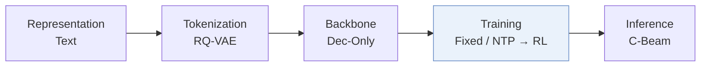
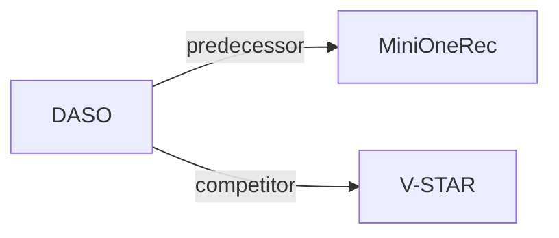

# DASO

| **题目** | *Difficulty-Aware Semantic-ID Optimization for Generative Recommendation* |
| :-- | :-- |
| **作者** | Yu et al. |
| **会议** | arXiv’26 |
| **问题与阶段** | `IV. 实用目标` · `Training` |
| **链接** | [论文](https://arxiv.org/abs/2608.20611) · [代码](https://github.com/LucasXinYu/DASO) · [矩阵](../../../README.zh.md#iv--training) · [English](../../papers/daso.md) |
| **阅读级别** | 概览（第 1 级） |

本页目录：[TL;DR](#tldr) · [速览](#速览) · [3. 实验发现](#3-实验发现) · [5. 相关工作](#5-相关工作)

- `Dec-Only`: Decoder-only.
- `Fixed`: SIDs are built first and not changed while the generator trains.
- `NTP → RL`: NTP, then reinforcement learning (GRPO, GBPO, etc.).
- `C-Beam`: Constrained beam search.

### TL;DR

> [!NOTE]
> DASO 在候选偏离目标路径的 SID 层级将部分 GRPO 采样组重分配给前缀引导补全，并加入分级前缀奖励，改进标准 GRPO。

---

### 速览

| 维度 | 摘要 |
| :-- | :-- |
| 研究问题 | IV. 实用目标：Are training and search aimed at what users and the platform value, rather than at token likelihood? |
| 核心贡献 | DASO 在候选偏离目标路径的 SID 层级将部分 GRPO 采样组重分配给前缀引导补全，并加入分级前缀奖励，改进标准 GRPO。 |
| 主要改动阶段 | Training |

---

### 3. 实验发现

实验设置

- **数据集**：Amazon Reviews 2018 Industrial & Scientific and Office Products, 5-core; proprietary user-to-item task with 1.36M recommendation examples and 319K users. Internal filtering rules: not reported.
  - 出处：Experimental Setup and Appendix C: [Sx5.SSx1.p1](https://arxiv.org/html/2608.20611v1#Sx5.SSx1.p1) and [A3.SSx1.p1](https://arxiv.org/html/2608.20611v1#A3.SSx1.p1)
- **切分**：Public: fixed chronological next-item prediction, earlier interactions as history and a held-out next item. Train/validation/test sequences: Office Products 38924/4866/4866; Industrial and Scientific 36259/4532/4533. Split assignment rule and history-item cap: not reported. Internal: SFT train/eval 1139832/60168, GRPO training prompts 100326, and about 36K disjoint constrained-generation evaluation prompts; allocation rules not reported.
  - 出处：Table 1, Appendix C and Table 4: [Sx5.T1](https://arxiv.org/html/2608.20611v1#Sx5.T1) and [A3.SSx1.p1](https://arxiv.org/html/2608.20611v1#A3.SSx1.p1) and [A3.T4](https://arxiv.org/html/2608.20611v1#A3.T4) and [Sx5.SSx1.p1](https://arxiv.org/html/2608.20611v1#Sx5.SSx1.p1)
- **候选集**：Valid-catalog SID trie and 50-beam generated ranking for public evaluation. Full-catalog versus sampled-negative evaluation and history-item exclusion: not reported.
  - 出处：Preliminaries, Appendix B and D: [Sx3.SSx1.p2](https://arxiv.org/html/2608.20611v1#Sx3.SSx1.p2) and [A2.SSx2.p2](https://arxiv.org/html/2608.20611v1#A2.SSx2.p2) and [A4.SSx4.p1](https://arxiv.org/html/2608.20611v1#A4.SSx4.p1)
- **可见性**：warm; no unseen-item protocol is defined. Easy/Medium/Hard diagnostics measure frozen-SFT prefix/target recovery, not item holdouts. Item-level exposure to the pretrained tokenizer: not reported.
  - 出处：Experimental Setup and Appendix F: [Sx5.SSx1](https://arxiv.org/html/2608.20611v1#Sx5.SSx1) and [A6.p2](https://arxiv.org/html/2608.20611v1#A6.p2)
- **SID 规格**：Public: official frozen MiniOneRec RQ-VAE assignments from Qwen text embeddings, 3 levels x256 codes. Internal: 4 levels x2048 codes; SID construction details not reported. Collision handling: not reported for either setting.
  - 出处：SID construction and Appendix C: [Sx5.SSx1.p2](https://arxiv.org/html/2608.20611v1#Sx5.SSx1.p2) and [A3.SSx1.p2](https://arxiv.org/html/2608.20611v1#A3.SSx1.p2) and [A3.SSx2.p1](https://arxiv.org/html/2608.20611v1#A3.SSx2.p1)
- **推理预算**：Public: trie-constrained beam50, HR@5/10 and NDCG@5. Internal: level-wise Top1/20 recall; internal beam width not reported. Primary training/evaluation setup uses 8x A100 80GB; inference batch and latency not reported. G=16 rollouts, Bmax=9 guided replacements and batch128 are training settings.
  - 出处：Appendix D evaluation and H compute resources: [A4.SSx4.p1](https://arxiv.org/html/2608.20611v1#A4.SSx4.p1) and [A4.SSx4.p2](https://arxiv.org/html/2608.20611v1#A4.SSx4.p2) and [A8.p1](https://arxiv.org/html/2608.20611v1#A8.p1) and [A4.T5](https://arxiv.org/html/2608.20611v1#A4.T5)
- **结果来源**：Paper's Table2 public and Table3 internal experiments plus appendix ablations/diagnostics. SFT-only, MiniOneRec-style GRPO, uniform GT injection, Sibling-GRPO and DASO share SFT initialization and fixed SID/trie per setting. One algorithm run per dataset/backbone/method; no multi-seed significance tests. No borrowed baseline scores are identified.
  - 出处：Experimental Setup, Tables2/3 and Appendix B: [Sx5.SSx1.p3](https://arxiv.org/html/2608.20611v1#Sx5.SSx1.p3) and [Sx5.T2](https://arxiv.org/html/2608.20611v1#Sx5.T2) and [Sx5.T3](https://arxiv.org/html/2608.20611v1#Sx5.T3) and [A2.SSx2.p1](https://arxiv.org/html/2608.20611v1#A2.SSx2.p1) and [A2.SSx2.p2](https://arxiv.org/html/2608.20611v1#A2.SSx2.p2)

---

### 5. 相关工作

- **前序工作** · [MiniOneRec](minionerec.md): MiniOneRec supplies public SIDs and the baseline SFT-to-GRPO recipe.
  - 出处：DASO v1, Experimental Setup and Appendix C: https://arxiv.org/html/2608.20611v1#Sx5.SSx1.p2; https://arxiv.org/html/2608.20611v1#Sx5.SSx1.p4; https://arxiv.org/html/2608.20611v1#A3.SSx1.p2.
- **同期对比** · [V-STAR](v-star.md): V-STAR's Sibling-GRPO is a compared tree-structured training baseline.
  - 出处：DASO v1, Related Work and Appendix D: https://arxiv.org/html/2608.20611v1#Sx2.SSx2.p2; https://arxiv.org/html/2608.20611v1#A4.SSx3.p2.

[查看同格全部论文](../../../README.zh.md#iv--training)
