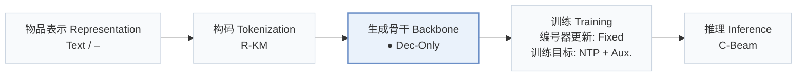
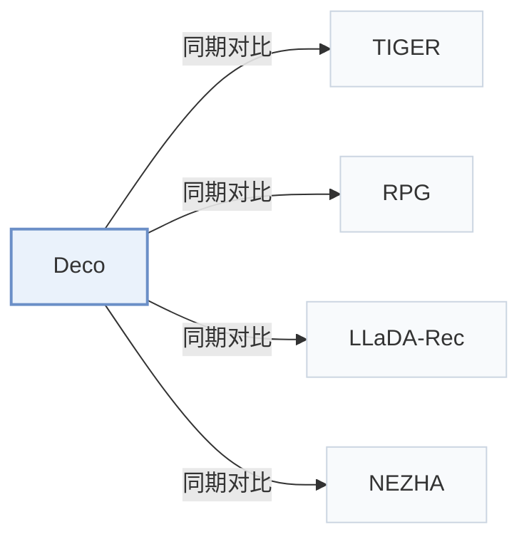

# Deco

[← 问题 × 阶段矩阵](../../../README.zh.md#v--backbone) · [按阶段索引](../index/stages.md) · [按模态找论文](../index/modality.md) · [按领域找论文](../index/domain.md) · [English](../../papers/deco.md) | 中文

| **题目** | *Separating Thinking from Spelling for Efficient Generative Recommendation* |
| :-- | :-- |
| **作者** | Gusak et al. |
| **发表** | arXiv’26 |
| **问题与阶段** | `V. 效率` · `生成骨干（Backbone）` |
| **改动** | ● 生成骨干 |
| **构码输入** | A: `Text` · B: `Audio` |
| **领域** | `电商` · `电影` · `音乐` |
| **应用场景** | `一般物品推荐`；`公开数据` |
| **链接** | [论文](https://arxiv.org/abs/2610.32980) |
| **阅读级别** | 概览（第 1 级） |

**本页目录**：[TL;DR](#tldr) · [3. 实验发现](#3-实验发现) · [5. 相关工作](#5-相关工作)

- `Text / –`：一种配置采用文本表征，另一种配置未报告表征来源。
- `R-KM`：残差 k-means 量化（Residual k-means）。
- `Dec-Only`：仅解码器（Decoder-only）自回归架构。
- `Fixed`：先独立训练并冻结编号器，生成器训练期间 SID 保持不变。
- `NTP + Aux.`：下一 token 预测结合辅助正则或对齐损失。
- `C-Beam`：受合法物品集合约束的束搜索（Constrained beam search）。

### TL;DR

> [!NOTE]
> Deco 将每个历史物品读作单个融合 token，把交互历史浓缩为下一物品概念，并在带 KV 缓存的轻量解码器而非完整骨干网络中执行束搜索。

---

### 3. 实验发现

实验设置

- **数据集**：Amazon-2014 Beauty/Sports/Toys and Amazon-2023 BPC-23/Books-23, published 5-core subsets; MovieLens-25M subset (filtering rules not reported); Yambda-500M last30 days, exact deduplication, consecutive track-repeat collapse and user/item thresholds5/20.
  - 出处：Sec.4.1.1: [S4.SS1.SSS1.p1](https://arxiv.org/html/2610.32980v2#S4.SS1.SSS1.p1)
- **切分**：Global temporal: latest10% interactions test, latest10% of the remainder validation; Yambda uses last day test and preceding day validation. Each user's last event per held-out period is target; earlier within-period events enter history. History cap20 Amazon,100 MovieLens/Yambda. Separate Beauty leave-one-out comparison also reported.
  - 出处：Sec.4.1.2/4.1.4: [S4.SS1.SSS2.p1](https://arxiv.org/html/2610.32980v2#S4.SS1.SSS2.p1) and [S4.SS1.SSS4.p1](https://arxiv.org/html/2610.32980v2#S4.SS1.SSS4.p1) and [S4.SS2.SSS1.Px5.p1](https://arxiv.org/html/2610.32980v2#S4.SS2.SSS1.Px5.p1)
- **候选集**：full catalog: the training item catalog; history items are not excluded because repeats are legitimate targets. Main beam100; larger candidate budgets up to1000 are separately tested.
  - 出处：Sec.4.1.2: [S4.SS1.SSS2.p1](https://arxiv.org/html/2610.32980v2#S4.SS1.SSS2.p1)
- **可见性**：warm; no unseen-item protocol is defined. Yambda new targets mean absent from the last100 history items, not globally unseen items. Tokenizer-fitting exposure to test items/interactions: not reported.
  - 出处：Sec.4.1 protocol and repeat/new analysis: [S4.SS1.SSS2.p1](https://arxiv.org/html/2610.32980v2#S4.SS1.SSS2.p1) and [S4.F6](https://arxiv.org/html/2610.32980v2#S4.F6) and [S4.SS2.SSS4.Px2.p1](https://arxiv.org/html/2610.32980v2#S4.SS2.SSS4.Px2.p1)
- **SID 规格**：Fixed RQ-KMeans,4 levels x2048 codes, from multilingual E5-large metadata embeddings or provided128-dimensional Yambda item embeddings. Popularity-based collision resolution is stated; detailed rule not reported. Depth study uses2-8 nested levels x256 codes.
  - 出处：Sec.4.1.4 and SID-depth study: [S4.SS1.SSS4.p1](https://arxiv.org/html/2610.32980v2#S4.SS1.SSS4.p1) and [S4.SS2.SSS3.Px2.p1](https://arxiv.org/html/2610.32980v2#S4.SS2.SSS3.Px2.p1)
- **推理预算**：Testbeam100 (validationbeam10), NDCG/Recall@10/50/100; copy pointer on Yambda. One H10080GB, bf16; main serving pipeline compiled with CUDA graphs and beam-shared history cache. Report batch128, peak sweep and50ms p95 budget;3.2-7.3x FusedGR throughput under that budget. GPU batch latency includes concept prefill/full beam/trie masking, excludes data loading/SID-item mapping and compilation/capture/warm-up. Each point repeats3 times,100 timed batches after10 warm-ups (50/5 above batch64). Table3 instead uses common eager PyTorch, batch128.
  - 出处：Sec.4.1.4, Sec.4.2.2 and Appendix C: [S4.SS1.SSS4.p1](https://arxiv.org/html/2610.32980v2#S4.SS1.SSS4.p1) and [S4.SS2.SSS2.p2](https://arxiv.org/html/2610.32980v2#S4.SS2.SSS2.p2) and [A3.SS0.SSS0.Px3.p1](https://arxiv.org/html/2610.32980v2#A3.SS0.SSS0.Px3.p1)
- **结果来源**：Table2: paper's six matched-family models, shared SIDs/training budgets, mean+SD over3 seeds. Table3 external baselines are tuned/retrained from scratch under this protocol; eager native-path timing, RPG graph construction excluded. Separate Table4 Beauty leave-one-out baseline scores come from literature. Main throughput includes prefill; decoder-only comparisons excluding prefill are separate.
  - 出处：Sec.4.1 baselines, Tables2-4 and Appendix C: [S4.SS1.SSS3.p1](https://arxiv.org/html/2610.32980v2#S4.SS1.SSS3.p1) and [S4.SS1.SSS3.p2](https://arxiv.org/html/2610.32980v2#S4.SS1.SSS3.p2) and [S4.T2](https://arxiv.org/html/2610.32980v2#S4.T2) and [S4.T3](https://arxiv.org/html/2610.32980v2#S4.T3) and [S4.SS2.SSS1.Px5.p1](https://arxiv.org/html/2610.32980v2#S4.SS2.SSS1.Px5.p1) and [A3.SS0.SSS0.Px3.p1](https://arxiv.org/html/2610.32980v2#A3.SS0.SSS0.Px3.p1)

---

### 5. 相关工作

- **同期对比** · [TIGER](tiger.md): KV-cached TIGER is retrained as an autoregressive comparison.
  - 出处：Deco v2, Sec.4.1.3 and Table3: [S4.SS1.SSS3.p2](https://arxiv.org/html/2610.32980v2#S4.SS1.SSS3.p2); [S4.T3](https://arxiv.org/html/2610.32980v2#S4.T3).
- **同期对比** · [RPG](rpg.md): RPG is compared with both graph search and full-catalog scoring.
  - 出处：Deco v2, Sec.4.1.3 and Table3: [S4.SS1.SSS3.p2](https://arxiv.org/html/2610.32980v2#S4.SS1.SSS3.p2); [S4.T3](https://arxiv.org/html/2610.32980v2#S4.T3).
- **同期对比** · [LLaDA-Rec](llada-rec.md): LLaDA-Rec is a retrained diffusion-based comparison.
  - 出处：Deco v2, Related Work and Table3: [S2.SS0.SSS0.Px2.p1](https://arxiv.org/html/2610.32980v2#S2.SS0.SSS0.Px2.p1); [S4.SS1.SSS3.p2](https://arxiv.org/html/2610.32980v2#S4.SS1.SSS3.p2); [S4.T3](https://arxiv.org/html/2610.32980v2#S4.T3).
- **同期对比** · [NEZHA](nezha.md): NEZHA is a retrained efficient-generation comparison.
  - 出处：Deco v2, Sec.4.1.3 and Table3: [S4.SS1.SSS3.p2](https://arxiv.org/html/2610.32980v2#S4.SS1.SSS3.p2); [S4.T3](https://arxiv.org/html/2610.32980v2#S4.T3).

[查看同格全部论文](../../../README.zh.md#v--backbone)
