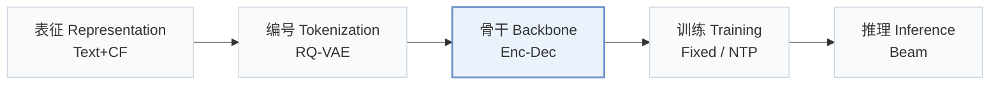
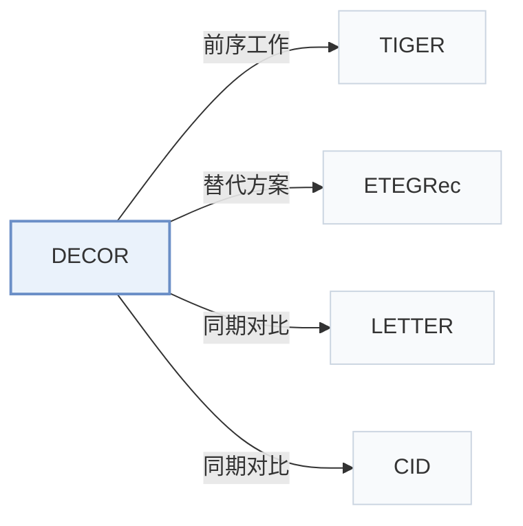

# DECOR

[← 问题 × 阶段矩阵](../../../README.zh.md#iii--backbone) · [按阶段索引](../index/stages.md) · [按模态索引](../index/modality.md) · [English](../../papers/decor.md) | 中文

| **题目** | *Learning Decomposed Contextual Token Representations from Pretrained and Collaborative Signals for Generative Recommendation* |
| :-- | :-- |
| **作者** | Liu et al. |
| **发表** | SIGIR’26 |
| **问题与阶段** | `III. SID 与模型对齐` · `骨干（Backbone）` |
| **链接** | [论文](https://arxiv.org/abs/2509.10468) · [代码](https://github.com/yliuaa/DECOR.git) |
| **阅读级别** | 概览（第 1 级） |

**本页目录**：[TL;DR](#tldr) · [速览](#速览) · [3. 实验发现](#3-实验发现) · [5. 相关工作](#5-相关工作)

- `Text+CF`：文本表征结合协同过滤信号。
- `RQ-VAE`：残差量化变分自编码器（Residual-Quantized VAE）。
- `Enc-Dec`：编码器-解码器（Encoder-decoder）架构。
- `Fixed`：先独立训练并冻结编号器，生成器训练期间 SID 保持不变。
- `NTP`：标准下一 token 预测（Next-Token Prediction）交叉熵损失；基于预训练 LLM 的指令微调（SFT）亦归入此类。
- `Beam`：在 SID token 上执行自回归束搜索（Beam search）。

### TL;DR

> [!NOTE]
> DECOR 按交互上下文修正 SID token 嵌入，并融合预训练码本嵌入与可学习协同嵌入，避免静态 token 分配覆盖预训练语义。

---

### 速览

| 维度 | 摘要 |
| :-- | :-- |
| 研究问题 | III. SID 与模型对齐：生成模型能否理解并推理离散 SID，编号器与生成器的优化目标是否一致？ |
| 核心贡献 | DECOR 按交互上下文修正 SID token 嵌入，并融合预训练码本嵌入与可学习协同嵌入，避免静态 token 分配覆盖预训练语义。 |
| 主要改动阶段 | 骨干（Backbone） |

---

### 3. 实验发现

实验设置

- **数据集**：Amazon Scientific, Instrument and Game (paper labels); user/item 5-core filtering; chronological histories capped at 20 items.
  - 出处：Section 4.1.1 and Table 1: [S4.SS1.SSS1.p1](https://arxiv.org/html/2509.10468v2#S4.SS1.SSS1.p1) ; [S3.T1](https://arxiv.org/html/2509.10468v2#S3.T1)
- **切分**：Per-user chronological leave-one-out: last interaction test, penultimate validation, remaining interactions training.
  - 出处：Section 4.1.1: [S4.SS1.SSS1.p1](https://arxiv.org/html/2509.10468v2#S4.SS1.SSS1.p1)
- **候选集**：full catalog; full-ranking evaluation without sampling.
  - 出处：Section 4.1.1: [S4.SS1.SSS1.p1](https://arxiv.org/html/2509.10468v2#S4.SS1.SSS1.p1)
- **可见性**：warm; no unseen-item protocol is defined. RQ-VAE/text-encoder exposure to test items not reported; collaborative embeddings are learned from recommendation sequences.
  - 出处：Sections 3.2/3.3/4.1 define no item holdout: [S3.SS2.p1](https://arxiv.org/html/2509.10468v2#S3.SS2.p1) ; [S3.SS3.p2](https://arxiv.org/html/2509.10468v2#S3.SS3.p2) ; [S4.SS1.SSS1.p1](https://arxiv.org/html/2509.10468v2#S4.SS1.SSS1.p1)
- **SID 规格**：Sentence-T5 embeddings; frozen RQ-VAE with 3 levels x 256 entries, plus an incremental index token resolving identical 3-token prefixes: 4-token IDs. Token assignments remain fixed while embeddings are contextually composed and fused with learned collaborative embeddings.
  - 出处：Sections 3.2/3.3/4.1.2: [S3.SS2.p2](https://arxiv.org/html/2509.10468v2#S3.SS2.p2) ; [S3.SS3.p2](https://arxiv.org/html/2509.10468v2#S3.SS3.p2) ; [S4.SS1.SSS2.p1](https://arxiv.org/html/2509.10468v2#S4.SS1.SSS2.p1)
- **推理预算**：Beam 50; Recall/NDCG@5/10; experiments on one Tesla A40. Table 5 batches 8/16/32/64/128: DECOR 4.49-4.70 ms/sample, 213-223 samples/s; batch 128 adds 0.85 ms over TIGER. Prefix constraints not reported.
  - 出处：Section 4.1.2/4.8 and Table 5: [S4.SS1.SSS2.p1](https://arxiv.org/html/2509.10468v2#S4.SS1.SSS2.p1) ; [S4.SS8.p1](https://arxiv.org/html/2509.10468v2#S4.SS8.p1) ; [S4.T5](https://arxiv.org/html/2509.10468v2#S4.T5)
- **结果来源**：Original Table 2 test results use seed 2025; significance tested across five seeds. Generative baselines rerun from official code; other baselines adapted or quoted when protocols match. Table 5 measures inference cost; Figure 5 measures convergence, excluding ETEGRec tokenizer-update epochs.
  - 出处：Sections 4.1.2/4.2/4.7 and Tables 2/5: [S4.SS1.SSS2.p1](https://arxiv.org/html/2509.10468v2#S4.SS1.SSS2.p1) ; [S4.SS2.p1](https://arxiv.org/html/2509.10468v2#S4.SS2.p1) ; [S3.T2](https://arxiv.org/html/2509.10468v2#S3.T2) ; [S4.T5](https://arxiv.org/html/2509.10468v2#S4.T5) ; [S4.SS7.p1](https://arxiv.org/html/2509.10468v2#S4.SS7.p1)

---

### 5. 相关工作

- **前序工作** · [TIGER](tiger.md): DECOR augments TIGER's fixed tokenization with contextual token embeddings.
  - 出处：DECOR v2, Sections 3.2/4.1.2 and Table 2: [S3.SS2.p1](https://arxiv.org/html/2509.10468v2#S3.SS2.p1) ; [S4.SS1.SSS2.p1](https://arxiv.org/html/2509.10468v2#S4.SS1.SSS2.p1) ; [S3.T2](https://arxiv.org/html/2509.10468v2#S3.T2).
- **替代方案** · [ETEGRec](etegrec.md): DECOR adapts embeddings without ETEGRec's repeated re-tokenization.
  - 出处：DECOR v2, Sections 3.4/4.7: [S3.SS4.p2](https://arxiv.org/html/2509.10468v2#S3.SS4.p2) ; [S4.SS7.p1](https://arxiv.org/html/2509.10468v2#S4.SS7.p1).
- **同期对比** · [LETTER](letter.md): LETTER is a tokenizer-enhancement baseline in the shared evaluation.
  - 出处：DECOR v2, Sections 1/4.2 and Table 2: [S1.p6](https://arxiv.org/html/2509.10468v2#S1.p6) ; [S4.SS2.p1](https://arxiv.org/html/2509.10468v2#S4.SS2.p1) ; [S3.T2](https://arxiv.org/html/2509.10468v2#S3.T2).
- **同期对比** · [CID](cid.md): P5-CID is a collaborative-indexing baseline.
  - 出处：DECOR v2, Section 4.2 and Table 2: [S4.SS2.p1](https://arxiv.org/html/2509.10468v2#S4.SS2.p1) ; [S3.T2](https://arxiv.org/html/2509.10468v2#S3.T2).

[查看同格全部论文](../../../README.zh.md#iii--backbone)
