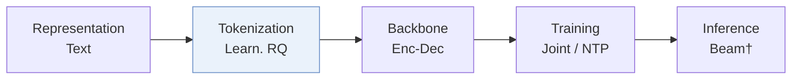
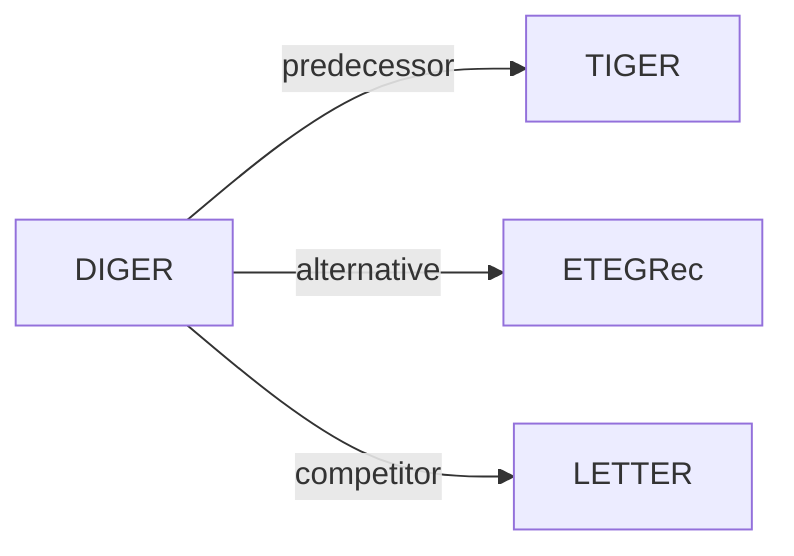

# DIGER

| **题目** | *Differentiable Semantic ID for Generative Recommendation* |
| :-- | :-- |
| **作者** | Fu et al. |
| **会议** | SIGIR’26 |
| **问题与阶段** | `II. 唯一性与合法性` · `Tokenization` |
| **链接** | [论文](https://arxiv.org/abs/2601.19711) · [代码](https://github.com/junchen-fu/DIGER) · [矩阵](../../../README.zh.md#ii--tokenization) · [English](../../papers/diger.md) |
| **阅读级别** | 概览（第 1 级） |

本页目录：[TL;DR](#tldr) · [速览](#速览) · [3. 实验发现](#3-实验发现) · [5. 相关工作](#5-相关工作)

- `Enc-Dec`: Encoder-decoder.
- `Joint`: The generator loss updates the tokenizer directly.
- `NTP`: Next-token prediction loss only; continuing from a pretrained LLM (SFT) also counts as NTP.

### TL;DR

> [!NOTE]
> DIGER 使 SID 可微以让推荐梯度直接更新编号器，并加入衰减 Gumbel 噪声防止码本坍缩，替代仅按重构目标训练的编号器。

---

### 速览

| 维度 | 摘要 |
| :-- | :-- |
| 研究问题 | II. 唯一性与合法性：Does every item get its own SID, every generated SID name a real item, and the codebook get used evenly? |
| 核心贡献 | DIGER 使 SID 可微以让推荐梯度直接更新编号器，并加入衰减 Gumbel 噪声防止码本坍缩，替代仅按重构目标训练的编号器。 |
| 主要改动阶段 | Tokenization |

---

### 3. 实验发现

实验设置

- **数据集**：B-Shop (cosmetic products), I-Shop (music-related products), Yelp (restaurants); remove users/items with fewer than five interactions. LLaMA-7B-generated item content; review text supplies interactions only. History cap not reported.
  - 出处：Section 5, Datasets: [S5.p1](https://arxiv.org/html/2601.19711v3#S5.p1)
- **切分**：Leave-one-out; exact validation/test allocation not reported. All reported results use the test set.
  - 出处：Section 5, Evaluation: [S5.p2](https://arxiv.org/html/2601.19711v3#S5.p2)
- **候选集**：full catalog; predicted item ranked against the full item set.
  - 出处：Section 5, Evaluation: [S5.p2](https://arxiv.org/html/2601.19711v3#S5.p2)
- **可见性**：warm; no unseen-item protocol is defined. Pretrained RQ-VAE/content-encoder exposure to test items not reported.
  - 出处：Sections 4.3/5 define no item holdout: [S4.SS3.p2](https://arxiv.org/html/2601.19711v3#S4.SS3.p2) ; [S5.p1](https://arxiv.org/html/2601.19711v3#S5.p1) ; [S5.p2](https://arxiv.org/html/2601.19711v3#S5.p2)
- **SID 规格**：Pretrained RQ-VAE initialization, then jointly optimized differentiable IDs: 3 code positions x 256 entries plus one conflict code. Conflict-code assignment details not reported. Training uses Gumbel exploration with uncertainty decay; validation/inference tokenizer assignments are deterministic.
  - 出处：Sections 4.2/4.3/5: [S4.SS2.p1](https://arxiv.org/html/2601.19711v3#S4.SS2.p1) ; [S4.SS3.p1](https://arxiv.org/html/2601.19711v3#S4.SS3.p1) ; [S5.p4](https://arxiv.org/html/2601.19711v3#S5.p4)
- **推理预算**：Autoregressive next-SID generation; Recall/NDCG@10. Decoder search/beam, prefix constraints, inference batch and latency not reported. Experiments use two H100 GPUs; tokenizer argmax is reported separately from generation.
  - 出处：Sections 3/4.2/5: [S3.p3](https://arxiv.org/html/2601.19711v3#S3.p3) ; [S4.SS2.p1](https://arxiv.org/html/2601.19711v3#S4.SS2.p1) ; [S5.p2](https://arxiv.org/html/2601.19711v3#S5.p2) ; [S5.p4](https://arxiv.org/html/2601.19711v3#S5.p4)
- **结果来源**：Original Tables 2/3 compare DIGER variants and baselines; main DIGER uses FrqUD. Most baseline results are quoted from LETTER (Wang et al., 2024); implemented methods are validation-tuned. Original Tables 4/5 give component and capacity/length ablations.
  - 出处：Sections 5/6.2 and Tables 2/3/4/5: [S5.p3](https://arxiv.org/html/2601.19711v3#S5.p3) ; [S5.T2](https://arxiv.org/html/2601.19711v3#S5.T2) ; [S6.T3](https://arxiv.org/html/2601.19711v3#S6.T3) ; [S6.SS2.p1](https://arxiv.org/html/2601.19711v3#S6.SS2.p1) ; [S7.T4](https://arxiv.org/html/2601.19711v3#S7.T4) ; [S7.T5](https://arxiv.org/html/2601.19711v3#S7.T5)

---

### 5. 相关工作

- **前序工作** · [TIGER](tiger.md): TIGER supplies the reference two-stage framework for differentiable-ID training.
  - 出处：DIGER v3, Sections 3/5 and Table 3: https://arxiv.org/html/2601.19711v3#S3.p1 ; https://arxiv.org/html/2601.19711v3#S5.p3 ; https://arxiv.org/html/2601.19711v3#S6.T3.
- **替代方案** · [ETEGRec](etegrec.md): DIGER replaces alternating distillation with direct recommendation gradients through indexing.
  - 出处：DIGER v3, Sections 2/6.2: https://arxiv.org/html/2601.19711v3#S2.p3 ; https://arxiv.org/html/2601.19711v3#S2.p4 ; https://arxiv.org/html/2601.19711v3#S6.SS2.p2.
- **同期对比** · [LETTER](letter.md): LETTER is a comparison method and the source of most quoted baseline results.
  - 出处：DIGER v3, Sections 5/6.2 and Table 3: https://arxiv.org/html/2601.19711v3#S5.p3 ; https://arxiv.org/html/2601.19711v3#S6.SS2.p3 ; https://arxiv.org/html/2601.19711v3#S6.T3.

[查看同格全部论文](../../../README.zh.md#ii--tokenization)
