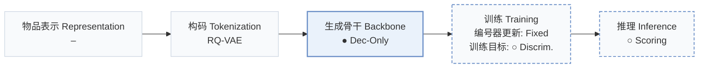
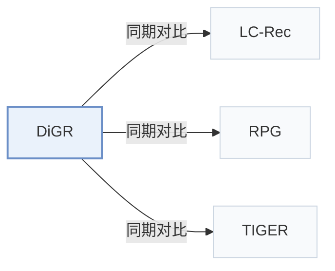

# DiGR

[← 问题 × 阶段矩阵](../../../README.zh.md#iv--backbone) · [按阶段索引](../index/stages.md) · [按模态找论文](../index/modality.md) · [按领域找论文](../index/domain.md) · [English](../../papers/digr.md) | 中文

| **题目** | *From Token Generation to Item Ranking: Direct Generative Recommendation with Semantic IDs* |
| :-- | :-- |
| **作者** | Zhao et al. |
| **发表** | arXiv’26 |
| **问题与阶段** | `IV. 实用目标` · `生成骨干（Backbone）` |
| **改动** | ● 生成骨干 · ○ 训练目标 · ○ 推理 |
| **构码输入** | `其他`（RQ-VAE 构码，未写输入） |
| **领域** | `电商` |
| **链接** | [论文](https://arxiv.org/abs/2602.07847) · [代码](https://anonymous.4open.science/r/SimGR-C408/) |
| **阅读级别** | 概览（第 1 级） |

**本页目录**：[TL;DR](#tldr) · [3. 实验发现](#3-实验发现) · [5. 相关工作](#5-相关工作)

- `RQ-VAE`：残差量化变分自编码器（Residual-Quantized VAE）。
- `Dec-Only`：仅解码器（Decoder-only）自回归架构。
- `Fixed`：先独立训练并冻结编号器，生成器训练期间 SID 保持不变。
- `Discrim.`：判别式候选物品打分损失，不直接生成 SID。
- `Scoring`：直接计算候选物品得分，不逐位生成 SID。

### TL;DR

> [!NOTE]
> DiGR 论证逐 token 解码不增加排序表达力后，将 SID token 作为物品表示并用单一物品级函数直接打分，不再逐位生成 token。

---

### 3. 实验发现

实验设置

- **数据集**：Amazon Reviews 2018: Musical Instruments, Arts/Crafts/Sewing, Video Games; user/item 5-core; chronological histories capped at 20.
  - 出处：[Sx5.SSx1.SSSx1.p1](https://arxiv.org/html/2602.07847v2#Sx5.SSx1.SSSx1.p1)
- **切分**：Per-user leave-one-out: last interaction test, penultimate validation, all earlier interactions training; learning rate and training epochs selected by validation grid search.
  - 出处：[Sx5.SSx1.SSSx3.p1](https://arxiv.org/html/2602.07847v2#Sx5.SSx1.SSSx3.p1) ; [Sx5.SSx1.SSSx4.p1](https://arxiv.org/html/2602.07847v2#Sx5.SSx1.SSSx4.p1)
- **候选集**：full catalog for DiGR and other scoring-based methods; autoregressive baselines use prefix-constrained beam 20; history exclusion not reported.
  - 出处：[Sx5.SSx1.SSSx3.p1](https://arxiv.org/html/2602.07847v2#Sx5.SSx1.SSSx3.p1)
- **可见性**：warm; no unseen-item protocol is defined. Tokenizer exposure to test items is not reported.
  - 出处：[Sx5.SSx1.SSSx3.p1](https://arxiv.org/html/2602.07847v2#Sx5.SSx1.SSSx3.p1) ; inductive capability is discussed, not evaluated as an item-holdout protocol.
- **SID 规格**：RQ-VAE SIDs composed by mean-pooling shared position-specific SID-token embeddings; SID length, codebook sizes, tokenizer input encoder and collision handling not reported. Appendix D additionally compares R-KMeans and OPQ on Instruments.
  - 出处：[Sx5.SSx1.SSSx4.p2](https://arxiv.org/html/2602.07847v2#Sx5.SSx1.SSSx4.p2) ; [Sx4.SSx2.SSS0.Px2.p1](https://arxiv.org/html/2602.07847v2#Sx4.SSx2.SSS0.Px2.p1) ; [A4.p1](https://arxiv.org/html/2602.07847v2#A4.p1)
- **推理预算**：Precomputed item vectors and direct item-level scoring; no SID decoding. HR@1/5/10 and NDCG@5/10. Instruments timing: 0.074 s/user on one NVIDIA A100; inference batch size not reported. Beam 20 belongs to main autoregressive baselines, with 50/100 in the separate timing study.
  - 出处：[Sx4.SSx2.SSS0.Px3.p1](https://arxiv.org/html/2602.07847v2#Sx4.SSx2.SSS0.Px3.p1) ; [Sx5.T3](https://arxiv.org/html/2602.07847v2#Sx5.T3) ; [Sx5.SSx1.SSSx3.p1](https://arxiv.org/html/2602.07847v2#Sx5.SSx1.SSSx3.p1)
- **结果来源**：Own recommendation comparison and controlled ranking/efficiency studies; ID baselines use RecBole, generative baselines follow official designs, LC-Rec shares Qwen3-4B/LoRA settings. Ranking-overlap reference is exhaustive LC-Rec scoring, not observed ground-truth preference order. Appendix D uses GPT-2 controls; no imported baseline scores stated; run counts/variance not reported.
  - 出处：[Sx5.T2](https://arxiv.org/html/2602.07847v2#Sx5.T2) ; [Sx5.SSx1.SSSx4.p2](https://arxiv.org/html/2602.07847v2#Sx5.SSx1.SSSx4.p2) ; [Sx5.SSx3.p1](https://arxiv.org/html/2602.07847v2#Sx5.SSx3.p1) ; [A4.p1](https://arxiv.org/html/2602.07847v2#A4.p1)

---

### 5. 相关工作

- **同期对比** · [LC-Rec](lc-rec.md): Matched-backbone baseline and exhaustive-ranking reference.
  - 出处：[Sx5.SSx1.SSSx4.p2](https://arxiv.org/html/2602.07847v2#Sx5.SSx1.SSSx4.p2) ; [Sx5.SSx3.p1](https://arxiv.org/html/2602.07847v2#Sx5.SSx3.p1)
- **同期对比** · [RPG](rpg.md): Parallel SID-generation baseline in the main comparison.
  - 出处：[Sx5.SSx1.SSSx2.p1](https://arxiv.org/html/2602.07847v2#Sx5.SSx1.SSSx2.p1) ; [Sx5.T2](https://arxiv.org/html/2602.07847v2#Sx5.T2)
- **同期对比** · [TIGER](tiger.md): Autoregressive SID-generation baseline in the main comparison.
  - 出处：[Sx5.SSx1.SSSx2.p1](https://arxiv.org/html/2602.07847v2#Sx5.SSx1.SSSx2.p1) ; [Sx5.T2](https://arxiv.org/html/2602.07847v2#Sx5.T2)

[查看同格全部论文](../../../README.zh.md#iv--backbone)
